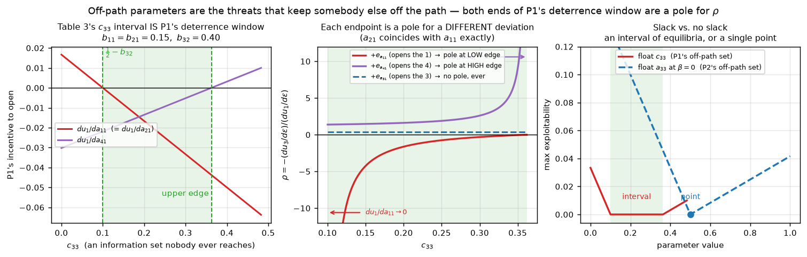

# The Complete Equilibrium Set of Three-Player Kuhn Poker, Who Pays When a Player Deviates, and What One More Card Changes

**Saayan Rao** — working draft, assembled 2026-10-16

> **About this draft.** This is everything the project has, in one file, written as a paper so it can
> be cut down and rewritten. Part I is the paper. Part II (appendices) is the reference material:
> how every piece works, every script, every data file, the errata, the reproduction commands. Part
> III is the complete research record reproduced verbatim (`MASTER_DATA.md`, `REPORT.md`,
> `GENERALIZATION.md`, `RESUME.md`, `PAPER_KIT.md`), so no number is lost when Part I is trimmed.
>
> Claim tags, used throughout:
> - **[P]** proved (closed form or structural argument, holds on the continuum);
> - **[E]** exact computation (rational arithmetic, or a stored certificate replayed by an exact
>   checker);
> - **[G]** grid or sampling evidence (holds at every point tested; not a proof);
> - **[F]** float exploration (decides nothing, reported for orientation only);
> - **[?]** plausible but not established.
>
> Theorem numbers follow `PAPER_KIT.md` and `MASTER_DATA.md`, so every cross-reference into the
> research record still resolves. Theorems 1–3 are about the incidence ratio, 4–6 about the
> equilibrium set and its refinements, 7–8 about the five-card game.

---

# PART I — THE PAPER

## Abstract

In a two-player zero-sum game a deviation's whole loss lands on the single opponent. With three
players the loss is split between two opponents, and Nash equilibrium does not determine the split.
We study this in three-player Kuhn poker. We start from the equilibrium family of Szafron, Gibson and
Sturtevant (AAMAS 2013), whose completeness they left open.

**We settle the equilibrium set exactly.** In every Nash equilibrium the first player checks with
every card, and play follows the published family wherever it is reached (Theorem 4). Off the path of
play the Nash set is strictly larger. We give all of it as the union of twelve explicit
semi-algebraic sets with certified coordinate ranges (Theorem 5). The proofs are exact:

- 66,699 support leaves and about 4.4 million enumeration nodes carry stored certificates
  (Nullstellensatz cofactors, rational LP duals, interval steps under outward rounding, exact
  propagation records);
- each certificate is replayed by an independent rational checker that contains no solver;
- no floating-point arithmetic is trusted anywhere in a proof.

**We decide the refinements exactly on this set** (Theorem 6), writing Kreps–Wilson beliefs in
closed form as leading coefficients along a tremble. Sequential rationality pins every off-path
coordinate except two, and confines the third player's call frequency `c33` to `[1/2, 15/16]`. Every
information set is binary, so extensive-form properness coincides with perfection. Perfection and
quasi-perfection both leave `c33` an interval; only normal-form properness selects a point.

**The split is determined only under normal-form properness.** We define an incidence ratio ρ, the
share of a deviator's loss borne by a given opponent. It has simple poles exactly on the boundary of
the equilibrium region, and its residue equals the costless transfer available there. The surviving
`c33` interval carries both poles.

**One more card reverses the first player's behaviour.** With five cards, an exact equilibrium exists
in which the first player bets (proved by an interval-Newton certificate in exact arithmetic). The
five-card equilibria form continua with *different* payoffs, unlike the four-card game. And no
five-card equilibrium has the first player silent: a deterrence cut plus a correlated-equilibrium
certificate, checked exactly over all 2^40 pure profiles of a restricted game, proves it (Theorem 8).

**On learning:**
- All 150 outputs of external-sampling MCCFR lie a certified distance of at least 0.0067 from the
  complete Nash set.
- The mechanism is that CFR averages in sequence form, and the Nash set is not convex: the midpoint
  of two exact equilibria with equal payoffs has exploitability exactly 1/320.
- Full-width CFR+ and DCFR do converge onto the Nash set (certified distance about 5e-6). Even so,
  they select neither the sequential nor the proper equilibrium.

---

## 1. Introduction

### 1.1 The question

At an equilibrium nobody can gain by deviating, so "who exploits whom" is vacuous. The substantive
question is **who pays**. With two players and a constant-sum game, `du_B = −du_A` settles it: the
opponent gains exactly what the deviator loses. With three players, `du_B + du_C = −du_A` constrains
only a sum. One coordinate is left free, and nothing in the equilibrium conditions closes it.

This paper asks what *does* close it. The answer runs through the whole equilibrium structure of the
game. That is why most of the work went into settling that structure exactly.

### 1.2 The game and the family

Three-player Kuhn poker (Abou Risk & Szafron 2010) is a small three-player game: a 4-card deck, one
card each, one betting round. Szafron, Gibson and Sturtevant (SGS, AAMAS 2013) found, with MCCFR and
then by proof, a parameterised family of equilibria. In every member the first player (P1) never
bets. The family has three sub-families, and the payoffs vary across it: P2 can shift `κβ` chips from
P1 to P3 while staying in equilibrium. SGS left open whether other equilibria exist.

### 1.3 Contributions

1. **The equilibrium set, exactly.**
   - *Theorem 4:* in every Nash equilibrium P1 checks with every card, and play follows the SGS
     family (Table 3's identities *and* ranges) at every reached information set.
   - P2's payoff is `−1/48` in every equilibrium.
   - *Theorem 5:* the complete Nash set, off path included, is the union of twelve explicit
     semi-algebraic sets, with every coordinate's range certified (Table 4).

   **[P,E]**
2. **Proofs a reader can replay.** Every verdict is a stored certificate checked by an independent
   Fraction-only checker with no solver in it:
   - 66,699 / 66,699 support leaves;
   - the enumeration's node kills for all 77 betting branches: 4,394,323 label-box certificate nodes
     on 71 branches, plus 26,223 exact-propagation certificate nodes on the last 6, replayed by a
     second, independently written checker;
   - 0 failures.

   **[E]**
3. **Refinements decided exactly.**
   - *Theorem 6:* beliefs in closed form as leading coefficients along a tremble.
   - Eighteen coordinates are settled by exact dominance.
   - In every sequential equilibrium every off-path coordinate is pinned except `c23` and `c33`, and
     `c33 ∈ [1/2, 15/16]`.
   - All 398 off-path support patterns are decided, every step replayed by an independent checker.
   - Extensive-form properness equals perfection here and leaves `c33` an interval (*Corollary
     6.1*). So does quasi-perfection (*Corollary 6.2*, new).

   **[P,E]**
4. **Normal-form properness makes the split determinate** (*Theorem 3*). It forces
   `c33 = lo + w/3`, where ρ is finite and exactly rational. **[P,E]**
5. **The incidence ratio's singularities are the equilibrium region's boundary.**
   - A three-part pole criterion (*Theorem 1*).
   - An exact global Möbius form `ρ = 1 + R/(c33 − c33*)` with residue `R = t/D′`, where `t` is
     the costless transfer (*Theorem 2*).
   - A hard floor (*Proposition 5*): the window width equals the family's transfer parameter, so it
     cannot be shrunk away.

   **[P,E]**
6. **Off-path determination.** The parameters that fix both the location and the value of P1's
   poles are never reached and have exactly zero effect on payoffs. **[E]**
7. **One more card flips P1** (*Theorems 7–8*).
   - (3,5)-Kuhn has a certified equilibrium in which P1 bets.
   - Its betting equilibria form continua with *different* payoffs.
   - P1 bets in **every** (3,5) equilibrium.

   With the (n, N) sweep over 108 runs, this makes the "P1 is silent iff the deck is minimal
   (N = n+1)" law a theorem at (3,4) vs (3,5). **[E,G]**
8. **Learning dynamics, exactly measured.**
   - Every MCCFR output is certified off the Nash set, and the certified lower bound is the exact
     distance.
   - The cause is non-convexity under sequence-form averaging (an exact two-point demonstration).
   - Full-width CFR+ and DCFR converge to the Nash set but select no refinement.
   - MCCFR shows a systematic seat bias (β ≈ 0.17).

   **[E,G]**
9. **An independent exact reproduction of SGS**, with two errata (one material). **[E]**
10. **A two-player control** showing the phenomenon needs three players for two independent
    reasons. **[E,G]**

### 1.4 What the proofs trust

Only three things:
1. the game tree (`tree.py`, printed in words by `checkD.py -v`), with the 48 gradients recomputed
   from it independently (`checkD.py`);
2. Python's `fractions.Fraction`;
3. the checkers themselves: about 450 lines of Fraction arithmetic in `checkcert.py`, plus the
   independently written `checkenum2.py`, `checkseqcert.py`, `checknefull.py`, `ceverify.py` and
   `ceverify2.py`.

sympy, scipy and HiGHS only *found* certificates; nothing depends on them having been right.
Floating-point arithmetic decides nothing (Appendix B.9).

---

## 2. Related work

**Kuhn poker and small-game analysis.**
- Kuhn (1950) solved the two-player game and gave its one-parameter equilibrium family.
- Abou Risk & Szafron (2010) introduced the three-player variant used here; SGS (2013) found the
  family under study.
- Hoehn et al. (2005) built exploitive agents from the analytic two-player solutions.
- Billingham et al. (arXiv:1802.04670) study three-player Kuhn with N > 3 cards numerically. This is
  likely the closest neighbour: **[?] verify what it reports before submission.** So are
  arXiv:1704.08124 and arXiv:1707.01392 (simplified three-player Kuhn variants).

**Multiplayer equilibrium computation.**
- CFR (Zinkevich et al. 2008), MCCFR (Lanctot et al. 2009), CFR+ (Tammelin 2014), and Linear and
  Discounted CFR (Brown & Sandholm 2019).
- CFR carries no convergence guarantee to Nash beyond two players.
- Three-player equilibrium computation is PPAD-hard (Daskalakis & Papadimitriou 2005).
- Ganzfried & Sandholm (2010) incorporate qualitative models; Ganzfried (2018, Games 9(2):33) built
  a three-player Kuhn agent.

**Equilibrium selection and refinement.**
- Selten (1975) trembling-hand perfection; Kreps & Wilson (1982) sequential equilibrium; Myerson
  (1978) proper equilibrium; van Damme (1984) quasi-perfection; van Damme (1991), the monograph.
- Harsanyi & Selten (1988) on selection.
- In two-player zero-sum games equilibria are interchangeable with a unique value. With three
  players they are not, and the SGS family is an explicit witness.

**Three-player poker specifically.**
- Nash & Shapley (1950) solved a three-person poker game analytically (with replacement and returned
  antes).
- Chen & Ankenman (2006, Example 29.2) construct an endgame with a utility transfer between two other
  players.

**Exact certification in game theory.** **[?]** Interval-Newton (Krawczyk) existence proofs, LP-dual
certificates and Nullstellensatz certificates are standard in verified numerics and polynomial
optimisation. Their combination into a replayable proof of an equilibrium-set characterisation
appears to be new for poker. Survey before claiming.

The full bibliography with verification status is in Appendix H.

---

## 3. The game and notation

### 3.1 Rules

- **Deal.** Deck {1,2,3,4}; one card each to P1, P2, P3. That makes **24 deals, each of probability
  κ = 1/24**. Everyone antes 1.
- **Betting.** One betting round; a bet or call is exactly 1 chip; no raises. Acting order P1, P2,
  P3. With no bet outstanding the actor checks (K) or bets (B); facing a bet, the actor folds (F) or
  calls (C).
- **Sequences.**
  - P1 bets → P2 answers → P3 answers → end.
  - P1 checks, P2 bets → P3 answers → P1 answers → end.
  - P1 checks, P2 checks, P3 bets → P1 answers → P2 answers → end.
  - All check → three-way showdown.
- **Showdown.** The highest unfolded card takes the pot.

There are 13 terminal histories per deal, 312 leaves in all.

### 3.2 Parameterisation (SGS Table 1)

`a_jk`, `b_jk`, `c_jk` is the probability that P1 / P2 / P3 takes the **aggressive** action (B with
no bet out, C facing a bet) holding card *j* in situation *k*:

| k | P1 history | P2 history | P3 history |
|---|---|---|---|
| 1 | (root) | K | KK |
| 2 | KKB | B | KB |
| 3 | KBF | KKBF | BF |
| 4 | KBC | KKBC | BC |

A profile is the 48-vector `[a11..a44, b11..b44, c11..c44]`. Situation k = 1 is the opening decision
(round 1); k = 2, 3, 4 are call/fold decisions (round 2). Every information set is (own card, public
history), and **every information set has exactly two actions**.

### 3.3 The SGS family (Tables 2 and 3)

**Table 2** (21 values SGS call necessary): `x12 = x13 = x14 = x24 = 0` and `x42 = x43 = x44 = 1` for
each player `x ∈ {a, b, c}`.

**Table 3**, with `β = max{b11, b21}`:
- **P1 has no free parameters:** `a11 = a21 = a22 = a23 = a31 = a32 = a34 = a41 = 0`, `a33 = 1/2`.
- **P2:**
  - free: `b11, b21, b23, b32`;
  - fixed: `b22 = b31 = b34 = 0`;
  - identities: `b33 = 1/2 + (b11+b21)/2 + β/2 − b23(1−b21)` and `b41 = 2b11 + 2b21`.
- **P3:**
  - free: `c11, c33, c34`;
  - identity: `c21 = 1/2 − c11`;
  - fixed: `c22 = c23 = c31 = c32 = 0`, `c41 = 1`.
- **Constraints:**
  - `b23 ≤ max{0, (b11−b21)/(2(1−b21))}`;
  - `c11 ≤ min{1/2, (2−b11)/(3+2b11+2b21)}`;
  - `b32 ≤ 1/2 + (3/4)(b11+b21) + β/4`;
  - `1/2 − b32 ≤ c33 ≤ 1/2 − b32 + (3/4)(b11+b21) + β/4`;
  - `0 ≤ c34 ≤ 1`.

**Sub-families:**
- **A:** `c11 = 0`, `b11 ≤ b21 ≤ 1/4`, `b23 = 0`, β = b21.
- **B:** `0 < c11 < 1/2`, `b21 = b11 ≤ 1/4`, `b23 = 0`, β = b11.
- **C:** `c11 = 1/2`, `b11 ≤ 1/4`, `b21 ≤ min{b11, 1/2 − 2b11}`, β = b11.

**Utilities:** `u1 = −κ(1/2 + β)`, `u2 = −κ/2`, `u3 = κ(1 + β)`.

### 3.4 Reachability

Because `a_j1 = 0` for every j, **P1 never bets anywhere in the family**. So P2 never faces a bet, and
P3 never reaches BF or BC. The coordinates `b12, b22, b32, b42` and `c13, c23, c33, c43, c14, c24,
c34, c44` sit at information sets of reach probability zero. Two of the family's own free parameters,
`b32` and `c33`, are among them. The off-path region is family-wide, not an artifact of a corner.

---

## 4. Reproduction of SGS, and two errata

### 4.1 Validation **[E]**

| check | result |
|---|---|
| Table 3 utilities, 600 random family points | max error 5.0e-16 |
| exact rational check at `b11 = 1/8, b21 = 1/4` | `u = (−1/32, −1/48, 5/96)` exactly |
| SGS §2's worked leaf (`a13` in deal 124) | factors `(1−a11)·b21·(1−c42)·a13`, payoff `(−2, 3, −1)` |
| Appendix eq. (3), (4), (5): u3 / u2 / u1 with one player free, 400 points each | max error 6.0e-16 / 2.2e-16 / 8.9e-16 |
| Table 4's mismatched profile; P2's gain κβ | reproduced exactly (0.0104167 = κ/4) |
| exact best-response gap, 450 family points | < 5e-16 for all three players |

Matching eqs. (3)–(5) pins down both the tree and the Table 3 transcription at once.

### 4.2 Erratum 1 (material): `b33` in SGS §5's prose **[E]**

For the `c11 = 1/2` sub-family, SGS §5 states `b33 = (1 + b11 + 2b21)/2`. Table 3 gives
`(1 + 2b11 + b21)/2 − b23(1 − b21)` there. The prose transposes b11 and b21 and drops the b23 term.
Where the two differ, the prose value is not an equilibrium:

| b11 | b21 | b23 | b33 (Table 3) | b33 (prose) | exploitability (Table 3) | exploitability (prose) |
|---|---|---|---|---|---|---|
| 0.20 | 0.05 | 0 | 0.72500 | 0.65000 | 2.2e-16 | **6.25e-03** |
| 0.15 | 0.10 | 0.02 | 0.68200 | 0.67500 | 7.3e-17 | **5.83e-04** |
| 0.20 | 0.05 | 0.079 | 0.65000 | 0.65000 | 2.2e-16 | 2.2e-16 |
| 0.10 | 0.10 | 0 | 0.65000 | 0.65000 | 7.6e-17 | 7.6e-17 |

`du_i/db33 = (0, 0, 0)` for all three players, yet a wrong `b33` destroys the equilibrium. It is a
pure deterrence parameter, the paper's main mechanism in miniature.

### 4.3 Erratum 2 (cosmetic): a sign in Lemma 4 **[E]**

SGS display `∂u2/∂b23 = 2κ(1−b21)(1−2c11)`. Their own eq. (4) gives `2κ(1−b21)(2c11−1)`. The next
line of their proof uses the corrected sign, so the proof is unaffected.

---

## 5. Method

### 5.1 Exact engine and multilinearity

- **Full enumeration.** All 24 deals × 13 histories are materialised once as a leaf table:
  `u_i(p) = κ Σ_leaves (Π factors) · payoff_i`. No sampling, no iteration.
- **Multilinearity.** Each `u_i` is multilinear in the 48 coordinates, hence affine along any single
  coordinate:
  - `∂u/∂x_i = u(x_i = 1) − u(x_i = 0)`, exactly;
  - any `∂u/∂x` is affine in every other single coordinate, so its zeros are solved in closed form
    rather than searched.
- **Exact best responses.** `u_i` decomposes over the card player i holds. A best response is 4
  independent 4-decision problems, 4 × 2^4 = 64 evaluations, so exploitability is exact.
- **Rational arithmetic** (`fractions.Fraction`) for every headline claim.

### 5.2 The Nash condition that is actually right: the own-reach-stripped gradient

For information set `i` of player `k`, the reach of any node factorises:
`R(n) = R_k(i) · R_{−k}(n)`, where `R_k(i)` is the product of k's own coordinates on the path (the
same for every node of i).

**Definition 4.** The own-reach-stripped gradient is
`D_i(p) = (1/24) Σ_{n ∈ i} R_{−k}(n) · (V_k(agg child of n) − V_k(pass child of n))`,
so that `∂u_k/∂x_i = R_k(i) · D_i` exactly.

**Definition 5 (D-condition).** `x_i D_i ≥ 0` and `(1 − x_i) D_i ≤ 0`. That is: interior ⇒ `D = 0`,
`x = 0` ⇒ `D ≤ 0`, `x = 1` ⇒ `D ≥ 0`.

**Lemma 1.**
- (a) Every Nash equilibrium satisfies the D-condition at every own-reachable set, and can be
  re-chosen at own-unreached sets (changing no payoff and no reached play) to satisfy it everywhere.
- (b) A profile satisfying the D-condition everywhere is Nash.

*Proof:* the one-shot deviation principle, by backward induction over each player's own tree
(PAPER_KIT §7.1). **[P]**

**Why not `∂u_k/∂x_i = 0`.** The plain gradient vanishes at every own-unreached set whatever the
continuation. So the reach-weighted first-order system admits non-equilibria: a dominated off-path
continuation can "support" an earlier choice. Five "open" leaves of the first pass were exactly such
points. With D they die at the root.

### 5.3 Support enumeration as a label tree

Each coordinate gets one of these labels:
- `0` or `1`;
- `MIX` (open interval (0,1));
- `DC` (its set provably unreached on the cell, or the coordinate occurs in no other constraint; it
  carries the D-condition pair instead of a label, which loses nothing by Lemma 2);
- `U` (not yet assigned).

A node's system substitutes the 0/1 labels into every D and imposes the sign conditions. Every leaf
implies its ancestors' systems (Lemma 3), and the labels partition the cube (Lemma 4). So a node
proved infeasible contains no equilibrium, and the surviving leaves cover every equilibrium.

### 5.4 How a node or leaf is proved empty: the certificate types

| certificate | what it proves | checker step |
|---|---|---|
| rational interval contraction (HC4) | a box shrinks; a coordinate is forced; the box empties | replay each step in Fractions |
| LP relaxation with McCormick rows, rational duals | the relaxation is infeasible (weak duality) | rebuild each row from named origins, check `y·A ≥ 0`, `y·b < 0` |
| Nullstellensatz / Rabinowitsch cofactors | `1 ∈ ⟨E, 1 − t v⟩` (an equality system forbids `v ≠ 0`) | multiply out the cofactors in Fractions |
| Gröbner normal forms of inequalities | e.g. `b41 ≥ 0` reduces to the constant −1/96 | cofactor proof of the reduction |
| interval tree recursion with the chord contractor | the tree-structured bound excludes a box | exact tree bounds |
| exact propagation record (enumc7) | a forced value, a chord narrowing justified by convexity, or a contradiction, on the exact propagated box | `checkenum2` replays every node from its parent's record |
| FAMILY claim | every point of the leaf satisfies Table 3 on non-DC coordinates | identities and ranges as separate certificates |

Three facts made it work. Each was learned the hard way (Appendix B):
- interval reasoning alone can never kill a family-adjacent leaf, because its closure contains
  equilibria;
- the exact test pays off at depth, not at the root, so it runs every four levels of the label DFS;
- in a betting branch, assigning the responses to P1's bet first (`KUHN_ORDER=bet`) turns hours into
  minutes.

### 5.5 Outward rounding and the third pass

`ivl.py` rounds every floating-point operation outward with `nextafter`, so float prunes are rigorous
under IEEE-754. The third pass removed even that dependence: every betting branch was re-derived as a
certificate tree in which every float kill is replaced by an exact certificate, or the node is split.
- 71 branches: `enumc2` + `checkenum`;
- the 6 that resisted: `enumc7` + `checkenum2`, exact propagation;
- cross-check: `enumc7` on **all** 77 gives 33,104 nodes and 462 leaves, all `EMPTY_BOX`.

Two independent certified methods agree.

---

## 6. Theorem 4: every equilibrium plays the SGS family on path

**Theorem 4 (on-path completeness).** *Every Nash equilibrium of three-player four-card Kuhn poker is
realisation-equivalent to a member of the SGS family. P1 never bets, and on every reached
information set play satisfies Table 3's identities and parameter ranges. As profiles, the
equilibrium set is strictly larger than the family (exact witness with `b12 = 9/100` off path).*
**[P,E]**

*Proof.*
1. By Lemma 1, it suffices to enumerate profiles satisfying the D-condition everywhere.
2. P1's four opening coordinates give 81 label cells; 78 survive the root in Nash mode.
3. **The 77 betting cells contain no support.** Layered exact enumeration reaches 45,276 supports,
   every one certified empty (47 of the 77 cells have no support at all).
4. **The silent cell** yields 668 supports: 656 certified empty and 12 FAMILY leaves. These are
   sub-families A (4 leaves), B (3) and C (5), with every corner.
5. **Every leaf verdict is a stored certificate.** `checkcert.py` verifies 66,699 of 66,699: 668
   silent, 45,276 Nash-mode betting and 20,755 seq-mode betting, with 0 failed.
6. **The node kills are certified too**, for all 77 betting cells:
   - 71 cells: 4,394,323 nodes replayed by `checkenum.py`;
   - 6 cells: 26,223 exact-propagation nodes replayed by `checkenum2.py`;
   - 0 failures.
7. Lemma 5: a FAMILY leaf's points agree with a family member on every reached coordinate. ∎

**Corollary 4.1.** In every Nash equilibrium P1 checks with every card.

**Corollary 4.2.** The equilibrium payoff set is the segment
`{(−κ(1/2 + β), −κ/2, κ(1 + β)) : β ∈ [0, 1/4]}`. In particular **P2's payoff is −1/48 in every
equilibrium**, and `u1 + u3 = −1/48`.

**The off-path witness** (why "as profiles" fails). Take the sub-family-C corner:
- on path: `b11 = 1/4`, `b21 = b23 = 0`, `c11 = 1/2`;
- off path: `b32 = 23/100`, `c33 = 1/4`, `c34 = 9/10`, `b12 = 9/100`, `b22 = 1/40`, `c23 = 1/25`.

Its exploitability is exactly (0, 0, 0). Setting `b12 := 0`, P1 gains exactly 1/300 by betting card
2. With Table 3's pins on top, P1 gains 1/150. So Table 2 is necessary only at reached information
sets, and a dominated off-path action can be *essential*: 169 of 23,820 hunt equilibria stop being
Nash when projected onto Table 2.

**Ledger** (the run of 2026-09-20/21 under outward-rounded interval arithmetic, suffix R):

| part | supports | verdict |
|---|---|---|
| Nash-mode betting, 77 branches | 45,276 | all empty (47 branches have no support) |
| seq-mode betting, 32 branches | 20,755 | all empty |
| silent cell | 668 | 656 empty + 12 FAMILY |
| leaf certificates replayed | 66,699 / 66,699 | 0 failed |
| node certificates replayed (betting) | 4,394,323 + 26,223 | 0 failed |

---

## 7. Theorem 5: the complete Nash set, off path included

**Theorem 5.** *The set of Nash equilibria is the union of twelve sets `Ŝ_ℓ`, one per FAMILY leaf ℓ.
Here `S_ℓ` is {the leaf's labels, and the D-condition at every coordinate}, and `Ŝ_ℓ` frees the
own-unreached coordinates. These are `b43` and `b44` in the two leaves with `b41 = 1`, and nothing
elsewhere.*

*Each `S_ℓ` factors as (on-path parameters) × (deterrence region) × (free cube).*
- *The reached coordinates carry Table 3.*
- *The off-path coordinates that enter some incentive are constrained only by the deterrence
  inequalities `D_{a_j1} ≤ 0`, `D_{b_j1} ≤ 0` where `b_j1 = 0`, and the sign-determined pins these
  induce.*
- *Every remaining coordinate has `D ≡ 0` and is free in [0, 1].* **[E,P]**

The twelve systems are written out in `nefull_systems.txt`. Their coordinate projections, the
*windows*, are in `nefull_ranges.txt`: 522 bound certificates (`{S_ℓ, x_v > T}` empty), checked by
`checknefull.py`, with exact witnesses where a bound is attained.

**Table 4 — the windows.** Marks: bare = attained (exact witness); ⁻ = certified strict bound, not
attained; ᶜ = certified bound with attainment undecided.

| coordinate | role | all equilibria | A | B | C |
|---|---|---|---|---|---|
| a13 | off path | [0, 0] | [0, 0] | [0, 0] | [0, 0] |
| a14 | off path | [0, 1] | [0, 1] | [0, 1] | [0, 1] |
| a23 | off path | [0, 0] | [0, 0] | [0, 0] | [0, 0] |
| a24 | off path | [0, 1] | [0, 1] | [0, 1] | [0, 1] |
| a33 | on path | [0, 1/2] | [0, 1/2] | [0, 1/2] | [0, 1/2] |
| a34 | off path | [0, 1] | [0, 1] | [0, 1ᶜ] | [0, 1] |
| a43 | off path | [1, 1] | [1, 1] | [1, 1] | [1, 1] |
| a44 | off path | [0, 1] | [0, 1] | [0ᶜ, 1] | [0, 1] |
| b11 | on path | [0, 1/4] | [0, 1/4] | [0, 1/4ᶜ] | [0, 1/4] |
| b12 | off path | [0, 0.4173ᶜ] | [0, 0.4173⁻] | [0, 0.4169⁻] | [0, 0.2781ᶜ] |
| b21 | on path | [0, 1/4] | [0, 1/4] | [0, 1/4] | [0, 1/6] |
| b22 | off path | [0, 0.5841ᶜ] | [0, 0.5841⁻] | [0, 7/12] | [0, 0.3895⁻] |
| b23 | on path | [0, 1/8] | [0, 0] | [0, 0] | [0, 1/8] |
| b32 | off path | [0, 15/16] | [0, 15/16] | [0, 15/16ᶜ] | [0, 19/24] |
| b33 | on path | [1/2, 7/8] | [1/2, 7/8] | [1/2ᶜ, 7/8] | [1/2, 3/4] |
| b41 | on path | [0, 1] | [0, 1] | [0, 1] | [0, 2/3] |
| b42 | off path | [31/40ᶜ, 1] | [0.7750ᶜ, 1] | [31/40ᶜ, 1] | [0.7750⁻, 1] |
| b43 | off path | [0ᶜ, 1] | [0⁻, 1] | [0⁻, 1] | [1, 1] |
| b44 | off path | [17/32ᶜ, 1] | [0.7797⁻, 1] | [17/32ᶜ, 1] | [4/5, 1] |
| c11 | on path | [0, 1/2] | [0, 0] | [0⁻, 1/2⁻] | [1/2, 1/2] |
| c12 | off path | [0, 0] | [0, 0] | [0, 0] | [0, 0] |
| c13 | off path | [0, 0.5269ᶜ] | [0, 0.5269⁻] | [0, 0.5268ᶜ] | [0, 0.3458ᶜ] |
| c14 | off path | [0, 1] | [0, 1] | [0, 1] | [0, 1] |
| c21 | on path | [0, 1/2] | [1/2, 1/2] | [0⁻, 1/2⁻] | [0, 0] |
| c22 | off path | [0, 0] | [0, 0] | [0, 0] | [0, 0] |
| c23 | off path | [0, 7/12] | [0, 7/12ᶜ] | [0, 7/12] | [0, 0.3894⁻] |
| c24 | off path | [0, 1] | [0, 1] | [0, 1] | [0, 1] |
| c32 | off path | [0, 1/2] | [0, 1/2] | [0, 1/2] | [0, 1/2] |
| c33 | off path | [0, 15/16] | [0, 15/16ᶜ] | [0, 15/16] | [0, 19/24] |
| c34 | off path | [0, 1] | [0, 1] | [0, 1ᶜ] | [0, 1] |
| c42 | off path | [1, 1] | [1, 1] | [1, 1] | [1, 1] |
| c43 | off path | [0.7750ᶜ, 1] | [0.7752ᶜ, 1] | [0.7750ᶜ, 1] | [0.7750⁻, 1] |
| c44 | off path | [0, 1] | [0, 1] | [0, 1] | [0, 1] |

**How to read it:**
- **Pinned although off path.** `a13 = c12 = c22 = 0` and `a43 = c42 = 1` in every equilibrium: the
  other players' deterrence pins them.
- **Free well beyond Table 2.** The responses to P1's bet that Table 2 sets to 0 range up to
  `b12 ≈ 0.42`, `b22 ≈ 0.58`, `c13 ≈ 0.53` and `c23 = 7/12`. The top-card calls `b42` and `c43` only
  need ≥ ≈ 0.775.
- **Wide windows.** `b32` and `c33` range over [0, 15/16], and `b44 ≥ 17/32`.
- **Sub-family C is the most restricted:** `b41 ≤ 2/3`, and `b32, c33 ≤ 19/24`.
- **The corner leaves** (`b11 = b21 = 0`) pin the responses to P1's bet exactly to Table 2.

---

## 8. Theorem 6: the refinements, decided exactly

### 8.1 Beliefs in closed form

Take a coordinate `v`. `D_v / R_v` is the value difference at its set under the profile's beliefs,
where `R_v` is the set's reach with the owner's own choices stripped. Along a tremble
`x_w = ε r_w` (where the profile plays 0) or `1 − ε r_w` (where it plays 1), both vanish at an
unreached set. Their limit is `A_v(x, r) / B_v(x, r)`, the ratio of leading coefficients. The ratios
`r` are shared by every set: this is Kreps–Wilson consistency in closed form. Sequential rationality
is then a sign condition on `A_v`, linear in r. For a fixed profile it is one exact LP; infeasibility
comes with a Farkas certificate.

**Lemma R1 (binary sets).** With two actions per set, ε-proper ⇔ ε′-perfect with ε′ = ε/(1−ε). So
extensive-form proper = extensive-form perfect = agent-normal-form perfect. Only *normal-form*
properness, which orders whole pure strategies across information sets, can select more. **[P]**

### 8.2 Theorem 6

**Theorem 6 (the sequential set).** Over the complete Nash set:
1. **Dominance, belief-free.** Eighteen coordinates satisfy `D_v = c · R_v` identically:
   - `c = −1` for calling with the worst cards (`x12, x13, x14, x24` for each player);
   - `c = +4` for `x43`;
   - `c = +5` for `x44`.

   Each is pinned in every sequential equilibrium. Also `b42 = 1`, since `D_b42 / R_b42 ≥ 4`.
   Thirteen of these have a nontrivial Nash window, and eight of those windows are all of [0, 1].
2. **Closure.** Substituting and recomputing settles 7–12 more coordinates per leaf, including
   `b44 = 1` and the "private" `b24 = b14 = 0`.
3. **The knife-edges.** After the closure, the unreached coordinates' leading coefficients are *the
   same six linear forms at all twelve leaves*. In every sequential equilibrium:
   - **`b32 = 0`**: interior `b32` needs `2 r_a41 = 3(r_a11 + r_a21)`, which is incompatible with
     `c33`'s knife-edge;
   - **`c43 = 1`**, **`c13 = 0`**, **`c34 = 0`** and **`b22 = 0`**;
   - P1's card-2 deterrence then reads **`c33 ≥ 1/2`**.

   Only `c23` keeps some freedom. Its interior forces trembles of different orders, which consistency
   allows and exact witnesses realise.
4. **What `c33` keeps:** `c33 ∈ [1/2, 15/16]`, the upper half of its Nash window. It collapses to the
   point 1/2 at the corner sub-families.
5. **The surviving interval.** At `b11 = b21 = 1/8`, `c11 = 1/4`:
   - the Nash window `c33 ∈ [1/2, 23/32]` is entirely sequential;
   - its interior is **perfect** (inward direction with `s* = 3715/28782`, indifference Jacobian of
     rank 8, implicit function theorem);
   - the endpoints are the two poles of ρ.

   **[P,E]**

**The enumeration behind (3).** All 398 off-path support patterns are decided: 377 killed and 21
witnessed. The independent replay (`seqcert.py` / `checkseqcert.py`) checks 637 kill records, 3,554
box certificates and 21 witnesses on concrete tremble curves `x_w = ε^e ρ`, at 12 of 12 leaves, with
0 failures. Three patterns survive:
- at the nine generic leaves: `b22 = 0, c23 = 0, c33` interior, and `b22 = 0, c23` interior, `c33`
  interior;
- at the three corner leaves: the mirrored structure, where P2's bet is the unreached one. There
  `a33 = c33 = 1/2` is pinned.

**Three traps the decision had to get past** (detail in Appendix B.6):
- **Per-set normalisation.** A leading coefficient is homogeneous within one set, so under a global
  simplex a whole set's ratios can vanish and the case becomes undecidable. 28 patterns that were
  undecided globally die at once per set.
- **Orderings.** Consistency allows different tremble orders; enumerate the ordered partitions (75
  for P1's four openings).
- **Multi-homogeneity.** Per-set normalisation is without loss only for multi-homogeneous forms. The
  checker enforces this.

### 8.3 Corollary 6.1: extensive-form properness does not select

**Corollary 6.1.** Extensive-form properness leaves `c33` an interval of width 7/32. Normal-form
properness (Theorem 3) selects `c33 = lo + w/3 = 55/96`. The two notions differ here. **[P,E]**

### 8.4 Corollary 6.2 (new): quasi-perfection does not select either

For quasi-perfection (van Damme 1984), each player's own later moves are taken from σ itself; only
the others tremble. In these coordinates the condition is the D-condition with the own-reach-stripped
gradient evaluated at the mixed profile `(σ_k, x_{−k})`. The certificate is `refine.perfect_cert`
with each row's own-player columns removed from the Jacobian, plus a stricter row set: every
interior coordinate whose D is not identically zero.

`qperf.py` sweeps `c33` through the Nash window at the slice of Theorem 6(5):
- **The open interval (1/2, 23/32), symbolically.** Both perfection and quasi-perfection are
  certified for every `c33` in the open interval: the same 8×8 minor (rows
  `a33, b11, b21, b33, b41, c11, c21, c33`; columns `a11, a12, a13, a21, a22, a23, a42, b11`), with
  `det = −95/3439853568 ≠ 0`.
- **Inward directions:** `s* = 3715/28782` for perfection and `s* = 1/14` for quasi-perfection.
- **The endpoints** 1/2 and 23/32 are first-order tight and not sign-definite (at `a21` and `a41`
  respectively). They are undecided at first order.

**Corollary 6.2.** *Quasi-perfection, like extensive-form properness, leaves `c33` an interval, at
least the open interval (1/2, 23/32) at this slice. Only normal-form properness selects a point
(55/96).* This closes open problem 2 for the refinements considered. **[E]**

---

## 9. Who pays when a player deviates: the incidence ratio

### 9.1 Definitions

- **Definition 1.** At `p`, a direction `d` on player A's coordinates is *feasible* if `d_i ≥ 0` where
  `p_i = 0` and `d_i ≤ 0` where `p_i = 1`.
- **Definition 2.** For feasible `d` with `du_A/dε ≠ 0`, the incidence ratio is
  `ρ_{A→X}(d) = −(du_X/dε)/(du_A/dε)`.
- **Definition 3.** `d` is *costless* if `du_A/dε = 0`. It is *equilibrium-preserving* if `p + εd`
  stays Nash.

### 9.2 Structural facts

**Proposition 1 (constant sum is structural).** `Σ u_i = 0` on all of [0,1]^48, because chips are
conserved at each of the 312 leaves. So `ρ_{A→B} + ρ_{A→C} = 1`: ρ is a share. **[P]**

**Proposition 2.** `ρ(d) = ρ(−d)`. **[P]**

**Proposition 3 (no improving direction).** At every family point, `du_A ≤ 0` for every feasible `d`.
The feasible cone is generated by the feasible `±e_i`. **[P]** Grid check: 502,626 feasible
(point, coordinate) pairs with 0 improving, and 4,000 random multi-coordinate directions with max
`du_A = −1.44e-2`. **[G]**

| player | feasible pairs | improving | strictly costly | neutral |
|---|---|---|---|---|
| P1 | 154,224 | 0 | 111,456 | 42,768 |
| P2 | 186,618 | 0 | 52,038 | 134,580 |
| P3 | 161,784 | 0 | 57,072 | 104,712 |

**Proposition 4 (two-player collapse).** With two players `du_B = −du_A`. So no costless transfer
exists, `ρ ≡ 1`, and no pole is possible. **[P]**

### 9.3 ρ is ill-defined, sign-unstable and unbounded on the family **[G]**

- **19 of 48** coordinates have `du_A ≡ 0` at every one of 9,072 grid points:
  `a33, a44, b11, b12, b21, b22, b32, b33, b41, b42, b44, c13, c14, c23, c24, c33, c34, c43, c44`.
  21 more vanish on part of the grid.
- **The denominator is not bounded away from 0:** min `|du_A| = 1.0e-4` against κ = 0.0417. ρ reaches
  −50 and +391.
- **P2's move along the family** has `du/dβ = (−κ, 0, +κ)` identically. The headline phenomenon of
  SGS is exactly where ρ blows up.
- **Sign flips** along `a11`, `a21` and `a41`: for `+e_a11`, ρ ranges over [−48.75, +22.0].

**Costless directions exist for every player, but only P2's along-family move preserves equilibrium**
(ε = 0.01 steps):

| direction | du | exploitability after the step |
|---|---|---|
| P2 `+e_b11` | (+1/12, 0, −1/12) | 8.33e-04 |
| P2 `+e_b21` | (+1/24, 0, −1/24) | 8.33e-04 |
| P2 `+e_b41` | (−1/24, 0, +1/24) | 4.17e-04 |
| P3 `+e_c21` | (−0.0333, +0.0333, 0) | 9.17e-04 |
| P1 `+e_a11` (boundary) | (0, +0.0255, −0.0255) | 2.71e-03 |
| along-family β move | — | < 5e-16 everywhere |

**Exact closed forms** **[E]**:
- `ρ_{P2→P1}(+e_b31) ≡ 3/5` on the entire family (worked by hand in Appendix A);
- `ρ_{P3→P2}(+e_c31) = (2 − 4s)/(4 − 5s)`, with `s = b11 + b21`;
- `ρ_{P1→P3}(+e_a31) ∈ [3/11, 2/5]`.

### 9.4 Off-path parameters decide on-path incidence **[E]**

`b32`, `c33`, `c34` and `c44` have exactly zero first derivatives for all three players at all 9,072
points. `c34` and `c44` have exploitability 7.3e-17 at every value in [0, 1]. Yet their mixed second
derivatives through P1's openings are nonzero:

| x | ∂²u/(∂a11 ∂x) | ∂²u/(∂a21 ∂x) | via a31 | via a41 |
|---|---|---|---|---|
| c34 | (0, +κ, −κ) | (0, +κ, −κ) | 0 | 0 |
| c44 | (0, −2κ, +2κ) | (0, −2κ, +2κ) | 0 | 0 |
| c33 | (−4κ, 0, +4κ) | (−4κ, 0, +4κ) | 0 | (+2κ, 0, −2κ) |
| b32 | (−4κ, +3κ, +κ) | (−4κ, +3κ, +κ) | 0 | (+2κ, −2κ, 0) |

*Unconstrained is not inert.* ρ has two independent sources of indeterminacy:
- **the denominator**, via `b32` and `c33`: constrained, but by an inequality whose boundary is
  attainable, which gives a pole;
- **the numerator**, via `c34` and `c44`: constrained by nobody.

### 9.5 Theorem 1 (pole criterion) and the census **[E,G]**

**Theorem 1.** ρ has a pole along `e_x` iff three things hold:
- (i) `du_owner/dx = 0` has a root in some free parameter;
- (ii) the root is attainable inside the Table 3 constraints;
- (iii) the numerator does not vanish there.

**Closed-form roots:**

| deviation | zero of `du_owner/dx` | round |
|---|---|---|
| +e_a11, +e_a21 | `lo = 1/2 − b32` (Table 3's lower bound on c33) | 1 |
| +e_a41 | `hi = lo + (3/4)(b11+b21) + β/4` (the upper bound) | 1 |
| +e_a31 | no root (no c33 dependence) | 1 |
| +e_a22 | `c11max = (2 − b11)/(3 + 2b11 + 2b21)` | 2 |
| +e_a32 | `b21 = (1 − 8 c11 b11)/(4 − 8 c11)` (in A: b21 = 1/4) | 2 |

So **Table 3's c33 interval is exactly P1's deterrence window**. Its lower bound exists to kill
a11/a21, its upper bound to kill a41, and both are attainable.

**Negative controls**, one per clause:
- `b34` fails (ii): its root is at `b31 = 1`, which Table 3 pins to 0.
- `c22` fails (iii): ρ ≡ 0.8, then 0/0.
- a11 with `b32 > 1/2` fails (ii): the root is below 0.

**Census over all 48 coordinates:**

| player | round-1 poles | round-2 poles |
|---|---|---|
| P1 | a11, a21, a41 | a22, a32 |
| P2 | none | none |
| P3 | c11, c21 | none |

### 9.6 Theorem 2 (exact global form) and the residues **[P,E]**

**Theorem 2.** Fix every free parameter except `c33`. Then `D(c33) = du1/da_j1` and
`N(c33) = −du3/da_j1` are both affine in `c33`, with `N′ = D′`. Hence

> **ρ(c33) = 1 + R/(c33 − c33\*)** exactly, with **R = t/D′**,

where `t` is the costless transfer at the boundary (at `c33*`, `du2 = −du3 = t` by Proposition 1).
`D′/κ` is −4 for a11 and a21, +2 for a41, and 0 for a31 (which is why a31 never poles).

| dev | D′/κ | c33* | t | R |
|---|---|---|---|---|
| a11 | −4 | 0.1000 | +0.04375 | **−21/80** |
| a21 | −4 | 0.1000 | +0.04375 | **−21/80** |
| a41 | +2 | 0.3625 | −0.00833 | **−1/10** |
| a11 | −4 | 0.5000 | −0.03646 | **+7/32** |
| a21 | −4 | 0.5000 | −0.01563 | **+3/32** |
| a41 | +2 | 0.7375 | +0.02083 | **+1/4** |
| a11 | −4 | 0.2000 | +0.06875 | **−33/80** |
| a21 | −4 | 0.2000 | +0.04271 | **−41/160** |
| a41 | +2 | 0.4500 | −0.00417 | **−1/20** |

### 9.7 Proposition 5: the hard floor **[P,E]**

The window width is **`w = hi − lo = (3/4)(b11 + b21) + β/4`**, independent of `b32`. So
`w = 0 ⟺ β = 0 ⟺ κβ = 0`: **deterrence slack and the SGS transfer are the same currency.** At
`w = 0`, a41's pole dies (its numerator vanishes) but a11's survives, as the only admissible value of
`c33`. Exactly verified at six points across all sub-families (w = 21/80, 11/40, 7/16, 19/80, 1/4).

### 9.8 Theorem 3: normal-form properness selects `c33 = lo + w/3` **[P,E]**

- **Costs:** `cost(a11) = cost(a21) = 4κ(c33 − lo)` and `cost(a41) = 2κ(hi − c33)`.
- **Mechanism:** properness orders trembles by cost. P3's belief at BF holding the 3 is
  `q = (r1 + r2)/(r1 + r2 + 2 r4)`, and P3's call threshold is `q = 1/5`.
  - Any strict cost inequality sends `c33` to 0 or 1, outside the window.
  - So cost equality is needed: **`c33 = lo + w/3`** (`= 1/2 + w/3` once `b32 = 0` is forced).
- **Both corners are excluded.**
- **ρ is finite and exactly rational** at the selected point:

| point | w | ρ(a11) | ρ(a21) | ρ(a41) |
|---|---|---|---|---|
| B, b32 = 2/5 | 21/80 | −4/7 | −4/7 | 11/7 |
| B, refined face | 21/80 | 20/7 | 20/7 | −5/7 |
| A, refined face | 11/40 | 73/22 | 49/22 | −7/11 |
| A, corner β = 1/4 | 7/16 | 5/2 | 29/14 | −5/7 |
| C, refined face | 19/80 | 83/38 | 143/38 | −11/19 |
| C, b23 at max | 1/4 | 7/4 | 29/8 | −1/2 |

*Scope:* properness on the **normal form**. Agent-normal-form properness would not order a11 against
a41, since they are different information sets.

### 9.9 The ladder **[E]**

| stage | what it does to ρ |
|---|---|
| Nash | undefined or unbounded; sign flips |
| sequential = extensive-form proper = perfect = quasi-perfect (Theorem 6, Corollaries 6.1–6.2) | kills the numerator source (`c34`, `c44`, `b32` pinned); ρ's sign becomes determinate, ρ(+e_a11) ∈ [1.395, 45.42] on the refined face; both poles survive |
| normal-form proper (Theorem 3) | kills the denominator source; ρ finite and rational |

### 9.10 Two-player control **[E,G]**

Independent 2-player engine: 3 cards, 30 leaves, α-family on [0, 1/3]. Max exploitability 1.9e-16 on
201 values of α, and `u1 = −1/18` exactly for every α.
- **No third party:** 0 costless transfers in 3,414 (point, direction) pairs, and ρ ≡ 1 on all 1,403
  defined pairs.
- **No slack:** the off-path region exists only at α = 0, and is pinned to a point (width 0), against
  `c33`'s width-0.2625 window in the 3-player game.

### 9.11 The one genuinely improving direction **[E]**

SGS's Table 4 mixes sub-families and is not an equilibrium: P2's exploitability there is exactly
κβ = 0.0104167. The direction is `−e_b23`, with `du = (0, +2κ, −2κ)`. P2's gain comes entirely out
of P3.

### 9.12 The dynamical-systems reading **[P,E,G]**

Learning dynamics in replicator form, one 2-simplex per set: `dx_i/dt = x_i(1−x_i) g_i(x)`.
- **The family is a manifold of fixed points** (max |dx/dt| = 1.9e-17 across the window).
- **ρ's denominator is an eigenvalue of the linearised flow.** For a pure coordinate the Jacobian row
  has only its diagonal entry `(1 − 2x_i) g_i`. Matched to 0.0e+00 in the spectrum.
- **A pole is a loss of hyperbolicity.** At `lo` the zero-eigenvalue count rises by two (a11, a21);
  at `hi` it rises by one (a41).
- **The flow does not converge** from interior starts: |dx/dt| is still about 2e-2 after 3,000 RK4
  steps. Only time averages converge.
- **Chaos: unresolved.** The two-player control's Lyapunov estimate (+0.0053, true value 0) shows a
  measurement bias larger than the three-player signal.

---

## 10. One more card: (3, 5)-Kuhn

### 10.1 The (n, N) law, from sampling **[G]**

Two engines were validated exactly against the main one with 0.0 discrepancy: `kuhnNp.py` (3 players,
N cards) and `kuhnGen.py` (n players, N cards; `n · 2^(n−1) + 1` leaves per deal). Over 108 MCCFR
runs:

| (n, N) | P1's max opening probability | roots inside [0, 1] |
|---|---|---|
| (3,4) | 0.011 | 70 % |
| (4,5) | 0.010 | 62 % |
| (5,6) | 0.024 | 54 % |
| (3,5) | 0.828 | 0 % |
| (4,6) | 0.850 | 8 % |
| (5,7) | 0.826 | 1 % |

**P1 goes silent exactly when N = n + 1** (the minimal deck), with no overlap. Pole attainability
tracks it.

**The general theorem (all n, N)** **[P,E]:**
- incidence lives on an (n−2)-simplex (`Σ s_k = 1`);
- each share is a Möbius transform of any other coordinate, so poles have order ≤ 1;
- off-path coordinates have exactly zero first derivatives, so every pole sits on an admissible
  interval's boundary.

The achievable share set has affine rank exactly n − 2 (1, 2, 3 at n = 3, 4, 5; all 108 seeds). The
paper's ρ is the lowest case of a vector-valued object.

**Seat asymmetry at n = 4, N = 5** **[G]:** P1 −0.01412, P2 −0.01396, P3 −0.00847, P4 +0.03656
(sd ≤ 0.0018 over 24 seeds).

### 10.2 The instrument on (3, 5)

`k35/` is the instrument with the card count as a parameter (60 coordinates, 60 deals). With 4
cards it reproduces the original bit for bit.
- **Root:** 240 of 243 P1-opening cells survive.
- **The exhaustive sweep:** 190 of 239 betting cells are decided inside 15 minutes each, and none
  carries an equilibrium. 49 time out.
- **Knuth estimates** for the open cells: 2.5e6 to 1.2e7 nodes, and 6e10 to 7e11 for the cells
  holding the known components. Exhaustive (3,5) certification is out of reach on one machine.

### 10.3 Theorem 7: (3, 5) has an exact equilibrium in which P1 bets **[E]**

- **Search (float, decides nothing).** MCCFR (20 seeds × 10^7) plus Newton with support repair. 7
  seeds reach one equilibrium: P1 opens cards 1 and 2 at 0.1615, card 3 at 0.0404 and card 5 at
  0.8478, and never card 4.
- **Structure.** At 420 digits the Jacobian has one null direction, `(c11, c21) ∝ (1, −1)`. With
  `c11 = 3/10`: `b11 = b21 = (11 + √13)/72` and `c32 = 4 − √13`. The other 12 coordinates are
  algebraic of degree > 8, so there is no closed form.
- **Certificate** (`k35/cert35.py`, exact rationals):
  1. polynomial identities reduce the 17 interior conditions to 14 equations in 14 unknowns;
  2. Krawczyk on the box `m ± 10^-30` gives `K(Y) ⊂ int(Y)` (contraction ratio 3.5e-29), so there
     is exactly one zero in the box;
  3. the D-condition holds on all 60 coordinates: the 43 pure ones are strictly signed on the whole
     box by exact interval evaluation;
  4. P1's openings are bounded away from 0.
- **Independent re-check** (`k35/cert35check.py`, no sympy). Negative controls (shifted box, flipped
  `a42`) are rejected.

**Theorem 7.** *(3,5)-Kuhn has a Nash equilibrium in which P1 bets.* Its payoffs are
u = (−0.0350070, −0.0013126, +0.0363196).

### 10.4 The betting equilibria form continua with different payoffs **[E]**

General Krawczyk (`k35/cert35gen.py`, `cert35seg.py`, `degen35.py`) certifies three components:

| component | P1 opens (cards 1–5) | payoffs (u1, u2, u3) | exact status |
|---|---|---|---|
| I | 0.1615, 0.1615, 0.0404, 0, 0.8478 | (−0.03501, −0.00131, +0.03632) | a segment: `c11 ∈ [0, 29/50]`, all certified |
| III | 0.1592, 0.1592, 0.0390, 0, 0.8341 | (−0.03629, −0.00108, +0.03737) | a one-parameter branch leaving I; certified at b11 = 27/200 |
| II | 0.3227, 0, 0.0365, 0, 0.8381 (only card 1 bluffs) | (−0.03921, **+0.00160**, +0.03762) | isolated |

- **Payoffs are not unique at (3,5)**, whereas P2 gets exactly −1/48 in every (3,4) equilibrium.
- **The set is not symmetric under swapping cards 1 and 2:** II's mirror image is not an
  equilibrium.

### 10.5 Theorem 8: P1 bets in every (3, 5) equilibrium **[E]**

**Step 1 — decomposition and the deterrence cut** (`k35/deter35.py`, exact over all 2^15 response
vertices). A P1-silent profile is Nash iff two things hold:
- (a) its check part is Nash in the restricted game G_c (P1 forced to check);
- (b) some responses to a bet deter every opening.

Exactly, `min_y [3 Ebet(1; y) + 8 Ebet(5; y)] = 16`. And `V_1 = −1` in G_c. So a P1-silent
equilibrium needs a G_c equilibrium with **V_5 ≥ 19/8**. The known G_c family has V_5 = 2.194111.

**Step 2 — a correlated-equilibrium (Lagrangian) certificate.** It uses 24 deviation multipliers
μ_τ ≥ 0:

`L(s) = u_1(s | 5) + Σ_τ μ_τ (u_a(s | c) − u_a(τ, s_−a | c))`.

At any Nash equilibrium every bracket is ≥ 0, so `V_5 ≤ max L`. L is multilinear, so its maximum is
attained at a pure profile.

**Step 3 — exact exhaustion over all 2^40 pure profiles.** One player is decoupled, and the
arithmetic is integer (common denominator 12·10^6). Two independent checkers agree:
- `k35/ceverify.py`: tree payoffs;
- `k35/ceverify2.py`: direct pot simulation, no shared code.

Both give `max L = 28071283/12000000 ≈ 2.3393 < 19/8`.

**Controls:**
- the two payoff implementations agree on all 15,360 (deal, plan-triple) cases;
- the empty certificate gives max L = 4;
- at the 7 known restricted equilibria, V_5 = 2.194 ≤ L = 2.268 ≤ 2.339.

**Theorem 8.** *In every Nash equilibrium of (3,5)-Kuhn poker, P1 bets with positive probability.* At
(3,4) P1 is silent in every equilibrium (Corollary 4.1). One extra card puts the two games on opposite
sides. **[E]**

**Lesson for method.** Turn "no equilibrium with property X" into a bound on an equilibrium *payoff*.
Then look for an LP-dual certificate built from incentive inequalities, which can be checked on pure
profiles. This took minutes, where support enumeration was 10^8 nodes.

### 10.6 Partial structure of the (3, 5) betting set **[E]**

Region certificates on the full game have the same form: CCE terms + faces + best-response terms.
They are proposed by `fullprop35v2.py` (float) and checked exactly by two independent checkers
(`fullcheck35.py` and `fullcheck35b.py`; the payoff tables agree on all 245,760 cases). They prove
that in every (3,5) equilibrium:
- P1 opens card 5 with positive probability;
- P1 never opens any of cards 1–4 with certainty;
- if P1 never bluffs with 1 or 2, then `0 < a51 < 1` and `a31 > 0`.

**Still open: whether I–III are all the betting equilibria.**
- The coarse relaxation's LP value is floored at 0, which means "too weak", not "an equilibrium
  exists". This happens in 24 of the 30 opening cells holding no known component.
- CE and independence-product relaxations creep toward 0.
- The next level must constrain correlation between players who meet (P2-k with P3-l): degree-2
  products verified off the vertices.
- 36 MCCFR seeds find only I, II and III.

---

## 11. Learning dynamics: what CFR actually computes

### 11.1 MCCFR does not select, and is biased (R14) **[E,G]**

150 seeds of external-sampling MCCFR, 10^6 iterations each, from an independent tree that agrees with
the engine to 1.1e-16. Median exploitability is 0.0015, which is 3.6 % of κ.
- **Family membership:** sub-family A 29, B 11, C 11, **none 99 of 150**. CFR sits between
  sub-families: 109 seeds have intermediate `c11` but `|b21 − b11|` has median 0.111.
- **β is biased:** mean 0.1687, never near 0. That hands P3 about 0.0070 chips per hand at P1's
  expense. This is a per-seat bias produced by the solver, not the game.
- **`c33` is not selected:** its position in the window has sd 0.27 and correlates with nothing.
  Off-path reach is about 1e-3, so CFR gets almost no training signal there.
- **Dominance predictions are reproduced** (`c34 < 0.02` in 139/150). Tremble-structure predictions
  are not (`b32 < 0.02` in only 41/150).

### 11.2 Re-read against Theorem 5: every MCCFR output is certified off the Nash set (new) **[E]**

`reread14.py` certifies, for each output p, an exact lower bound on its max-norm distance to the
complete Nash set of Theorem 5. It uses a superset per leaf (labels, linear identities, certified
ranges) and weak duality: `|x − p|_∞ ≥ N/|g|_1` with rational multipliers. `reread14b.py` then finds,
for every output, an exact Nash point at that distance (re-verified by exact best responses).

| statistic | value |
|---|---|
| certified distance, min / median / mean / max | 0.0067 / 0.0444 / 0.0519 / 0.2101 |
| outputs certified farther than 0.005 / 0.01 / 0.02 / 0.05 / 0.1 | 150 / 147 / 123 / 67 / 10 (of 150) |
| distance ÷ exploitability, median (min) | 28.7 (4.3) |
| exact witness found, upper bound = lower bound | 150 / 150 (max ub − lb = 1.65e-7; exactly equal in 106) |
| coordinates carrying the certificate | a32 78, b11 41, b21 41, c11 10, a41 7, c21 6, … |
| off-path coordinates outside Table 4's windows (by > 0.02) | 0 |

So R14's "99/150 outside the family" is **not** evidence of equilibria outside the family. All 150
outputs are off the complete Nash set. The error is **on path** (P1's call `a32`, P2's bluffs
`b11`/`b21`), while their off-path play sits inside the Nash windows. Exploitability badly
understates the distance to the Nash set: by a factor of 29 at the median.

### 11.3 Why: the Nash set is not convex, and CFR averages in sequence form **[E]**

`mixdemo.py` uses two exact equilibria:
- x_A (sub-family A): `b11 = 1/20, b21 = 1/5, c11 = 0, c21 = 1/2`;
- x_C (sub-family C): `b11 = 1/5, b21 = 1/20, c11 = 1/2, c21 = 0`;
- both have `b33 = 29/40`, `b41 = 1/2`, and **identical payoffs** u = (−7/240, −1/48, 1/20).

Their sequence-form mixture is what an average over iterations computes:

| λ | b11 | b21 | c11 | exact exploitability | certified distance to the Nash set |
|---|---|---|---|---|---|
| 0 | 0.0500 | 0.2000 | 0.0000 | 0 | 0 |
| 1/10 | 0.0650 | 0.1850 | 0.0500 | 9/8000 | 0.0500 |
| 1/4 | 0.0875 | 0.1625 | 0.1250 | 3/1280 | 0.0375 |
| 1/2 | 0.1250 | 0.1250 | 0.2500 | **1/320** | 0.0273 |
| 3/4 | 0.1625 | 0.0875 | 0.3750 | 3/1280 | 0.0375 |
| 9/10 | 0.1850 | 0.0650 | 0.4500 | 9/8000 | 0.0500 |
| 1 | 0.2000 | 0.0500 | 0.5000 | 0 | 0 |

**Proposition 8.** *The Nash set of three-player Kuhn poker is not convex in sequence form. The
average of two equilibria with identical payoffs from different sub-families has exploitability
1/320, a small exploitability, at a certified distance 0.0273 from every equilibrium.* That is
exactly the signature of the R14 outputs. **[E]**

### 11.4 MCCFR at 10^8 iterations does not converge onto the set (new) **[G]**

`cfrlong.py` + `cfrlong_an.py`: 24 seeds × 10^8 iterations of ES-MCCFR (about 5,958 s per seed),
checkpointed. At each checkpoint the analysis measures the running average and the play of each
window alone.

| t | exploitability (median) | certified distance (median) | distance (max) | sub-families A/B/C | β (mean) |
|---|---|---|---|---|---|
| 1e4 | 1.39e-2 | 0.3895 | 0.6705 | 20/2/2 | 0.2362 |
| 1e5 | 4.04e-3 | 0.1219 | 0.3080 | 10/9/5 | 0.1658 |
| 1e6 | 1.45e-3 | 0.0452 | 0.1268 | 11/11/2 | 0.1749 |
| 1e7 | 4.99e-4 | 0.0142 | 0.0715 | 8/11/5 | 0.1631 |
| 1e8 | 6.16e-4 | 0.0193 | 0.1061 | 10/13/1 | 0.1716 |

- From 10^6 to 10^8 the median distance shrinks by a factor of 0.44; a 1/√t rate would give 0.1.
- Between 10^7 and 10^8, exploitability and distance get *worse*.
- **The window averages keep switching sub-family** in 18 of 24 seeds over the last two decades
  (β's sd across one seed's windows: median 0.072).
- MCCFR wanders among the sub-families, and its average sits between them.

### 11.5 Full-width CFR+ and DCFR do converge, but select nothing (new) **[E,G]**

`cfrfull.py` (vectorised full-width CFR variants) + `cfrfull_run.py`, 24 starts each (seed
perturbations of the initial regrets):

| variant | updates | iterations | exploitability (median) | certified distance (median / max) | sub-families | β (median) | b32 (median) | c33 position (median) |
|---|---|---|---|---|---|---|---|---|
| CFR | simultaneous, uniform average | 10^6 | 1.60e-4 | 2.97e-3 / 3.34e-2 | A 17, B 7 | 0.157 | 0.0045 | 0.356 |
| Linear CFR | simultaneous, linear | 10^6 | 1.38e-3 | 1.80e-2 / 4.28e-2 | **B 24** | 0.137 | 0.094 | 0.626 |
| CFR+ | alternating, RM+, linear avg | 2·10^4 | 3.68e-7 | **4.95e-6** / 1.74e-5 | A 12, C 12 | 0.121 | 0.120 | 0.174 |
| DCFR(1.5, 0, 2) | alternating | 2·10^4 | 2.54e-7 | **5.62e-6** / 6.92e-5 | A 19, B 2, C 3 | 0.128 | 0.155 | 0.153 |

**Distance over time** (median):
- CFR+: 4.2e-2 (100) → 7.5e-4 (10^3) → 1.3e-5 (10^4) → 5.0e-6 (2·10^4);
- Linear CFR stalls at about 1.6–1.9e-2 from 10^5 on;
- vanilla CFR reaches 3.0e-3 at 10^6.

All variants give `u2 = −1/48` to within 1e-6 (CFR+ range 7.2e-7), as Corollary 4.2 requires.

**Findings:**
1. **Alternating-update full-width variants converge onto the Nash set; the others do not, within
   these budgets.** "CFR does not converge in three-player games" is a statement about specific
   variants and averages, not a law.
2. **Even converged, CFR selects no refinement.**
   - Sequential equilibrium needs `b32 = 0`; CFR+ has median 0.12 and DCFR 0.155.
   - Normal-form properness needs `c33` at 1/3 of its window; CFR+ lands at 0.17 (sd 0.20).
   - The dominance prediction `c34 → 0` holds, and so does Table 3's on-path pin `a32 → 0`.
3. **The seat bias survives convergence:** β ≈ 0.12–0.13 in every variant, never near 0. Every CFR
   variant tested systematically favours P3 over P1.
4. **The sub-family a variant lands in depends on the variant:** Linear CFR lands in B in all 24
   starts; CFR+ splits A/C 12–12.

---

## 12. Identifiability: can a player tell which equilibrium is being played? (new, preliminary)

Payoffs vary across the family (P1's and P3's by κ/4), so a player would want to know which member
the others play. In Kuhn poker, cards are seen only at showdown. `ident_probe.py` computes, in exact
arithmetic (sympy rationals), the distribution over what an observer sees: the public action history,
plus the cards of players still in at a showdown, plus the observer's own card for a seated observer.

**On path, the family is identifiable** **[E]**. The Jacobian of the observation distribution with
respect to each sub-family's free on-path parameters has full rank at an interior rational point:

| sub-family | free on-path parameters | rank (P1 / P2 / P3 / spectator) |
|---|---|---|
| A | b11, b21 | 2 / 2 / 2 / 2 |
| B | b11 (= b21), c11 | 2 / 2 / 2 / 2 |
| C | b11, b21, b23 | 3 / 3 / 3 / 3 |

There are 204 observation classes for a seated observer and 171 for a spectator.

**Equal-payoff equilibria are far apart in what they show** **[E].** x_A and x_C of §11.3 have total
variation 41/192 (P1), 159/640 (P2), 113/480 (P3) and 397/1920 (spectator). Some observations are
possible under one and impossible under the other.

**How fast** **[F]**. At x_A, the per-hand Fisher information for β is about 5.7–6.1 for every
observer, so about 6,600 hands pin β to ±0.01 (95 %). Knowing one's own card barely helps. This is a
float number at one point, for orientation only.

**The point that matters: equilibrium-ness is not identifiable.** The responses to P1's bet are never
observed, because P1 never bets. Yet they decide whether the profile is an equilibrium and whether a
bet would pay (Table 4's windows; the `b12 := 0` witness of §6). So an observer can learn what the
opponents do, but not whether it is an equilibrium, except by paying to bet and see. **[P]**
*Proposed follow-up:* the price of learning the off-path responses. This links to the
exploit-vs-safety trade-off.

---

## 13. Discussion

1. **"Exploitation" is the wrong question at an equilibrium; incidence is the right one.** With three
   players zero-sum constrains only a sum, and that one free coordinate is what the whole paper is
   about.
2. **The indeterminacy sits on the boundary of the equilibrium set.** Table 3's c33 interval *is*
   P1's deterrence window. The poles of ρ, the boundary of the Nash set and the loss of
   hyperbolicity of the learning flow are the same object.
3. **Off-path play determines on-path incidence.** `b32`, `c33`, `c34` and `c44` are never reached
   and have zero effect on payoffs, yet they fix where P1's poles are and what ρ is. "Who pays when a
   player deviates" is a fact about behaviour that never occurs. This is the most quotable result.
4. **A refinement ladder in which each rung does something different.** Sequential rationality
   removes the numerator source and ρ's sign ambiguity. Only normal-form properness removes the
   denominator source. Perfection, extensive-form properness and quasi-perfection all stop at the
   same interval.
5. **You cannot shrink the window instead.** The window width and the transfer are the same quantity
   (`w = 0 ⇔ κβ = 0`).
6. **The deck size is a switch.** P1 is silent in every (3,4) equilibrium and bets in every (3,5) one.
   Equilibrium payoffs are unique at (3,4) and not at (3,5). Small games are not "the same game,
   smaller".
7. **For multiplayer agents and benchmarks:**
   - two agents both playing "an equilibrium" from this family can produce a non-equilibrium (SGS
     Table 4);
   - per-seat results are partly an artefact of which equilibrium a solver lands in;
   - every CFR variant tested leans toward P3;
   - exploitability is a poor proxy for distance to the Nash set in multiplayer games (factor ~29).
8. **On method.** A verdict without a verified certificate is a claim, not a result. The project's own
   checker found a real prover bug (erratum 11). Several "results" were overturned by controls
   (Appendix F).

---

## 14. Limitations

1. **One small game**, plus its five-card version. Nothing here shows the mechanism in larger games.
   The (n, N) sweep is sampling-based (approximate equilibria at exploitability ~1e-3).
2. **Completeness at (3,5) is open.** Theorems 7–8 are existence and non-existence statements; I–III
   are not proved to be all.
3. **Grid versus continuum.** Pole locations are closed-form **[P/E]**. Census counts, sign ranges and
   min-|du| are grid statistics **[G]**.
4. **Coordinate directions.** ρ is a ratio and not a convex combination of coordinate ρ's, so
   per-direction values do not extend automatically.
5. **Properness is the normal-form notion.** The step from normal-form tremble probabilities to the
   behavioural rates is a modelling assumption; say so.
6. **Perfection everywhere on the sequential set is not decided:** the c23-interior pattern has no
   uniform inward direction. Corollary 6.2 is proved at one slice (open interval, symbolically); its
   endpoints are undecided at first order.
7. **CFR studies are of specific variants, budgets and averaging schemes.** Distances are certified,
   but the conclusions about convergence are empirical.
8. **Identifiability (§12)** is a probe at single rational points, with float Fisher information.
9. **The certificates are stored outside git** (about 64 GB of ignored data, which includes the
   `cert_*.json.gz` files). An archive (e.g. Zenodo) is needed for artifact review.

---

## 15. Open problems

1. **(3,5) completeness:** are components I–III all the betting equilibria? This needs a relaxation
   that constrains correlation between players who meet.
2. **Perfection on the whole sequential set**, and the endpoints of the `c33` interval.
3. **The N = n+1 law beyond (3,4)/(3,5):** an exact certificate at (4,5) and at a second N > n + 1
   point. The Krawczyk and CE-certificate tools should port.
4. **A vector residue identity** for n ≥ 4, where incidence lives on an (n−2)-simplex.
5. **A general theorem:** in n-player constant-sum extensive games, does an equilibrium component
   with an attainable deterrence boundary always produce an unbounded incidence ratio there?
6. **Learning:**
   - why do alternating full-width variants converge here, and simultaneous ones not?
   - is there a CFR variant that selects the sequential or the proper equilibrium?
   - what drives the β ≈ 0.12–0.17 seat bias?
7. **Identifiability:** the cost of learning off-path responses; sample complexity for telling
   sub-families apart.
8. **Toward real poker:** which of these phenomena survive in Leduc and in abstracted Texas Hold'em
   (research branch `holdem-approx`)?

---

## 16. Claim calibration: sentences you may and may not write

| ✗ do not write | ✓ write instead |
|---|---|
| "P1 never bets in Kuhn-type 3-player games" | "P1 is silent in every equilibrium at (3,4) and bets in every equilibrium at (3,5)" |
| "we enumerated every (3,5) equilibrium" | "no (3,5) equilibrium has P1 silent (deterrence cut + CE certificate over all 2^40 pure profiles); the betting equilibria are not enumerated" |
| "the SGS family is the set of all equilibria" | "every Nash equilibrium plays a member of the SGS family on the path of play; as profiles the set is strictly larger" |
| "CFR does not converge in 3-player games" | "external-sampling MCCFR and simultaneous-update CFR/LCFR stay at certified distance 3e-3 to 2e-2; alternating CFR+ and DCFR reach about 5e-6" |
| "CFR converges to the family" | "MCCFR outputs are all certified off the Nash set (min distance 0.0067); the error is on path" |
| "R14 suggests equilibria outside the family" | "R14's off-family outputs are averages of equilibria from different sub-families; the Nash set is not convex" |
| "properness pins ρ" | "normal-form properness pins ρ; extensive-form properness (= perfection here) and quasi-perfection leave c33 an interval" |
| "ρ is undefined on a measure-zero set" | "ρ is undefined on 19 of 48 coordinate directions everywhere, and on part of the family for 21 more" |
| "P1 is the only player exposed" | "P1 is the only player whose poles are located by off-path parameters, and the only one whose ρ changes sign; P3 also has poles" |
| "c34 and c44 are irrelevant" | "c34 and c44 are unconstrained by every incentive, but not inert: they set the numerator of P1's ρ" |
| "we checked the results numerically" | "every verdict is a stored exact certificate replayed by an independent Fraction checker" |
| "the first-order conditions characterise Nash" | "the own-reach-stripped system does, up to re-choosing own-unreached coordinates; the plain reach-weighted system admits non-equilibria" |
| "(3,5) payoffs are unique" | "(3,5) has equilibria with different payoffs: P2 gets −0.00131 on I and +0.00160 on II" |
| "exploitability measures distance to equilibrium" | "in this game the certified distance is a median 29× the exploitability" |

---

## References

See Appendix H for the full list with verification status. Core:

- D. Szafron, R. Gibson, N. Sturtevant. *A Parameterized Family of Equilibrium Profiles for
  Three-Player Kuhn Poker.* AAMAS 2013, 247–254.
- H. W. Kuhn. *Simplified two-person poker.* Contributions to the Theory of Games I, 1950, 97–103.
- N. Abou Risk, D. Szafron. *Using counterfactual regret minimization to create competitive
  multiplayer poker agents.* AAMAS 2010, 159–166.
- M. Zinkevich, M. Johanson, M. Bowling, C. Piccione. *Regret minimization in games with incomplete
  information.* NIPS 2007 (proceedings 2008).
- M. Lanctot, K. Waugh, M. Zinkevich, M. Bowling. *Monte Carlo sampling for regret minimization in
  extensive games.* NIPS 2009.
- O. Tammelin. *Solving large imperfect information games using CFR+.* arXiv:1407.5042, 2014.
- N. Brown, T. Sandholm. *Solving imperfect-information games via discounted regret minimization.*
  AAAI 2019.
- R. Selten (1975); D. Kreps, R. Wilson (1982); R. Myerson (1978); E. van Damme (1984, 1991);
  J. Harsanyi, R. Selten (1988).
- C. Daskalakis, C. Papadimitriou. *Three-player games are hard.* ECCC TR05-139, 2005.
- J. Nash, L. Shapley. *A simple three-person poker game.* 1950.
- B. Chen, J. Ankenman. *The Mathematics of Poker.* 2006.

---

# PART II — APPENDICES

## Appendix A. The hand-checkable worked example

A referee should be able to redo one number without running code.

**Point.** Sub-family A, with `b11 = b21 = 0` (so β = 0), `b23 = 0`, `b32 = 0`, `c33 = 1/2`,
`c34 = 0`. The resulting play:
- P1 and P2 never bet.
- After two checks, P3 bets the 4 always and the 2 half the time.
- Facing P3's bet, P1 calls only with the 4 (`a42 = 1`).
- If P1 folds, P2 calls with the 4 always and the 3 half the time (`b33 = 1/2`).

Utilities are (−1/48, −1/48, +1/24).

**Deviation.** A = P2, `d = +e_b31`: P2 starts betting the 3 after P1 checks. Only the six deals in
which P2 holds the 3 are affected:

| deal (P1,P2,P3) | P2 bets | P2 checks | difference |
|---|---|---|---|
| (1,3,2) | (−1, 2, −1) | (−1, 3/2, −1/2) | (0, +1/2, −1/2) |
| (1,3,4) | (−1, −2, 3) | (−1, −3/2, 5/2) | (0, −1/2, +1/2) |
| (2,3,1) | (−1, 2, −1) | (−1, 2, −1) | (0, 0, 0) |
| (2,3,4) | (−1, −2, 3) | (−1, −3/2, 5/2) | (0, −1/2, +1/2) |
| (4,3,1) | (+3, −2, −1) | (+2, −1, −1) | (+1, −1, 0) |
| (4,3,2) | (+3, −2, −1) | (+5/2, −1, −3/2) | (+1/2, −1, +1/2) |
| **sum** | | | **(+3/2, −5/2, +1)** |

Multiplying by κ = 1/24 gives `du = (+1/16, −5/48, +1/24)`, which sums to zero. Then
`ρ_{P2→P1} = −(1/16)/(−5/48) = 3/5`.

**Why it is 3/5 everywhere.** With `b33`, `c11` and `c21` symbolic:
- `du1 = (1/24)(2 − (c11 + c21))`;
- `du2 = (1/24)[(c11 + c21)(3 − 4 b33) + 2 b33 − 4]`.

Table 3 gives `c11 + c21 = 1/2`, so `du1 = (3/2)/24` and `du2 = (−5/2)/24`, independent of every
free parameter. Breaking `c11 + c21 = 1/2` breaks the constancy.

**Contrast at the same point.** `+e_b11` gives (+1/12, 0, −1/12), so ρ is undefined: same point,
same player, one clean rational share and one with no share at all.

---

## Appendix B. How everything works

This appendix explains the whole instrument: what each stage does, why it is built that way, and the
traps that each cost real time. Read it before changing any stage.

### B.1 The engine

- **`kuhn3p.py`** — the 312-leaf table (`build_leaf_table`). Each leaf is (deal, list of
  (coordinate, aggressive?) factors, payoff triple). It also provides utilities (float, batch,
  exact), exact and central-difference gradients, exact best responses (64 evaluations per player,
  card by card), reach, and exploitability.
- **`tree.py`** — the same game as positions, owners, a coordinate per (deal, position), and payoffs.
  This is the tree every exact computation and every checker uses.
- **`family.py`** — SGS Tables 2 and 3 transcribed verbatim, the constraint checker `violations`,
  and the sub-family constructors. `classify.family_gap` measures on-path (leaf-distribution) distance
  to the family. **It is blind to off-path coordinates by construction, and returns 1.0 as a
  sentinel, not a distance** (erratum 5).
- **`kuhn2p.py`** — the independent two-player control (30 leaves).
- **`kuhnNp.py` / `kuhnGen.py`** — 3-player N-card and n-player N-card engines. Each reproduces the
  smaller one with 0.0 discrepancy.

### B.2 Interval branch-and-bound (first instrument)

`ivl.py` does tree-structured interval propagation; `bnb5.py` → `bnb6.py` run the branch-and-bound.
Four design facts:
1. **Do not enumerate {0, 1, interior} as three branches with interior = [0,1].** That re-does the
   whole problem inside every interior branch. Use the partition formulation instead: a box implies
   its own condition (lo > 0 needs du ≥ 0, hi < 1 needs du ≤ 0). One branch went from 43,218 nodes
   to 1,777.
2. **Off-path coordinates are variables, not constants.** Freezing them made every family point fail
   its own control.
3. **Split on width × gradient looseness (`objsplit`), not width.** This gives 3.2× fewer boxes at
   depth 26 (growth 1.44/level vs 1.57). The rate stays flat, so it does not reopen pure refinement.
4. **`wtol` and `maxdepth` must agree.** All 13 `feas.py` tasks emitted boxes on depth, never on
   width: 0 of 43.3M boxes reached wtol (erratum 4). Assert `maxdepth ≥ nfree · ceil(log2(1/wtol))`.

Checkpointing (`bnb5 ckpt=`):
- spill boxes append-only and fsync before the checkpoint records the row count;
- `control_ck.py` proves a resumed run is bit-identical to an uninterrupted one.

Controls:
- `control3.py` covers bnb and `control5.py` covers bnb5. Known family points must survive every
  prune.
- An `ABORT` is never a pass.
- A control point must actually be an equilibrium. `profile_B(b11, 1/2)` is one only for
  b11 ≤ 1/6 (erratum 6).

### B.3 Support enumeration (label tree)

- **`enum6.py`** — DFS over labels {0, 1, MIX, DC}, with float interval propagation pruning.
- **`enuml.py`** — runs the **layered** exact test (`enumx.node_test`, LP + contraction on the
  symbolic system `D_all.pkl`) every four levels. 84–94 % of nodes die at every layer, so a branch
  that took a day takes minutes. Do not run the exact test from the root: it takes 5 s per node and
  prunes nothing there.
- **Label order matters.** `KUHN_ORDER=bet` assigns P2's and P3's responses to P1's bet first. On
  `a11:MIX,a21:0,a31:0,a41:MIX` this cut 6 of 548 frontier subtrees and finished in 743 s; the
  default order was still growing after 2.5 h.
- **Dynamic work sharing.** A worker has a budget of 400 exact tests, then hands its unfinished stack
  back to the driver. Without this, the last deep subtrees ran alone for an hour.
- **Modes.**
  - `KUHN_MODE=nash`: strong rules only (sound for all Nash equilibria).
  - `seq`: the weak dominance rules too (sound for sequential equilibria only).

  The bnb2/bnb5 "weak rules" that move an unreachable coordinate to its dominant value are **not**
  Nash-sound.
- **Drivers:** `runbet6.py` (betting branches; checks return codes and retries) and `runsilent.py`.

### B.4 The exact leaf stage

`symleaf.py` decides an enumeration leaf exactly:
- `EMPTY_*`, with a certificate;
- `FAMILY`: every equilibrium in the leaf is Table 3 on its reached coordinates;
- `OPEN`.

The engine:
- **`exactbox.py`** — rational interval B&B with open endpoints for MIX, HC4 contraction, an LP
  relaxation at every node with recursive McCormick, and branching on the largest product gap.
- **`exlp.py`** — float HiGHS proposes duals; the bound is verified in Fractions; exact simplex is
  the fallback.

Rules that matter:
- **Rabinowitsch / Gröbner kill family-adjacent leaves; intervals never can** (erratum 10).
- **Gate Gröbner by size**, since sympy has no timeout and a 15-variable system hangs. Always run the
  root LP first.
- **Round contracted bounds outward to the dyadic grid 2^-48.** Otherwise denominators grow 3 → 5 →
  12 → 39 → 203 → 1075 bits in six rounds and every leaf times out.
- **An LM point on a MIX pattern's boundary belongs to the neighbouring leaf.** "984 leaves carry
  equilibria" was really 12 (erratum 9).

### B.5 Certificates and the independent checker

- **`certleaf.py <tag> <workers>`** re-derives every verdict with a stored certificate
  (`cert_<tag>.json.gz`):
  - `certbox.py` records the contraction trace, the split tree, and, per LP-closed node, only the
    rows with nonzero duals (about 2.7 KB per leaf);
  - `nullcert.py` turns every Gröbner fact into cofactors by a Macaulay solve (modular pre-solve,
    exact re-solve);
  - `treebound.py` provides the exact interval tree recursion plus the chord contractor. It is used
    when the LP fails, with the dual LP solved exactly as the last resort: at a family corner,
    HiGHS's duals are off by 1e-13.
- **`checkcert.py`** replays everything in Fractions with no solver. It rebuilds each row from a
  named origin (D/0/1/DCx/DC1 of a coordinate, derived rows with cofactor proofs, a FAMILY claim's
  hypotheses).
- **`checkD.py`** recomputes the 48 gradients from the tree. Since 2026-09-26 the checker also
  checks that every certificate starts from a box containing everything the node's labels allow.
- **Tampering is rejected:** dual sign, a stronger contraction step, another label, a dropped child,
  the McCormick type, the cofactor.
- **Replay traps:**
  - a contractor that returns early on a kill must still return the steps it applied before;
  - two bounds derived from ONE evaluation (the chord's lower and upper bound) must be ONE step.
- **Erratum 11**, found by the checker: a dict literal dropped a coefficient for squared monomials
  in McCormick rows. Build sparse rows by adding. **A verdict without a verified certificate is a
  claim, not a result.**

### B.6 The third pass: certificate trees for whole branches

- **`enumc2.py` + `checkenum.py` + `runenumc.py`.** The float propagation only chooses which nodes to
  kill. Every kill and every excluded label gets a `certbox` certificate, or the node is split. DC
  marks are free (Lemma 2). This closed 71 branches (4,394,323 nodes).
- **`enumc7.py` + `xprop.py`; checked by `xcheck.py` + `checkenum2.py`** (an independent
  implementation that imports only `tree.py`). Exact rational propagation records a certificate
  for every step: a forced value, a convexity-justified chord narrowing, or a contradiction. This
  closed the last 6 branches (26,223 nodes), and it reproduces all 77 (33,104 nodes).
- **Lessons:**
  - **Measure where the time goes before redesigning.** A 15-minute Knuth probe (`probe_knuth.py`)
    showed the layer test ran the full ladder (61–129 s) on alive nodes. Two days had gone into
    enumc3/enumc4 on an untested theory.
  - **A/B a policy on a verified branch.** A lost kill costs its whole subtree (`ab_layer.py`).
  - **Never split the machine across branches.** Run one branch at a time with all workers.
  - **Long runs must be resumable.** `enumc6.py` seals a gzip member and fsyncs before writing the
    offset to `.ckpt`, and resume replays the propagation down the ancestors. `retry_partial.py`
    round-robins 8 h slices and treats a non-zero exit as an error.

### B.7 The complete Nash set

- **`nefull.py`** writes the twelve leaves' reduced systems (`nefull_systems.txt`) and the certified
  windows (`nefull_ranges.txt`, 522 certificates).
- **`checknefull.py`** is the independent check; **`ranges_table.py`** builds Table 4.
- **Trap:** SLSQP stops at local optima. Seed the range search with the best known equilibrium too,
  and use LP-only certificates in the outward search (a failing chord step costs 50 s).

### B.8 Refinements

- **`refine.py`** — the Jacobian of the gradients, the dominance test (`D_v = c R_v` identically; a
  coefficient-sign test misses mixed-sign R_v), and the first-order perfection certificate.
- **`seqset.py`** — belief systems in closed form (`A_v / B_v`), the exact sequentiality LP, tremble
  orderings, exact witnesses.
- **`seqrun.py`** → `seq_<leaf>.json`. **`seqcert.py` / `checkseqcert.py`** — the enumeration with
  stored evidence and its independent replay. **`seqforms.py`** — the belief forms rebuilt from the
  tree in Fractions.
- **Closing the last patterns:** `resolve_seq.py`, `resolve_seq2.py`, `witC.py`, `perfwit.py`,
  `forcecheck.py`.
- **`qperf.py`** — quasi-perfection (Corollary 6.2).
- **Traps:**
  - uniform tremble scale gives false negatives, so enumerate orderings;
  - witness points must satisfy the dominance closure first;
  - normalise ratios per information set, never globally;
  - per-set normalisation is WLOG only for multi-homogeneous forms.

### B.9 The no-float-trust policy

No float result may decide anything in a certified pipeline. Float propagation, HiGHS, SLSQP, LM,
MCCFR and the CFR runs may only *propose*. Exact re-implementations of float-era methods are
allowed only with all of:
- an independent checker;
- controls against known equilibria;
- oracle-checked tampering;
- written soundness lemmas.

Speed-ups come from cheaper or better-chosen exact certificates, work sharing, or resumability. They
never come from trusting floats.

### B.10 The (3, 5) tools (`k35/`)

The instrument is generalised by `KUHN_CARDS`, and 4 cards reproduce the original bit for bit.

| tool | role |
|---|---|
| `makeD.py` | the 60 gradients (2,807 terms) |
| `rootcells.py`, `runcells.py`, `estcells.py` | root cells, the sweep, and Knuth leaf+node estimates |
| `xprop.py`, `enumc7.py`, `ab_k5.py` | exact propagation port and A/B |
| `polish35.py`, `q2_polish35.py`, `hiprec35.py` | MCCFR + Newton polish (float), 400-digit runs |
| `cert35.py`, `cert35check.py`, `cert35gen.py`, `cert35seg.py`, `degen35.py`, `xeq35.py` | exact Krawczyk certificates, the independent re-check, general / segment versions, degeneracy finder, exact Nash verifier |
| `silent35.py`, `silent35b.py`, `silent35_deter.py` | restricted-game MCCFR and polish (evidence) |
| `deter35.py` | the exact deterrence cut over 2^15 vertices |
| `cceprop35.py`, `ceverify.py`, `ceverify2.py`, `cecontrol.py`, `silent35_cert.json` | CE certificate proposer, two independent exact checkers, controls, the certificate |
| `fullprop35v2.py`, `fullprop35p.py`, `fullcheck35.py`, `fullcheck35b.py`, `fullcert/` | full-game region certificates |

### B.11 CFR and measurement

- **Solvers:**
  - `cfr3p.py`: independent ES-MCCFR; its tree agrees to 1.1e-16;
  - `cfrNp.py` / `cfrGen.py`: MCCFR on the general engines;
  - `cfrfull.py`: vectorised full-width CFR / CFR+ / LCFR / DCFR;
  - `cfrlong.py`: checkpointed 10^8 ES-MCCFR.
- **Studies:**
  - `followup10.py`: R14, 150 seeds;
  - `cfrfull_run.py`: per-checkpoint certified distances;
  - `cfrlong_an.py`: running versus window averages.
- **Distance to the Nash set:**
  - `reread14.py`: certified lower bound by weak duality on per-leaf supersets;
  - `reread14b.py`: exact witnesses showing the bound is the distance;
  - `mixdemo.py`: the non-convexity demonstration.

### B.12 Running long jobs on this machine (Windows, 28 cores, 32 GB)

**Seeing what is running:**
- Python runs as `python3.13`, so `Get-Process python` shows nothing. Use
  `Get-CimInstance Win32_Process -Filter "name like 'python%'"` or `status.ps1`.
- An empty log is not a dead run.

**Keeping a run alive:**
- The box idle-sleeps after 60 min on AC. Start `keepawake.py` (a process-scoped
  `SetThreadExecutionState`).
- Anything started from a tool call dies with the app's process tree. Launch long runs from a Task
  Scheduler task running `pythonw.exe script.py`, with no `cmd /c` wrapper: a console window that
  gets closed kills the run.
- Task Scheduler kills tasks after **72 h** by default. Set `ExecutionTimeLimit = PT0S`.
- A pending one-time trigger relaunches a "stopped" task. Disable the task, then verify 15 min
  later.

**Cleaning up and throttling:**
- Killing a driver orphans its multiprocessing workers (2 GB each at 60 coordinates). Kill the tree
  (`taskkill /F /T`) and sweep for orphans.
- `nohup … &` from Git Bash is throttled to about 1/6 of a core. Run under a waiting shell.
- `np.load` on an `.npz` keeps the file open on Windows. Always use `with np.load(...) as z:`.

**Throughput:**
- For batched LM, batch size sets throughput, not worker count. 28 × 16 is best, and 20 × 2048 is
  11× slower (a cache effect, not BLAS).
- (3,5) propagation chunks must be about 96 rows, or they run out of memory.


---

## Appendix C. Code map: every script, with its own description

Generated from each file's module docstring (first paragraph) or first comment. Ordered by directory, then name. Where a script belongs to a stage, Appendix B says which.


### C.1 `(root)` (269 scripts)

| file | what it does |
|---|---|
| `ab_layer.py` | A/B test of the layer-test ladder on a branch enumc2 verified (a11:MIX,a21:MIX,a31:MIX,a41:1: 59,300 nodes, 1,024 s at 20 workers): KUHN_RUNGS_LAYER=0 (enumc5) vs 0,1,2,3 (enumc2), everything else equal, both at once with the same workers. usage: python ab_layer.py [workers] [limit s] |
| `allbranch3.py` | (no docstring) |
| `allbranch5.py` | Exhaustive interval partition of P1's opening coordinates, driven by bnb5. |
| `analyze.py` | Directional-derivative / utility-transfer analysis of the Szafron-Gibson- Sturtevant equilibrium family for three-player Kuhn poker. |
| `analyze_boxes.py` | From surviving interval boxes: rigorous enclosures + certified equilibria. |
| `betcut.py` | Does the algebraic necessary condition for a11 > 0 collapse the search? |
| `betencl.py` | Rigorous enclosure of the P1-betting region from the surviving boxes. |
| `betenum.py` | How big is the support enumeration of a P1-BETTING branch? |
| `bethunt.py` | Multistart hunt for an equilibrium in which P1 bets. |
| `bgrad.py` | Batched exact gradient du_owner/dx for a stack of profiles, via the tree. |
| `bisbatch.py` | Batched depth-limited value bisection: sound infeasibility pruning. |
| `bnb.py` | Branch-and-bound enumeration of ALL support patterns that can carry a Nash equilibrium of 3-player 4-card Kuhn poker. |
| `bnb2.py` | Fused interval branch-and-bound over [0,1]^48. |
| `bnb3.py` | Interval B&B with the MIX label split into `nsplit` sub-intervals at the moment it is created -- interval propagation is far sharper on [0,1/2] than on [0,1], so this kills subtrees long before the labelling is complete. |
| `bnb4.py` | bnb3 + an arbitrary extra box-pruning predicate (for targeted questions). |
| `bnb5.py` | Partition-based interval branch-and-bound over [0,1]^48. |
| `bnb6.py` | NASH-SOUND interval branch-and-bound over the FULL cube [0,1]^48, with contractors and a dependency-directed split. |
| `boxpats.py` | Support patterns implied by the P1-betting box cover, one file per tag. |
| `branchpipe.py` | Full pipeline for one P1-opening branch: enumerate -> sound bisection -> LM feasibility -> survivors. |
| `branchrun.py` | Run the B&B on one top-level branch (a fixed label pattern for P1's opening). |
| `causal.py` | C: why do later opponents put in less money against a bet when the deck is minimal? |
| `cell35.py` | (3, 5): is there a Nash equilibrium in a given P1-opening cell? (float exploration, decides nothing) silent35.py generalised: P1's openings for the cards in KUHN_FIX are held at 0 (restricted MCCFR, a fixed information set is played at its fixed probability and gets no regret), Newton + support ... |
| `certall.py` | Certificates for every leaf set of a runbet6 ledger (both modes) plus the silent branch: certleaf.py then checkcert.py per tag, one summary table. |
| `certbox.py` | Certificate-producing exact branch-and-bound: the same algorithm as exactbox.prove_empty (contraction + rationally certified LP relaxation, split), but every step is RECORDED so that checkcert.py can verify the emptiness proof with fractions.Fraction only -- no sympy, no scipy, no LP solving. |
| `certify.py` | A: drive a CFR profile to an EXACT equilibrium. |
| `certify45.py` | Port exact certification to (4,5), then answer B on CERTIFIED equilibria. |
| `certify_run.py` | (no docstring) |
| `certleaf.py` | Re-derive every leaf verdict of a symleaf run WITH A STORED CERTIFICATE, for checkcert.py to replay independently. Same decision procedure as symleaf.decide (K0 root box, K1 Groebner, K1b normal forms, K2 forced MIX coordinate, K3 box B&B, FAMILY identities and ranges), but |
| `cfr3p.py` | External-sampling MCCFR (Lanctot, Waugh, Zinkevich & Bowling, NIPS-22, 2009) for three-player Kuhn poker. |
| `cfrGen.py` | External-sampling MCCFR for the general n-player Kuhn engine. |
| `cfrNp.py` | External-sampling MCCFR for N-card three-player Kuhn poker. |
| `cfrfull.py` | Open problem 5, part 2: full-width CFR variants on three-player Kuhn poker (vectorised over the 24 deals), with checkpoints, so that "which equilibrium does CFR pick?" can be asked per algorithm. |
| `cfrfull_run.py` | Open problem 5: run the full-width CFR variants (cfrfull.py) from many starts and record, at log-spaced checkpoints, where the average strategy is relative to the complete Nash set. |
| `cfrlong.py` | Open problem 5 (which equilibrium does CFR pick, and does it favour a seat?), part 1: long ES-MCCFR runs with checkpoints. |
| `cfrlong_an.py` | Analysis of cfrlong.py's checkpointed ES-MCCFR runs: does the average strategy converge to the Nash set, and is the off-family locus of R14 an artefact of averaging? |
| `chain_nash.ps1` | silent branch again under the value-margin contractor (bnb6 fix of 2026-09-16 18:20) |
| `chaos.py` | Is the learning flow on three-player Kuhn chaotic? |
| `checkD.py` | Independent recomputation of the 48 own-reach-stripped gradients D_i from the game tree (tree.py: positions, owners, coordinates per deal, leaf payoffs), in Fractions on dict-polynomials, compared with D_all.pkl -- the data every leaf certificate (checkcert.py) starts from. |
| `check_engine.py` | Structural sanity checks on the game engine (no equilibrium theory yet). |
| `check_enum6.py` | Controls on enum6's silent-branch leaf set against the old enumeration. |
| `checkcert.py` | INDEPENDENT CHECKER for the leaf certificates written by certleaf.py (certbox.py box certificates, nullcert.py cofactor certificates). |
| `checkcert_before_boxcheck.py` | INDEPENDENT CHECKER for the leaf certificates written by certleaf.py (certbox.py box certificates, nullcert.py cofactor certificates). |
| `checkenum.py` | Independent checker for a certified enumeration tree (enumc.py / enumc2.py output). |
| `checkenum2.py` | Independent checker for an enumc7 tree (option 2, 2026-10-05): exact propagation, no float. |
| `checkenum_before_boxes.py` | Independent checker for a certified enumeration tree (enumc.py / enumc2.py output). |
| `checknefull.py` | Independent check of nefull's range certificates (Fractions only). |
| `checkseq.py` | INDEPENDENT CHECKER for the sequential-equilibrium witnesses (seq_<leaf>.json). |
| `checkseqcert.py` | INDEPENDENT CHECKER for Theorem 6's pattern enumeration (seqcert_<leaf>.jsonl.gz). |
| `classify.py` | Verify candidate equilibria and classify them against the SGS family. |
| `cmp3.py` | (no docstring) |
| `control.py` | (no docstring) |
| `control2.py` | (no docstring) |
| `control3.py` | (no docstring) |
| `control5.py` | Controls for the bnb5 PARTITION pruning rules, as used by allbranch5.py. |
| `control6.py` | Controls for bnb6.py. Every one must pass before a bnb6 verdict is quoted. |
| `control_boxpats.py` | Control for the box -> support-pattern derivation of boxpats.py. |
| `control_ck.py` | Control for bnb5's checkpoint/resume. |
| `control_famgap.py` | Control for the family_gap / violations tolerance fix. |
| `control_mlx.py` | Controls for mlx.py -- run before trusting any verdict built on it. |
| `control_pg.py` | Control for pgsolve: can it recover a known equilibrium from a COARSE box? |
| `control_replay.py` | Control for enumc6's parallel replay: on a partial output, replay(nw=1) and replay(nw=8) must give the same unfinished nodes with bit-identical states. usage: python control_replay.py <tag> <spec> |
| `control_resume.py` | Control for enumc6's durability: an interrupted, tampered, resumed run must replay OK in checkenum, like an uninterrupted one. Not bit-identical by design (resumed jobs get fresh ids and count depth from the root), so the checks are: every record replays, no child is missing, no id is written ... |
| `control_symleaf.py` | Completeness control for enumeration + exact stage: every certified equilibrium we own must lie in a leaf whose verdict is FAMILY. |
| `control_xprop_eq.py` | SOUNDNESS CONTROL for option 2: exact propagation must never discard a known equilibrium. For certified equilibria (certified_eq_all.npy: 744 distinct family equilibria of the silent branch, expl < 1e-13), follow each one's own labels down the enumc7 label tree from the silent root: at every ... |
| `counterfactual.py` | A controlled counterfactual for the last link. |
| `dcbis_test.py` | Does bisecting the DC coordinates decide the undecided residual? bisbatch.bisect only splits MIX. Here: split MIX or DC, widest first. |
| `decompose.py` | Why does du1/d(open top) flip sign at N = n+1? |
| `depthproof.py` | What does deeper bisection buy in PROOF on the P1-silent branch? |
| `directions.py` | Directional-derivative machinery for a strategy profile p. |
| `dominance.py` | Step 1 of pruned support enumeration: find every action that is CONDITIONALLY DOMINATED, i.e. whose sign is the same for every strategy of everyone else. |
| `dynamics.py` | The dynamical-systems reading of the incidence poles. |
| `enum6.py` | Support enumeration with bnb6's contracting propagation (sequential-sound). |
| `enum_full.py` | Step 3: pruned support enumeration, with HONEST coverage reporting. |
| `enumc.py` | CERTIFIED support enumeration of one P1-opening branch: every node of the label tree is either killed with a certificate (certbox on the node's D-system), split into its three children on the first unassigned coordinate of treesize6.ORDER, or a leaf decided with a certificate (certleaf). No ... |
| `enumc2.py` | FLOAT-GUIDED CERTIFIED enumeration of one P1-opening branch (third pass). |
| `enumc3.py` | FLOAT-GUIDED CERTIFIED enumeration with INHERITED CERTIFIED BOXES (enumc3, 2026-09-26). |
| `enumc4.py` | enumc4 = enumc3 whose inherited contraction also carries the TREE-STRUCTURED BOUNDS on D (treebound.tree_rules: pins and kills from the exact tree bounds) at every split and the CHORD contractor every K_LAYER levels -- the parts of the float propagation that plain interval contraction lacks, and ... |
| `enumc5.py` | FLOAT-GUIDED CERTIFIED enumeration of one P1-opening branch (third pass). |
| `enumc6.py` | RESUMABLE enumc5 (2026-09-30). Same workers (enumc5.subtree / kill_cert, same rungs, same record format, verified by checkenum.py); only the driver changes, so that no amount of work is lost to a cap, a kill or a power cut. |
| `enumc7.py` | OPTION 2 prover (2026-10-05): the label enumeration of one P1-opening branch with EXACT propagation (xprop.py) -- no float arithmetic anywhere -- and a certificate for every claim, replayed by the independent checker checkenum2.py (exact propagation certificates via xcheck.py, box certificates ... |
| `enumerate_support.py` | Close A: exhaustive support enumeration at (3,4). |
| `enuml.py` | LAYERED exact enumeration: enum6's float label DFS, with symleaf's exact root test applied every K levels all the way down -- not only at the top expansion frontier. |
| `enumx.py` | EXACT support enumeration: the label DFS of enum6 with symleaf's exact root test as the pruning engine at EVERY node, instead of bnb6's float propagation. |
| `eqtools.py` | Tools for characterising the FULL equilibrium set of 3-player 4-card Kuhn poker. |
| `exactbox.py` | Exact interval branch-and-bound over Q with OPEN endpoints, for the small polynomial systems an enum6 leaf reduces to. |
| `exlp.py` | Exact rational simplex (dense tableau, Bland's rule, two phases). |
| `explore.py` | Exploratory pass: what does the derivative landscape look like? |
| `explore35.py` | (3, 5): look for MORE betting equilibrium components (float exploration, decides nothing). New MCCFR seeds (polish35._train, external sampling), each polished like q2_polish35: Newton on the certified support (component I) from the seed's own interior values, else a distance-ordered support ... |
| `explore35_one.py` | Re-polish ONE explore35 seed with a bigger support-search budget (float exploration, decides nothing). usage: python explore35_one.py <cache json> <index> <seed label> <budget> |
| `family.py` | The Szafron / Gibson / Sturtevant (AAMAS 2013) parameterized family of equilibrium profiles for three-player Kuhn poker. |
| `feas.py` | Pure feasibility: is there ANY equilibrium inside a restricted box? |
| `followup.py` | Two follow-up questions. |
| `followup10.py` | Q5: does MCCFR -- the algorithm SGS used to discover the family -- select a particular member of it, and if so which? |
| `followup11.py` | Items 1-3: the hard-floor theorem, the global closed form for rho, and the properness selection argument. Exact rational arithmetic throughout. |
| `followup2.py` | Three loose ends from the follow-up. |
| `followup3.py` | Correcting loose end (c). |
| `followup4.py` | Two verification demands. |
| `followup5.py` | (1) Does the "attainable deterrence boundary => pole of rho" mechanism appear at ROUND-2 decisions, or is it specific to opening bets? (2) Exact residue of each pole, not just its existence. |
| `followup6.py` | Control: does any of this survive into TWO-player Kuhn poker? |
| `followup7.py` | (a) the residue identity, stated cleanly; (b) the 2-player slack test, done right. |
| `followup8.py` | Does an equilibrium REFINEMENT collapse rho's indeterminacy? |
| `followup9.py` | Refinement, part 2: the tremble-consistency check across ALL off-path sets, and what survives on the resulting refined face. (Part 1 is followup8.py.) |
| `forcecheck.py` | Mechanised part of the forcing chain (MASTER_DATA 16.13): the leading form of an unreached coordinate is linear in the tremble ratios, so bounding each of its coefficients over the Nash windows of Table 4 settles the coordinate whenever the bounds share a sign. Run on all 12 FAMILY leaves; c43 = ... |
| `gradladder.py` | Depth ladder under the `grad` split rule. |
| `grids.py` | Grids over the valid range of the family's free parameters. |
| `handcheck.py` | A fully hand-reproducible grid point. |
| `hb.py` | Heartbeat probe: does a detached python survive on this box at all? |
| `hunt.py` | Look for equilibria OUTSIDE the Szafron-Gibson-Sturtevant family. |
| `ident_probe.py` | Feasibility probe for research question 10 (identifiability from partial observation). |
| `iterdom.py` | Step 2: ITERATED conditional dominance. Fixing a dominated action can make another action dominated that was not before, so repeat until nothing changes. Coordinates already fixed are held at their forced values while scanning. |
| `ivl.py` | Rigorous interval propagation over the game tree, vectorised over a batch of partial support assignments. Gives outer bounds on du_owner/dx for all 48 coordinates, plus reach upper bounds (for detecting don't-care coordinates). |
| `keepawake.py` | Ask Windows not to idle-sleep while a long run is going. |
| `kuhn2p.py` | TWO-PLAYER Kuhn poker as a CONTROL for the 3-player rho analysis. |
| `kuhn3p.py` | Exact 3-player Kuhn poker engine (Abou Risk & Szafron variant, as described in Szafron, Gibson & Sturtevant, "A Parameterized Family of Equilibrium Profiles for Three-Player Kuhn Poker", AAMAS 2013, Section 2). |
| `kuhnGen.py` | n-player, N-card Kuhn poker, exact. |
| `kuhnNp.py` | Three-player Kuhn poker on an N-card deck, exact. |
| `lastlink.py` | The remaining causal link: why do later opponents call P1's bet less at N = n+1? |
| `lmdeep.py` | Aggressive LM on the UNDECIDED silent patterns. |
| `lmscreen.py` | LM feasibility screen over every enumerated support pattern (no bisection). |
| `lookahead.py` | Does LOOK-AHEAD propagation make the P1-betting branches tractable? |
| `md2html.py` | Minimal Markdown -> print-ready HTML for MASTER_DATA.md. |
| `mechanism.py` | Why does P1 go silent exactly when N = n+1? |
| `mixdemo.py` | Why can a CFR average sit OFF the Nash set with tiny exploitability? Because CFR averages strategies in SEQUENCE FORM (each player's play weighted by that player's own reach), and the Nash set of three-player Kuhn poker is not convex: the average of two equilibria from different sub-families is ... |
| `mlx.py` | EXACT interval bounds and contractors for the 27 first-order Nash conditions on the Table-2-reduced game (27 free coordinates), vectorised over boxes. |
| `nefull.py` | THE FULL NASH SET, off path included: exact ranges of every coordinate over each of the 12 FAMILY leaves of the silent branch (and over their union). |
| `nefull_refine.py` | Second pass over nefull's ranges: for every bound whose attainment is undecided (no witness at T, {x >= T} not certified empty either), try the small-denominator rationals between the best known equilibrium value and the certified bound with a larger B&B budget, and look for an exact witness ... |
| `nullcert.py` | Cofactor (Nullstellensatz / ideal-membership) certificates by linear algebra. |
| `offpath.py` | The SGS family is NOT complete as a set of PROFILES -- exact witness. |
| `perfwit.py` | A PERFECT witness for each surviving pattern: the enumeration's witness is whatever point the search hit first, often a corner where some deterrence is tight and the first-order test cannot decide. Here the family parameters are moved to generic interior rationals and `refine.perfect_cert` is ... |
| `pgsolve.py` | Levenberg-Marquardt on the PROJECTED-GRADIENT residual. No support labels. |
| `pilot_hunt.py` | Pilot: does PG-LM converge to a certified equilibrium from random starts? |
| `pipe.py` | Silent-branch pipeline: sound bisection prune -> LM feasibility -> Nash check. |
| `pipe2.py` | Silent-branch pipeline with checkpointing and resume. |
| `plots.py` | Plots of rho = -(du_C/d eps)/(du_A/d eps) over the family's free parameters. |
| `plots2.py` | Figure 4: why P1 is the only player exposed to off-path indeterminacy. |
| `poletest.py` | The LOCAL pole test -- everything the criterion needs, around a SINGLE profile. |
| `polish35.py` | (3, 5)-Kuhn: polish MCCFR profiles into equilibria, looking for ones in which P1 BETS. |
| `probe.py` | Where does rho change sign for A = P1, and how does it blow up? |
| `probe6.py` | Quick single-process probes of bnb6 on P1-betting claims. usage: python probe6.py <coord> <delta> <maxnodes> [rule] [contract] [weak] |
| `probe81.py` | (no docstring) |
| `probe_knuth.py` | Knuth-weighted estimate of where enumc2's time goes on the hard branches. A random root-to-leaf walk that follows enumc2.subtree exactly: live children = float-live children + float-dead children whose kill ladder FAILED (enumc2 keeps and splits those). Every ladder call is recorded with its ... |
| `probe_knuth_sum.py` | Summarise probe_knuth.jsonl: Knuth estimates (mean over walks of sum w*t) per branch and context, split by ladder outcome; 'saved' = time a rung-0-only ladder would not spend, and 'lost kills' = estimated nodes such a ladder would no longer kill (killed at rung 1-3). |
| `probe_ladder.py` | Where does enumc2's time go on the hard branches? Random root-to-leaf walks with enumc2's semantics (float box carried down, certificates from the label box); at every layer node (depth % 4 == 0) and every float-dead child, run the kill-certificate ladder rung by rung and record time and ... |
| `probe_xprop.py` | Feasibility of option 2: along random paths of a hard branch, propagate every child in float (treesize6.propagate) and EXACTLY (xprop_proto, from the exact parent box), and count float kills the exact propagation does not reproduce. usage: python probe_xprop.py <spec> <walks> <workers> |
| `probe_xprop2.py` | xprop (exact, label level) against treesize6.propagate (float) along random paths: kills reproduced, exact box inside the float box, labels equal (implied 0/1 and DC). usage: python probe_xprop2.py <spec> <walks> <workers> |
| `properness.py` | B: does the properness selection generalise past n=3, N=4? |
| `prove6.py` | Parallel, checkpointed driver for bnb6: is {a_coord >= delta} free of Nash equilibria? |
| `prove6pat.py` | Per-leaf bisection with bnb6's contracting propagation (sequential-sound). |
| `provea11.py` | THEOREM ATTEMPT: no Nash equilibrium has a11 >= delta. (P1 never bluffs card 1.) |
| `proveall.py` | Push the P1-silent branch from 80.3 % PROVEN toward 100 %. |
| `q2_polish35.py` | (3, 5): where do ALL the MCCFR seeds go? polish35's greedy support repair lost 13 of 20 seeds. Here every seed gets (a) Newton on the CERTIFIED equilibrium's support (17 interior coordinates, its pure values), started from the seed's own interior values, and if that fails (b) a distance-ordered ... |
| `qperf.py` | Open problem 2, last part: does QUASI-PERFECTION (van Damme 1984) select c33 = lo + w/3? |
| `qsearch.py` | Global questions about the equilibrium set, answered by interval B&B with objective pruning. A search that terminates with 0 surviving boxes PROVES that no equilibrium attains an objective value above the threshold. |
| `ranges_table.py` | Markdown tables from nefull_ranges.txt: the union window of every coordinate over the complete Nash set, and per sub-family, with attainment marks. usage: python ranges_table.py > ranges_table.md |
| `recheck_all.py` | Re-verify EVERY stored certificate after the checker was tightened (2026-09-26): check_box_cert now requires a certificate's starting box to contain everything the node's labels allow (previously the declared box was taken on trust). |
| `refine.py` | REFINEMENTS ON THE COMPLETE NASH SET: which equilibria survive a tremble. |
| `reread14.py` | R14 re-read against Theorems 4-5: how far is each MCCFR output from the COMPLETE Nash set? |
| `reread14b.py` | R14 re-read, part 2: UPPER bounds on dist_inf(MCCFR output, complete Nash set), by exact witnesses. |
| `rerunR.ps1` | Full re-derivation under ivl's DIRECTED ROUNDING (2026-09-20).  Run from the poker folder: |
| `rerun_silent.ps1` | (PowerShell script) |
| `resolve_left.py` | Post-pass for a runbet6 ledger: every branch whose line still has undecided leaves (open / timeout / error) gets prove6pat -- bnb6's rigorous interval B&B from the leaf box, weak rules in seq mode -- on exactly those leaves, writing prove6pat_<tag>_left.npz, which summarize6 folds into the table. |
| `resolve_seq.py` | Second pass over seqrun's UNDECIDED cases: a much larger emptiness budget (with the chord contractor) and a wider exact witness search. Updates seq_<leaf>.json in place. usage: python resolve_seq.py [workers] |
| `resolve_seq2.py` | Third pass over seqrun's UNDECIDED patterns, with the two tests that close the corner leaves (2026-09-24): |
| `restart.ps1` | Restart everything after a reboot (2026-09-18).  Run from the poker folder: |
| `retry_partial.py` | Second attempt at the third pass's PARTIAL branches, with a long clock and several branches at once. |
| `root81.py` | Which of the 81 P1-opening label branches survive treesize6.propagate at the root? Honours KUHN_MODE (seq: bnb6 weak rules; nash: strong rules plus the certainly-reached dominance rule). Writes branches_alive<suffix>.txt, suffix '' for seq and '_nash' for nash, in the format runbet6 reads. |
| `run_enumc7.py` | Run the option-2 prover (enumc7) on a list of branches, one at a time with all workers, and check each output with the independent checker (checkenum2). Resumable: enumc7 resumes its own output, and a branch already in the ledger is skipped. Ledger: enumc7_summary_nash.txt. usage (windowless): ... |
| `run_silentX.ps1` | (PowerShell script) |
| `run_uncon.py` | (no docstring) |
| `runbet6.py` | Enumerate every P1-betting branch that survives the root with enum6, smallest estimated first, then screen and prove each leaf set. |
| `runbranch1.py` | (no docstring) |
| `runenumc.py` | Driver for the CERTIFIED enumeration of every P1-betting branch (third pass): enumc.py per branch, then checkenum.py, one ledger line each in enumc_summary_<mode>.txt; branches already ledgered are skipped. |
| `runsilent.py` | (no docstring) |
| `screen.py` | Cheap first-pass feasibility screen for support patterns. |
| `screen2.py` | Compact LM feasibility screen: Jacobian restricted to free columns only. |
| `screen6.py` | LM screen of the leaves prove6pat could not prove, seeded from their contracted boxes, with certification by eqtools.expl and on-path classification by classify.family_gap (plus the off-path census offpath.py taught us to do). |
| `seqcert.py` | THEOREM 6 WITH REPLAYABLE EVIDENCE -- the prover side. |
| `seqforms.py` | CHECKER-SIDE belief forms for Theorem 6, sympy-free. |
| `seqrange.py` | Ranges over the SEQUENTIAL set: for every coordinate still free after the refinement, the exact inf/sup over each leaf's surviving cases, each bound an emptiness certificate ({case system, x_v > T} has no point) the way nefull.py does it for the Nash set. usage: python seqrange.py [workers] |
| `seqrun.py` | Driver: the sequential-equilibrium set of every FAMILY leaf (seqset.py). usage: python seqrun.py [workers] [leaf ...] -> seq_<leaf>.json, seq_summary.txt |
| `seqset.py` | THE SEQUENTIAL-EQUILIBRIUM SET, exactly, on the complete Nash set. |
| `silent35.py` | (3, 5)-Kuhn: are there Nash equilibria in which P1 NEVER bets? |
| `silent35_deter.py` | (3, 5): can a P1-silent check-subgame equilibrium be completed into a FULL Nash equilibrium? |
| `silent35b.py` | (3, 5) P1-silent equilibria, step 2 (fixes silent35's polish, which judged the FULL-game exploitability -- dominated by P1's undeterred opening gain -- and so repaired every support away). For each restricted MCCFR profile (cfr35_silent_*.json): 1. Newton on the restricted interior support (P1's ... |
| `solve2.py` | Active-set feasibility solve for one support pattern. |
| `solvepat.py` | Batched damped Gauss-Newton on the indifference system of a support pattern. |
| `splitrule.py` | Does a better split rule change the box-count growth of bnb5? |
| `srch.py` | Layer 1: unconstrained + constrained descent on the Nash gap. |
| `start_enumc3.py` | Windowless launcher for enumc3. enumc3 must run as a real __main__ script (its pool's spawned workers re-import the main module), so it is started as a subprocess, not via runpy. usage: pythonw.exe start_enumc3.py <spec> <workers> <tag> [KEY=VALUE ...] |
| `start_third_pass.py` | Windowless launcher for the third pass: sets the run's environment and hands over to runenumc, with no console for anything to Ctrl+C. Run as: pythonw.exe start_third_pass.py |
| `status.ps1` | What is actually running on this project, and how far along. |
| `summarize6.py` | Tabulate runbet6's ledgers (seq and nash) and state where the completeness proof stands: which betting branches are decided, how many leaves, and whether anything non-empty was found. |
| `sweep6.py` | Fourth value of n: (6,7) vs (6,8). |
| `sweepN4p.py` | Multi-seed pole test for the 4-PLAYER game, plus incidence rank. |
| `sweepN5.py` | 50-seed local pole test at N=5, plus a control run at N=4. |
| `sweepNn.py` | Multi-seed pole test across (n, N) to test the N = n+1 hypothesis. |
| `symbet.py` | Is there structure in du1/da_j1 -- the derivative that decides whether P1 bets? |
| `symbet2.py` | Can P1 bet card 1 at all? The owners' side of the four coordinates. |
| `symbet3.py` | The next link: does P1 actually want to value-bet card 4? |
| `symderive.py` | Symbolic derivation: given the support structure that the enumeration says is the ONLY one carrying P1-silent equilibria, solve the indifference system exactly and compare with SGS Table 3. |
| `symleaf.py` | EXACT algebraic decision for an enum6 leaf: is its support pattern empty of equilibria, and if not, is everything in it the SGS family on path? |
| `t10_tmp.py` | (no docstring) |
| `t11_tmp.py` | (no docstring) |
| `t12_tmp.py` | the all-zero-ish case, the R11 face: b32=0, c33 interior |
| `t13_tmp.py` | (no docstring) |
| `t14_tmp.py` | (no docstring) |
| `t15_tmp.py` | (no docstring) |
| `t16_tmp.py` | (no docstring) |
| `t17_tmp.py` | derivative of the c33 belief condition w.r.t. the ratio it pins |
| `t18_tmp.py` | (no docstring) |
| `t19_tmp.py` | (no docstring) |
| `t1_tmp.py` | (no docstring) |
| `t20_tmp.py` | (no docstring) |
| `t21_tmp.py` | (no docstring) |
| `t22_tmp.py` | (no docstring) |
| `t23_tmp.py` | (no docstring) |
| `t24_tmp.py` | (no docstring) |
| `t25_tmp.py` | (no docstring) |
| `t26_tmp.py` | (no docstring) |
| `t27_tmp.py` | add b32 = 0 (proved: A_b32 is one-signed at every ordering) and re-close |
| `t28_tmp.py` | (no docstring) |
| `t29_tmp.py` | (no docstring) |
| `t2_tmp.py` | Is D_v = c * R_v exactly (strict dominance at the set, by c chips)? |
| `t30_tmp.py` | (no docstring) |
| `t31_tmp.py` | mechanised part of the forcing chain: bound each coefficient of the linear-in-r leading form over the Nash windows of Table 4; one sign => forced. |
| `t32_tmp.py` | (no docstring) |
| `t33_tmp.py` | (no docstring) |
| `t34_tmp.py` | (no docstring) |
| `t35_tmp.py` | (no docstring) |
| `t36_tmp.py` | (no docstring) |
| `t37_tmp.py` | (no docstring) |
| `t38_tmp.py` | (no docstring) |
| `t39_tmp.py` | what does the system say about b22 alone? maximise b22 over it |
| `t3_tmp.py` | (no docstring) |
| `t40_tmp.py` | (no docstring) |
| `t41_tmp.py` | (no docstring) |
| `t42_tmp.py` | which of the enumeration's sequential witnesses are PERFECT? |
| `t43_tmp.py` | (no docstring) |
| `t44_tmp.py` | (no docstring) |
| `t4_tmp.py` | (no docstring) |
| `t50_tmp.py` | (no docstring) |
| `t51_tmp.py` | (no docstring) |
| `t5_tmp.py` | of the coordinates still free, which have a vacuous condition even under trembles? |
| `t60_tmp.py` | (no docstring) |
| `t6_tmp.py` | (no docstring) |
| `t7_tmp.py` | single-coordinate questions: can c34 be 1? can b22 be positive? etc. |
| `t8_tmp.py` | (no docstring) |
| `t9_tmp.py` | (no docstring) |
| `test_ivl_directed.py` | Check ivl.bounds (directed) against the SAME recursion in exact rationals: directed bounds must enclose the exact-arithmetic bounds, and the nearest version, and be within a few ulps of them. Also exact-zero preservation. |
| `test_xcheck.py` | Control for option 2's propagation certificates: along random walks the independent checker (xcheck) must replay every certificate the prover (xprop) writes and reach the SAME verdict and box, and must reject tampered certificates. usage: python test_xcheck.py <spec> <walks> <workers> |
| `testb2.py` | (no docstring) |
| `testb3.py` | (no docstring) |
| `testbis.py` | (no docstring) |
| `testsil3.py` | (no docstring) |
| `testsolve.py` | (no docstring) |
| `theorem.py` | The general theorem, and the parts of it that are verifiable without knowing an equilibrium. |
| `tracetops.py` | Summarise the latest faulthandler dump of each worker: its innermost project frames. usage: python tracetops.py <prefix> (reads trace_<prefix>_*.txt) |
| `tree.py` | Explicit 25-position game tree, shared shape across all 24 deals. |
| `treebound.py` | Exact (Fractions) tree-structured interval bounds on the own-reach-stripped gradients D_i over a box of the 48 coordinates -- ivl.bounds' recursion with the owner's reach factor stripped, in rational arithmetic. |
| `treesize.py` | How many support patterns does a branch actually have? (Knuth estimator.) |
| `treesize6.py` | Knuth tree-size estimate of the SUPPORT enumeration with bnb6's propagation. |
| `union_silent.py` | The P1-silent branch, both halves together. |
| `verify_paper.py` | Validate the engine + family transcription against everything the paper states independently: the closed-form utilities u1/u2/u3 of Table 3, the Appendix equations (3), (4), (5), the Table 4 non-equilibrium example, and the equilibrium property itself (exact best-response gap = 0). |
| `verify_surv.py` | high-precision polish |
| `widthscan.py` | Were the emitted boxes finished by width tolerance, or by the depth cap? |
| `witC.py` | Targeted exact witnesses for the sub-family-C leaves (97, 196, 198), whose Table-3 region needs a SMALL positive b23 (b23 <= (b11-b21)/(2(1-b21))) that the generic grid never samples. Same exact pipeline: family point, every Nash condition verified in Fractions, then the belief LP -- uniform ... |
| `xcheck.py` | INDEPENDENT checker of exact propagation certificates (option 2, 2026-10-05). |
| `xprop.py` | EXACT label-aware propagation for the option-2 prover (enumc7): bnb6.propagate + treesize6.propagate in rational arithmetic, one box at a time. No float anywhere. |
| `xprop_proto.py` | PROTOTYPE (feasibility only): bnb6.propagate in exact rational arithmetic, one box at a time. Measures the cost of an exact propagation and whether it reproduces the float kills. Box endpoints are kept dyadic: a contracted endpoint is rounded OUTWARD to the grid 2^-GRID (a weaker bound, so still ... |

### C.2 `k35/` (42 scripts)

| file | what it does |
|---|---|
| `k35/ab_k5.py` | A/B of the layer-test ladder for the 5-card exact-propagation prover on one timed-out cell: arms run at once with equal workers and a time limit; compare completion, nodes, queue. usage (from k35/): KUHN_CARDS=5 python ab_k5.py <spec> <workers per arm> <limit s> <arm=rungs> ... e.g. python ... |
| `k35/bnb6.py` | NASH-SOUND interval branch-and-bound over the FULL cube [0,1]^48, with contractors and a dependency-directed split. |
| `k35/cceprop35.py` | PROPOSER (float, decides nothing) of a coarse-correlated-equilibrium certificate for the (3,5) restricted game G_c (P1 never opens): multipliers mu_tau >= 0, one per (player, card, pure plan tau), such that L(s) = u_1(s \| 5) + sum_tau mu_tau * ( u_a(s \| c) - u_a(tau, s_-a \| c) ) a = (player, ... |
| `k35/cecontrol.py` | Controls for the (3,5) silent certificate (ceverify.py / ceverify2.py): 1. the certificate function L agrees between the exact checker's tables and the float proposer (cceprop35.terms) at random pure profiles (same multipliers, so to float rounding); 2. at the 7 polished restricted equilibria ... |
| `k35/cert35.py` | EXACT certificate that (3, 5)-Kuhn has a Nash equilibrium in which P1 BETS. |
| `k35/cert35check.py` | INDEPENDENT re-check of cert35.py, without sympy: polynomials are dicts {exponent tuple: Fraction} built directly from k35's tree; substitution, differentiation and interval evaluation are written here. Re-checks (1) the structural identities, (2) the Krawczyk existence test, (3) the ... |
| `k35/cert35gen.py` | GENERAL exact certificate for a float equilibrium of (3, 5)-Kuhn whose interior system is SQUARE AND NONSINGULAR (no free directions): high-precision Newton (mpmath), then exact Krawczyk on the \|S\| interior conditions over a box of radius 10^-R, then the one-shot D-condition of all 60 ... |
| `k35/cert35seg.py` | Component I of (3, 5) is a SEGMENT: certify all of it at once. cert35/cert35check prove that the reduced 14x14 system G (unknowns A, B, s, ... -- no c11 in it) has a unique zero y* in the box Y. For ANY c11 with 0 <= c11 <= s* (c21 = s* - c11 >= 0) the profile (y*, c11, c21) satisfies all 17 ... |
| `k35/certbox.py` | Certificate-producing exact branch-and-bound: the same algorithm as exactbox.prove_empty (contraction + rationally certified LP relaxation, split), but every step is RECORDED so that checkcert.py can verify the emptiness proof with fractions.Fraction only -- no sympy, no scipy, no LP solving. |
| `k35/ceverify.py` | EXACT check of a Lagrangian (correlated-equilibrium) certificate for the (3,5) restricted game G_c. No float decides anything: payoffs are integers from tree.py, multipliers are rationals read from JSON, the maximum is found by exact exhaustion in integers. |
| `k35/ceverify2.py` | INDEPENDENT re-check of a correlated-equilibrium certificate for the (3,5) restricted game G_c (see ceverify.py for the claim and why it proves "every NE of G_c has V_5 < 19/8"). |
| `k35/degen35.py` | Where are the degeneracies of a float (3,5) equilibrium's interior system? High-precision pseudo-inverse Newton (tolerates a singular Jacobian), then the SVD: null COLUMN vectors (free directions among the interior coordinates) and null ROW vectors (conditions that are combinations of the ... |
| `k35/deter35.py` | (3,5)-Kuhn: the DETERRENCE CUT, exact. No float anywhere. |
| `k35/enumc7.py` | (k35 port, FEASIBILITY PROBE: leaves are recorded as "leafpending", not certified.) OPTION 2 prover (2026-10-05): the label enumeration of one P1-opening branch with EXACT propagation (xprop.py) -- no float arithmetic anywhere -- and a certificate for every claim, replayed by the independent ... |
| `k35/enuml.py` | LAYERED exact enumeration: enum6's float label DFS, with symleaf's exact root test applied every K levels all the way down -- not only at the top expansion frontier. |
| `k35/enumx.py` | EXACT support enumeration: the label DFS of enum6 with symleaf's exact root test as the pruning engine at EVERY node, instead of bnb6's float propagation. |
| `k35/estcells.py` | Knuth tree-size estimate for the (3,5) cells the sweep cannot finish. |
| `k35/estline.py` | Knuth size of the two LINE trees of the restricted game G_c (see estrestrict.py). |
| `k35/estrestrict.py` | Knuth tree-size estimate for the RESTRICTED game G_c of (3,5)-Kuhn (P1's openings frozen at 0 with NO condition on them) -- with and without the deterrence CUT. |
| `k35/exactbox.py` | Exact interval branch-and-bound over Q with OPEN endpoints, for the small polynomial systems an enum6 leaf reduces to. |
| `k35/exlp.py` | Exact rational simplex (dense tableau, Bland's rule, two phases). |
| `k35/fullcheck35.py` | EXACT check of an emptiness certificate for a region of the FULL (3,5)-Kuhn game (see fullprop35.py). |
| `k35/fullcheck35b.py` | INDEPENDENT exact check of a full-game (3,5) emptiness certificate (see fullcheck35.py for the claim). |
| `k35/fullprop35.py` | PROPOSER (float, decides nothing) of EMPTINESS certificates for regions of the FULL (3,5)-Kuhn game. |
| `k35/fullprop35p.py` | PROPOSER (float, decides nothing) with INDEPENDENCE PRODUCTS -- a first level of a hierarchy above the coarse-correlated relaxation of fullprop35v2.py. |
| `k35/fullprop35v2.py` | fullprop35.py, faster: profiles are 15 plan indices (one per agent), payoffs come from a precomputed table PAY[deal, P1 plan, P2 plan, P3 plan] (from tree.py), and the local search moves one agent to another plan of its face. Same LP, same certificate format, same judges (fullcheck35 / ... |
| `k35/hiprec35.py` | High-precision refinement of the (3, 5) equilibrium found by polish35 (seeds 0, 3, 6, 8, 12, 13, 14), and integer-relation guesses for its coordinates. Uses k35's own tree (not kuhnGen). Nothing here is a proof: it produces CANDIDATE exact values for an exact verification. usage (from k35/): ... |
| `k35/ivl.py` | Rigorous interval propagation over the game tree, vectorised over a batch of partial support assignments. Gives outer bounds on du_owner/dx for all 48 coordinates, plus reach upper bounds (for detecting don't-care coordinates). |
| `k35/kuhn3p.py` | Exact 3-player Kuhn poker engine (Abou Risk & Szafron variant, as described in Szafron, Gibson & Sturtevant, "A Parameterized Family of Equilibrium Profiles for Three-Player Kuhn Poker", AAMAS 2013, Section 2). |
| `k35/makeD.py` | D_all<n>.pkl for the (3, n)-card game: the own-reach-stripped gradients as dict-polys over the NPARAM coordinates, computed exactly from the tree (the checkD.py recursion), no sympy. usage: KUHN_CARDS=5 python makeD.py |
| `k35/nullcert.py` | Cofactor (Nullstellensatz / ideal-membership) certificates by linear algebra. |
| `k35/rootcells.py` | Which of the 3^n P1-opening label cells survive treesize6.propagate at the root, for the (3, n)-card game (KUHN_CARDS). Honours KUHN_MODE. usage: KUHN_CARDS=5 KUHN_MODE=nash python rootcells.py |
| `k35/runcells.py` | (3,5)-Kuhn feasibility sweep: layered enumeration (enuml.py, exact tests, directed-rounding floats) of every root-alive P1-opening cell, each with a wall-clock cap. Ledger cells_summary_<n>.txt: cell, leaves, exact tests, kills, seconds, or TIMEOUT. Only EMPTY leaf verdicts are meaningful here ... |
| `k35/start_k35silent.py` | Windowless launcher for the (3,5) silent-cell exact enumeration (k35/enumc7.py, resumable). usage: pythonw.exe start_k35silent.py |
| `k35/symbet.py` | Is there structure in du1/da_j1 -- the derivative that decides whether P1 bets? |
| `k35/symleaf.py` | EXACT algebraic decision for an enum6 leaf: is its support pattern empty of equilibria, and if not, is everything in it the SGS family on path? |
| `k35/test_xprop_port.py` | Checks for the k35 port of xprop. usage (from k35/): KUHN_CARDS=4 python test_xprop_port.py regress -- the port reproduces the 4-card xprop bit for bit KUHN_CARDS=5 python test_xprop_port.py struct -- DEP / certain_reach against k35's bnb6 / treesize6 KUHN_CARDS=5 python test_xprop_port.py agree ... |
| `k35/tree.py` | Explicit 25-position game tree, shared shape across all 24 deals. |
| `k35/treebound.py` | Exact (Fractions) tree-structured interval bounds on the own-reach-stripped gradients D_i over a box of the 48 coordinates -- ivl.bounds' recursion with the owner's reach factor stripped, in rational arithmetic. |
| `k35/treesize6.py` | Knuth tree-size estimate of the SUPPORT enumeration with bnb6's propagation. |
| `k35/xeq35.py` | EXACT Nash verification for (3, n)-Kuhn profiles, independent of the search (kuhnGen / cfrGen / certify / polish35): the game is k35's own tree (tree.py over kuhn3p with KUHN_CARDS), and all arithmetic is in Fractions. |
| `k35/xprop.py` | (k35 port: the coordinate count is NP = 12 * KUHN_CARDS.) EXACT label-aware propagation for the option-2 prover (enumc7): bnb6.propagate + treesize6.propagate in rational arithmetic, one box at a time. No float anywhere. |

### C.3 `workbook/` (2 scripts)

| file | what it does |
|---|---|
| `workbook/build.py` | Assemble PROOF_WORKBOOK.pdf: part1.html + part2.html with workbook/fragments.json (gen.py) and the new-results tables (from today's JSON outputs), rendered with KaTeX and printed by headless Edge. |
| `workbook/gen.py` | Computed content for the proof workbook (PROOF_WORKBOOK.pdf). |

---

## Appendix D. Data inventory: every data file, log and certificate

### D.1 In the repository (tracked or about to be committed)

967 data files, 19.8 MB in total.

| extension | files | size |
|---|---|---|
| `.txt` | 849 | 17.2 MB |
| `.json` | 99 | 1.9 MB |
| `.png` | 4 | 469.6 KB |
| `.html` | 4 | 190.8 KB |
| `.jsonl` | 2 | 88.6 KB |
| `.sh` | 6 | 4.6 KB |
| `.env` | 2 | 586 B |
| `(none)` | 1 | 433 B |

### D.2 Outside git (ignored by `.gitignore`: generated, large)

2262 files, 63.3 GB in total. These include the stored certificates (`cert_*.json.gz`, the enumeration certificate trees) that the proofs consist of. **They must be archived separately (e.g. Zenodo) before artifact review**; everything here can be regenerated by the commands in Appendix E, but regeneration takes days.

| extension | files | size |
|---|---|---|
| `.npy` | 1406 | 35.1 GB |
| `.f64` | 26 | 26.9 GB |
| `.gz` | 179 | 880.5 MB |
| `.npz` | 498 | 435.5 MB |
| `.json.gz` | 50 | 64.0 MB |
| `.pdf` | 3 | 7.0 MB |
| `.pkl` | 3 | 630.9 KB |
| `.premigrate` | 1 | 593.8 KB |
| `.html` | 1 | 115.2 KB |
| `.ckpt` | 89 | 5.6 KB |
| `.bak` | 2 | 5.0 KB |
| `.py` | 1 | 3.5 KB |
| `.pid` | 3 | 15 B |

Certificate and tree files outside git (229):

| file | size |
|---|---|
| `cert_b_0_0_1_0NR.json.gz` | 77.0 KB |
| `cert_b_0_0_1_0R.json.gz` | 33.7 KB |
| `cert_b_0_0_1_MNR.json.gz` | 244.1 KB |
| `cert_b_0_0_1_MR.json.gz` | 144.1 KB |
| `cert_b_0_0_M_0NR.json.gz` | 4.9 MB |
| `cert_b_0_1_0_0NR.json.gz` | 5.7 KB |
| `cert_b_0_1_0_1NR.json.gz` | 7.3 KB |
| `cert_b_0_1_1_0NR.json.gz` | 5.5 KB |
| `cert_b_0_1_1_1NR.json.gz` | 16.4 KB |
| `cert_b_0_1_M_0NR.json.gz` | 17.0 KB |
| `cert_b_0_M_0_1NR.json.gz` | 2.7 MB |
| `cert_b_0_M_0_1R.json.gz` | 1.8 MB |
| `cert_b_0_M_0_MNR.json.gz` | 14.4 MB |
| `cert_b_0_M_0_MR.json.gz` | 9.4 MB |
| `cert_b_0_M_1_1NR.json.gz` | 1.1 MB |
| `cert_b_0_M_1_1R.json.gz` | 18.6 KB |
| `cert_b_0_M_M_1NR.json.gz` | 1.4 MB |
| `cert_b_0_M_M_1R.json.gz` | 10.0 MB |
| `cert_b_1_0_0_0NR.json.gz` | 22.3 KB |
| `cert_b_1_0_0_1NR.json.gz` | 73.8 KB |
| `cert_b_1_0_1_0NR.json.gz` | 23.2 KB |
| `cert_b_1_0_1_1NR.json.gz` | 38.5 KB |
| `cert_b_1_0_1_MNR.json.gz` | 4.3 KB |
| `cert_b_1_0_M_0NR.json.gz` | 114.5 KB |
| `cert_b_1_1_0_1NR.json.gz` | 8.8 KB |
| `cert_b_1_1_0_MNR.json.gz` | 8.4 KB |
| `cert_b_1_1_1_1NR.json.gz` | 537 B |
| `cert_b_1_1_1_MNR.json.gz` | 21.4 KB |
| `cert_b_1_M_1_1NR.json.gz` | 27.2 KB |
| `cert_b_M_0_0_1NR.json.gz` | 364.1 KB |
| `cert_b_M_0_0_1R.json.gz` | 1.6 MB |
| `cert_b_M_0_0_MNR.json.gz` | 3.6 MB |
| `cert_b_M_0_0_MR.json.gz` | 651.9 KB |
| `cert_b_M_0_1_0R.json.gz` | 8.2 KB |
| `cert_b_M_0_1_1NR.json.gz` | 1019.6 KB |
| `cert_b_M_0_1_1R.json.gz` | 6.3 KB |
| `cert_b_M_0_1_MR.json.gz` | 8.1 KB |
| `cert_b_M_0_M_1NR.json.gz` | 155.1 KB |
| `cert_b_M_0_M_1R.json.gz` | 54.1 KB |
| `cert_b_M_M_0_1NR.json.gz` | 1019.9 KB |
| `cert_b_M_M_0_1R.json.gz` | 665.9 KB |
| `cert_b_M_M_0_MNR.json.gz` | 4.6 MB |
| `cert_b_M_M_0_MR.json.gz` | 485.4 KB |
| `cert_b_M_M_1_0R.json.gz` | 9.6 KB |
| `cert_b_M_M_1_1R.json.gz` | 444.1 KB |
| `cert_b_M_M_1_MR.json.gz` | 1.9 KB |
| `cert_b_M_M_M_1NR.json.gz` | 347.5 KB |
| `cert_b_M_M_M_1R.json.gz` | 2.0 MB |
| `cert_silentR.json.gz` | 457.3 KB |
| `enumc_c3test_M_0_M_1N.jsonl.gz` | 43.5 KB |
| `enumc_c3test_M_1_M_0N.jsonl.gz` | 113.8 KB |
| `enumc_c4probe.jsonl.gz` | 0 B |
| `enumc_c4test_0_M_0_MN.jsonl.gz` | 334.3 MB |
| `enumc_c5test_M_1_M_0N.jsonl.gz` | 116.4 KB |
| `enumc_c6ab_full.jsonl.gz` | 4.3 MB |
| `enumc_c6ab_r0.jsonl.gz` | 28.3 MB |
| `enumc_c6ctlA.jsonl.gz` | 4.8 MB |
| `enumc_c6ctlB.jsonl.gz` | 6.7 MB |
| `enumc_c6par.jsonl.gz` | 865.8 KB |
| `enumc_c7_0_0_0_MN.jsonl.gz` | 640 B |
| `enumc_c7_0_0_1_0N.jsonl.gz` | 450.4 KB |
| `enumc_c7_0_0_1_MN.jsonl.gz` | 549 B |
| `enumc_c7_0_0_M_0N.jsonl.gz` | 2.4 MB |
| `enumc_c7_0_0_M_MN.jsonl.gz` | 643 B |
| `enumc_c7_0_1_0_0N.jsonl.gz` | 4.5 KB |
| `enumc_c7_0_1_0_1N.jsonl.gz` | 5.2 KB |
| `enumc_c7_0_1_0_MN.jsonl.gz` | 1.9 KB |
| `enumc_c7_0_1_1_0N.jsonl.gz` | 4.5 KB |
| `enumc_c7_0_1_1_1N.jsonl.gz` | 3.5 KB |
| `enumc_c7_0_1_1_MN.jsonl.gz` | 6.8 KB |
| `enumc_c7_0_1_M_0N.jsonl.gz` | 1.9 KB |
| `enumc_c7_0_1_M_1N.jsonl.gz` | 10.5 KB |
| `enumc_c7_0_1_M_MN.jsonl.gz` | 1.9 KB |
| `enumc_c7_0_M_0_0N.jsonl.gz` | 1.2 KB |
| `enumc_c7_0_M_0_1N.jsonl.gz` | 743.1 KB |
| `enumc_c7_0_M_0_MN.jsonl.gz` | 15.7 MB |
| `enumc_c7_0_M_1_0N.jsonl.gz` | 1.3 KB |
| `enumc_c7_0_M_1_1N.jsonl.gz` | 22.0 KB |
| `enumc_c7_0_M_1_MN.jsonl.gz` | 13.7 KB |
| `enumc_c7_0_M_M_0N.jsonl.gz` | 1.2 KB |
| `enumc_c7_0_M_M_1N.jsonl.gz` | 20.9 KB |
| `enumc_c7_0_M_M_MN.jsonl.gz` | 4.4 KB |
| `enumc_c7_1_0_0_0N.jsonl.gz` | 2.1 KB |
| `enumc_c7_1_0_0_1N.jsonl.gz` | 2.1 KB |
| `enumc_c7_1_0_0_MN.jsonl.gz` | 1.4 KB |
| `enumc_c7_1_0_1_0N.jsonl.gz` | 2.1 KB |
| `enumc_c7_1_0_1_1N.jsonl.gz` | 8.0 KB |
| `enumc_c7_1_0_1_MN.jsonl.gz` | 6.0 KB |
| `enumc_c7_1_0_M_0N.jsonl.gz` | 1.5 KB |
| `enumc_c7_1_0_M_1N.jsonl.gz` | 6.1 KB |
| `enumc_c7_1_0_M_MN.jsonl.gz` | 5.0 KB |
| `enumc_c7_1_1_0_0N.jsonl.gz` | 1.6 KB |
| `enumc_c7_1_1_0_1N.jsonl.gz` | 2.0 KB |
| `enumc_c7_1_1_0_MN.jsonl.gz` | 1.5 KB |
| `enumc_c7_1_1_1_0N.jsonl.gz` | 1.6 KB |
| `enumc_c7_1_1_1_1N.jsonl.gz` | 858 B |
| `enumc_c7_1_1_1_MN.jsonl.gz` | 5.3 KB |
| `enumc_c7_1_1_M_0N.jsonl.gz` | 1.5 KB |
| `enumc_c7_1_1_M_1N.jsonl.gz` | 6.3 KB |
| `enumc_c7_1_1_M_MN.jsonl.gz` | 5.1 KB |
| `enumc_c7_1_M_0_0N.jsonl.gz` | 2.0 KB |
| `enumc_c7_1_M_0_1N.jsonl.gz` | 1.5 KB |
| `enumc_c7_1_M_0_MN.jsonl.gz` | 1.3 KB |
| `enumc_c7_1_M_1_0N.jsonl.gz` | 1.7 KB |
| `enumc_c7_1_M_1_1N.jsonl.gz` | 1.7 KB |
| `enumc_c7_1_M_1_MN.jsonl.gz` | 3.2 KB |
| `enumc_c7_1_M_M_0N.jsonl.gz` | 1.6 KB |
| `enumc_c7_1_M_M_1N.jsonl.gz` | 2.3 KB |
| `enumc_c7_1_M_M_MN.jsonl.gz` | 2.2 KB |
| `enumc_c7_M_0_0_0N.jsonl.gz` | 1.7 KB |
| `enumc_c7_M_0_0_1N.jsonl.gz` | 3.6 MB |
| `enumc_c7_M_0_0_MN.jsonl.gz` | 5.9 MB |
| `enumc_c7_M_0_1_0N.jsonl.gz` | 3.0 KB |
| `enumc_c7_M_0_1_1N.jsonl.gz` | 10.0 KB |
| `enumc_c7_M_0_1_MN.jsonl.gz` | 18.1 KB |
| `enumc_c7_M_0_M_0N.jsonl.gz` | 1.8 KB |
| `enumc_c7_M_0_M_1N.jsonl.gz` | 11.1 KB |
| `enumc_c7_M_0_M_MN.jsonl.gz` | 10.1 KB |
| `enumc_c7_M_1_0_0N.jsonl.gz` | 3.1 KB |
| `enumc_c7_M_1_0_1N.jsonl.gz` | 3.6 KB |
| `enumc_c7_M_1_0_MN.jsonl.gz` | 3.3 KB |
| `enumc_c7_M_1_1_0N.jsonl.gz` | 3.6 KB |
| `enumc_c7_M_1_1_1N.jsonl.gz` | 1.5 KB |
| `enumc_c7_M_1_1_MN.jsonl.gz` | 3.5 KB |
| `enumc_c7_M_1_M_0N.jsonl.gz` | 2.9 KB |
| `enumc_c7_M_1_M_1N.jsonl.gz` | 3.8 KB |
| `enumc_c7_M_1_M_MN.jsonl.gz` | 3.7 KB |
| `enumc_c7_M_M_0_0N.jsonl.gz` | 4.5 KB |
| `enumc_c7_M_M_0_1N.jsonl.gz` | 1.6 MB |
| `enumc_c7_M_M_0_MN.jsonl.gz` | 4.6 MB |
| `enumc_c7_M_M_1_0N.jsonl.gz` | 3.7 KB |
| `enumc_c7_M_M_1_1N.jsonl.gz` | 4.2 KB |
| `enumc_c7_M_M_1_MN.jsonl.gz` | 17.5 KB |
| `enumc_c7_M_M_M_0N.jsonl.gz` | 6.2 KB |
| `enumc_c7_M_M_M_1N.jsonl.gz` | 13.4 KB |
| `enumc_c7_M_M_M_MN.jsonl.gz` | 11.5 KB |
| `enumc_c7_silentN.jsonl.gz` | 3.9 MB |
| `enumc_c7test_M_1_M_0N.jsonl.gz` | 2.9 KB |
| `enumc_c_0_0_0_MN.jsonl.gz` | 4.5 MB |
| `enumc_c_0_0_1_0N.jsonl.gz` | 10.7 MB |
| `enumc_c_0_0_1_MN.jsonl.gz` | 1.4 MB |
| `enumc_c_0_0_M_MN.jsonl.gz` | 6.6 MB |
| `enumc_c_0_1_0_0N.jsonl.gz` | 451.2 KB |
| `enumc_c_0_1_0_1N.jsonl.gz` | 343.6 KB |
| `enumc_c_0_1_0_MN.jsonl.gz` | 952.5 KB |
| `enumc_c_0_1_1_0N.jsonl.gz` | 1.4 MB |
| `enumc_c_0_1_1_1N.jsonl.gz` | 246.5 KB |
| `enumc_c_0_1_1_MN.jsonl.gz` | 2.1 MB |
| `enumc_c_0_1_M_0N.jsonl.gz` | 875.9 KB |
| `enumc_c_0_1_M_1N.jsonl.gz` | 4.0 MB |
| `enumc_c_0_1_M_MN.jsonl.gz` | 3.0 MB |
| `enumc_c_0_M_0_0N.jsonl.gz` | 2.6 MB |
| `enumc_c_0_M_0_1N.jsonl.gz` | 40.0 MB |
| `enumc_c_0_M_1_0N.jsonl.gz` | 3.4 MB |
| `enumc_c_0_M_1_1N.jsonl.gz` | 9.2 MB |
| `enumc_c_0_M_1_MN.jsonl.gz` | 21.7 MB |
| `enumc_c_0_M_M_0N.jsonl.gz` | 6.2 MB |
| `enumc_c_0_M_M_MN.jsonl.gz` | 9.5 MB |
| `enumc_c_1_0_0_0N.jsonl.gz` | 606.9 KB |
| `enumc_c_1_0_0_1N.jsonl.gz` | 1.1 MB |
| `enumc_c_1_0_0_MN.jsonl.gz` | 1.7 MB |
| `enumc_c_1_0_1_0N.jsonl.gz` | 737.1 KB |
| `enumc_c_1_0_1_1N.jsonl.gz` | 350.0 KB |
| `enumc_c_1_0_1_MN.jsonl.gz` | 1.5 MB |
| `enumc_c_1_0_M_0N.jsonl.gz` | 1.1 MB |
| `enumc_c_1_0_M_1N.jsonl.gz` | 3.5 MB |
| `enumc_c_1_0_M_MN.jsonl.gz` | 3.4 MB |
| `enumc_c_1_1_0_0N.jsonl.gz` | 6.4 KB |
| `enumc_c_1_1_0_1N.jsonl.gz` | 90.7 KB |
| `enumc_c_1_1_0_MN.jsonl.gz` | 792.7 KB |
| `enumc_c_1_1_1_0N.jsonl.gz` | 4.2 KB |
| `enumc_c_1_1_1_1N.jsonl.gz` | 3.1 KB |
| `enumc_c_1_1_1_MN.jsonl.gz` | 1.6 MB |
| `enumc_c_1_1_M_0N.jsonl.gz` | 14.8 KB |
| `enumc_c_1_1_M_1N.jsonl.gz` | 5.6 MB |
| `enumc_c_1_1_M_MN.jsonl.gz` | 6.7 MB |
| `enumc_c_1_M_0_0N.jsonl.gz` | 89.0 KB |
| `enumc_c_1_M_0_1N.jsonl.gz` | 1.8 MB |
| `enumc_c_1_M_0_MN.jsonl.gz` | 2.0 MB |
| `enumc_c_1_M_1_0N.jsonl.gz` | 6.0 KB |
| `enumc_c_1_M_1_1N.jsonl.gz` | 1.7 MB |
| `enumc_c_1_M_1_MN.jsonl.gz` | 4.0 MB |
| `enumc_c_1_M_M_0N.jsonl.gz` | 2.6 MB |
| `enumc_c_1_M_M_1N.jsonl.gz` | 6.2 MB |
| `enumc_c_1_M_M_MN.jsonl.gz` | 3.1 MB |
| `enumc_c_M_0_0_0N.jsonl.gz` | 4.9 MB |
| `enumc_c_M_0_0_1N.jsonl.gz` | 33.4 MB |
| `enumc_c_M_0_1_0N.jsonl.gz` | 3.2 MB |
| `enumc_c_M_0_1_1N.jsonl.gz` | 5.7 MB |
| `enumc_c_M_0_1_MN.jsonl.gz` | 9.8 MB |
| `enumc_c_M_0_M_0N.jsonl.gz` | 5.6 MB |
| `enumc_c_M_0_M_1N.jsonl.gz` | 6.3 MB |
| `enumc_c_M_0_M_MN.jsonl.gz` | 26.0 MB |
| `enumc_c_M_1_0_0N.jsonl.gz` | 46.9 KB |
| `enumc_c_M_1_0_1N.jsonl.gz` | 246.3 KB |
| `enumc_c_M_1_0_MN.jsonl.gz` | 538.0 KB |
| `enumc_c_M_1_1_0N.jsonl.gz` | 22.2 KB |
| `enumc_c_M_1_1_1N.jsonl.gz` | 655.7 KB |
| `enumc_c_M_1_1_MN.jsonl.gz` | 4.6 MB |
| `enumc_c_M_1_M_0N.jsonl.gz` | 113.8 KB |
| `enumc_c_M_1_M_1N.jsonl.gz` | 4.6 MB |
| `enumc_c_M_1_M_MN.jsonl.gz` | 7.3 MB |
| `enumc_c_M_M_0_0N.jsonl.gz` | 5.4 MB |
| `enumc_c_M_M_1_0N.jsonl.gz` | 3.4 MB |
| `enumc_c_M_M_1_1N.jsonl.gz` | 9.0 MB |
| `enumc_c_M_M_1_MN.jsonl.gz` | 10.4 MB |
| `enumc_c_M_M_M_0N.jsonl.gz` | 5.9 MB |
| `enumc_c_M_M_M_1N.jsonl.gz` | 7.5 MB |
| `enumc_c_M_M_M_MN.jsonl.gz` | 33.6 MB |
| `enumc_testC.jsonl.gz` | 15.0 MB |
| `enumc_testC2.jsonl.gz` | 8.8 MB |
| `k35/enumc_k5ab_full.jsonl.gz` | 2.6 MB |
| `k35/enumc_k5ab_r0.jsonl.gz` | 4.4 MB |
| `k35/enumc_k5ab_r02.jsonl.gz` | 6.6 MB |
| `k35/enumc_k5c7_M_0_0_0_1N.jsonl.gz` | 5.9 MB |
| `k35/enumc_k5c7_silentN.jsonl.gz` | 51.1 MB |
| `nefull_certs.json.gz` | 197.9 KB |
| `seqcert_18.jsonl.gz` | 32.8 KB |
| `seqcert_196.jsonl.gz` | 24.0 KB |
| `seqcert_198.jsonl.gz` | 19.4 KB |
| `seqcert_211.jsonl.gz` | 33.9 KB |
| `seqcert_440.jsonl.gz` | 12.5 KB |
| `seqcert_469.jsonl.gz` | 13.6 KB |
| `seqcert_62.jsonl.gz` | 24.1 KB |
| `seqcert_70.jsonl.gz` | 12.5 KB |
| `seqcert_72.jsonl.gz` | 32.2 KB |
| `seqcert_77.jsonl.gz` | 15.0 KB |
| `seqcert_97.jsonl.gz` | 22.4 KB |
| `seqcert_99.jsonl.gz` | 23.8 KB |

### D.3 Full list of data files in the repository

| file | size |
|---|---|
| `.gitignore` | 433 B |
| `branches_alive.txt` | 943 B |
| `branches_aliveR.txt` | 943 B |
| `branches_alive_nash.txt` | 2.1 KB |
| `branches_alive_nashR.txt` | 2.1 KB |
| `branches_enumc7.txt` | 257 B |
| `branches_enumc7_all.txt` | 2.2 KB |
| `cell35_fix34_10000000_s0_8.json` | 8.8 KB |
| `cell35_fix34_10000000_s0_8_polished.json` | 3.6 KB |
| `cert_leaf1793.json` | 31.0 KB |
| `cert_summary_R.txt` | 6.8 KB |
| `certified.json` | 2.4 KB |
| `certified_45.json` | 44.3 KB |
| `cfr34_8000000.json` | 3.8 KB |
| `cfr35_10000000.json` | 22.7 KB |
| `cfr35_10000000_s20_36.json` | 18.5 KB |
| `cfr35_silent_10000000.json` | 17.2 KB |
| `cfr45_4000000.json` | 12.2 KB |
| `cfr_sweep.json` | 148.7 KB |
| `cfrfull_cfr-lcfr_1000000.json` | 258.4 KB |
| `cfrfull_cfrp-dcfr_20000.json` | 197.7 KB |
| `cfrlong_an.json` | 407.3 KB |
| `completeness.html` | 25.7 KB |
| `decompose.json` | 8.0 KB |
| `dominance.json` | 212 B |
| `enumc7_summary_nash.txt` | 11.1 KB |
| `enumc_partial_history.txt` | 3.6 KB |
| `enumc_summary_nash.txt` | 10.8 KB |
| `explore35_s20_36.json` | 8.7 KB |
| `explore35_seed26.json` | 680 B |
| `fig1_rho_parallel_direction.png` | 109.4 KB |
| `fig2_rho_illdefined_and_signflip.png` | 121.2 KB |
| `fig3_costless_transfers.png` | 102.5 KB |
| `fig4_offpath_deterrence.png` | 136.5 KB |
| `iterdom.json` | 357 B |
| `k35/cells_alive_nash_4.txt` | 2.1 KB |
| `k35/cells_alive_nash_5.txt` | 8.1 KB |
| `k35/cells_summary_5.txt` | 22.0 KB |
| `k35/cert35_equilibrium.txt` | 1.4 KB |
| `k35/cert35gen_seed10.json` | 5.1 KB |
| `k35/cert35gen_seed4.json` | 5.4 KB |
| `k35/fullcert/autocheck.sh` | 1.0 KB |
| `k35/fullcert/autocheck_ce.sh` | 1.0 KB |
| `k35/fullcert/cell_open1pos_open2pos_open3pos_open4pos_open5one.json` | 323 B |
| `k35/fullcert/cell_open1pos_open2pos_open3pos_open4pos_open5pos.json` | 290 B |
| `k35/fullcert/cell_open1pos_open2pos_open3pos_open4zero_open5one.json` | 352 B |
| `k35/fullcert/cell_open1pos_open2pos_open3zero_open4pos_open5one.json` | 351 B |
| `k35/fullcert/cell_open1pos_open2pos_open3zero_open4pos_open5pos.json` | 319 B |
| `k35/fullcert/cell_open1pos_open2pos_open3zero_open4zero_open5one.json` | 379 B |
| `k35/fullcert/cell_open1pos_open2pos_open3zero_open4zero_open5pos.json` | 347 B |
| `k35/fullcert/cell_open1pos_open2zero_open3pos_open4pos_open5one.json` | 351 B |
| `k35/fullcert/cell_open1pos_open2zero_open3pos_open4pos_open5pos.json` | 319 B |
| `k35/fullcert/cell_open1pos_open2zero_open3pos_open4zero_open5one.json` | 380 B |
| `k35/fullcert/cell_open1pos_open2zero_open3zero_open4pos_open5one.json` | 379 B |
| `k35/fullcert/cell_open1pos_open2zero_open3zero_open4pos_open5pos.json` | 347 B |
| `k35/fullcert/cell_open1pos_open2zero_open3zero_open4zero_open5one.json` | 407 B |
| `k35/fullcert/cell_open1pos_open2zero_open3zero_open4zero_open5pos.json` | 375 B |
| `k35/fullcert/cell_open1zero_open2pos_open3pos_open4pos_open5one.json` | 351 B |
| `k35/fullcert/cell_open1zero_open2pos_open3pos_open4pos_open5pos.json` | 318 B |
| `k35/fullcert/cell_open1zero_open2pos_open3pos_open4zero_open5one.json` | 379 B |
| `k35/fullcert/cell_open1zero_open2pos_open3pos_open4zero_open5pos.json` | 346 B |
| `k35/fullcert/cell_open1zero_open2pos_open3zero_open4pos_open5one.json` | 379 B |
| `k35/fullcert/cell_open1zero_open2pos_open3zero_open4pos_open5pos.json` | 346 B |
| `k35/fullcert/cell_open1zero_open2pos_open3zero_open4zero_open5one.json` | 407 B |
| `k35/fullcert/cell_open1zero_open2pos_open3zero_open4zero_open5pos.json` | 374 B |
| `k35/fullcert/cell_open1zero_open2zero_open3pos_open4pos_open5one.json` | 1.4 KB |
| `k35/fullcert/cell_open1zero_open2zero_open3pos_open4pos_open5pos.json` | 346 B |
| `k35/fullcert/cell_open1zero_open2zero_open3pos_open4zero_open5one.json` | 1.5 KB |
| `k35/fullcert/cell_open1zero_open2zero_open3pos_open4zero_open5pos.json` | 374 B |
| `k35/fullcert/cell_open1zero_open2zero_open3zero_open4pos_open5one.json` | 1.4 KB |
| `k35/fullcert/cell_open1zero_open2zero_open3zero_open4pos_open5pos.json` | 1.4 KB |
| `k35/fullcert/cell_open1zero_open2zero_open3zero_open4zero_open5one.json` | 1.4 KB |
| `k35/fullcert/cell_open1zero_open2zero_open3zero_open4zero_open5pos.json` | 1.4 KB |
| `k35/fullcert/cells.txt` | 1.4 KB |
| `k35/fullcert/cells_summary.txt` | 3.8 KB |
| `k35/fullcert/check2_open1one.txt` | 773 B |
| `k35/fullcert/check2_open2one.txt` | 756 B |
| `k35/fullcert/check2_open3one.txt` | 750 B |
| `k35/fullcert/check2_open4one.txt` | 768 B |
| `k35/fullcert/check2_open5zero.txt` | 790 B |
| `k35/fullcert/check_cell_open1zero_open2zero_open3pos_open4pos_open5one.txt` | 1.6 KB |
| `k35/fullcert/check_cell_open1zero_open2zero_open3pos_open4zero_open5one.txt` | 1.6 KB |
| `k35/fullcert/check_cell_open1zero_open2zero_open3zero_open4pos_open5one.txt` | 1.5 KB |
| `k35/fullcert/check_cell_open1zero_open2zero_open3zero_open4pos_open5pos.txt` | 2.4 KB |
| `k35/fullcert/check_cell_open1zero_open2zero_open3zero_open4zero_open5one.txt` | 1.6 KB |
| `k35/fullcert/check_cell_open1zero_open2zero_open3zero_open4zero_open5pos.txt` | 2.3 KB |
| `k35/fullcert/check_open1one.txt` | 648 B |
| `k35/fullcert/check_open2one.txt` | 653 B |
| `k35/fullcert/check_open3one.txt` | 654 B |
| `k35/fullcert/check_open4one.txt` | 662 B |
| `k35/fullcert/check_open5zero.txt` | 1.5 KB |
| `k35/fullcert/ctrl_open2zero.json` | 210 B |
| `k35/fullcert/ctrl_open4zero.json` | 210 B |
| `k35/fullcert/log_ce_open1zero.txt` | 9.3 KB |
| `k35/fullcert/log_ce_open1zero_open2zero.txt` | 9.6 KB |
| `k35/fullcert/log_ce_open3zero.txt` | 9.6 KB |
| `k35/fullcert/log_ce_open4pos.txt` | 8.4 KB |
| `k35/fullcert/log_ce_open5one.txt` | 10.5 KB |
| `k35/fullcert/log_cecell_open1zero_open2zero_open3pos_open4pos_open5pos.txt` | 3.4 KB |
| `k35/fullcert/log_cecell_open1zero_open2zero_open3pos_open4zero_open5pos.txt` | 3.6 KB |
| `k35/fullcert/log_cell_open1pos_open2pos_open3pos_open4pos_open5one.txt` | 1.6 KB |
| `k35/fullcert/log_cell_open1pos_open2pos_open3pos_open4pos_open5pos.txt` | 1.6 KB |
| `k35/fullcert/log_cell_open1pos_open2pos_open3pos_open4zero_open5one.txt` | 1.5 KB |
| `k35/fullcert/log_cell_open1pos_open2pos_open3zero_open4pos_open5one.txt` | 1.6 KB |
| `k35/fullcert/log_cell_open1pos_open2pos_open3zero_open4pos_open5pos.txt` | 1.5 KB |
| `k35/fullcert/log_cell_open1pos_open2pos_open3zero_open4zero_open5one.txt` | 1.5 KB |
| `k35/fullcert/log_cell_open1pos_open2pos_open3zero_open4zero_open5pos.txt` | 1.5 KB |
| `k35/fullcert/log_cell_open1pos_open2zero_open3pos_open4pos_open5one.txt` | 1.9 KB |
| `k35/fullcert/log_cell_open1pos_open2zero_open3pos_open4pos_open5pos.txt` | 1.7 KB |
| `k35/fullcert/log_cell_open1pos_open2zero_open3pos_open4zero_open5one.txt` | 1.5 KB |
| `k35/fullcert/log_cell_open1pos_open2zero_open3zero_open4pos_open5one.txt` | 1.6 KB |
| `k35/fullcert/log_cell_open1pos_open2zero_open3zero_open4pos_open5pos.txt` | 1.5 KB |
| `k35/fullcert/log_cell_open1pos_open2zero_open3zero_open4zero_open5one.txt` | 1.6 KB |
| `k35/fullcert/log_cell_open1pos_open2zero_open3zero_open4zero_open5pos.txt` | 1.4 KB |
| `k35/fullcert/log_cell_open1zero_open2pos_open3pos_open4pos_open5one.txt` | 1.7 KB |
| `k35/fullcert/log_cell_open1zero_open2pos_open3pos_open4pos_open5pos.txt` | 1.7 KB |
| `k35/fullcert/log_cell_open1zero_open2pos_open3pos_open4zero_open5one.txt` | 1.7 KB |
| `k35/fullcert/log_cell_open1zero_open2pos_open3pos_open4zero_open5pos.txt` | 1.6 KB |
| `k35/fullcert/log_cell_open1zero_open2pos_open3zero_open4pos_open5one.txt` | 1.7 KB |
| `k35/fullcert/log_cell_open1zero_open2pos_open3zero_open4pos_open5pos.txt` | 1.6 KB |
| `k35/fullcert/log_cell_open1zero_open2pos_open3zero_open4zero_open5one.txt` | 1.7 KB |
| `k35/fullcert/log_cell_open1zero_open2pos_open3zero_open4zero_open5pos.txt` | 1.5 KB |
| `k35/fullcert/log_cell_open1zero_open2zero_open3pos_open4pos_open5one.txt` | 3.1 KB |
| `k35/fullcert/log_cell_open1zero_open2zero_open3pos_open4pos_open5pos.txt` | 2.4 KB |
| `k35/fullcert/log_cell_open1zero_open2zero_open3pos_open4zero_open5one.txt` | 2.9 KB |
| `k35/fullcert/log_cell_open1zero_open2zero_open3pos_open4zero_open5pos.txt` | 2.0 KB |
| `k35/fullcert/log_cell_open1zero_open2zero_open3zero_open4pos_open5one.txt` | 3.0 KB |
| `k35/fullcert/log_cell_open1zero_open2zero_open3zero_open4pos_open5pos.txt` | 3.6 KB |
| `k35/fullcert/log_cell_open1zero_open2zero_open3zero_open4zero_open5one.txt` | 2.9 KB |
| `k35/fullcert/log_cell_open1zero_open2zero_open3zero_open4zero_open5pos.txt` | 3.1 KB |
| `k35/fullcert/log_ctrl_open2zero.txt` | 1.6 KB |
| `k35/fullcert/log_ctrl_open4zero.txt` | 1.6 KB |
| `k35/fullcert/log_open1one.txt` | 3.0 KB |
| `k35/fullcert/log_open1zero.txt` | 1.6 KB |
| `k35/fullcert/log_open1zero_open2zero.txt` | 2.0 KB |
| `k35/fullcert/log_open2one.txt` | 2.9 KB |
| `k35/fullcert/log_open3one.txt` | 3.4 KB |
| `k35/fullcert/log_open3zero.txt` | 1.2 KB |
| `k35/fullcert/log_open4one.txt` | 3.0 KB |
| `k35/fullcert/log_open4pos.txt` | 1.7 KB |
| `k35/fullcert/log_open5one.txt` | 1.8 KB |
| `k35/fullcert/log_open5zero.txt` | 3.3 KB |
| `k35/fullcert/log_p1_open3zero.txt` | 3.2 KB |
| `k35/fullcert/log_p1_open4pos.txt` | 2.7 KB |
| `k35/fullcert/log_p_open1zero.txt` | 3.8 KB |
| `k35/fullcert/log_p_open1zero_open2zero.txt` | 5.2 KB |
| `k35/fullcert/log_p_open3zero.txt` | 3.4 KB |
| `k35/fullcert/log_p_open4pos.txt` | 1.1 KB |
| `k35/fullcert/log_p_open5one.txt` | 2.6 KB |
| `k35/fullcert/open1one.json` | 1.2 KB |
| `k35/fullcert/open1zero.json` | 198 B |
| `k35/fullcert/open1zero_open2zero.json` | 253 B |
| `k35/fullcert/open2one.json` | 1.1 KB |
| `k35/fullcert/open3one.json` | 1.2 KB |
| `k35/fullcert/open3zero.json` | 199 B |
| `k35/fullcert/open4one.json` | 1.3 KB |
| `k35/fullcert/open4pos.json` | 171 B |
| `k35/fullcert/open5one.json` | 203 B |
| `k35/fullcert/open5zero.json` | 1.2 KB |
| `k35/fullcert/runcell.sh` | 816 B |
| `k35/hiprec35.json` | 4.3 KB |
| `k35/hiprec400.json` | 6.8 KB |
| `k35/log_ab_k5.txt` | 116 B |
| `k35/log_cceprop35.txt` | 2.7 KB |
| `k35/log_cecontrol35.txt` | 950 B |
| `k35/log_cell_k5_0_0_0_0_M.txt` | 317 B |
| `k35/log_cell_k5_0_0_0_1_0.txt` | 128 B |
| `k35/log_cell_k5_0_0_0_1_M.txt` | 317 B |
| `k35/log_cell_k5_0_0_0_M_0.txt` | 883 B |
| `k35/log_cell_k5_0_0_0_M_M.txt` | 323 B |
| `k35/log_cell_k5_0_0_1_0_0.txt` | 311 B |
| `k35/log_cell_k5_0_0_1_0_1.txt` | 311 B |
| `k35/log_cell_k5_0_0_1_0_M.txt` | 317 B |
| `k35/log_cell_k5_0_0_1_1_0.txt` | 311 B |
| `k35/log_cell_k5_0_0_1_1_1.txt` | 311 B |
| `k35/log_cell_k5_0_0_1_1_M.txt` | 316 B |
| `k35/log_cell_k5_0_0_1_M_0.txt` | 317 B |
| `k35/log_cell_k5_0_0_1_M_1.txt` | 316 B |
| `k35/log_cell_k5_0_0_1_M_M.txt` | 323 B |
| `k35/log_cell_k5_0_0_M_0_0.txt` | 317 B |
| `k35/log_cell_k5_0_0_M_0_1.txt` | 432 B |
| `k35/log_cell_k5_0_0_M_0_M.txt` | 132 B |
| `k35/log_cell_k5_0_0_M_1_0.txt` | 317 B |
| `k35/log_cell_k5_0_0_M_1_1.txt` | 750 B |
| `k35/log_cell_k5_0_0_M_1_M.txt` | 540 B |
| `k35/log_cell_k5_0_0_M_M_0.txt` | 429 B |
| `k35/log_cell_k5_0_0_M_M_1.txt` | 327 B |
| `k35/log_cell_k5_0_0_M_M_M.txt` | 134 B |
| `k35/log_cell_k5_0_1_0_0_0.txt` | 314 B |
| `k35/log_cell_k5_0_1_0_0_1.txt` | 311 B |
| `k35/log_cell_k5_0_1_0_0_M.txt` | 320 B |
| `k35/log_cell_k5_0_1_0_1_0.txt` | 311 B |
| `k35/log_cell_k5_0_1_0_1_1.txt` | 311 B |
| `k35/log_cell_k5_0_1_0_1_M.txt` | 317 B |
| `k35/log_cell_k5_0_1_0_M_0.txt` | 320 B |
| `k35/log_cell_k5_0_1_0_M_1.txt` | 317 B |
| `k35/log_cell_k5_0_1_0_M_M.txt` | 326 B |
| `k35/log_cell_k5_0_1_1_0_0.txt` | 312 B |
| `k35/log_cell_k5_0_1_1_0_1.txt` | 311 B |
| `k35/log_cell_k5_0_1_1_0_M.txt` | 320 B |
| `k35/log_cell_k5_0_1_1_1_0.txt` | 314 B |
| `k35/log_cell_k5_0_1_1_1_1.txt` | 311 B |
| `k35/log_cell_k5_0_1_1_1_M.txt` | 317 B |
| `k35/log_cell_k5_0_1_1_M_0.txt` | 320 B |
| `k35/log_cell_k5_0_1_1_M_1.txt` | 317 B |
| `k35/log_cell_k5_0_1_1_M_M.txt` | 326 B |
| `k35/log_cell_k5_0_1_M_0_0.txt` | 320 B |
| `k35/log_cell_k5_0_1_M_0_1.txt` | 317 B |
| `k35/log_cell_k5_0_1_M_0_M.txt` | 326 B |
| `k35/log_cell_k5_0_1_M_1_0.txt` | 317 B |
| `k35/log_cell_k5_0_1_M_1_1.txt` | 317 B |
| `k35/log_cell_k5_0_1_M_1_M.txt` | 323 B |
| `k35/log_cell_k5_0_1_M_M_0.txt` | 326 B |
| `k35/log_cell_k5_0_1_M_M_1.txt` | 323 B |
| `k35/log_cell_k5_0_1_M_M_M.txt` | 332 B |
| `k35/log_cell_k5_0_M_0_0_0.txt` | 317 B |
| `k35/log_cell_k5_0_M_0_0_1.txt` | 328 B |
| `k35/log_cell_k5_0_M_0_0_M.txt` | 326 B |
| `k35/log_cell_k5_0_M_0_1_0.txt` | 320 B |
| `k35/log_cell_k5_0_M_0_1_1.txt` | 876 B |
| `k35/log_cell_k5_0_M_0_1_M.txt` | 132 B |
| `k35/log_cell_k5_0_M_0_M_0.txt` | 326 B |
| `k35/log_cell_k5_0_M_0_M_1.txt` | 439 B |
| `k35/log_cell_k5_0_M_0_M_M.txt` | 134 B |
| `k35/log_cell_k5_0_M_1_0_0.txt` | 320 B |
| `k35/log_cell_k5_0_M_1_0_1.txt` | 319 B |
| `k35/log_cell_k5_0_M_1_0_M.txt` | 326 B |
| `k35/log_cell_k5_0_M_1_1_0.txt` | 317 B |
| `k35/log_cell_k5_0_M_1_1_1.txt` | 317 B |
| `k35/log_cell_k5_0_M_1_1_M.txt` | 325 B |
| `k35/log_cell_k5_0_M_1_M_0.txt` | 326 B |
| `k35/log_cell_k5_0_M_1_M_1.txt` | 323 B |
| `k35/log_cell_k5_0_M_1_M_M.txt` | 331 B |
| `k35/log_cell_k5_0_M_M_0_0.txt` | 323 B |
| `k35/log_cell_k5_0_M_M_0_1.txt` | 434 B |
| `k35/log_cell_k5_0_M_M_0_M.txt` | 134 B |
| `k35/log_cell_k5_0_M_M_1_0.txt` | 326 B |
| `k35/log_cell_k5_0_M_M_1_1.txt` | 132 B |
| `k35/log_cell_k5_0_M_M_1_M.txt` | 442 B |
| `k35/log_cell_k5_0_M_M_M_0.txt` | 332 B |
| `k35/log_cell_k5_0_M_M_M_1.txt` | 134 B |
| `k35/log_cell_k5_0_M_M_M_M.txt` | 136 B |
| `k35/log_cell_k5_1_0_0_0_0.txt` | 314 B |
| `k35/log_cell_k5_1_0_0_0_1.txt` | 314 B |
| `k35/log_cell_k5_1_0_0_0_M.txt` | 320 B |
| `k35/log_cell_k5_1_0_0_1_0.txt` | 314 B |
| `k35/log_cell_k5_1_0_0_1_1.txt` | 311 B |
| `k35/log_cell_k5_1_0_0_1_M.txt` | 320 B |
| `k35/log_cell_k5_1_0_0_M_0.txt` | 130 B |
| `k35/log_cell_k5_1_0_0_M_1.txt` | 321 B |
| `k35/log_cell_k5_1_0_0_M_M.txt` | 327 B |
| `k35/log_cell_k5_1_0_1_0_0.txt` | 311 B |
| `k35/log_cell_k5_1_0_1_0_1.txt` | 311 B |
| `k35/log_cell_k5_1_0_1_0_M.txt` | 320 B |
| `k35/log_cell_k5_1_0_1_1_0.txt` | 311 B |
| `k35/log_cell_k5_1_0_1_1_1.txt` | 311 B |
| `k35/log_cell_k5_1_0_1_1_M.txt` | 317 B |
| `k35/log_cell_k5_1_0_1_M_0.txt` | 317 B |
| `k35/log_cell_k5_1_0_1_M_1.txt` | 317 B |
| `k35/log_cell_k5_1_0_1_M_M.txt` | 323 B |
| `k35/log_cell_k5_1_0_M_0_0.txt` | 319 B |
| `k35/log_cell_k5_1_0_M_0_1.txt` | 319 B |
| `k35/log_cell_k5_1_0_M_0_M.txt` | 323 B |
| `k35/log_cell_k5_1_0_M_1_0.txt` | 320 B |
| `k35/log_cell_k5_1_0_M_1_1.txt` | 317 B |
| `k35/log_cell_k5_1_0_M_1_M.txt` | 326 B |
| `k35/log_cell_k5_1_0_M_M_0.txt` | 326 B |
| `k35/log_cell_k5_1_0_M_M_1.txt` | 325 B |
| `k35/log_cell_k5_1_0_M_M_M.txt` | 332 B |
| `k35/log_cell_k5_1_1_0_0_0.txt` | 309 B |
| `k35/log_cell_k5_1_1_0_0_1.txt` | 314 B |
| `k35/log_cell_k5_1_1_0_0_M.txt` | 320 B |
| `k35/log_cell_k5_1_1_0_1_0.txt` | 309 B |
| `k35/log_cell_k5_1_1_0_1_1.txt` | 313 B |
| `k35/log_cell_k5_1_1_0_1_M.txt` | 319 B |
| `k35/log_cell_k5_1_1_0_M_0.txt` | 317 B |
| `k35/log_cell_k5_1_1_0_M_1.txt` | 320 B |
| `k35/log_cell_k5_1_1_0_M_M.txt` | 326 B |
| `k35/log_cell_k5_1_1_1_0_0.txt` | 309 B |
| `k35/log_cell_k5_1_1_1_0_1.txt` | 309 B |
| `k35/log_cell_k5_1_1_1_0_M.txt` | 315 B |
| `k35/log_cell_k5_1_1_1_1_0.txt` | 309 B |
| `k35/log_cell_k5_1_1_1_1_1.txt` | 374 B |
| `k35/log_cell_k5_1_1_1_1_M.txt` | 320 B |
| `k35/log_cell_k5_1_1_1_M_0.txt` | 315 B |
| `k35/log_cell_k5_1_1_1_M_1.txt` | 320 B |
| `k35/log_cell_k5_1_1_1_M_M.txt` | 326 B |
| `k35/log_cell_k5_1_1_M_0_0.txt` | 320 B |
| `k35/log_cell_k5_1_1_M_0_1.txt` | 317 B |
| `k35/log_cell_k5_1_1_M_0_M.txt` | 326 B |
| `k35/log_cell_k5_1_1_M_1_0.txt` | 315 B |
| `k35/log_cell_k5_1_1_M_1_1.txt` | 319 B |
| `k35/log_cell_k5_1_1_M_1_M.txt` | 326 B |
| `k35/log_cell_k5_1_1_M_M_0.txt` | 326 B |
| `k35/log_cell_k5_1_1_M_M_1.txt` | 326 B |
| `k35/log_cell_k5_1_1_M_M_M.txt` | 329 B |
| `k35/log_cell_k5_1_M_0_0_0.txt` | 320 B |
| `k35/log_cell_k5_1_M_0_0_1.txt` | 320 B |
| `k35/log_cell_k5_1_M_0_0_M.txt` | 326 B |
| `k35/log_cell_k5_1_M_0_1_0.txt` | 320 B |
| `k35/log_cell_k5_1_M_0_1_1.txt` | 320 B |
| `k35/log_cell_k5_1_M_0_1_M.txt` | 326 B |
| `k35/log_cell_k5_1_M_0_M_0.txt` | 325 B |
| `k35/log_cell_k5_1_M_0_M_1.txt` | 326 B |
| `k35/log_cell_k5_1_M_0_M_M.txt` | 332 B |
| `k35/log_cell_k5_1_M_1_0_0.txt` | 317 B |
| `k35/log_cell_k5_1_M_1_0_1.txt` | 320 B |
| `k35/log_cell_k5_1_M_1_0_M.txt` | 325 B |
| `k35/log_cell_k5_1_M_1_1_0.txt` | 319 B |
| `k35/log_cell_k5_1_M_1_1_1.txt` | 317 B |
| `k35/log_cell_k5_1_M_1_1_M.txt` | 326 B |
| `k35/log_cell_k5_1_M_1_M_0.txt` | 325 B |
| `k35/log_cell_k5_1_M_1_M_1.txt` | 325 B |
| `k35/log_cell_k5_1_M_1_M_M.txt` | 332 B |
| `k35/log_cell_k5_1_M_M_0_0.txt` | 326 B |
| `k35/log_cell_k5_1_M_M_0_1.txt` | 326 B |
| `k35/log_cell_k5_1_M_M_0_M.txt` | 332 B |
| `k35/log_cell_k5_1_M_M_1_0.txt` | 326 B |
| `k35/log_cell_k5_1_M_M_1_1.txt` | 323 B |
| `k35/log_cell_k5_1_M_M_1_M.txt` | 332 B |
| `k35/log_cell_k5_1_M_M_M_0.txt` | 332 B |
| `k35/log_cell_k5_1_M_M_M_1.txt` | 332 B |
| `k35/log_cell_k5_1_M_M_M_M.txt` | 338 B |
| `k35/log_cell_k5_M_0_0_0_0.txt` | 317 B |
| `k35/log_cell_k5_M_0_0_0_1.txt` | 22.1 KB |
| `k35/log_cell_k5_M_0_0_0_M.txt` | 11.1 KB |
| `k35/log_cell_k5_M_0_0_1_0.txt` | 320 B |
| `k35/log_cell_k5_M_0_0_1_1.txt` | 3.7 KB |
| `k35/log_cell_k5_M_0_0_1_M.txt` | 19.4 KB |
| `k35/log_cell_k5_M_0_0_M_0.txt` | 541 B |
| `k35/log_cell_k5_M_0_0_M_1.txt` | 47 B |
| `k35/log_cell_k5_M_0_0_M_M.txt` | 134 B |
| `k35/log_cell_k5_M_0_1_0_0.txt` | 321 B |
| `k35/log_cell_k5_M_0_1_0_1.txt` | 130 B |
| `k35/log_cell_k5_M_0_1_0_M.txt` | 47 B |
| `k35/log_cell_k5_M_0_1_1_0.txt` | 321 B |
| `k35/log_cell_k5_M_0_1_1_1.txt` | 321 B |
| `k35/log_cell_k5_M_0_1_1_M.txt` | 327 B |
| `k35/log_cell_k5_M_0_1_M_0.txt` | 47 B |
| `k35/log_cell_k5_M_0_1_M_1.txt` | 327 B |
| `k35/log_cell_k5_M_0_1_M_M.txt` | 134 B |
| `k35/log_cell_k5_M_0_M_0_0.txt` | 327 B |
| `k35/log_cell_k5_M_0_M_0_1.txt` | 47 B |
| `k35/log_cell_k5_M_0_M_0_M.txt` | 134 B |
| `k35/log_cell_k5_M_0_M_1_0.txt` | 132 B |
| `k35/log_cell_k5_M_0_M_1_1.txt` | 654 B |
| `k35/log_cell_k5_M_0_M_1_M.txt` | 551 B |
| `k35/log_cell_k5_M_0_M_M_0.txt` | 748 B |
| `k35/log_cell_k5_M_0_M_M_1.txt` | 134 B |
| `k35/log_cell_k5_M_0_M_M_M.txt` | 136 B |
| `k35/log_cell_k5_M_1_0_0_0.txt` | 318 B |
| `k35/log_cell_k5_M_1_0_0_1.txt` | 321 B |
| `k35/log_cell_k5_M_1_0_0_M.txt` | 327 B |
| `k35/log_cell_k5_M_1_0_1_0.txt` | 321 B |
| `k35/log_cell_k5_M_1_0_1_1.txt` | 321 B |
| `k35/log_cell_k5_M_1_0_1_M.txt` | 327 B |
| `k35/log_cell_k5_M_1_0_M_0.txt` | 327 B |
| `k35/log_cell_k5_M_1_0_M_1.txt` | 327 B |
| `k35/log_cell_k5_M_1_0_M_M.txt` | 333 B |
| `k35/log_cell_k5_M_1_1_0_0.txt` | 318 B |
| `k35/log_cell_k5_M_1_1_0_1.txt` | 318 B |
| `k35/log_cell_k5_M_1_1_0_M.txt` | 324 B |
| `k35/log_cell_k5_M_1_1_1_0.txt` | 318 B |
| `k35/log_cell_k5_M_1_1_1_1.txt` | 318 B |
| `k35/log_cell_k5_M_1_1_1_M.txt` | 327 B |
| `k35/log_cell_k5_M_1_1_M_0.txt` | 324 B |
| `k35/log_cell_k5_M_1_1_M_1.txt` | 327 B |
| `k35/log_cell_k5_M_1_1_M_M.txt` | 333 B |
| `k35/log_cell_k5_M_1_M_0_0.txt` | 327 B |
| `k35/log_cell_k5_M_1_M_0_1.txt` | 327 B |
| `k35/log_cell_k5_M_1_M_0_M.txt` | 333 B |
| `k35/log_cell_k5_M_1_M_1_0.txt` | 327 B |
| `k35/log_cell_k5_M_1_M_1_1.txt` | 327 B |
| `k35/log_cell_k5_M_1_M_1_M.txt` | 333 B |
| `k35/log_cell_k5_M_1_M_M_0.txt` | 333 B |
| `k35/log_cell_k5_M_1_M_M_1.txt` | 333 B |
| `k35/log_cell_k5_M_1_M_M_M.txt` | 339 B |
| `k35/log_cell_k5_M_M_0_0_0.txt` | 327 B |
| `k35/log_cell_k5_M_M_0_0_1.txt` | 220 B |
| `k35/log_cell_k5_M_M_0_0_M.txt` | 134 B |
| `k35/log_cell_k5_M_M_0_1_0.txt` | 327 B |
| `k35/log_cell_k5_M_M_0_1_1.txt` | 888 B |
| `k35/log_cell_k5_M_M_0_1_M.txt` | 134 B |
| `k35/log_cell_k5_M_M_0_M_0.txt` | 333 B |
| `k35/log_cell_k5_M_M_0_M_1.txt` | 134 B |
| `k35/log_cell_k5_M_M_0_M_M.txt` | 136 B |
| `k35/log_cell_k5_M_M_1_0_0.txt` | 327 B |
| `k35/log_cell_k5_M_M_1_0_1.txt` | 327 B |
| `k35/log_cell_k5_M_M_1_0_M.txt` | 333 B |
| `k35/log_cell_k5_M_M_1_1_0.txt` | 327 B |
| `k35/log_cell_k5_M_M_1_1_1.txt` | 327 B |
| `k35/log_cell_k5_M_M_1_1_M.txt` | 333 B |
| `k35/log_cell_k5_M_M_1_M_0.txt` | 333 B |
| `k35/log_cell_k5_M_M_1_M_1.txt` | 333 B |
| `k35/log_cell_k5_M_M_1_M_M.txt` | 339 B |
| `k35/log_cell_k5_M_M_M_0_0.txt` | 134 B |
| `k35/log_cell_k5_M_M_M_0_1.txt` | 134 B |
| `k35/log_cell_k5_M_M_M_0_M.txt` | 136 B |
| `k35/log_cell_k5_M_M_M_1_0.txt` | 333 B |
| `k35/log_cell_k5_M_M_M_1_1.txt` | 550 B |
| `k35/log_cell_k5_M_M_M_1_M.txt` | 227 B |
| `k35/log_cell_k5_M_M_M_M_0.txt` | 136 B |
| `k35/log_cell_k5_M_M_M_M_1.txt` | 136 B |
| `k35/log_cell_k5_M_M_M_M_M.txt` | 138 B |
| `k35/log_ceverify2_35.txt` | 275 B |
| `k35/log_ceverify35.txt` | 276 B |
| `k35/log_enumc7.txt` | 1.4 KB |
| `k35/log_enumc7_k5ab_full.txt` | 8.5 KB |
| `k35/log_enumc7_k5ab_r0.txt` | 11.5 KB |
| `k35/log_enumc7_k5ab_r02.txt` | 11.0 KB |
| `k35/log_enumc7_k5c7_M_0_0_0_1N.txt` | 6.2 KB |
| `k35/log_enumc7_k5c7_silentN.txt` | 58.8 KB |
| `k35/log_est_5.txt` | 342 B |
| `k35/log_est_5b.txt` | 435 B |
| `k35/log_est_control.txt` | 138 B |
| `k35/log_est_control2.txt` | 302 B |
| `k35/log_estcells_known.txt` | 435 B |
| `k35/log_estcells_silent5.txt` | 169 B |
| `k35/log_k5test.txt` | 311 B |
| `k35/log_rootcells5.txt` | 16.5 KB |
| `k35/log_runcells5.txt` | 4.7 KB |
| `k35/log_runcells5_err.txt` | 0 B |
| `k35/log_runcells5b.txt` | 10.5 KB |
| `k35/log_runcells5b_err.txt` | 0 B |
| `k35/neg_a42.json` | 6.8 KB |
| `k35/neg_shift.json` | 6.5 KB |
| `k35/q13_relations.json` | 2.2 KB |
| `k35/runcells_err2.txt` | 0 B |
| `k35/runcells_log2.txt` | 3.3 KB |
| `k35/runcells_log3.txt` | 5.5 KB |
| `k35/silent35_cert.json` | 5.9 KB |
| `k35/xeq_control4.json` | 621 B |
| `ledger_nashR_table.txt` | 8.2 KB |
| `ledger_seqR_table.txt` | 3.5 KB |
| `ledger_tables.txt` | 7.7 KB |
| `ledger_tables_R.txt` | 7.7 KB |
| `log_ab_layer.txt` | 73 B |
| `log_allbranch5.txt` | 1.9 KB |
| `log_analyze.txt` | 11.5 KB |
| `log_b0000.txt` | 103 B |
| `log_b3_s.txt` | 0 B |
| `log_bet3.txt` | 338 B |
| `log_betcut.txt` | 373 B |
| `log_betencl.txt` | 5.1 KB |
| `log_betenum_a11.txt` | 166 B |
| `log_betenum_a21.txt` | 329 B |
| `log_bethunt.txt` | 257 B |
| `log_bethunt2.txt` | 6.3 MB |
| `log_boxpats.txt` | 342 B |
| `log_boxtest.txt` | 18 B |
| `log_c45.txt` | 1.5 KB |
| `log_causal.txt` | 1.1 KB |
| `log_cell35_fix34.txt` | 1.3 KB |
| `log_cert.txt` | 742 B |
| `log_certall_R.txt` | 4.7 KB |
| `log_certall_R2.txt` | 0 B |
| `log_certall_R3.txt` | 166 B |
| `log_certall_R3_err.txt` | 0 B |
| `log_certall_R_err.txt` | 0 B |
| `log_certall_R_pre.txt` | 2.0 KB |
| `log_certleaf_b_0_0_1_0NR.txt` | 449 B |
| `log_certleaf_b_0_0_1_0R.txt` | 294 B |
| `log_certleaf_b_0_0_1_MNR.txt` | 954 B |
| `log_certleaf_b_0_0_1_MR.txt` | 728 B |
| `log_certleaf_b_0_0_M_0NR.txt` | 5.4 KB |
| `log_certleaf_b_0_1_0_0NR.txt` | 146 B |
| `log_certleaf_b_0_1_0_1NR.txt` | 146 B |
| `log_certleaf_b_0_1_1_0NR.txt` | 146 B |
| `log_certleaf_b_0_1_1_1NR.txt` | 226 B |
| `log_certleaf_b_0_1_M_0NR.txt` | 225 B |
| `log_certleaf_b_0_M_0_1NR.txt` | 1.4 KB |
| `log_certleaf_b_0_M_0_1R.txt` | 1.1 KB |
| `log_certleaf_b_0_M_0_MNR.txt` | 3.4 KB |
| `log_certleaf_b_0_M_0_MR.txt` | 1.9 KB |
| `log_certleaf_b_0_M_1_1NR.txt` | 2.3 KB |
| `log_certleaf_b_0_M_1_1R.txt` | 145 B |
| `log_certleaf_b_0_M_M_1NR.txt` | 344 B |
| `log_certleaf_b_0_M_M_1R.txt` | 3.9 KB |
| `log_certleaf_b_1_0_0_0NR.txt` | 187 B |
| `log_certleaf_b_1_0_0_1NR.txt` | 336 B |
| `log_certleaf_b_1_0_1_0NR.txt` | 223 B |
| `log_certleaf_b_1_0_1_1NR.txt` | 263 B |
| `log_certleaf_b_1_0_1_MNR.txt` | 146 B |
| `log_certleaf_b_1_0_M_0NR.txt` | 484 B |
| `log_certleaf_b_1_1_0_1NR.txt` | 146 B |
| `log_certleaf_b_1_1_0_MNR.txt` | 146 B |
| `log_certleaf_b_1_1_1_1NR.txt` | 141 B |
| `log_certleaf_b_1_1_1_MNR.txt` | 226 B |
| `log_certleaf_b_1_M_1_1NR.txt` | 189 B |
| `log_certleaf_b_M_0_0_1NR.txt` | 227 B |
| `log_certleaf_b_M_0_0_1R.txt` | 853 B |
| `log_certleaf_b_M_0_0_MNR.txt` | 1.3 KB |
| `log_certleaf_b_M_0_0_MR.txt` | 334 B |
| `log_certleaf_b_M_0_1_0R.txt` | 186 B |
| `log_certleaf_b_M_0_1_1NR.txt` | 2.2 KB |
| `log_certleaf_b_M_0_1_1R.txt` | 145 B |
| `log_certleaf_b_M_0_1_MR.txt` | 186 B |
| `log_certleaf_b_M_0_M_1NR.txt` | 148 B |
| `log_certleaf_b_M_0_M_1R.txt` | 145 B |
| `log_certleaf_b_M_M_0_1NR.txt` | 381 B |
| `log_certleaf_b_M_M_0_1R.txt` | 297 B |
| `log_certleaf_b_M_M_0_MNR.txt` | 2.0 KB |
| `log_certleaf_b_M_M_0_MR.txt` | 335 B |
| `log_certleaf_b_M_M_1_0R.txt` | 186 B |
| `log_certleaf_b_M_M_1_1R.txt` | 654 B |
| `log_certleaf_b_M_M_1_MR.txt` | 145 B |
| `log_certleaf_b_M_M_M_1NR.txt` | 192 B |
| `log_certleaf_b_M_M_M_1R.txt` | 656 B |
| `log_certleaf_silentR.txt` | 574 B |
| `log_cfr.txt` | 4.4 KB |
| `log_cfrfull_fast.txt` | 38 B |
| `log_cfrfull_slow.txt` | 39 B |
| `log_cfrlong_1e8.txt` | 63 B |
| `log_cfrlong_an.txt` | 1.3 KB |
| `log_chain_nash.txt` | 80 B |
| `log_check_enum6_silent.txt` | 550 B |
| `log_checkcert_b_0_M_0_1R.txt` | 362 B |
| `log_checkcert_silentR.txt` | 98 B |
| `log_checknefull.txt` | 86 B |
| `log_ckctl.txt` | 5.9 KB |
| `log_ckprobe.txt` | 45 B |
| `log_ckprobe2.txt` | 158 B |
| `log_control5.txt` | 2.8 KB |
| `log_control5b.txt` | 2.7 KB |
| `log_control6.txt` | 1.1 KB |
| `log_control6_R.txt` | 1.1 KB |
| `log_control6_fixed.txt` | 1.1 KB |
| `log_control_mlx.txt` | 788 B |
| `log_control_resume.txt` | 1.2 KB |
| `log_control_resume_B.txt` | 1.7 KB |
| `log_control_resume_B2.txt` | 1.7 KB |
| `log_control_resume_B3.txt` | 373 B |
| `log_control_symleaf.txt` | 947 B |
| `log_control_symleaf_silentN2.txt` | 482 B |
| `log_control_symleaf_silentN2_err.txt` | 0 B |
| `log_control_symleaf_silentR.txt` | 455 B |
| `log_control_symleaf_silentX.txt` | 916 B |
| `log_control_xprop_eq.txt` | 89 B |
| `log_decomp.txt` | 1.2 KB |
| `log_depthproof.txt` | 399 B |
| `log_enum.txt` | 4.0 KB |
| `log_enum2.txt` | 4.1 KB |
| `log_enum6_silent.txt` | 723 B |
| `log_enum6_silent2.txt` | 722 B |
| `log_enum6_silent3.txt` | 628 B |
| `log_enum6_silentN.txt` | 328 B |
| `log_enum6_silentN2.txt` | 525 B |
| `log_enum6_silentN2_err.txt` | 0 B |
| `log_enum6_silentN_err.txt` | 0 B |
| `log_enum6_silentX.txt` | 800 B |
| `log_enumc2.txt` | 0 B |
| `log_enumc3.txt` | 0 B |
| `log_enumc3_c3test_M_0_M_1N.txt` | 302 B |
| `log_enumc3_c3test_M_1_M_0N.txt` | 196 B |
| `log_enumc3_c4probe.txt` | 1.1 KB |
| `log_enumc3_c4test_0_M_0_MN.txt` | 92.6 KB |
| `log_enumc3_c4test_0_M_0_MN_preoutage.txt` | 1.9 KB |
| `log_enumc4.txt` | 0 B |
| `log_enumc5.txt` | 0 B |
| `log_enumc5_c5test.txt` | 459 B |
| `log_enumc6.txt` | 0 B |
| `log_enumc6_c6ab_full.txt` | 4.6 KB |
| `log_enumc6_c6ab_r0.txt` | 18.6 KB |
| `log_enumc6_c6ctlA.txt` | 1.5 KB |
| `log_enumc6_c6ctlB.txt` | 10.8 KB |
| `log_enumc6_c6par.txt` | 574 B |
| `log_enumc7.txt` | 0 B |
| `log_enumc7_0_M_M_1N.txt` | 457 B |
| `log_enumc7_c7_0_0_0_MN.txt` | 344 B |
| `log_enumc7_c7_0_0_1_0N.txt` | 930 B |
| `log_enumc7_c7_0_0_1_MN.txt` | 341 B |
| `log_enumc7_c7_0_0_M_0N.txt` | 1.8 KB |
| `log_enumc7_c7_0_0_M_MN.txt` | 346 B |
| `log_enumc7_c7_0_1_0_0N.txt` | 348 B |
| `log_enumc7_c7_0_1_0_1N.txt` | 348 B |
| `log_enumc7_c7_0_1_0_MN.txt` | 344 B |
| `log_enumc7_c7_0_1_1_0N.txt` | 348 B |
| `log_enumc7_c7_0_1_1_1N.txt` | 348 B |
| `log_enumc7_c7_0_1_1_MN.txt` | 486 B |
| `log_enumc7_c7_0_1_M_0N.txt` | 344 B |
| `log_enumc7_c7_0_1_M_1N.txt` | 486 B |
| `log_enumc7_c7_0_1_M_MN.txt` | 346 B |
| `log_enumc7_c7_0_M_0_0N.txt` | 344 B |
| `log_enumc7_c7_0_M_0_1N.txt` | 1.3 KB |
| `log_enumc7_c7_0_M_0_MN.txt` | 5.7 KB |
| `log_enumc7_c7_0_M_1_0N.txt` | 344 B |
| `log_enumc7_c7_0_M_1_1N.txt` | 352 B |
| `log_enumc7_c7_0_M_1_MN.txt` | 488 B |
| `log_enumc7_c7_0_M_M_0N.txt` | 346 B |
| `log_enumc7_c7_0_M_M_1N.txt` | 134 B |
| `log_enumc7_c7_0_M_M_MN.txt` | 348 B |
| `log_enumc7_c7_1_0_0_0N.txt` | 342 B |
| `log_enumc7_c7_1_0_0_1N.txt` | 342 B |
| `log_enumc7_c7_1_0_0_MN.txt` | 343 B |
| `log_enumc7_c7_1_0_1_0N.txt` | 342 B |
| `log_enumc7_c7_1_0_1_1N.txt` | 485 B |
| `log_enumc7_c7_1_0_1_MN.txt` | 348 B |
| `log_enumc7_c7_1_0_M_0N.txt` | 343 B |
| `log_enumc7_c7_1_0_M_1N.txt` | 348 B |
| `log_enumc7_c7_1_0_M_MN.txt` | 350 B |
| `log_enumc7_c7_1_1_0_0N.txt` | 342 B |
| `log_enumc7_c7_1_1_0_1N.txt` | 342 B |
| `log_enumc7_c7_1_1_0_MN.txt` | 343 B |
| `log_enumc7_c7_1_1_1_0N.txt` | 342 B |
| `log_enumc7_c7_1_1_1_1N.txt` | 367 B |
| `log_enumc7_c7_1_1_1_MN.txt` | 485 B |
| `log_enumc7_c7_1_1_M_0N.txt` | 343 B |
| `log_enumc7_c7_1_1_M_1N.txt` | 348 B |
| `log_enumc7_c7_1_1_M_MN.txt` | 485 B |
| `log_enumc7_c7_1_M_0_0N.txt` | 344 B |
| `log_enumc7_c7_1_M_0_1N.txt` | 343 B |
| `log_enumc7_c7_1_M_0_MN.txt` | 345 B |
| `log_enumc7_c7_1_M_1_0N.txt` | 344 B |
| `log_enumc7_c7_1_M_1_1N.txt` | 344 B |
| `log_enumc7_c7_1_M_1_MN.txt` | 352 B |
| `log_enumc7_c7_1_M_M_0N.txt` | 346 B |
| `log_enumc7_c7_1_M_M_1N.txt` | 348 B |
| `log_enumc7_c7_1_M_M_MN.txt` | 350 B |
| `log_enumc7_c7_M_0_0_0N.txt` | 348 B |
| `log_enumc7_c7_M_0_0_1N.txt` | 2.1 KB |
| `log_enumc7_c7_M_0_0_MN.txt` | 5.2 KB |
| `log_enumc7_c7_M_0_1_0N.txt` | 350 B |
| `log_enumc7_c7_M_0_1_1N.txt` | 348 B |
| `log_enumc7_c7_M_0_1_MN.txt` | 352 B |
| `log_enumc7_c7_M_0_M_0N.txt` | 350 B |
| `log_enumc7_c7_M_0_M_1N.txt` | 355 B |
| `log_enumc7_c7_M_0_M_MN.txt` | 493 B |
| `log_enumc7_c7_M_1_0_0N.txt` | 350 B |
| `log_enumc7_c7_M_1_0_1N.txt` | 350 B |
| `log_enumc7_c7_M_1_0_MN.txt` | 350 B |
| `log_enumc7_c7_M_1_1_0N.txt` | 350 B |
| `log_enumc7_c7_M_1_1_1N.txt` | 344 B |
| `log_enumc7_c7_M_1_1_MN.txt` | 352 B |
| `log_enumc7_c7_M_1_M_0N.txt` | 352 B |
| `log_enumc7_c7_M_1_M_1N.txt` | 352 B |
| `log_enumc7_c7_M_1_M_MN.txt` | 352 B |
| `log_enumc7_c7_M_M_0_0N.txt` | 492 B |
| `log_enumc7_c7_M_M_0_1N.txt` | 2.2 KB |
| `log_enumc7_c7_M_M_0_MN.txt` | 3.8 KB |
| `log_enumc7_c7_M_M_1_0N.txt` | 352 B |
| `log_enumc7_c7_M_M_1_1N.txt` | 350 B |
| `log_enumc7_c7_M_M_1_MN.txt` | 354 B |
| `log_enumc7_c7_M_M_M_0N.txt` | 494 B |
| `log_enumc7_c7_M_M_M_1N.txt` | 496 B |
| `log_enumc7_c7_M_M_M_MN.txt` | 493 B |
| `log_enumc7_c7test.txt` | 323 B |
| `log_enumc7_silentN.txt` | 6.1 KB |
| `log_enumc_c_0_0_0_MN.txt` | 3.1 KB |
| `log_enumc_c_0_0_1_0N.txt` | 968 B |
| `log_enumc_c_0_0_1_MN.txt` | 652 B |
| `log_enumc_c_0_0_M_0N.txt` | 153.4 KB |
| `log_enumc_c_0_0_M_MN.txt` | 4.4 KB |
| `log_enumc_c_0_1_0_0N.txt` | 318 B |
| `log_enumc_c_0_1_0_1N.txt` | 318 B |
| `log_enumc_c_0_1_0_MN.txt` | 418 B |
| `log_enumc_c_0_1_1_0N.txt` | 318 B |
| `log_enumc_c_0_1_1_1N.txt` | 324 B |
| `log_enumc_c_0_1_1_MN.txt` | 651 B |
| `log_enumc_c_0_1_M_0N.txt` | 418 B |
| `log_enumc_c_0_1_M_1N.txt` | 1.3 KB |
| `log_enumc_c_0_1_M_MN.txt` | 1.3 KB |
| `log_enumc_c_0_M_0_0N.txt` | 1.7 KB |
| `log_enumc_c_0_M_0_1N.txt` | 6.4 KB |
| `log_enumc_c_0_M_0_MN.txt` | 250.7 KB |
| `log_enumc_c_0_M_1_0N.txt` | 1.4 KB |
| `log_enumc_c_0_M_1_1N.txt` | 12.2 KB |
| `log_enumc_c_0_M_1_MN.txt` | 2.4 KB |
| `log_enumc_c_0_M_M_0N.txt` | 4.2 KB |
| `log_enumc_c_0_M_M_1N.txt` | 141.6 KB |
| `log_enumc_c_0_M_M_MN.txt` | 4.7 KB |
| `log_enumc_c_1_0_0_0N.txt` | 324 B |
| `log_enumc_c_1_0_0_1N.txt` | 326 B |
| `log_enumc_c_1_0_0_MN.txt` | 538 B |
| `log_enumc_c_1_0_1_0N.txt` | 324 B |
| `log_enumc_c_1_0_1_1N.txt` | 324 B |
| `log_enumc_c_1_0_1_MN.txt` | 645 B |
| `log_enumc_c_1_0_M_0N.txt` | 533 B |
| `log_enumc_c_1_0_M_1N.txt` | 1.1 KB |
| `log_enumc_c_1_0_M_MN.txt` | 1.6 KB |
| `log_enumc_c_1_1_0_0N.txt` | 181 B |
| `log_enumc_c_1_1_0_1N.txt` | 318 B |
| `log_enumc_c_1_1_0_MN.txt` | 322 B |
| `log_enumc_c_1_1_1_0N.txt` | 181 B |
| `log_enumc_c_1_1_1_1N.txt` | 308 B |
| `log_enumc_c_1_1_1_MN.txt` | 533 B |
| `log_enumc_c_1_1_M_0N.txt` | 185 B |
| `log_enumc_c_1_1_M_1N.txt` | 1.8 KB |
| `log_enumc_c_1_1_M_MN.txt` | 1.9 KB |
| `log_enumc_c_1_M_0_0N.txt` | 187 B |
| `log_enumc_c_1_M_0_1N.txt` | 764 B |
| `log_enumc_c_1_M_0_MN.txt` | 880 B |
| `log_enumc_c_1_M_1_0N.txt` | 185 B |
| `log_enumc_c_1_M_1_1N.txt` | 763 B |
| `log_enumc_c_1_M_1_MN.txt` | 1.6 KB |
| `log_enumc_c_1_M_M_0N.txt` | 1.6 KB |
| `log_enumc_c_1_M_M_1N.txt` | 2.8 KB |
| `log_enumc_c_1_M_M_MN.txt` | 1.8 KB |
| `log_enumc_c_M_0_0_0N.txt` | 3.1 KB |
| `log_enumc_c_M_0_0_1N.txt` | 4.3 KB |
| `log_enumc_c_M_0_0_MN.txt` | 111.1 KB |
| `log_enumc_c_M_0_1_0N.txt` | 1.2 KB |
| `log_enumc_c_M_0_1_1N.txt` | 647 B |
| `log_enumc_c_M_0_1_MN.txt` | 1.4 KB |
| `log_enumc_c_M_0_M_0N.txt` | 3.5 KB |
| `log_enumc_c_M_0_M_1N.txt` | 1.1 KB |
| `log_enumc_c_M_0_M_MN.txt` | 5.4 KB |
| `log_enumc_c_M_1_0_0N.txt` | 187 B |
| `log_enumc_c_M_1_0_1N.txt` | 187 B |
| `log_enumc_c_M_1_0_MN.txt` | 191 B |
| `log_enumc_c_M_1_1_0N.txt` | 185 B |
| `log_enumc_c_M_1_1_1N.txt` | 420 B |
| `log_enumc_c_M_1_1_MN.txt` | 1.5 KB |
| `log_enumc_c_M_1_M_0N.txt` | 191 B |
| `log_enumc_c_M_1_M_1N.txt` | 1.9 KB |
| `log_enumc_c_M_1_M_MN.txt` | 2.6 KB |
| `log_enumc_c_M_M_0_0N.txt` | 3.4 KB |
| `log_enumc_c_M_M_0_1N.txt` | 151.8 KB |
| `log_enumc_c_M_M_0_MN.txt` | 424.3 KB |
| `log_enumc_c_M_M_0_MN_preoutage.txt` | 191 B |
| `log_enumc_c_M_M_1_0N.txt` | 1.3 KB |
| `log_enumc_c_M_M_1_1N.txt` | 1.4 KB |
| `log_enumc_c_M_M_1_MN.txt` | 1.6 KB |
| `log_enumc_c_M_M_M_0N.txt` | 3.7 KB |
| `log_enumc_c_M_M_M_1N.txt` | 1.9 KB |
| `log_enumc_c_M_M_M_MN.txt` | 6.6 KB |
| `log_enumfull.txt` | 313 B |
| `log_enuml_silentL.txt` | 913 B |
| `log_enuml_silentLB.txt` | 1.7 KB |
| `log_enuml_silentLB_err.txt` | 0 B |
| `log_enuml_silentL_err.txt` | 300 B |
| `log_enuml_silentR.txt` | 1.6 KB |
| `log_enuml_silentR_err.txt` | 0 B |
| `log_enuml_test.txt` | 279 B |
| `log_enuml_test_err.txt` | 0 B |
| `log_enuml_xcheck.txt` | 362 B |
| `log_enuml_xcheck2.txt` | 619 B |
| `log_enuml_xcheck2_err.txt` | 0 B |
| `log_enuml_xcheck_err.txt` | 0 B |
| `log_explore35_s20_36.txt` | 1.9 KB |
| `log_feas2.txt` | 516 B |
| `log_feas3.txt` | 189 B |
| `log_feas_a.txt` | 0 B |
| `log_feas_bet.txt` | 11.6 KB |
| `log_feas_sil.txt` | 0 B |
| `log_gradladder.txt` | 566 B |
| `log_handcheck.txt` | 3.4 KB |
| `log_hb.txt` | 1.5 KB |
| `log_hunt.txt` | 115 B |
| `log_internal_test.txt` | 469 B |
| `log_keepawake.txt` | 102.0 KB |
| `log_keepawake2.txt` | 10.5 KB |
| `log_keepawake3.txt` | 10.3 KB |
| `log_keepawake4.txt` | 63.9 KB |
| `log_keepawake5.txt` | 29.3 KB |
| `log_keepawake6.txt` | 4.5 KB |
| `log_keepawake7.txt` | 60 B |
| `log_keepawake_task.txt` | 119 B |
| `log_ladder.txt` | 472 B |
| `log_last.txt` | 904 B |
| `log_lm.txt` | 69 B |
| `log_lmdeep.txt` | 3.2 KB |
| `log_lookahead.txt` | 199 B |
| `log_mech.txt` | 794 B |
| `log_mixdemo.txt` | 1.0 KB |
| `log_nefull.txt` | 590 B |
| `log_nefull_refine.txt` | 5.3 KB |
| `log_offpath.txt` | 2.2 KB |
| `log_open6.txt` | 423 B |
| `log_ordertest.txt` | 540 B |
| `log_perfwit.txt` | 3.4 KB |
| `log_pipe_rest.txt` | 4.1 KB |
| `log_pipe_rest2.txt` | 559 B |
| `log_pipe_rest3.txt` | 987 B |
| `log_pipe_rest4.txt` | 7.1 KB |
| `log_pipe_rest5.txt` | 16.2 KB |
| `log_pipe_rest_corrupted.txt` | 3.5 KB |
| `log_pipe_samp.txt` | 395 B |
| `log_pipe_silent.txt` | 309 B |
| `log_polesN4p.txt` | 996 B |
| `log_polesN5.txt` | 2.2 KB |
| `log_polish35.txt` | 3.9 KB |
| `log_probe6_a11_002.txt` | 0 B |
| `log_probe6_a11_002_seq.txt` | 81 B |
| `log_probe6_a11_02.txt` | 137 B |
| `log_probe6_a11_02_bnb5like.txt` | 461 B |
| `log_probe6_a11_02_seq.txt` | 54 B |
| `log_probe6_a21_1.txt` | 634 B |
| `log_probe6_a21_1_seq.txt` | 94 B |
| `log_probe6_a21_1_seq_bnb5like.txt` | 381 B |
| `log_probe81.txt` | 4.3 KB |
| `log_probe_job0.txt` | 88 B |
| `log_probe_knuth.txt` | 7.5 KB |
| `log_probe_ladder.txt` | 1.1 KB |
| `log_prof_N50.txt` | 821 B |
| `log_prof_leaf.txt` | 87 B |
| `log_prof_leaf2.txt` | 1.3 KB |
| `log_prof_leaf3.txt` | 354 B |
| `log_prof_leaf4.txt` | 682 B |
| `log_prof_to.txt` | 570 B |
| `log_prove6_a11_02s.txt` | 64.7 KB |
| `log_prove6pat_silent3.txt` | 218 B |
| `log_prove_d18.txt` | 528 B |
| `log_provea11.txt` | 1.1 KB |
| `log_provea11_d02.txt` | 1.5 KB |
| `log_provechain.txt` | 3.5 KB |
| `log_provechain2.txt` | 2.2 KB |
| `log_provechain3.txt` | 1.5 KB |
| `log_q1.txt` | 84 B |
| `log_q2.txt` | 0 B |
| `log_qperf.txt` | 1.9 KB |
| `log_range5609.txt` | 462 B |
| `log_recheck_all.txt` | 16.4 KB |
| `log_reread14.txt` | 2.6 KB |
| `log_reread14b.txt` | 477 B |
| `log_resolve_left_seqR.txt` | 400 B |
| `log_resolve_seq.txt` | 1.2 KB |
| `log_resolve_seq2.txt` | 2.2 KB |
| `log_retry_partial.txt` | 3.5 KB |
| `log_root81.txt` | 3.4 KB |
| `log_root81R.txt` | 5.2 KB |
| `log_root81_nashR.txt` | 5.8 KB |
| `log_run_enumc7.txt` | 12.3 KB |
| `log_runbet6.txt` | 190.4 KB |
| `log_runbet6R.txt` | 39.7 KB |
| `log_runbet6_driver.txt` | 151 B |
| `log_runbet6_driver2.txt` | 2.6 KB |
| `log_runbet6_driver2_err.txt` | 0 B |
| `log_runbet6_driver3.txt` | 1.4 KB |
| `log_runbet6_driver3_err.txt` | 0 B |
| `log_runbet6_driverR.txt` | 3.3 KB |
| `log_runbet6_driverR_err.txt` | 0 B |
| `log_runbet6_driver_nash.txt` | 2.2 KB |
| `log_runbet6_driver_nash2.txt` | 1.4 KB |
| `log_runbet6_driver_nash2_err.txt` | 0 B |
| `log_runbet6_driver_nash3.txt` | 2.1 KB |
| `log_runbet6_driver_nash3_err.txt` | 0 B |
| `log_runbet6_driver_nash4.txt` | 6.5 KB |
| `log_runbet6_driver_nash4_err.txt` | 0 B |
| `log_runbet6_driver_nashR.txt` | 7.0 KB |
| `log_runbet6_driver_nashR_err.txt` | 0 B |
| `log_runbet6_driver_nash_err.txt` | 0 B |
| `log_runbet6_driver_seq2.txt` | 2.6 KB |
| `log_runbet6_driver_seq2_err.txt` | 0 B |
| `log_runbet6_nash.txt` | 837.8 KB |
| `log_runbet6_nashR.txt` | 60.5 KB |
| `log_runenumc_nash.txt` | 281 B |
| `log_runenumc_nash2.txt` | 121 B |
| `log_runenumc_nash3.txt` | 105 B |
| `log_runenumc_nash4.txt` | 2.1 KB |
| `log_runenumc_nash5.txt` | 2 B |
| `log_runenumc_nash_err.txt` | 0 B |
| `log_runenumc_task.txt` | 7.9 KB |
| `log_seqcert.txt` | 1.7 KB |
| `log_seqrun.txt` | 4.2 KB |
| `log_seqrun_pass1.txt` | 12.7 KB |
| `log_seqrun_pass3.txt` | 1.4 KB |
| `log_seqrun_pass4.txt` | 5.8 KB |
| `log_seqrun_pass5.txt` | 4.2 KB |
| `log_sil3.txt` | 612 B |
| `log_silent35.txt` | 2.9 KB |
| `log_smallbranch.txt` | 532 B |
| `log_smoke2.txt` | 87 B |
| `log_splitrule.txt` | 489 B |
| `log_sweep6.txt` | 432 B |
| `log_sweep68.txt` | 432 B |
| `log_sweepNn.txt` | 1.7 KB |
| `log_symbet.txt` | 1.2 KB |
| `log_symleaf_b_0_M_0_1.txt` | 212 B |
| `log_symleaf_b_0_M_0_1_err.txt` | 0 B |
| `log_symleaf_silent3.txt` | 3.7 KB |
| `log_symleaf_silent3_err.txt` | 0 B |
| `log_symleaf_silent3_recheck.txt` | 303 B |
| `log_symleaf_silent3_recheck_err.txt` | 0 B |
| `log_symleaf_silentN.txt` | 4.6 KB |
| `log_symleaf_silentN2.txt` | 4.6 KB |
| `log_symleaf_silentN2_err.txt` | 0 B |
| `log_symleaf_silentN_err.txt` | 0 B |
| `log_symleaf_silentX.txt` | 6.2 KB |
| `log_test_enum6.txt` | 273 B |
| `log_test_enum6_err.txt` | 0 B |
| `log_treesize.txt` | 768 B |
| `log_treesize6.txt` | 75.5 KB |
| `log_treesize6_branches.txt` | 4.4 KB |
| `log_union_silent.txt` | 735 B |
| `log_verify.txt` | 2.4 KB |
| `log_verify_rest.txt` | 420 B |
| `log_verify_samp.txt` | 417 B |
| `log_widthscan.txt` | 1.0 KB |
| `mechanism.json` | 6.7 KB |
| `nefull_ranges.txt` | 17.8 KB |
| `nefull_systems.txt` | 21.2 KB |
| `offpath_witness.txt` | 563 B |
| `perf_witnesses.json` | 3.3 KB |
| `poles_N5.json` | 49.0 KB |
| `poles_n4.json` | 200.2 KB |
| `polish35_candidates.json` | 10.1 KB |
| `probe_knuth.jsonl` | 66.2 KB |
| `probe_ladder.jsonl` | 22.4 KB |
| `provechain.sh` | 700 B |
| `provechain2.sh` | 244 B |
| `provechain3.sh` | 823 B |
| `q2_polish35.json` | 10.5 KB |
| `q2_polish35_plus.json` | 11.2 KB |
| `qperf.json` | 37.5 KB |
| `recheck_summary.txt` | 16.4 KB |
| `reread14.json` | 41.0 KB |
| `reread14b.json` | 79.7 KB |
| `results.json` | 8.5 KB |
| `retry_order.txt` | 443 B |
| `run_c4test_0_M_0_MN.env` | 88 B |
| `run_retry.env` | 498 B |
| `runbet6_summary.txt` | 4.4 KB |
| `runbet6_summaryR.txt` | 3.3 KB |
| `runbet6_summary_nash.txt` | 7.9 KB |
| `runbet6_summary_nashR.txt` | 7.0 KB |
| `seq_18.json` | 9.2 KB |
| `seq_196.json` | 4.2 KB |
| `seq_198.json` | 4.1 KB |
| `seq_211.json` | 9.0 KB |
| `seq_440.json` | 4.0 KB |
| `seq_469.json` | 4.0 KB |
| `seq_62.json` | 4.2 KB |
| `seq_70.json` | 4.2 KB |
| `seq_72.json` | 9.2 KB |
| `seq_77.json` | 4.1 KB |
| `seq_97.json` | 4.3 KB |
| `seq_99.json` | 4.2 KB |
| `seq_summary.txt` | 1.1 KB |
| `seq_summary_pass4.txt` | 1.1 KB |
| `seq_summary_pass5.txt` | 1.1 KB |
| `seqcert_summary.txt` | 1.5 KB |
| `silent35_results.json` | 8.4 KB |
| `silent35b.json` | 18.2 KB |
| `supports_34.json` | 22.0 KB |
| `sweep6.json` | 4.1 KB |
| `sweep_Nn.json` | 71.4 KB |
| `tasks2.txt` | 732 B |
| `tasks3.txt` | 476 B |
| `tasks4.txt` | 417 B |
| `tasks_ladder.txt` | 306 B |
| `tasks_sil.txt` | 2.1 KB |
| `trace_c4_1076.txt` | 292.5 KB |
| `trace_c4_15784.txt` | 252.9 KB |
| `trace_c4_16328.txt` | 57.7 KB |
| `trace_c4_17240.txt` | 896.9 KB |
| `trace_c4_19000.txt` | 36.4 KB |
| `trace_c4_24764.txt` | 774.2 KB |
| `trace_c4_25016.txt` | 192.2 KB |
| `trace_c4_26288.txt` | 417.4 KB |
| `trace_c4_28500.txt` | 302.0 KB |
| `trace_c4_29184.txt` | 13.1 KB |
| `trace_c4_29936.txt` | 50.5 KB |
| `trace_c4_30092.txt` | 898.9 KB |
| `trace_c4_30204.txt` | 881.1 KB |
| `trace_c4_30236.txt` | 114.1 KB |
| `trace_c4_30372.txt` | 158.6 KB |
| `trace_c4_32580.txt` | 188.0 KB |
| `trace_c4_3764.txt` | 121.5 KB |
| `trace_c4_39792.txt` | 131.3 KB |
| `trace_c4_5732.txt` | 373.3 KB |
| `trace_c4_7144.txt` | 527.8 KB |
| `trace_c4_7664.txt` | 265.8 KB |
| `trace_c4_9644.txt` | 108.7 KB |
| `workbook/fragments.json` | 43.0 KB |
| `workbook/part1.html` | 33.9 KB |
| `workbook/part2.html` | 22.8 KB |
| `workbook/workbook.html` | 108.4 KB |

---

## Appendix E. Reproduction

Python 3.13; numpy, scipy, sympy, highspy (proposers only), and matplotlib (figures). No randomness
in any headline result. Environment variables:

| variable | meaning |
|---|---|
| `KUHN_MODE` | `nash` (strong rules) or `seq` (weak rules) |
| `KUHN_ORDER=bet` | bet-first label order |
| `KUHN_ENUM=layered` | layered exact test |
| `KUHN_SUFFIX=R` | outward-rounded rerun |
| `KUHN_CARDS` | card count, in `k35/` |
| `KUHN_EXACT_FILTER`, `KUHN_BUDGET`, `KUHN_JOBSECS`, `KUHN_RUNGS_*` | enumeration tuning |
| `KUHN_ROUND=nearest` | restores the old rounding |

**E.1 Reproduction of SGS and the incidence-ratio results** (Sections 4, 9):
```
python check_engine.py
python verify_paper.py          # Section 4 -> log_verify.txt
python analyze.py               # derivatives, zero-sum, rho census -> log_analyze.txt, results.json
python handcheck.py             # Appendix A
python followup4.py ; python followup5.py ; python followup6.py ; python followup7.py
python followup8.py ; python followup9.py ; python followup10.py ; python followup11.py
python plots.py ; python plots2.py
```

**E.2 Theorem 4** (the directed-rounding R ledger with certificates):
```
python test_ivl_directed.py
python control6.py
python checkD.py                                                   # 48/48 gradients from the tree
KUHN_SUFFIX=R python root81.py ; KUHN_MODE=nash KUHN_SUFFIX=R python root81.py   # 33 / 78 cells
KUHN_MODE=nash KUHN_ORDER=bet python enuml.py silent 8 silentR 4   # 668 supports, 12 FAMILY
python control_symleaf.py silentR
powershell -File rerunR.ps1                                        # nash + seq betting drivers
KUHN_MODE=nash python resolve_left.py R 16 ; KUHN_MODE=seq python resolve_left.py R 8
python summarize6.py R                                             # ledger_tables_R.txt
python certall.py R 24                                             # cert_summary_R.txt (66,699 leaves)
python checkcert.py cert_silentR.json.gz
```

**E.3 Third pass** (the betting side as certificate trees):
```
python runenumc.py ...            # enumc2 per branch -> enumc_summary_nash.txt (77 OK lines)
python checkenum.py <tree.gz>     # Fraction replay, bounded batches
python run_enumc7.py ...          # enumc7 on the six (and on all 77 for the cross-check)
python checkenum2.py <tree.gz>    # independent exact replay
python control_resume.py ; python control_replay.py ; python control_xprop_eq.py
```

**E.4 Theorem 5:**
```
python nefull.py ; python checknefull.py ; python ranges_table.py
```

**E.5 Theorem 6 and Corollary 6.2:**
```
python seqrun.py ; python seqcert.py ; python checkseqcert.py ; python checkseq.py
python resolve_seq.py ; python resolve_seq2.py ; python witC.py ; python perfwit.py ; python forcecheck.py
python qperf.py                   # log_qperf.txt, qperf.json
```

**E.6 (3,5):**
```
cd k35
KUHN_CARDS=5 KUHN_MODE=nash KUHN_ORDER=bet python runcells.py 8 1 900     # cells_summary_5.txt
python polish35.py ; python cert35.py ; python cert35check.py               # Theorem 7
python q2_polish35.py ; python cert35gen.py ... ; python cert35seg.py       # components I-III
python deter35.py ; python ceverify.py ; python ceverify2.py ; python cecontrol.py   # Theorem 8
python fullcheck35.py <cert> ; python fullcheck35b.py <cert>               # region certificates
```

**E.7 Learning and identifiability:**
```
python reread14.py ; python reread14b.py ; python mixdemo.py
python cfrfull_run.py cfrp,dcfr 20000 24 ; python cfrfull_run.py cfr,lcfr 1000000 24
python cfrlong.py ... ; python cfrlong_an.py cfrlong_100000000.npz 24
python ident_probe.py
```

**Long runs:** see Appendix B.12. Use `start_third_pass.py` / Task Scheduler with `pythonw.exe` and
`PT0S`, plus `keepawake.py`.

---

## Appendix F. Errata log

### F.1 Errata to the published paper (SGS 2013)

| # | where | what | status |
|---|---|---|---|
| 1 | §5 prose, `b33` for `c11 = 1/2` | b11, b21 transposed and the b23 term dropped; non-equilibria (exploitability up to 6.25e-3) | material |
| 2 | Lemma 4 | sign of `∂u2/∂b23` | cosmetic; the proof uses the right sign |

### F.2 Errata to this project's own earlier claims (each caught by a control or a checker)

| # | claim | what was wrong | MASTER_DATA |
|---|---|---|---|
| 3 | `c41 = 1` is dominance-forced | no: `du3/dc41 = 0` exactly at a profile with reach 0.25; the scan excluded it by interiority | §15.2 |
| 4 | `feas.py` "open: N boxes" verdicts | depth-limited: 0 of 43.3M boxes reached wtol | §15.9.2 |
| 5 | two hunt points "outside the family" | `family_gap` returns 1.0 as a sentinel; the true gap was 2.2e-16 | §15.9.8 |
| 6 | `profile_B(b11, 1/2)` is never an equilibrium | it is one for b11 ≤ 1/6 | §15.9.8 |
| 7 | the bisection plateau at ~93 % | a shared `keepcap` across a block, not the bound; 20× in proving power | §15.10.2 |
| 8 | the reach-weighted first-order system is the Nash condition | it is not; use the own-reach-stripped D | §16.2 |
| 9 | "984 leaves carry certified equilibria" | 12 (LM points on the MIX boundary) | §16.2 |
| 10 | interval reasoning will decide the residual leaves | never, for family-adjacent leaves; exact tests decide them | §16.2 |
| 11 | McCormick rows on squared monomials | a dict literal dropped a coefficient (found by the checker) | §16.8 |

### F.3 Hypotheses tested and refuted (MASTER_DATA Part 11)

1. "P1 slow-plays the nuts" (the correlation goes the wrong way, +0.91).
2. Information sharpness explains calling.
3. `c44` is inert.
4. P1 is the only exposed player.
5. Greedy support repair finds equilibria.
6. Calling rates at N = n+1 sit below best response.
7. A certified equilibrium sits outside the family (a rounding bug in the checker).
8. Random restarts will find outside-family equilibria (50,400 restarts found zero, including zero
   family members).

---

## Appendix G. Figures

| file | caption draft |
|---|---|
| `fig1_rho_parallel_direction.png` | ρ against β for "bluff-bet the 3 in the opening round" (`a31` / `b31` / `c31`) on four slices through the three sub-families. P2's is exactly 3/5 everywhere. |
| `fig2_rho_illdefined_and_signflip.png` | Derivatives for `+e_a11` as c33 sweeps its window; ρ diverging through the pole and crossing zero; a 121×121 sign map over (β, c33). |
| `fig3_costless_transfers.png` | The four costless directions: `du_A ≡ 0` while the other two players move equal and opposite. |
| `fig4_offpath_deterrence.png` | Table 3's c33 interval coincides with P1's deterrence window; each endpoint is a pole for a different deviation; slack vs no slack. |

**Figures to make:**
- a game-tree figure with the four situations;
- a decision diagram of the three-part pole criterion;
- the 2-player/3-player contrast;
- the CFR distance-vs-iterations curves per variant (`cfrfull_*.json`, `cfrlong_an.json`);
- the mixdemo exploitability/distance curve;
- Table 4 as a window chart.

---

## Appendix H. Bibliography with verification status

**[V]** read and used directly:
- D. Szafron, R. Gibson, N. Sturtevant. *A Parameterized Family of Equilibrium Profiles for
  Three-Player Kuhn Poker.* AAMAS 2013, 247–254. <https://www.ifaamas.org/Proceedings/aamas2013/docs/p247.pdf>

**[S]** standard (from SGS's reference list; re-verify page numbers):
- H. W. Kuhn. *Simplified two-person poker.* Contributions to the Theory of Games I, 97–103, 1950.
- N. Abou Risk, D. Szafron. *Using counterfactual regret minimization to create competitive
  multiplayer poker agents.* AAMAS 2010, 159–166.
- M. Zinkevich, M. Johanson, M. Bowling, C. Piccione. *Regret minimization in games with incomplete
  information.* NIPS-20, 905–912, 2008.
- M. Lanctot, K. Waugh, M. Zinkevich, M. Bowling. *Monte Carlo sampling for regret minimization in
  extensive games.* NIPS-22, 1078–1086, 2009.
- C. Daskalakis, C. H. Papadimitriou. *Three-player games are hard.* ECCC TR05-139, 2005.
- J. Nash. *Equilibrium points in n-person games.* PNAS 36:48–49, 1950.
- J. Nash, L. Shapley. *A simple three-person poker game.* Contributions to the Theory of Games I,
  105–116, 1950.
- B. Hoehn, F. Southey, R. Holte, V. Bulitko. *Effective short-term opponent exploitation in
  simplified poker.* AAAI 2005, 783–788.
- S. Ganzfried, T. Sandholm. *Computing equilibria by incorporating qualitative models.* AAMAS 2010,
  183–190.
- D. Koller, A. Pfeffer. *Representations and solutions for game-theoretic problems.* AIJ
  94(1):167–215, 1997.
- B. Chen, J. Ankenman. *The Mathematics of Poker.* ConJelCo, 2006.
- F. Southey et al. *Bayes' bluff: opponent modelling in poker.* UAI 2005, 550–558.
- R. Selten. *Reexamination of the perfectness concept for equilibrium points in extensive games.*
  IJGT 4:25–55, 1975.
- D. Kreps, R. Wilson. *Sequential equilibria.* Econometrica 50(4):863–894, 1982.
- R. Myerson. *Refinements of the Nash equilibrium concept.* IJGT 7:73–80, 1978.
- E. van Damme. *A relation between perfect equilibria in extensive form games and proper equilibria
  in normal form games.* IJGT 13:1–13, 1984. (Quasi-perfection; verify the details.)
- J. Harsanyi, R. Selten. *A General Theory of Equilibrium Selection in Games.* MIT Press, 1988.
- E. van Damme. *Stability and Perfection of Nash Equilibria.* Springer, 1991.
- O. Tammelin. *Solving large imperfect information games using CFR+.* arXiv:1407.5042, 2014.
- N. Brown, T. Sandholm. *Solving imperfect-information games via discounted regret minimization.*
  AAAI 2019.

**[P]** found by search but not read; verify before citing:
- J. Billingham et al. *Equilibrium solutions of three player Kuhn poker with N > 3 cards.*
  arXiv:1802.04670, 2018.
- *Simplified three player Kuhn poker.* arXiv:1704.08124.
- *Full street simplified three player Kuhn poker.* arXiv:1707.01392.
- S. Ganzfried. *Successful Nash equilibrium agent for a three-player imperfect-information game.*
  Games 9(2):33, 2018; arXiv:1804.04789.
- Dynamics: Sato, Akiyama & Farmer, PNAS 2002; Palaiopanos, Panageas & Piliouras; Piliouras &
  Shamma.


---

# PART III — THE COMPLETE RESEARCH RECORD (verbatim)
The project's working documents, reproduced unchanged so that nothing is lost when Parts I and II are cut. Headings inside them keep their own numbering. `part15.md` (an early draft of MASTER_DATA Part 15) and `ranges_table.md` (Table 4) are omitted as duplicates.

---

## III.1 MASTER_DATA.md — the complete data record

<!-- verbatim copy of MASTER_DATA.md -->

# COMPLETE DATA RECORD
## Three-player Kuhn poker: deviation incidence on the Szafron–Gibson–Sturtevant family

Every number, table, derivation, dead end and open question this project produced. Nothing is
summarised away. Written to be mined for a paper, not read straight through.

**Evidence tags used throughout**

| tag | meaning |
|---|---|
| **[P]** | proved — closed form or structural argument, holds on the continuum |
| **[E]** | exact computation — rational arithmetic or machine precision at enumerated points |
| **[G]** | grid / multi-seed evidence — holds at every tested point, not a proof |
| **[X]** | tested and REFUTED, or a method that failed |
| **[?]** | plausible, NOT established here — do not assert |

---

# PART 0 — SOURCE AND SCOPE

**Source paper.** Duane Szafron, Richard Gibson, Nathan Sturtevant, *"A Parameterized Family of
Equilibrium Profiles for Three-Player Kuhn Poker"*, AAMAS 2013, pp. 247–254.
<https://www.ifaamas.org/Proceedings/aamas2013/docs/p247.pdf>

**Taken from it.** The game definition, Table 1 (parameter naming), Table 2 (21 necessary
values), Table 3 (the family and three sub-families), Table 4 (a deliberately mismatched
profile), Appendix equations (3), (4), (5). All transcribed verbatim.

**Added here.** The incidence ratio ρ and its complete analysis; a pole criterion; a residue
theorem; a refinement ladder; the N = n+1 law across n = 3…6; two errata; and a catalogue of
failed hypotheses.

**The scope caveat that governs everything.** SGS leave open whether their family contains ALL
equilibria. Every claim about the four-card game is conditional on being inside it. Part 10
records four separate attempts to settle this, all inconclusive.

---

# PART 1 — CODE INVENTORY AND VALIDATION CHAIN

Python 3.13, numpy only (matplotlib for figures). No randomness in any headline result; random
draws sample validation points under fixed seeds.

| file | role |
|---|---|
| `kuhn3p.py` | 4-card 3-player engine: 312-leaf tree, exact utilities, gradients, best response, reach, rational utilities |
| `family.py` | SGS Tables 2 and 3 transcribed; constraint checker `violations()`; sub-family constructors |
| `grids.py` | the 9,072-point family grid and dense 1-D sweeps |
| `kuhn2p.py` | independent 2-player engine (30-leaf tree), α-family |
| `kuhnNp.py` | 3-player, N-card engine |
| `kuhnGen.py` | **n-player, N-card** engine — the general one |
| `cfr3p.py`, `cfrNp.py`, `cfrGen.py` | external-sampling MCCFR for each engine |
| `poletest.py` | the local pole criterion, engine-agnostic |
| `properness.py` | the d_free vs d_cond dimension test |
| `certify.py` | Newton on the indifference system + greedy support repair |
| `decompose.py`, `causal.py`, `counterfactual.py` | the mechanism analyses |
| `dominance.py`, `iterdom.py`, `enum_full.py` | dominance scan and pruned support enumeration |
| `dynamics.py` | replicator flow, exact Jacobian, spectrum (Part 14) |
| `chaos.py` | Lyapunov exponent measurement and its two-player calibration |
| `verify_paper.py` | validation against the published paper |
| `handcheck.py` | the hand-reproducible worked example |
| `analyze.py`, `followup*.py`, `sweep*.py`, `hunt.py`, `certify45.py`, `enumerate_support.py` | study scripts |
| `plots.py`, `plots2.py` | figures 1–4 |

## 1.1 Cross-validation between independent implementations [E]

Each engine is validated by requiring it to reproduce its predecessor.

| engine | scope | validated against | discrepancy |
|---|---|---|---|
| `kuhn3p` | 3 players, 4 cards, 312 leaves | the SGS paper (Part 3) | ≤ 8.9e-16 |
| `cfr3p` | independent tree for MCCFR | `kuhn3p`, 200 random profiles | **1.1e-16** |
| `kuhnNp` | 3 players, N cards | `kuhn3p` at N=4 | **0.0 exactly** (reach 2.5e-16) |
| `kuhnGen` | n players, N cards | `kuhnNp` at n=3, N=4,5,6 | 8.9e-16 / 1.4e-15 / 1.9e-15 |
| `kuhn2p` | 2 players, 3 cards, 30 leaves | known value u₁ = −1/18 | exact rational |

Component checks: `gradient()` vs `dcoord()` → 3.9e-16 to 1.75e-15; `best_response_bi()` vs
brute force → 4.4e-16 to 5.6e-16; vectorised `pole_test` vs direct per-pair → root error
4.0e-15, numerator error 1.7e-16.

## 1.2 Structural formulas, confirmed exactly (not fitted) [E]

| quantity | formula | n=3 | n=4 | n=5 | n=6 |
|---|---|---|---|---|---|
| leaves per deal | n·2^(n−1) + 1 | 13 | 33 | 81 | 193 |
| situations per player | 2^(n−1) | 4 | 8 | 16 | 32 |
| parameters | n·N·2^(n−1) | 12N | 32N | 80N | 192N |
| deals | N!/(N−n)! | 24 @N=4 | 120 @N=5 | 720 @N=6 | 5,040 @N=7 |

Sizes built: (5,7) = 2,520 deals / 204,120 leaves / 560 params, builds in **1.35 s**.
(6,8) = 20,160 deals / 3,890,880 leaves / 1,536 params.

## 1.3 Performance work required to reach n = 6 [E]

| problem | cause | fix | before | after |
|---|---|---|---|---|
| memory | per-(player,card) slice cached one full leaf-table copy **per player** | build lazily | (6,8) ~6 GB | **266 MB** |
| memory | int64 indices, float64 payoffs | int32 / int8 | (6,7) ~1.5 GB | **69 MB** |
| gradient | O(maxf²) product recomputation | prefix/suffix + `bincount` | — | 1.0 s @(6,7) |
| best response | brute force 2^16 per card at n=5 | backward induction | infeasible | 2.1 s @(5,6) |
| utilities | (nleaf × nplayer) temporary | matvec `w @ PAY` | — | — |

---

# PART 2 — THE GAME AND NOTATION

## 2.1 Rules

Deck {1,2,3,4}; three players; one card each; one card undealt. 24 deals, each of probability
**κ = 1/24 ≈ 0.0416667**. Everyone antes 1. One betting round, order P1 → P2 → P3.

- No bet outstanding: the actor **checks (K)** or **bets (B)** one chip.
- Once anyone bets: every other player, *including those who already checked*, answers
  **fold (F)** or **call (C)**, in order, wrapping around.
- No raises. Highest unfolded card takes the pot.

13 terminal histories per deal → **312 leaves**:
`BFF BFC BCF BCC KBFF KBFC KBCF KBCC KKK KKBFF KKBFC KKBCF KKBCC`

## 2.2 Parameterization (SGS Table 1)

`a_jk` / `b_jk` / `c_jk` = probability that P1 / P2 / P3 takes the **aggressive** action
(B with no bet out, C facing a bet) holding card *j* in situation *k*.

| k | P1 history | P2 history | P3 history |
|---|---|---|---|
| 1 | (root) | K | KK |
| 2 | KKB | B | KB |
| 3 | KBF | KKBF | BF |
| 4 | KBC | KKBC | BC |

A profile is the 48-vector `[a₁₁..a₄₄, b₁₁..b₄₄, c₁₁..c₄₄]`;
index = `player·16 + (card−1)·4 + (situation−1)`.
Call k=1 a **round-1 (opening)** decision and k=2,3,4 **round-2 (call/fold)** decisions.

## 2.3 The general n-player betting rule

Verified to reproduce SGS's tree exactly at n=3:

```
bettor = index of first 'B' in history, else None
if bettor is None:  terminal if len(hist) == n, else actor = len(hist)
else:               nresp = len(hist) - bettor - 1
                    terminal if nresp == n-1, else actor = (bettor + 1 + nresp) mod n
```

---

# PART 3 — THE PUBLISHED FAMILY AND ITS VALIDATION

## 3.1 Table 2 — 21 necessary values

`a₁₂=a₁₃=a₁₄=a₂₄=0`, `a₄₂=a₄₃=a₄₄=1`, and the same pattern for b and c.
**Independently confirmed by dominance computation: 21 / 21.** See §10.1. [E]

## 3.2 Table 3 — the family

With **β = max{b₁₁, b₂₁}**:

- **P1 has no free parameters:** `a₁₁=a₂₁=a₂₂=a₂₃=a₃₁=a₃₂=a₃₄=a₄₁=0`, `a₃₃=1/2`.
- **P2 free:** `b₁₁, b₂₁, b₂₃, b₃₂`; `b₂₂=b₃₁=b₃₄=0`;
  `b₃₃ = ½ + (b₁₁+b₂₁)/2 + β/2 − b₂₃(1−b₂₁)`; `b₄₁ = 2b₁₁ + 2b₂₁`.
- **P3 free:** `c₁₁, c₃₃, c₃₄`; `c₂₁ = ½ − c₁₁`; `c₂₂=c₂₃=c₃₁=c₃₂=0`; `c₄₁=1`.

**Constraints:**
```
b₂₃ ≤ max{0, (b₁₁−b₂₁)/(2(1−b₂₁))}
c₁₁ ≤ min{½, (2−b₁₁)/(3+2b₁₁+2b₂₁)}
b₃₂ ≤ ½ + ¾(b₁₁+b₂₁) + β/4
½ − b₃₂ ≤ c₃₃ ≤ ½ − b₃₂ + ¾(b₁₁+b₂₁) + β/4
0 ≤ c₃₄ ≤ 1
```

**Three sub-families:**

| | condition | β |
|---|---|---|
| A | `c₁₁ = 0`, `b₁₁ ≤ b₂₁ ≤ ¼`, `b₂₃ = 0` | b₂₁ |
| B | `0 < c₁₁ < ½`, `b₂₁ = b₁₁ ≤ ¼`, `b₂₃ = 0` | b₁₁ |
| C | `c₁₁ = ½`, `b₁₁ ≤ ¼`, `b₂₁ ≤ min{b₁₁, ½−2b₁₁}` | b₁₁ |

**Utilities:** `u₁ = −κ(½+β)`, `u₂ = −κ/2`, `u₃ = κ(1+β)`, β ∈ [0, ¼].

## 3.3 Reachability — the fact everything depends on

Because `a_j1 = 0` for every j, **P1 never bets anywhere in the family.** Therefore P2 never
answers a bet and P3 never reaches the post-bet subtrees. The coordinates
`b₁₂, b₂₂, b₃₂, b₄₂` and `c₁₃, c₂₃, c₃₃, c₄₃, c₁₄, c₂₄, c₃₄, c₄₄` have **reach probability zero
family-wide** — not at a corner, everywhere. This includes two of the family's own free
parameters, `b₃₂` and `c₃₃`.

## 3.4 Validation against the paper [E]

| check | sample | max error |
|---|---|---|
| Table 3 utilities | 600 random family points | **5.0e-16** |
| exact rational at b₁₁=1/8, b₂₁=1/4 | 1 point | u = (−1/32, −1/48, 5/96) exactly |
| worked leaf a₁₃ in deal 124 | 1 leaf | factors (1−a₁₁)·b₂₁·(1−c₄₂)·a₁₃, payoff (−2,3,−1) — matches |
| Appendix eq. (3), u₃ with P3 free | 400 random points | **6.0e-16** |
| Appendix eq. (4), u₂ with P2 free | 400 random points | **2.2e-16** |
| Appendix eq. (5), u₁ with P1 free | 400 random points | **8.9e-16** |
| Table 4 mismatched profile, P2 gains κβ | 1 profile | 0.0104167 exactly |
| best-response gap on family points | 450 random points | **< 5e-16** |

Matching eq. (3)/(4)/(5) is the strong test — those polynomials pin down the tree and the
transcription simultaneously.

---

# PART 4 — ERRATA IN THE PUBLISHED PAPER

## 4.1 Erratum 1 — MATERIAL. The `b₃₃` formula in the Section 5 prose [E]

For the `c₁₁ = ½` sub-family, SGS Section 5 states `b₃₃ = (1 + b₁₁ + 2b₂₁)/2`. Table 3's general
formula gives `½ + (b₁₁+b₂₁)/2 + β/2 − b₂₃(1−b₂₁)`, i.e. with β = b₁₁,
`(1 + 2b₁₁ + b₂₁)/2 − b₂₃(1−b₂₁)`. The prose version transposes b₁₁ and b₂₁ and drops the b₂₃
term. They agree only when `b₁₁ = b₂₁` and `b₂₃ = 0`, or at `b₂₃ = b₂₃^max`.

Where they differ the prose value is **not an equilibrium**:

| b₁₁ | b₂₁ | b₂₃ | b₃₃ Table 3 | b₃₃ prose | exploitability (T3) | exploitability (prose) |
|---|---|---|---|---|---|---|
| 0.20 | 0.05 | 0 | 0.72500 | 0.65000 | 2.2e-16 | **6.25e-03** |
| 0.15 | 0.10 | 0.02 | 0.68200 | 0.67500 | 7.3e-17 | **5.83e-04** |
| 0.20 | 0.05 | 0.079 | 0.65000 | 0.65000 | 2.2e-16 | 2.2e-16 |
| 0.10 | 0.10 | 0 | 0.65000 | 0.65000 | 7.6e-17 | 7.6e-17 |

Table 3's formula is correct and is what the Appendix proof uses.

**A detail worth its own sentence:** `du_i/db₃₃ = (0, 0, 0)` — b₃₃ affects nobody's payoff at
all, yet setting it wrong destroys the equilibrium. It is a pure deterrence parameter, and it
foreshadows the paper's entire mechanism.

## 4.2 Erratum 2 — cosmetic. A sign in Lemma 4 [E]

Lemma 4 displays `∂u₂/∂b₂₃ = 2κ(1−b₂₁)(1−2c₁₁)`. Differentiating the paper's own eq. (4) gives
`2κ(1−b₂₁)(2c₁₁−1)`. The paper's immediately following usage ("If c₁₁ = 0, then
∂u₂/∂b₂₃ = −2κ(1−b₂₁) ≤ 0") matches the corrected sign, so no theorem is affected. Our engine
matches eq. (4) to 2.2e-16, confirming the correction.

---

# PART 5 — FORMAL RESULTS

Stated for a finite n-player constant-sum extensive game with binary information sets,
parameterized by p ∈ [0,1]^M.

## Definition 1 — feasible direction
At p, a direction d supported on player A's coordinates is *feasible* if `d_i ≥ 0` wherever
`p_i = 0` and `d_i ≤ 0` wherever `p_i = 1`. The feasible set is a polyhedral cone whose extreme
rays are exactly the feasible ±e_i.

## Definition 2 — incidence ratio
For feasible d with `du_A/dε ≠ 0`: **ρ_{A→X}(d) = −(du_X/dε)/(du_A/dε)**.

## Definition 3 — costless vs equilibrium-preserving
d is *costless* for A if `du_A/dε = 0`. It is *equilibrium-preserving* if `p + εd` remains a
Nash equilibrium for small ε > 0. **These are different**, and the distinction matters (§7.4).

## Proposition 1 — constant sum is structural [P]
`Σᵢ uᵢ(p) = 0` on **all** of [0,1]^M, not merely on the equilibrium set.
*Proof:* every leaf pays out exactly the chips paid in, so the payoffs sum to zero at each of the
312 leaves; expectation inherits it. ∎
*Corollaries:* `Σᵢ duᵢ = 0` for every direction, on and off equilibrium; hence
**ρ_{A→B} + ρ_{A→C} = 1** — ρ is a *share*.
*Numerics:* max |Σdu| = **3.5e-16** exact, 2.8e-11 by central difference at h=1e-5 (pure
round-off from dividing by 2h); 1.1e-15 → 2.1e-14 across all (n,N). **Zero points flagged.**

## Proposition 2 — orientation invariance [P]
`ρ(d) = ρ(−d)`; numerator and denominator both flip sign. ρ depends only on *which* coordinate
is perturbed, not the sign of the step.

## Proposition 3 — no improving direction [P,G]
At every point of the family, `du_A/dε ≤ 0` for every feasible d, for every A.
*Proof:* `du_A(d) = Σᵢ dᵢ ∂u_A/∂xᵢ` is linear in d; the feasible cone is generated by the
feasible ±eᵢ; each generator has du_A ≤ 0 or the profile is not an equilibrium; a nonnegative
combination of nonpositive numbers is nonpositive. ∎

| player | feasible pairs | improving | strictly costly | neutral (du_A = 0) |
|---|---|---|---|---|
| P1 | 154,224 | **0** | 111,456 | 42,768 |
| P2 | 186,618 | **0** | 52,038 | 134,580 |
| P3 | 161,784 | **0** | 57,072 | 104,712 |
| **total** | **502,626** | **0** | 220,566 | 282,060 |

Plus 4,000 random feasible **multi-coordinate** directions: max du_A = **−1.44e-02**, none
positive.

## Proposition 4 — two-player collapse [P]
With n=2, `du_B = −du_A` identically. Hence (a) no costless transfer exists — `du_A = 0` forces
`du_B = 0`; (b) ρ ≡ 1 wherever defined; (c) no pole is possible, since numerator and denominator
are the same number up to sign and vanish together. ∎

## Proposition 5 — hard floor [P,E]
`w = hi − lo = ¾(b₁₁+b₂₁) + β/4`, **independent of b₃₂**.
*Proof:* `lo = ½ − b₃₂`, `hi = ½ + ¾(b₁₁+b₂₁) + β/4 − b₃₂`; subtract. ∎
Every term is non-negative, so **w = 0 ⟺ b₁₁ = b₂₁ = 0 ⟺ β = 0 ⟺ κβ = 0.**

| point | b₁₁ | b₂₁ | b₃₂ | w measured | w formula | κβ |
|---|---|---|---|---|---|---|
| B, b₃₂=2/5 | 3/20 | 3/20 | 2/5 | **21/80** | 21/80 | 1/160 |
| B, refined face | 3/20 | 3/20 | 0 | **21/80** | 21/80 | 1/160 |
| A, refined face | 1/10 | 1/5 | 0 | **11/40** | 11/40 | 1/120 |
| A, corner β=¼ | 1/4 | 1/4 | 0 | **7/16** | 7/16 | 1/96 |
| C, refined face | 1/5 | 1/20 | 0 | **19/80** | 19/80 | 1/120 |
| C, b₂₃ at max | 1/4 | 0 | 0 | **1/4** | 1/4 | 1/96 |

*Consequence:* deterrence slack and the SGS transfer are the same currency. The window cannot be
closed without destroying the transfer that motivates the study.

**The collapse is asymmetric.** At b₁₁ = b₂₁ = 0 the window degenerates to {½}:

| dev | D′/κ | t = du₂ at c₃₃* | du₃ | du₁ | verdict |
|---|---|---|---|---|---|
| a₁₁ | −4 | **−1/48** | +1/48 | 0 | **still a POLE** |
| a₄₁ | +2 | 0 | 0 | 0 | 0/0, clause (iii) fails |

a₄₁'s numerator vanishes with the window so its pole dies; a₁₁'s does not — the singular point
becomes the *only admissible* value of c₃₃. Shrinking the window is doubly futile.

## Proposition 6 — incidence is an (n−2)-simplex [P,E]
Shares `s_k = (∂u_k/∂y)/(−∂u_A/∂y)` satisfy `Σ_{k≠A} s_k = 1`.
- **n=2:** the simplex is a point, s = 1 forced. There is no incidence question.
- **n=3:** one dimension — a single scalar ρ. *The only case where "the split" is a number.*
- **n≥4:** (n−2) dimensions — ρ becomes a vector.

*Verified:* max |Σs − 1| = **2.8e-13 → 8.7e-12**. Affine rank of the achievable share set:

| n | N | costly directions | affine rank | n−2 |
|---|---|---|---|---|
| 3 | 4, 5, 6 | 48, 60, 72 | **1** | 1 |
| 4 | 5, 6 | 160, 192 | **2** | 2 |
| 5 | 6 | 480 | **3** | 3 |
| 6 | 7, 8 | 1344, 1536 | **4** | 4 |

Rank = n−2 in **all 122 solver runs**.

## Theorem 1 — the pole criterion [E,G]
ρ has a pole along e_y **iff** all three hold:
- **(i)** `du_A/dy = 0` has a root in some free coordinate x;
- **(ii)** that root is attainable inside the family's constraints;
- **(iii)** the numerator `du_C/dy` does not vanish there.

A witness for each failure mode is in §7.5.

## Theorem 2 — exact global form for ρ [P,E]
Fix every free parameter but c₃₃. Then `D(c₃₃) = du₁/da_{j1}` and `N(c₃₃) = −du₃/da_{j1}` are
both affine in c₃₃, and moreover **N′ = D′**. Hence ρ is a Möbius function with a pole of order
exactly 1, and

> **ρ(c₃₃) = 1 + R/(c₃₃ − c₃₃*)** — exactly, not asymptotically — with **R = N(c₃₃*)/D′**.

`D′ = ∂²u₁/(∂a_{j1}∂c₃₃)` equals **−4κ** for a₁₁ and a₂₁, **+2κ** for a₄₁, and **0** for a₃₁ —
which is precisely why a₃₁ can never have a pole.

At c₃₃* the denominator vanishes, so the deviation is costless for P1 and Proposition 1 forces
`du₂ = −du₃ = t`. Hence `N(c₃₃*) = t` and **R = t/D′**: the residue *is* the magnitude of the
costless transfer available at that boundary, divided by the mixed second derivative.

*Verified:* N′/D′ = 1 exactly and residual error **0.0e+00** in exact rational arithmetic at six
family points × three deviations. Second differences of N and D in c₃₃ < 2.2e-16. This supersedes
the weaker `ρ = R/(c₃₃−c₃₃*) + O(1)` — the O(1) term is exactly 1.

## Theorem 3 — properness selection [P,E]
Under Myerson properness on the normal form, an interior c₃₃ requires
`cost(a₁₁) = cost(a₄₁)`, which holds uniquely at **c₃₃ = lo + w/3** (= ½ + w/3 once b₃₂ = 0 is
forced). Both corners are eliminated, and ρ is finite and exactly rational everywhere.

*Proof sketch:* `cost(a₁₁) = cost(a₂₁) = 4κ(c₃₃ − lo)` and `cost(a₄₁) = 2κ(hi − c₃₃)`.
Properness sends the probability of a strictly costlier action to a lower order, so any cost
inequality drives `r₄/(r₁+r₂)` to 0 or ∞; via the belief `q = (r₁+r₂)/(r₁+r₂+2r₄)` and P3's
threshold q = 1/5 that pushes c₃₃ to 1 or 0, both outside the window. Cost equality gives
`4(c₃₃−lo) = 2(hi−c₃₃)`. There properness constrains nothing between the equal-cost actions, so
the knife-edge ratio `r₄ = 2(r₁+r₂)` is admissible and P3 is exactly indifferent. The corners
have one cost exactly 0 and the other strictly positive, so the same argument contradicts them. ∎

**Scope caveat.** Properness on the **normal** form, where whole pure strategies are ordered by
expected cost and the behavioural rates r_j inherit that ordering. *Agent*-normal-form properness
compares only actions within one information set and would **not** order a₁₁ against a₄₁ — P1
holding the 1 and P1 holding the 4 are different information sets. [?] whether extensive-form
proper or quasi-perfect selects the same point.

**And it is specific to the minimal game** — see §9.6.

---

# PART 6 — METHOD

1. **Full enumeration.** All 24 deals × 13 histories materialized once as a leaf table of
   (parameter-index list, payoff triple). `u_i(p) = κ Σ_leaves (Π factors) × payoff_i`.
   No sampling, no CFR, no iteration for any exact result.

2. **Multilinearity.** Each u_i is multilinear in the 48 coordinates, hence *affine* along any
   single coordinate. Consequences:
   - `∂u/∂x_i = u(x_i=1) − u(x_i=0)` — exact from two evaluations.
   - central differences are exact to round-off: max |central − exact| = **2.4e-11** at h=1e-5
     over 9,072 × 48 × 3.
   - any `∂u/∂x` is itself affine in every *other* coordinate, so its zeros are **solved for**,
     not searched. This converts "ρ grows near the boundary" into "the pole is *at* the boundary".
   - a ratio of two affine functions is Möbius → poles are simple.

3. **Exact best responses.** u_i decomposes over the card i holds, so BR splits into 4
   independent 4-decision problems: 4 × 2⁴ = 64 exact evaluations. For n ≥ 5, backward induction
   over information sets (linear in tree size).

4. **Grid.** 9,072 valid family points — sub-family A 2,268, B 2,268, C 4,536 — sweeping
   b₁₁, b₂₁, b₂₃, b₃₂, c₁₁, c₃₃, c₃₄ across their full valid ranges, β spanning [0, ¼]. Dense
   1-D sweeps use 201 points. Every point checked against `violations()`.

5. **Rational arithmetic** (`fractions.Fraction`) for all headline claims.

---

# PART 7 — RESULTS ON THE FOUR-CARD FAMILY

## 7.1 The premise correction [G]

At an equilibrium no strictly improving deviation exists, so "exploitation direction" is the
wrong frame. Feasible directions split into **costly** (du_A < 0; ρ well defined) and
**costless** (du_A = 0; ρ has a zero denominator). See Proposition 3 for the full count.

## 7.2 ρ is neither well-defined nor sign-stable [G]

- **19 of 48** coordinates have `du_A ≡ 0` at *every* grid point:
  `a₃₃, a₄₄, b₁₁, b₁₂, b₂₁, b₂₂, b₃₂, b₃₃, b₄₁, b₄₂, b₄₄, c₁₃, c₁₄, c₂₃, c₂₄, c₃₃, c₃₄, c₄₃, c₄₄`
- **21 more** vanish on part of the grid — boundary sub-manifolds.
- Smallest nonzero denominator: **1.0e-4** against κ = 0.0417 — within 0.25 % of zero.
- Observed ρ range: **−50 to +391**.
- **Along-family direction:** `du/dβ = (−κ, 0, +κ)` identically in all three sub-families. With
  A = P2 the denominator is exactly zero while the numerator is κ ≠ 0 — **the paper's headline
  phenomenon is precisely where ρ blows up.**

**Sign behaviour:**

| behaviour | coordinates | detail |
|---|---|---|
| sign **flips** | a₁₁, a₂₁, a₄₁ | ρ(a₁₁) ∈ **[−48.75, +22.0]**; 4,844 pts negative, 906 in (0,1], 1,200 above 1 |
| reaches 0 without flipping | a₃₂, c₃₁ | |
| strictly positive where defined | all P2/P3 costly directions | b₃₁ ≡ 0.600; b₁₄,b₂₄,b₃₄ ≡ 1.0; c₄₁ ≡ 1.0; c₄₂ ≡ 0.75; c₃₁ ∈ [0, 0.5]; c₁₁,c₂₁ ∈ [2, 391] |

## 7.3 Exact closed forms for ρ [E]

| direction | closed form | notes |
|---|---|---|
| `+e_{b₃₁}` | **ρ ≡ 3/5 exactly** | on the *entire* family; hand-derivable (Part 8) |
| `+e_{c₃₁}` | `(2−4s)/(4−5s)`, s = b₁₁+b₂₁ | depends on b₁₁,b₂₁ only via their sum; hits 0 at s = ½ |
| `+e_{a₃₁}` | ∈ [3/11, 2/5] | independent of c₁₁, b₃₂, c₃₃ |

## 7.4 Costless directions exist for everyone — only P2's preserve equilibrium [E,G]

| player | costless coordinates | fraction of grid |
|---|---|---|
| P2 | b₁₁, b₂₁, b₄₁ | 9,072 / 9,072 |
| P3 | c₁₁, c₂₁ | 9,072 / 9,072 |
| P1 | a₁₁, a₂₁, a₂₂, a₃₂, a₄₁ | 7,484 / 9,072 (boundary sub-manifolds only) |

**None of the single-coordinate costless directions preserves equilibrium:**

| direction | du | exploitability after ε=0.01 | after ε=0.05 |
|---|---|---|---|
| P2 `+e_{b₁₁}` | (+1/12, 0, −1/12) | 8.33e-04 | 4.17e-03 |
| P2 `+e_{b₂₁}` | (+1/24, 0, −1/24) | 8.33e-04 | 4.17e-03 |
| P2 `+e_{b₄₁}` | (−1/24, 0, +1/24) | 4.17e-04 | 2.08e-03 |
| P3 `+e_{c₂₁}` | (−0.0333, +0.0333, 0) | 9.17e-04 | 4.58e-03 |
| P3 `+e_{c₁₁}` | (−0.025, +0.0333, −0.0083) | 9.17e-04 | 4.58e-03 |
| P1 `+e_{a₁₁}` at boundary | (0, +0.0255, −0.0255) | 2.71e-03 | 1.35e-02 |
| P1 `+e_{a₂₁}` at boundary | (0, +0.0422, −0.0422) | 1.60e-03 | 8.02e-03 |
| **P2 along-family β** | (−κ, 0, +κ) | **< 5e-16 — stays exactly Nash** | |

*This is the precise sense in which the SGS transfer result is special:* costless directions are
common; costless directions that stay inside the equilibrium set belong to P2 alone.

## 7.5 The pole census, with a witness for every failure mode [E,G]

| deviation | root of du_owner/dx = 0 sits at | max error | round | verdict |
|---|---|---|---|---|
| `+e_{a₁₁}` | `lo = ½ − b₃₂` — Table 3's **lower** bound on c₃₃ | **6.7e-16** | 1 | POLE |
| `+e_{a₂₁}` | the same `lo` (Lemma 5 gives du₁/da₂₁ = du₁/da₁₁ once a₂₂=a₂₃=0) | **6.7e-16** | 1 | POLE |
| `+e_{a₄₁}` | `hi = lo + ¾(b₁₁+b₂₁) + β/4` — Table 3's **upper** bound | **1.2e-15** | 1 | POLE |
| `+e_{a₂₂}` | `c₁₁^max = (2−b₁₁)/(3+2b₁₁+2b₂₁)` | **7.8e-16** | **2** | POLE |
| `+e_{a₃₂}` | `b₂₁ = (1 − 8c₁₁b₁₁)/(4 − 8c₁₁)`; in sub-family A, b₂₁ = ¼ | **2.7e-15** | **2** | POLE |
| `+e_{a₃₁}` | **no root** — no c₃₃ dependence at all, 48/48 cases | — | 1 | fails (i) |
| `b₃₄` | root at b₃₁ = 1, but Table 3 pins b₃₁ = 0 | — | 2 | **fails (ii)** |
| `c₂₂` | root at b₁₁ = b₂₁ = 0 **is** attainable | ρ ≡ 0.800 | 2 | **fails (iii)** |
| `a₁₁, a₂₁` when b₃₂ > ½ | `c₃₃* = ½ − b₃₂ < 0`, outside [0,1] | — | 1 | **fails (ii)** |

**The a₂₂ root verification:**

| b₁₁ | b₂₁ | b₂₃ | root(c₁₁) | c₁₁^max | \|diff\| |
|---|---|---|---|---|---|
| 0.00 | 0.00 | 0 | 0.66666667 | 0.66666667 | 0.0e+00 |
| 0.10 | 0.20 | 0 | 0.52777778 | 0.52777778 | 5.6e-16 |
| 0.25 | 0.25 | 0 | 0.43750000 | 0.43750000 | 5.6e-17 |
| 0.15 | 0.15 | 0 | 0.51388889 | 0.51388889 | 3.3e-16 |
| 0.20 | 0.05 | 0.09 | 0.51428571 | 0.51428571 | 7.8e-16 |
| 0.25 | 0.00 | 0.125 | 0.50000000 | 0.50000000 | 1.1e-16 |

**Full census over all 48 parameters:**

| | round-1 poles | round-2 poles |
|---|---|---|
| **P1** | a₁₁, a₂₁, a₄₁ | a₂₂, a₃₂ |
| **P2** | none | none |
| **P3** | c₁₁, c₂₁ | none |

Neither specific to opening bets, nor to P1. What *is* specific to P1: only P1's pole locations
are set by **off-path** parameters. P3's sit at boundaries in on-path parameters. P2 has no poles
at all — every P2 direction either has du₂ ≡ 0 or a bounded, constant ρ.

## 7.6 The divergence, and the residue [E]

At b₁₁ = b₂₁ = 0.15, b₃₂ = 0.40, c₁₁ = 0.25, c₃₄ = 0.5; c₃₃ interval [0.1000, 0.3625]:

| c₃₃ position | du₁/da₁₁ | ρ(a₁₁) | du₁/da₄₁ | ρ(a₄₁) |
|---|---|---|---|---|
| lo (endpoint) | +0.0000000 | **undefined** | −0.0218750 | +1.38 |
| lo + 1e-4 | −0.0000044 | **−9999.00** | −0.0218728 | +1.38 |
| lo + 1% | −0.0004375 | −99.00 | −0.0216562 | +1.38 |
| midpoint | −0.0218750 | −1.00 | −0.0109375 | +1.76 |
| hi − 1% | −0.0433125 | −0.01 | −0.0002187 | +39.10 |
| hi − 1e-4 | −0.0437456 | −0.00 | −0.0000022 | **+3810.52** |
| hi (endpoint) | −0.0437500 | +0.00 | +0.0000000 | **undefined** |

Each direction is well behaved at the *other's* pole. The pole is not isolated:
`du₁/da₁₁ = du₁/da₂₁ = 0` identically along the whole line `c₃₃ = ½ − b₃₂` (checked at
b₃₂ = 0, 0.15, 0.30, 0.45; exploitability 7.3e-17 throughout) — a codimension-1 surface.

**Exact residues, R = t/D′:**

| dev | D′/κ | c₃₃* | transfer t | R = t/D′ |
|---|---|---|---|---|
| a₁₁ | −4 | +0.1000 | +0.04375000 | **−21/80** |
| a₂₁ | −4 | +0.1000 | +0.04375000 | **−21/80** |
| a₄₁ | +2 | +0.3625 | −0.00833333 | **−1/10** |
| a₁₁ | −4 | +0.5000 | −0.03645833 | **+7/32** |
| a₂₁ | −4 | +0.5000 | −0.01562500 | **+3/32** |
| a₄₁ | +2 | +0.7375 | +0.02083333 | **+1/4** |
| a₁₁ | −4 | +0.2000 | +0.06875000 | **−33/80** |
| a₂₁ | −4 | +0.2000 | +0.04270833 | **−41/160** |
| a₄₁ | +2 | +0.4500 | −0.00416667 | **−1/20** |
| a₄₁ | +2 | +0.0500 | −0.03750000 | **−9/20** |

**Rate confirmation** — ρ·(c₃₃ − c₃₃*) → R, one decade of relative error per decade of offset:

| offset | a₁₁: ρ·Δc | rel. err | a₄₁: ρ·Δc | rel. err |
|---|---|---|---|---|
| 1e-2 | −0.2525000000 | 3.81e-02 | −0.1100000000 | 1.00e-01 |
| 1e-3 | −0.2615000000 | 3.81e-03 | −0.1010000000 | 1.00e-02 |
| 1e-4 | −0.2624000000 | 3.81e-04 | −0.1001000000 | 1.00e-03 |
| 1e-5 | −0.2624900000 | 3.81e-05 | −0.1000100000 | 1.00e-04 |
| 1e-6 | −0.2624990000 | 3.81e-06 | −0.1000010001 | 1.00e-05 |
| 1e-7 | −0.2624999004 | 3.79e-07 | −0.1000001014 | 1.01e-06 |
| 1e-8 | −0.2624999916 | 3.19e-08 | −0.1000000183 | 1.83e-07 |
| 1e-9 | −0.2624999771 | 8.71e-08 | −0.1000001620 | 1.62e-06 |

(The floor near 1e-8 is float cancellation, not a departure from the model.)

## 7.7 Off-path parameters: unconstrained is NOT inert [E]

`b₃₂, c₃₃, c₃₄, c₄₄` have **exactly zero** first derivatives for all three players at all 9,072
points (max |du_i/dx| = **0.000e+00**), and `c₃₄, c₄₄` have exploitability 7.3e-17 for *every*
value in [0,1] — nobody's incentive constrains them.

But the **mixed second derivatives** are not zero:

| x | ∂²u/(∂a₁₁∂x) | ∂²u/(∂a₂₁∂x) | via a₃₁ | via a₄₁ |
|---|---|---|---|---|
| `c₃₄` | (0, +κ, −κ) | (0, +κ, −κ) | 0 | 0 |
| `c₄₄` | (0, −2κ, +2κ) | (0, −2κ, +2κ) | 0 | 0 |
| `c₃₃` | (−4κ, 0, +4κ) | (−4κ, 0, +4κ) | 0 | (+2κ, 0, −2κ) |
| `b₃₂` | (−4κ, +3κ, +κ) | (−4κ, +3κ, +κ) | 0 | (+2κ, −2κ, 0) |

`c₄₄` requires b₃₂ > 0 to be reachable at all:

| b₃₂ | reach(c₄₄) after a₁₁ = 0.5 | ∂²u₃/(∂a₁₁∂c₄₄) |
|---|---|---|
| 0.00 | 0 | 0 |
| 0.10 | 0.00208333 | +0.020833 |
| 0.40 | 0.00833333 | +0.083333 |

Reach after a single P1 deviation (a_j1 = 0.5), at b₃₂ = 0.40:

| P1 opens with | reach(c₃₄) | reach(c₄₄) |
|---|---|---|
| card 1 | 0.020833 | 0.008333 |
| card 2 | 0.020833 | 0.008333 |
| card 3 | 0 | 0 |
| card 4 | 0 | 0 |

**Two independent sources of indeterminacy in ρ:**
- **denominator** ← b₃₂, c₃₃ — constrained, but by an *inequality* whose boundary is attainable
  → a **pole** on the edge of the equilibrium set.
- **numerator** ← c₃₄, c₄₄ — constrained by nobody at all → ρ's *value* is undetermined even
  where the denominator is safely away from zero.

## 7.8 The refinement ladder [E]

| rung | pins | evidence | what survives |
|---|---|---|---|
| **Nash** | nothing off-path | first derivatives exactly 0.00e+00 | ρ undefined or unbounded, sign ambiguous |
| **Dominance** | c₃₄ = 0, c₄₄ = 1 | advantage **−1.000000** / **+5.000000** under *every* tremble ratio tested | numerator still partly free |
| **Sequential rationality** | b₃₂ = 0 at the knife-edge | b₃₂ advantage **−0.1667**; off it, c₃₃ → 1 gives exploitability **5.3e-02** | sign fixed: ρ(a₁₁) ∈ [1.395, 45.42], **no flip** |
| **Properness** | **c₃₃ = lo + w/3** | costs equal in exact rationals | ρ finite and exactly rational |

**The belief computation.** At P3's BF/card-3 set the pot is 4; folding costs 1, calling risks 2
to win 3. Calling beats folding iff `3q − 2(1−q) > −1`, i.e. **q > 1/5**, where
`q = P(P1 holds 1 or 2 | P1 bet, P2 folded, P3 holds the 3)`. From the tree,
`q = (r₁+r₂)/(r₁+r₂+2r₄)`. Indifference iff **r₄ = 2(r₁+r₂)**.

| r₄ | q | c₃₃ advantage | b₃₂ advantage | c₃₃ admissible? | b₃₂ admissible? |
|---|---|---|---|---|---|
| 0.5 | 0.66667 | +2.333333 | +1.000000 | no | no (→1, outside) |
| 1 (uniform) | 0.50000 | +1.500000 | +0.666667 | no | no (→1, outside) |
| 2 | 0.33333 | +0.666667 | +0.250000 | no | no (→1, outside) |
| 3 | 0.25000 | +0.250000 | −0.000000 | no | yes (mix) |
| **4** | **0.20000** | **+0.000000** | **−0.166667** | **yes (mix)** | **yes (→0)** |
| 5 | 0.16667 | −0.166667 | −0.285714 | no | yes (→0) |
| 8 | 0.11111 | −0.444444 | −0.500000 | no | yes (→0) |
| 12 | 0.07692 | −0.615385 | −0.642857 | no | yes (→0) |
| 20 | 0.04762 | −0.761905 | −0.772727 | no | yes (→0) |

Exactly one ratio works, and there b₃₂ = 0 is forced. The knife-edge holds across the family
(5 points spanning all three sub-families, all indifferent to ≤ 1.8e-13).

**Properness cost equality at c₃₃ = lo + w/3, exact rationals:**

| point | c₃₃* | cost a₁₁ | cost a₂₁ | cost a₄₁ | equal? | cost a₃₁ | a₃₁ costliest? |
|---|---|---|---|---|---|---|---|
| B, b₃₂=2/5 | 3/16 | 7/480 | 7/480 | 7/480 | ✓ | 73/960 | ✓ |
| B, refined face | 47/80 | 7/480 | 7/480 | 7/480 | ✓ | 73/960 | ✓ |
| A, refined face | 71/120 | 11/720 | 11/720 | 11/720 | ✓ | 7/96 | ✓ |
| A, corner β=¼ | 31/48 | 7/288 | 7/288 | 7/288 | ✓ | 11/192 | ✓ |
| C, refined face | 139/240 | 19/1440 | 19/1440 | 19/1440 | ✓ | 73/960 | ✓ |
| C, b₂₃ at max | 7/12 | 1/72 | 1/72 | 1/72 | ✓ | 7/96 | ✓ |

**Corner exclusion:**

| point | at c₃₃ = lo | at c₃₃ = hi |
|---|---|---|
| B, b₃₂=2/5 | cost a₁₁ = 0, cost a₄₁ = 7/320 → a₄₁ strictly worse | 7/160 vs 0 → a₁₁ strictly worse |
| A, refined face | 0 vs 11/480 | 11/240 vs 0 |
| A, corner β=¼ | 0 vs 7/192 | 7/96 vs 0 |

**The selected ρ — every value finite and exactly rational:**

| point | w | ρ(a₁₁) | ρ(a₂₁) | ρ(a₄₁) |
|---|---|---|---|---|
| B, b₃₂=2/5 | 21/80 | **−4/7** | −4/7 | **11/7** |
| B, refined face | 21/80 | **20/7** | 20/7 | **−5/7** |
| A, refined face | 11/40 | **73/22** | 49/22 | **−7/11** |
| A, corner β=¼ | 7/16 | **5/2** | 29/14 | **−5/7** |
| C, refined face | 19/80 | **83/38** | 143/38 | **−11/19** |
| C, b₂₃ at max | 1/4 | **7/4** | 29/8 | **−1/2** |

**Refined face (b₃₂ = 0, c₃₄ = 0):** the c₃₃ window becomes [½, b₃₂max]; both poles survive.

| b₁₁ | b₂₁ | refined c₃₃ interval | width | a₁₁ lower edge | a₄₁ upper edge |
|---|---|---|---|---|---|
| 0.15 | 0.15 | [0.5000, 0.7625] | 0.2625 | **POLE** | **POLE** |
| 0.10 | 0.20 | [0.5000, 0.7750] | 0.2750 | **POLE** | **POLE** |
| 0.25 | 0.25 | [0.5000, 0.9375] | 0.4375 | **POLE** | **POLE** |
| 0.20 | 0.05 | [0.5000, 0.7375] | 0.2375 | **POLE** | **POLE** |
| 0.00 | 0.00 | [0.5000, 0.5000] | 0 (degenerate) | POLE | none |

Refined face stays exactly Nash (max exploitability 2.2e-16). With b₃₂ = 0, reach(c₄₄) = 0 even
after a P1 deviation — **c₄₄ becomes genuinely inert**. On the refined face
ρ(a₁₁) ∈ [1.395, 45.42] over 250 sampled points, strictly positive, **no sign flip**.

## 7.9 Two-player control [E,G]

Independent 30-leaf engine (3 cards, 6 deals), standard one-parameter family α ∈ [0, 1/3].

**Family verified first:** max exploitability **1.9e-16** over 201 α; `u₁ = −1/18` exactly
(rational check at α = 1/6 gives (−1/18, +1/18)); α = −0.02 → exploitability 0.020 and
α = ⅓+0.02 → 0.010, so the interval is exactly right.

**Reason 1 — no third party.** Over 201 α × every feasible coordinate direction:

```
strictly costly (du_A < 0)         : 1403
du_A = 0 AND opponent moves        :    0   <- costless transfers
du_A = 0 and nothing moves (null)  : 2011
max |du_1 + du_2|                  : 0.000e+00
```

Every free-parameter direction is exactly (0, 0):

| α | x₁₁ | x₃₁ | x₂₂ |
|---|---|---|---|
| 0.0000 | (+0.00000, +0.00000) | (−0.00000, +0.00000) | (+0.00000, +0.00000) |
| 0.1667 | (+0.00000, +0.00000) | (−0.00000, +0.00000) | (−0.00000, +0.00000) |
| 0.3333 | (+0.00000, +0.00000) | (−0.00000, +0.00000) | (+0.00000, +0.00000) |

against three-player `du/db₁₁ = (+1/12, 0, −1/12)`, `du/db₂₁ = (+1/24, 0, −1/24)`,
`du/db₄₁ = (−1/24, 0, +1/24)`. ρ is **identically 1** over all 1,403 defined pairs — range
[1.000000000000000, 1.000000000000000] — even with |du_A| down to 8.3e-4.

**Reason 2 — no slack either.** Off-path region exists only at the single endpoint α = 0, and
those coordinates are pinned to a **point**:

| parameter | zero-exploitability set | width |
|---|---|---|
| 2p `y₁₂` (family value 0) | [0.000000, 0.000000] | **0 — no slack** |
| 2p `y₂₂` (family value 1/3) | [0.333333, 0.333333] | **0 — no slack** |
| 2p `y₃₂` (family value 1) | [1.000000, 1.000000] | **0 — no slack** |
| 3p `c₃₃` at b₁₁=b₂₁=0.15, b₃₂=0.40 | [0.1000, 0.3625] | **0.2625 — slack** |

Reach across the 2-player family:

| param | reach @α=0 | reach @α=1/3 |
|---|---|---|
| x₁₁ | 0.333333 | 0.333333 |
| x₁₂ | 0.166667 | 0.111111 |
| x₃₂ | 0.055556 | 0.000000 |
| y₁₂ | **0.000000** | 0.166667 |
| y₂₂ | **0.000000** | 0.222222 |
| y₃₂ | **0.000000** | 0.055556 |

**Interchangeability contrast:** 2-player u₁ = −1/18 for every α, spread **2.4e-16**.
3-player u₁ ∈ [−0.03125, −0.02083] and u₃ ∈ [0.04167, 0.05208], spread **κ/4 each**, while
u₂ is pinned at −κ/2 (spread 2.8e-16).

## 7.10 The one genuinely improving direction — SGS Table 4 [E]

Table 4 deliberately mixes sub-families (P2 from c₁₁=½, P3 from c₁₁=0) and is not an
equilibrium. P2's exact exploitability there is **0.0104167 = κβ**, matching the paper.

Improving direction `−e_{b₂₃}`:
```
du₁/dε = 0    du₂/dε = +0.083333 = 2κ    du₃/dε = −0.083333
ρ_{P2→P1} = 0.0000    ρ_{P2→P3} = 1.0000
```
P2's entire gain comes out of P3; P1 is untouched. Magnitudes tie out: 2κ × (1/8) = κ/4 = κβ.

## 7.11 Seat asymmetry on the four-card family

| β | u₁ | u₂ | u₃ |
|---|---|---|---|
| 0 | −0.0208 | −0.0208 | +0.0417 |
| ¼ | **−0.0313** | −0.0208 | **+0.0521** |

P1's positional penalty ranges over **[κ/2, 3κ/4]** = [0.0208, 0.0313] — and which value obtains
is set by β, a choice **P2** makes that costs P2 exactly nothing. Seat 1's handicap is 50 %
larger or smaller depending on a free decision by a player who is unaffected either way.

---

# PART 8 — THE HAND-REPRODUCIBLE WORKED EXAMPLE

**Grid point.** Sub-family A, b₁₁ = b₂₁ = 0 (β = 0), b₂₃ = 0, b₃₂ = 0, c₃₃ = ½, c₃₄ = 0.
P1 and P2 never bet; P3 bets the 4 always and the 2 half the time after two checks. Facing P3's
bet, P1 calls only with the 4 (a₄₂ = 1); if P1 folds, P2 calls with the 4 always and the 3 half
the time (b₃₃ = ½). Utilities **(−1/48, −1/48, +1/24)** = (−κ(½+0), −κ/2, κ(1+0)).

**Deviation.** A = P2, `d = +e_{b₃₁}`: P2 starts betting the 3 after P1 checks. Only the **6
deals where P2 holds the 3** are affected.

| deal (P1,P2,P3) | P2 **bets** | P2 **checks** | difference |
|---|---|---|---|
| (1,3,2) | (−1, 2, −1) | (−1, 3/2, −1/2) | (0, +1/2, −1/2) |
| (1,3,4) | (−1, −2, 3) | (−1, −3/2, 5/2) | (0, −1/2, +1/2) |
| (2,3,1) | (−1, 2, −1) | (−1, 2, −1) | (0, 0, 0) |
| (2,3,4) | (−1, −2, 3) | (−1, −3/2, 5/2) | (0, −1/2, +1/2) |
| (4,3,1) | (+3, −2, −1) | (+2, −1, −1) | (+1, −1, 0) |
| (4,3,2) | (+3, −2, −1) | (+5/2, −1, −3/2) | (+1/2, −1, +1/2) |
| **sum** | | | **(+3/2, −5/2, +1)** |

Multiply by κ = 1/24: `du = (+1/16, −5/48, +1/24)`. Constant-sum check:
`3/48 − 5/48 + 2/48 = 0` ✓. With A = P2 and C = P1:

> **ρ = −(1/16)/(−5/48) = 3/5**, complement 2/5.

Engine agrees to **2.7e-12** by both central difference and exact derivative.

**Why it is 3/5 everywhere.** Carrying the same six deals with b₃₃, c₁₁, c₂₁ symbolic:
```
du₁ = (1/24) [ (1 − c₁₁) + (1 − c₂₁) ]  = (1/24)(2 − (c₁₁+c₂₁))
du₂ = (1/24) [ (c₁₁+c₂₁)(3 − 4b₃₃) + 2b₃₃ − 4 ]
```
Table 3 sets `c₂₁ = ½ − c₁₁`, so `c₁₁ + c₂₁ = ½` identically and both collapse to
`du₁ = (3/2)/24`, `du₂ = (−5/2)/24` — **independent of b₁₁, b₂₁, b₂₃, b₃₃, c₁₁, b₃₂, c₃₃, c₃₄**.
Hence ρ ≡ 3/5 on the whole family. Verified with b₃₃ over [0.5, 0.875] and c₁₁ over [0, 0.5];
breaking `c₁₁ + c₂₁ = ½` (e.g. c₁₁=0.20, c₂₁=0.10) gives du₁ = +0.0708, du₂ = −0.1050 and
destroys the constancy.

**Contrast at the same point.** `+e_{b₁₁}` gives (+1/12, 0, −1/12): P2 pays nothing, P1 gains
1/12, P3 loses 1/12, and ρ = −(1/12)/0 is undefined. Same grid point, same player, one direction
with a clean rational share and one with no share at all.

---

# PART 9 — GENERALIZATION: n PLAYERS, N CARDS

## 9.1 The complete (n,N) grid — 122 MCCFR runs [G]

| n | N | N=n+1 | seeds | median expl | **P1 max opening** | off-path | rank | pairs | attainable | **POLES** | seeds w/pole | % roots in [0,1] |
|---|---|---|---|---|---|---|---|---|---|---|---|---|
| 3 | 4 | **YES** | 20 | 0.00157 | **0.011** | 6 | 1 | 251 | 175 | **175** | 18/20 | **70%** |
| 3 | 5 | no | 20 | 0.00348 | 0.828 | 2 | 1 | 40 | 0 | **0** | 0/20 | **0%** |
| 4 | 5 | **YES** | 20 | 0.00264 | **0.010** | 34 | 2 | 756 | 468 | **468** | 20/20 | **62%** |
| 4 | 6 | no | 20 | 0.00284 | 0.850 | 14 | 2 | 288 | 22 | 22 | 15/20 | 8% |
| 5 | 6 | **YES** | 20 | 0.00313 | **0.024** | 94 | 3 | 393 | 213 | **213** | 15/20 | **54%** |
| 5 | 7 | no | 8 | 0.00448 | 0.826 | 52 | 3 | 350 | 2 | 2 | 2/8 | 1% |
| 6 | 7 | **YES** | 8 | 0.00365 | **0.014** | 420 | 4 | 103 | 44 | **44** | 7/8 | **43%** |
| 6 | 8 | no | 6 | 0.00457 | 0.764 | 130 | 4 | 107 | 1 | 1 | 1/6 | 1% |

> **The separation on P1's opening probability has NO overlap:**
> **0.010 – 0.024 when N = n+1**, versus **0.764 – 0.850 when N > n+1**, across four values of n.

**Honest nuance:** N > n+1 is not *exactly* pole-free. (3,5) is a clean 0/20, but (4,6), (5,7)
and (6,8) leak a few. The claim is a sharp quantitative separation, not an absolute dichotomy.

**Root distributions:**

| n,N | roots | min | median | max | % inside [0,1] |
|---|---|---|---|---|---|
| 3,4 | 251 | −11.604 | 0.718 | 55.477 | 70% |
| 3,5 | 40 | 1.218 | 1.572 | 2.778 | 0% |
| 4,5 | 756 | −116.489 | 0.610 | 1409.874 | 62% |
| 4,6 | 288 | −306.199 | 2.126 | 7071.596 | 8% |
| 5,6 | 393 | −116.861 | 0.526 | 29.931 | 54% |
| 5,7 | 350 | −19496.747 | 9.165 | 7027969.173 | 1% |

## 9.2 Seat utilities across all eight configurations [G]

| n, N | seat utilities (mean over seeds) |
|---|---|
| 3, 4 | P1 −0.02832, P2 −0.02021, **P3 +0.04853** |
| 3, 5 | P1 −0.03509, P2 −0.00145, **P3 +0.03653** |
| 4, 5 | P1 −0.01406, P2 −0.01397, P3 −0.00840, **P4 +0.03643** |
| 4, 6 | P1 −0.03184, P2 −0.01022, P3 +0.00769, **P4 +0.03437** |
| 5, 6 | P1 −0.00908, P2 −0.00907, P3 −0.00770, P4 −0.00388, **P5 +0.02973** |
| 5, 7 | P1 −0.02954, P2 −0.01483, P3 −0.00095, P4 +0.01254, **P5 +0.03278** |
| 6, 7 | P1 −0.00604, P2 −0.00619, P3 −0.00619, P4 −0.00494, P5 −0.00181, **P6 +0.02517** |
| 6, 8 | P1 −0.02681, P2 −0.01579, P3 −0.00658, P4 +0.00343, P5 +0.01480, **P6 +0.03096** |

First player worst and last player best in **all eight**. The minimal deck *compresses* the
spread (n=5,N=6: −0.009 → +0.030) while an extra card widens it (n=5,N=7: −0.030 → +0.033).

## 9.3 Adding cards kills it — the 50-seed detail at N=5 [G]

| | N = 4 (10 seeds) | N = 5 (50 seeds) |
|---|---|---|
| median exploitability | 0.00105 | 0.00342 |
| off-path sets | vary by seed | **`b5_3, b5_4` in 50/50** |
| (x,y) pairs where x moves an incentive | 111 | 100 |
| root attainable in [0,1] | 86 | **0** |
| genuine poles | **86** | **0** |
| root range | median 0.78 | **1.216 – 2.966** |

Closest any root comes to the admissible interval at N=5: **0.216 outside**. Clause (ii) fails
uniformly in all 50 independent approximate equilibria.

**Why.** At N=4 P1 never bets, sending P2's and P3's bet-response sets off-path family-wide.
From N=5 on P1 value-bets the top card ~80 % (0.825, 0.799 at N=5, 6), so those sets are reached
(reach 5.8e-2, 4.7e-2, 1.1e-2 at N=5). The only surviving off-path sets are `b_N_3, b_N_4` —
P2 self-excluding by always betting the top card — and P2 strictly prefers that bet at *every*
admissible value: `du₂/db5_1` runs +0.154 → +0.033, floor ≈ 2κ. The root sits at
**b5_3 = 1.270**, outside [0,1]. Mixed second derivative confirming b5_3 does move the incentive:
`∂²u/(∂b5_1 ∂b5_3) = (0, −0.1214, +0.1214)`.

## 9.4 Adding players restores it — the 24-seed detail at (4,5) [G]

| | value |
|---|---|
| median exploitability | 0.00257 (max 0.00367) |
| off-path sets per seed | median **39** |
| (x,y) pairs where x moves an incentive | 978 |
| root attainable in [0,1] | **619** |
| genuine poles | **619** |
| seeds with ≥1 pole | **24 / 24** |
| pole roots | 0.036 – 0.9997, median **0.639** |
| numerators | min 1.7e-4, median 0.0207 |
| affine rank of share set | **2 in 24/24 seeds** |

Most common pole pairs: `x = b5[B]` and `x = c5[BF]` (opponents' responses to a bet by P1)
driving `y = a1[-] … a4[-]` (P1's own opening) — **structurally identical to the (3,4)
mechanism.**

## 9.5 The mechanism chain

### 9.5.1 The incentive flips sign at the threshold [G]

| n, N | N=n+1 | P1 opens TOP card | P(someone bets \| P1 checks) | **du₁/d(open top)** |
|---|---|---|---|---|
| 3, 4 | **YES** | 0.0154 | 0.5114 | **−0.00902** |
| 3, 5 | no | 0.8306 | 0.5841 | **+0.00099** |
| 4, 5 | **YES** | 0.0169 | 0.4514 | **−0.01022** |
| 4, 6 | no | 0.8390 | 0.6531 | **+0.00120** |
| 5, 6 | **YES** | 0.0237 | 0.4424 | **−0.00711** |
| 5, 7 | no | 0.8308 | 0.7009 | **+0.00208** |

### 9.5.2 The exact decomposition [P,E]

Holding the best card P1 never loses a showdown and never folds, so P1's payoff on those deals
is exactly the sum of the **opponents'** contributions. Hence

> **du₁/d(open top) = Σⱼ Δⱼ**, where
> **Δⱼ = P(j puts in a 2nd chip | P1 bets) − P(j puts in a 2nd chip | P1 checks)**

*Verified exact* to **2.6e-17 / 4.0e-18 / 7.5e-17** at (3,4)/(4,5)/(5,6) once P1 is forced never
to fold the nuts. On raw CFR output it holds to 5.6e-05, the gap being CFR's residual folding at
a barely-reached set.

**Per-opponent:**

| n, N | N=n+1 | Δ P2 | Δ P3 | Δ P4 | Δ P5 |
|---|---|---|---|---|---|
| 3, 4 | YES | −0.01008 | +0.00106 | | |
| 3, 5 | no | −0.01135 | +0.01234 | | |
| 4, 5 | YES | +0.00068 | +0.00126 | −0.01217 | |
| 4, 6 | no | −0.01489 | +0.00931 | +0.00677 | |
| 5, 6 | YES | +0.00233 | +0.00901 | −0.00461 | −0.01385 |
| 5, 7 | no | −0.00942 | −0.00317 | +0.01113 | +0.00353 |

**By role, and split into halves:**

| n,N | N=n+1 | next player Δ | **all later Δ** | later: if P1 BETS | later: if P1 CHECKS |
|---|---|---|---|---|---|
| 3,4 | YES | −0.01008 | **+0.00106** | **0.04162** | 0.04055 |
| 4,5 | YES | +0.00068 | **−0.01090** | **0.03322** | 0.04412 |
| 5,6 | YES | +0.00233 | **−0.00944** | **0.02816** | 0.03760 |
| 3,5 | no | −0.01135 | **+0.01234** | **0.06178** | 0.04944 |
| 4,6 | no | −0.01489 | **+0.01608** | **0.06590** | 0.04982 |
| 5,7 | no | −0.00942 | **+0.01149** | **0.05846** | 0.04697 |

**The later-players term separates with no overlap** — [−0.0109, +0.0011] at N = n+1 versus
[+0.0115, +0.0161] otherwise — and it carries the total. The **check** column is flat across all
six (0.038–0.049) while the **bet** column nearly doubles. So the whole effect is opponents'
**calling rate against a bet**, not their betting into a check.

### 9.5.3 The resolution: a fixed point, not a one-way cause [E]

Defining every strategy by card **rank** so the identical strategy instantiates at any deck
size, and holding P1's range fixed and polarised, an opponent's best-response call fraction is:

| n | N=n+1 | n+2 | n+3 | n+4 | n+5 |
|---|---|---|---|---|---|
| 3 | 0.2500 | 0.2000 | 0.1667 | 0.2857 | 0.2500 |
| 4 | 0.2000 | 0.1667 | 0.2857 | 0.2500 | 0.2222 |

**Flat** — no trend, no separation at N = n+1. Robust across 9 reference settings (bluff rate
0.15/0.33/0.60 × call breadth 0.3/0.5/0.7): slopes in N run **−0.031 to +0.071**, mixed sign,
spreads 0.107–0.607. Against an *equilibrium* call rate that jumps 2–3× at exactly that boundary
(0.049–0.105 at N=n+1 versus 0.143–0.241 otherwise).

Reach of the bet-response sets (near-tautological but recorded):

| n,N | N=n+1 | reach of bet-response sets | equilibrium call rate | myopic BR | gap |
|---|---|---|---|---|---|
| 3,4 | YES | **0.0108** | 0.1046 | 0.0020 | +0.1026 |
| 4,5 | YES | **0.0161** | 0.0607 | 0.0024 | +0.0583 |
| 5,6 | YES | **0.0235** | 0.0487 | 0.0023 | +0.0465 |
| 3,5 | no | **0.4716** | 0.2413 | 0.0646 | +0.1767 |
| 4,6 | no | **0.6057** | 0.1770 | 0.0543 | +0.1228 |
| 5,7 | no | **0.6998** | 0.1427 | 0.0471 | +0.0956 |

> **Conclusion.** Deck size does not shift any single best-response function; it selects which
> pair of behaviours is simultaneously consistent:
> **P1 silent ↔ bet-response sets off-path ↔ calling constrained only by deterrence.**
> Each half holds because the other does. Three attempts to find a one-way cause failed because
> the structure is a simultaneity.

## 9.6 Properness is specific to the minimal game [E]

Dimension test: **d_free** = off-path coordinates with a non-degenerate deterrence window, after
discarding dominance-pinned and inert ones; **d_cond** = rank of the Jacobian of the deviating
player's cost-differences with respect to those coordinates.

**Control on exact SGS profiles** (three family points, both sub-families, both b₃₂ values):
**d_free = 2, d_cond = 2 → at most one point.** Reproduces the known (3,4) result.

**At (4,5), on 12 CERTIFIED exact equilibria:**

| off-path | with slack | inert | dominance-pinned | **d_free** | d_cond |
|---|---|---|---|---|---|
| 113 | 53 | 36 | 17 | **0** | 0 |

36 + 17 = 53 exactly — every slack off-path coordinate is either inert or pinned by belief-free
dominance, leaving **nothing for properness to pin**. Survives **40 random tremble ratios
spanning three orders of magnitude**.

> **Theorem 3 describes the special case, not the general one.** At (3,4) properness is needed
> because c₃₃ has slack that dominance does not reach. At (4,5) a weaker refinement suffices.

This **corrects** an earlier indicative reading (d_free = d_cond = 4 at (4,5)), which was an
artifact of running the test on approximate equilibria where the windows collapse.

## 9.7 MCCFR does not select the proper equilibrium [E,G]

150 seeds × 10⁶ iterations, 660 s on 27 workers.

| question | answer |
|---|---|
| exploitability reached | median **0.001503**, mean 0.001703, range [0.000467, 0.005465] — 3.6 % of κ |
| per player (mean) | P1 0.000827, P2 0.001077, P3 0.001428 |
| outputs in sub-family A / B / C | 29 / 11 / 11 — **99 of 150 in NONE** |
| dominant failure | 109 seeds have intermediate c₁₁, which requires b₂₁ = b₁₁ exactly; median \|b₂₁−b₁₁\| = **0.111** |
| max-norm distance to nearest family profile | median 0.038, max 0.286 |
| β distribution | mean **0.1687**, sd 0.0499, range [0.0545, 0.2734] — **never near 0**; 9 seeds above the valid ceiling |
| implied per-seat bias | hands P3 ≈ **0.0070 chips** at P1's expense vs the β=0 member |
| c₃₃ position in window (1/3 = properness point) | mean 0.4845, sd 0.2739; best quartile 0.4125, sd 0.2350 |
| correlation of that position with exploitability / reach / β | **+0.076 / −0.000 / −0.050** — it is noise |
| reproduces dominance prediction c₃₄ → 0 | **139 / 150** (median 0.0002) |
| reproduces tremble prediction b₃₂ → 0 | **41 / 150** (median 0.072) |
| reach of off-path sets in CFR output (median) | b₃₂ 1.4e-3, c₃₃ 1.2e-3, c₃₄ 2.0e-4, c₄₄ 9.5e-6 |

Pinned parameters do come out right: c₄₁ = 1.0000 exactly, a₃₃ = 0.5054 ± 0.0095,
a₁₁/a₂₁/a₃₁ ≈ 0 (max dev 0.0108), a₄₁ 0.0109 ± 0.0076.

> **MCCFR reproduces the refinement predictions that follow from belief-free dominance, and not
> those requiring a particular tremble structure.** The off-path sets carry reach ~10⁻³, so the
> solver gets almost no training signal exactly where the indeterminacy lives.

---

# PART 10 — EXACT CERTIFICATION AND THE COMPLETENESS QUESTION

## 10.1 Independent dominance verification [E]

Conditional dominance measured as the per-unit-reach advantage `du_owner/dx ÷ reach(x)`, with
other coordinates confined to [ε, 1−ε] so every set stays reached. (Without the reach
normalisation, unreachable sets give du/dx = 0 exactly and **nothing** ever appears dominated —
a first attempt returned 0/48 for exactly this reason.)

| verdict | count | coordinates |
|---|---|---|
| always worse → fix 0 | 12 | a₁₂ a₁₃ a₁₄ a₂₄ b₁₂ b₁₃ b₁₄ b₂₄ c₁₂ c₁₃ c₁₄ c₂₄ |
| always better → fix 1 | 10 | a₄₂ a₄₃ a₄₄ b₄₂ b₄₃ b₄₄ **c₄₁** c₄₂ c₄₃ c₄₄ |
| genuinely free | 26 | a₁₁ a₂₁ a₂₂ a₂₃ a₃₁ a₃₂ a₃₃ a₃₄ a₄₁ b₁₁ b₂₁ b₂₂ b₂₃ b₃₁ b₃₂ b₃₃ b₃₄ b₄₁ c₁₁ c₂₁ c₂₂ c₂₃ c₃₁ c₃₂ c₃₃ c₃₄ |

> **All 21 of Table 2's values are confirmed: 21 / 21.** Independent verification of the paper.
> **And one more:** `c₄₁ = 1` is also dominance-forced, though the paper places it in Table 3
> (the family) rather than Table 2 (necessary conditions). A small strengthening.

**Iterated dominance adds nothing** — a fixed point is reached in one round. Space:
3⁴⁸ = 7.98e22 → **3²⁶ = 2.54e12**.

## 10.2 Newton on the indifference system [E]

At an equilibrium every strictly interior coordinate leaves its owner indifferent:
`F_i(p) = du_owner/dp_i = 0`. Multilinearity makes the Jacobian
`J_ij = ∂²u_owner/(∂p_i ∂p_j)` exact from two gradient evaluations per column. Damped
pseudo-inverse Newton (rcond 1e-6, strict-improvement line search).

**The formulation is right:** on the exact SGS profile, **max|F| = 2.8e-17**.

**The solver is right:**

| noise added to the true profile | exploitability | max\|F\| |
|---|---|---|
| 1e-3 | 1.6e-04 → **1.9e-16** | 2.8e-04 → 4.2e-17 |
| 1e-2 | 4.7e-03 → **1.9e-16** | 4.2e-03 → 1.4e-17 |
| 3e-2 | 1.5e-02 → **1.8e-16** | 7.4e-03 → 4.2e-17 |

(Coordinate error stays at noise level: it converges to a *different* point of the same
positive-dimensional component, still an exact equilibrium.)

## 10.3 Support enumeration at (3,4) — 40 exact equilibria [E]

An 8-million-iteration MCCFR run shrinks the ambiguous coordinate set from 16 to **12**; Newton
over all 2¹² = 4,096 support hypotheses certifies **40 exact equilibria** (exploitability to
**3.5e-17**) in 98 s.

| certified | in SGS family | deviating in any coordinate | deviating in an **on-path** coordinate |
|---|---|---|---|
| **40 / 4096** | **40** | 13 | **0** |

Every deviation is in `c₂₃` alone — off-path, reach 1e-29 to exactly 0, where Table 2 assigns a
value that cannot matter. All 40 match the family's closed-form utilities to **2.43e-16**.

**A retracted claim.** An earlier pass flagged one case as deviating in on-path `b₄₁`
(reach 0.25). That was a bug in the checker: it rounded the free parameters to six decimals
before rebuilding, so `b₄₁ = 2(b₁₁+b₂₁)` came out ~4e-6 off and tripped a 1e-6 threshold.
Unrounded it matches Table 3 to **1.11e-16**.

## 10.4 Certification ported to (4,5) [E]

43 ambiguous coordinates — 2⁴³ hypotheses — so exhaustive enumeration is impossible. Visiting
hypotheses in order of **Hamming distance from the CFR reading** certifies **29 exact
equilibria** (best **1.86e-16**), all within distance 1–2, in 782 s. CFR at 4M iterations reached
exploitability [0.00087, 0.00059, 0.00087, 0.00172].

## 10.5 Four attempts on "are there equilibria outside the family?" — ALL INCONCLUSIVE

**Note on method.** Lemke–Howson / LCP does **not** apply here: it is specific to two-player
games. With n ≥ 3 the complementarity conditions are polynomial rather than linear, so pruned
support enumeration is the appropriate tool.

### Attempt 1 — broad random-restart Newton. FAILED, uninformative. [X]
50,400 restarts from random 0/1/interior support patterns (half forcing P1's opening interior)
found **zero** exact equilibria — including **zero family members**, which is the tell.
Diagnosis: with the correct support and random starting values Newton recovers an equilibrium
**5 times in 20**; with random supports it hits **0 in 2,000**. The support space is the
obstacle, not the solver.

### Attempt 2 — is P1's bet dominated? No. [E]
Maximising `du₁/da_j1` over *all* opponent strategies (coordinate ascent, 400 restarts):

| P1 bets card | 1 | 2 | 3 | 4 |
|---|---|---|---|---|
| max gain | **+0.99989** | **+1.16611** | **+1.20565** | **+1.24959** |

Against loose enough opponents P1 gains up to **30× κ** by betting. The family's `a_j1 = 0` is
**not** forced by dominance, so an equilibrium with P1 betting is not ruled out.

### Attempt 3 — CFR from a pro-betting start. Returns to silence. [G]
Initialising P1's opening regrets at +5000:

| iterations | P1 max opening | exploitability |
|---|---|---|
| 400 k | 0.576 | 0.0406 |
| 2 M | 0.148 | 0.0079 |
| 8 M | **0.039** | **0.0020** |

The early rows are under-convergence, not a discovery — exploitability 0.04 is about κ. Given
enough iterations the profile returns to P1-silent even from an adversarial start.

### Attempt 4 — pruned support enumeration. Coverage far too low. [X]
Pruning applied: iterated dominance (48 → 26 free), branch on P1's opening pattern (81
branches), reachability inside each branch. Surviving space **1.089e12**.

| P1 pattern | reachable free coords | 3^k |
|---|---|---|
| (0,0,0,0) — silent | 17 | 1.291e+08 |
| (1,1,1,1) | 5 | 2.430e+02 |
| (0,0,0,½) — worst | 22 | 3.138e+10 |

Result: **320,243 hypotheses tested = 2.94e-07 of the space; 0 equilibria found** — including 0
in the P1-silent branch where 40 are known to exist. Random sampling of support patterns cannot
work at this scale.

> **VERDICT.** No equilibrium outside the family found; **no proof of completeness.** The
> evidence corroborates SGS — 40 certified equilibria all inside, CFR returning to the family
> from a hostile start — but the systematic search was local and P1's bet is not dominated.
> **What is actually needed: branch-and-bound with partial-feasibility pruning**, cutting
> infeasible subtrees without testing every leaf. That is a different algorithm from anything
> built here.
>
> **It was subsequently built — see PART 15.** Everything in this Part 10.5 stands as written;
> Part 15 supersedes its verdict.

---

# PART 11 — HYPOTHESES TESTED AND REFUTED

Eight claims that looked right and were not. Each was caught by a control.

| # | claim | why it looked right | what killed it |
|---|---|---|---|
| 1 | **P1 slow-plays the nuts** because someone is likely to bet behind | explains silence at N=n+1 intuitively | Predicts P(someone bets) *higher* at N=n+1. It is *lower* — 0.44–0.51 vs 0.58–0.70 — and correlates **+0.91 the wrong way** |
| 2 | **Information sharpness** explains the calling difference | minimal deck → your card pins your rank | Sharpness is **identical (0.1667)** at (3,4) and (3,5), which have opposite Δ. Fails on the first pair |
| 3 | **c₄₄ is inert** | zero first derivative for everyone, everywhere | Nonzero mixed second derivative (0, −2κ, +2κ). Unconstrained ≠ inert |
| 4 | **P1 is the only player exposed** to off-path indeterminacy | P1 is the only one with zero free parameters | P3 has poles too (c₁₁, c₂₁). Correct claim is narrower: only P1's pole *locations* are set by off-path parameters |
| 5 | **Greedy support repair** will find the exact equilibrium | drop the worst-violated coordinate to its pure value | Diverges monotonically: exploitability 2.1e-03 → 2.1e-01 over nine repairs |
| 6 | **Calling rates at N=n+1 sit below best response** because those sets are deterrence-driven | bet-response sets really do carry only 1–2 % reach at N=n+1 vs 47–70 % | Gap is positive everywhere and *larger* at N>n+1. Test mis-designed: forcing a_top=1 makes P1's range artificially all-nuts, so BR is fold-everything |
| 7 | **A certified equilibrium sits outside the SGS family** | one of 40 deviated in on-path b₄₁, reach 0.25 | Checker bug: free parameters rounded to 6 decimals before rebuilding. Unrounded it matches Table 3 to 1.11e-16 |
| 8 | **Random-restart search will find equilibria outside the family** | the solver certifies reliably once the support is right | 50,400 restarts found *zero* — including zero family members. Support space is the obstacle |

## 11.1 Bugs caught by controls, not by inspection

| bug | how it surfaced |
|---|---|
| Properness test miscounted **inert** parameters as free | control on the exact SGS profile returned "face of dim 2" instead of the known unique point |
| Newton `rcond` = 1e-10 → huge steps along near-null directions | exploitability got **58× worse** at (4,5) |
| Line search accepted non-improving steps | same |
| Residue `D′` computed as a first rather than mixed second derivative | printed 0 for every deviation |
| Test point outside the family (b₁₁≠b₂₁ with 0<c₁₁<½) | a single MISMATCH row in an otherwise clean identity check |
| Dominance scan measured unnormalised `du/dx` | returned 0/48 dominated; unreachable sets give exactly 0, so no sign is ever uniform |
| `_sub` cached one full leaf-table copy per player | (6,8) needed ~6 GB |
| Empty-support hypothesis → zero-size array reduction | crash at the all-pure branch of enumeration |
| Buffered stdout on a long background run | log file empty for 25 minutes |
| `nohup ... &` inside an already-backgrounded shell | job silently killed, 0-byte log |


---

# PART 14 — THE DYNAMICAL-SYSTEMS READING

Learning dynamics on an extensive-form game with binary information sets take the replicator
form, one 2-simplex per set, driven by counterfactual value:

```
dx_i/dt = x_i (1 - x_i) g_i(x),     g_i(x) = du_owner(i) / dx_i
```

## 14.1 The family is a MANIFOLD of fixed points [E]

Every SGS family point is a fixed point: interior coordinates have `g_i = 0` (indifference) and
pure coordinates have `x_i(1-x_i) = 0`. Verified across the c₃₃ window:
**max |dx/dt| = 1.9e-17.**

This is not an isolated equilibrium but a continuum of them — which is what makes the incidence
question well posed in the first place.

## 14.2 ρ's denominator IS an eigenvalue of the linearised flow [P,E]

Linearising, and using that u is multilinear so `d²u/dx_i² = 0`:

```
J_ij = delta_ij (1 - 2 x_i) g_i  +  x_i (1 - x_i) * d2u_owner/(dx_i dx_j)
```

For a **pure** coordinate, `x_i(1-x_i) = 0`, so row i of J has *only* its diagonal entry.
Therefore `(1 - 2x_i) g_i` is **exactly an eigenvalue**. Verified — match to `0.0e+00`:

| coordinate | x_i | g_i | predicted eigenvalue | in spectrum? |
|---|---|---|---|---|
| a₁₁ | 0.00 | −0.02187500 | −0.02187500 | **yes (0.0e+00)** |
| a₂₁ | 0.00 | −0.02187500 | −0.02187500 | **yes (0.0e+00)** |
| a₃₁ | 0.00 | −0.07604167 | −0.07604167 | **yes (0.0e+00)** |
| a₄₁ | 0.00 | −0.01093750 | −0.01093750 | **yes (0.0e+00)** |
| c₄₁ | 1.00 | +0.06041667 | −0.06041667 | **yes (0.0e+00)** |
| a₃₃ | 0.50 | 0.00000000 | 0.00000000 | **yes (0.0e+00)** |

And `du₁/da₁₁ = −0.02187500` is exactly ρ's denominator for `+e_{a₁₁}`.

> **ρ = −(du_C/dy)/(du_A/dy) has an eigenvalue of the linearised learning dynamics in its
> denominator.**

## 14.3 The pole IS the loss of hyperbolicity [E]

Since the equilibrium conditions are `g_i <= 0` for a pure-0 coordinate and `g_i >= 0` for a
pure-1 one, every pure coordinate is **stable**, and becomes **neutral exactly when g_i = 0** —
which is the deterrence boundary, which is where ρ's denominator vanishes.

Spectrum across the c₃₃ window at b₁₁=b₂₁=0.15, b₃₂=0.40:

| c₃₃ position | zero eigenvalues | stable | g(a₁₁) | ρ(a₁₁) |
|---|---|---|---|---|
| **lo (POLE)** | **17** | 26 | +0.000000 | **undefined** |
| lo + 2% | 15 | 28 | −0.000875 | −49.00 |
| quarter | 15 | 28 | −0.010937 | −3.00 |
| midpoint | 15 | 28 | −0.021875 | −1.00 |
| hi − 2% | 15 | 28 | −0.042875 | −0.02 |
| **hi (POLE)** | **16** | 27 | −0.043750 | **+0.00** |

**The multiplicity matches which deviations pole there.** At `lo` the count rises by **two**,
because a₁₁ and a₂₁ share that root (§7.5); at `hi` it rises by **one**, for a₄₁ alone.

> **A pole of the incidence ratio and a bifurcation of the learning dynamics are the same
> event.** The published parameter interval is simultaneously the deterrence window and the
> hyperbolicity region of the flow, and its endpoints are where an eigenvalue crosses zero.

(A single eigenvalue reads +2.5e-10 at every point — one real value inside the zero cluster,
numerical noise rather than an instability.)

## 14.4 A bifurcation-theoretic reading of the hard floor [E]

Proposition 5 says the window width is `w = ¾(b₁₁+b₂₁) + β/4`, and `w = 0 ⟺ β = 0`. In
dynamical terms: as β → 0 the two boundaries **collide**, and with them the two poles. The
collision is asymmetric — a₄₁'s numerator vanishes with the window so its pole dies, while
a₁₁'s survives (t = −1/48) and the singular point becomes the *only admissible* value of c₃₃.

The N = n+1 law (Part 9) is the same phenomenon at the level of the game rather than the
parameter: crossing the deck-size threshold changes the qualitative structure of the fixed-point
set. Because N is discrete this is not a smooth bifurcation, and §9.5.3 shows the switch is a
**fixed-point selection** rather than a change in any single best-response function.

## 14.5 The flow does not converge [G]

Integrating from random interior starts (RK4, 3,000 steps):

| run | dx/dt at end | max distance from nearest pure |
|---|---|---|
| 0 | 1.64e-02 | 0.4878 |
| 1 | 1.64e-02 | 0.4824 |
| 2 | 1.98e-02 | 0.4813 |
| 3 | 1.95e-02 | 0.4815 |
| 4 | 1.47e-02 | 0.4939 |

The state is still moving at ~2e-2 after thousands of steps and stays deep in the interior. The
flow **cycles or wanders; it does not settle onto the family.** This matches the standard picture
for no-regret dynamics — only the *time-average* converges — and it explains §9.7 directly: the
off-path coordinates receive essentially no training signal because the current iterate never
settles anywhere near them.

## 14.6 Is it chaotic? UNRESOLVED — the measurement is not precise enough [X]

Largest Lyapunov exponent by the Benettin tangent-space method with the exact Jacobian:

| | runs | lambda range | mean |
|---|---|---|---|
| three-player (48 coords) | 5 | −0.0066 … +0.0025 | **−0.0023** |
| **two-player control** (12 coords) | 4 | +0.0003 … +0.0096 | **+0.0053** |

**The control settles it, and settles it negatively.** Two-player zero-sum replicator dynamics
are volume-preserving, so the control's true exponent is **exactly 0**. Measuring +0.0053 means
the method carries a bias larger than the entire three-player signal. Upgrading the tangent step
from Euler to RK4 moved the control only from +0.0059 to +0.0053, so the residual bias is
elsewhere — most likely the clipping that keeps trajectories inside the box (which breaks
conservativity) and the finite-difference Jacobian used in the two-player case.

**Resolution ~ ±0.01; signal ~ 1e-3.** No claim either way about chaos is supportable from this
measurement. What *would* settle it: an unclipped formulation on the interior (e.g. logit
coordinates), an exact Jacobian for the two-player engine, and far longer runs after verifying
the trajectory has equilibrated.

## 14.7 What the dynamical view adds, honestly

**Real:** the family is a manifold of fixed points; ρ's denominator is exactly an eigenvalue;
the pole is exactly a loss of hyperbolicity, with multiplicity matching the deviations involved;
the flow provably does not converge, which explains why CFR cannot resolve the off-path
coordinates.

**Not established:** chaos. And the N = n+1 threshold is a discrete switch, so calling it a
bifurcation is an analogy rather than a theorem.

**Literature this connects to** (verify before citing — not read here): Sato, Akiyama & Farmer,
*Chaos in learning a simple two-person game*, PNAS 2002; Palaiopanos, Panageas & Piliouras on
multiplicative weights and chaos; Piliouras & Shamma on cycling in game dynamics.

---

# PART 12 — OPEN PROBLEMS

1. **Is the SGS family complete?** Open in the original paper. **Substantially advanced in
   Part 15** — the branch-and-bound was built; the P1-silent support space is now exhaustively
   enumerated and 39 of 80 P1-betting branches are proven empty. Still open: 41 P1-betting
   branches in which P1 bluffs at an interior frequency (§15.5, §15.7).
2. **Extensive-form vs normal-form properness.** Theorem 3 is scoped to the normal form. Does
   quasi-perfect or extensive-form proper select the same point? [?]
3. **Why does deck size select the fixed point?** §9.5.3 shows it is a simultaneity, not a
   one-way cause, but not *why* N = n+1 is the switching value.
4. **Does the mechanism reach larger games?** Everything here is tiny by design.
5. **A general theorem.** Conjecture: in any n-player constant-sum extensive game with n ≥ 3, an
   equilibrium component with an attainable deterrence boundary produces an unbounded incidence
   ratio there. Theorem 1's three clauses are stated to generalize; the residue theorem needs
   only multilinearity. [?]
6. **Does the indeterminacy matter for learning?** CFR converges to *some* family point (§9.7
   shows a systematic β bias). Which one, and does the choice favour a seat?
7. **Is the learning flow chaotic?** §14.6 could not resolve it — the two-player control, whose
   true exponent is 0, reads +0.005. Needs an unclipped (logit) formulation, an exact two-player
   Jacobian, and equilibrated long runs.
8. **Does the eigenvalue identity generalise?** §14.2 shows ρ's denominator is an eigenvalue for
   *pure* coordinates because their Jacobian row is diagonal. Whether an analogous statement
   holds for interior coordinates is untested. [?]

---

# PART 13 — REPRODUCTION

```
python check_engine.py      # engine sanity
python verify_paper.py      # Part 3 validation      -> log_verify.txt
python analyze.py           # Part 7 core results    -> log_analyze.txt, results.json
python handcheck.py         # Part 8 worked example  -> log_handcheck.txt
python followup4.py         # poles at all P1 openings; c34/c44 inertness
python followup5.py         # round-2 census, attainability controls
python followup6.py         # 2-player control
python followup7.py         # residue identity R = t/D'
python followup8.py         # refinement: off-path owners under trembles
python followup9.py         # tremble consistency; the refined face
python followup10.py        # 150-seed MCCFR study    -> cfr_sweep.json
python followup11.py        # hard floor, exact form, properness
python sweepNn.py           # the (n,N) pole sweep    -> sweep_Nn.json
python sweep6.py            # n=6 branches
python mechanism.py         # why P1 goes silent
python decompose.py         # exact per-opponent decomposition
python causal.py            # which half of Delta moves
python counterfactual.py    # rank-defined control
python dominance.py         # conditional dominance scan  -> dominance.json
python iterdom.py           # iterated dominance          -> iterdom.json
python enumerate_support.py # (3,4) certification         -> supports_34.json
python certify45.py         # (4,5) certification         -> certified_45.json
python enum_full.py         # pruned enumeration
python hunt.py              # random-restart equilibrium hunt
python dynamics.py          # replicator spectrum (imported by chaos.py)
python chaos.py             # Lyapunov exponents + 2-player calibration
python plots.py; python plots2.py   # figures 1-4
```

**Two numbers that convince a reader nothing was sampled:** **312** leaves in the base game and
**9,072** grid points, both enumerated exhaustively. Put them in the abstract.

---

# PART 15 — THE COMPLETENESS QUESTION, RE-OPENED AND LARGELY SETTLED

Part 10.5 left four inconclusive attempts and a verdict: *"What is actually needed:
branch-and-bound with partial-feasibility pruning."* That algorithm was built. This part records
it and what it found.

## 15.1 The instrument [E]

Three new engines, each validated against the existing ones before use.

| file | role | validation |
|---|---|---|
| `tree.py` | explicit 25-position game tree, one shape shared by all 24 deals | utilities vs `kuhn3p` **1.0e-15**; gradients **8.9e-16** |
| `bgrad.py` | batched exact `du_owner/dx` for a stack of profiles, 29 µs/row | vs `tree.tree_grad` **2.2e-16**; reach vs `kuhn3p.reach` **1.9e-16** |
| `ivl.py` | **interval propagation** over the tree: outer bounds on every `du/dx`, on reach, and on `(u1,u2,u3)`, for a *box* of profiles | collapses onto the exact gradient at a point (**5.6e-17**); containment verified on 300 random points inside random boxes; `util_box` containment on 400 points |

The bound is tree-structured, not term-by-term. At a node with coordinate `x` in `[lo,hi]` the
value interval is `[min_q (q·Vagg_lo + (1−q)·Vpass_lo), max_q (…)]` over `q` in `[lo,hi]` — tight
in `q`, because value is a *convex combination* in `q`. Term-by-term interval arithmetic on the
312-leaf sum loses the constraint `x + (1−x) = 1` and is far weaker.

### Search formulations, in the order they were tried

1. `bnb.py` — enumerate **support labels** `{0, 1, interior}` per coordinate, prune with the
   interval bound, collapse provably-unreachable coordinates.
2. `bnb2.py` / `bnb3.py` — the same, plus **value bisection** of the interior boxes.
3. `bnb5.py` — **no labels at all.** A box `[lo,hi]` per coordinate *implies* its own condition:
   `lo > 0` forces `du/dx ≥ 0`; `hi < 1` forces `du/dx ≤ 0`; both force `du/dx = 0`. Splitting
   `[0,1]` at `m` gives `[0,m]` (needs `du ≤ 0`) and `[m,1]` (needs `du ≥ 0`) — **both children
   carry a condition immediately, and the halves do not overlap.**

Formulation 3 removes a real defect of 1 and 2: the label "interior" has to be carried as the box
`[0,1]`, which *contains* the two pure labels, so the branch `a_j1 = interior` re-does the entire
problem. That redundancy is why the label search on the P1-betting branches would not terminate.

**Soundness.** Every pruning rule is a necessary condition of Nash, so no equilibrium is ever
discarded — with one qualification. Two "weak" rules fire when the value difference `Δ` at a
coordinate's node is bounded away from zero with a constant sign on the whole box: then
`du = Σ_n R_n Δ_n` vanishes only if every reach `R_n` is zero, i.e. only if the information set is
unreachable, in which case the coordinate cannot affect any leaf. Those rules move such a
coordinate to its dominant pure value. **They are sound modulo leaf-distribution equivalence**,
which is the right equivalence here: two profiles with the same 312-leaf distribution are the same
strategic object.

## 15.2 Table 2 re-derived rigorously, and one project claim corrected [E]

A single fixed point of interval propagation on the **full cube** `[0,1]^48` — no sampling, no
interiority assumption — forces **exactly 21 coordinates**:

```
-> 0 :  a12 a13 a14 a24   b12 b13 b14 b24   c12 c13 c14 c24     (12)
-> 1 :  a42 a43 a44       b42 b43 b44       c42 c43 c44          (9)
```

That is Table 2, entry for entry, from a rigorous global bound rather than the reach-normalised
scan of §10.1. **27 coordinates remain free**, not 26.

> **ERRATUM 3 — to this project, not to the paper.** §10.1 claimed `c41 = 1` is also
> dominance-forced, "a small strengthening" of Table 2. **It is not.** Witness: set
> `a22 = a32 = b23 = b33 = 0` (with the 21 Table-2 values). Then `du3/dc41 = 0.0` **exactly**
> while `reach(c41) = 0.25` — P3 holding card 4 wins the same 2 chips whether it bets and everyone
> folds, or checks and wins the showdown. The §10.1 scan confined the other coordinates to
> `[ε, 1−ε]`, which excludes precisely this profile; an interiority-restricted scan cannot
> establish dominance. `c41 = 1` belongs in Table 3, exactly where SGS put it.

## 15.3 The P1-silent branch: a complete support enumeration [E]

Branch: `a11 = a21 = a31 = a41 = 0`. After Table 2 and reachability collapsing, **18** coordinates
are live, so `3^18 = 387,420,489` support hypotheses. Depth-first search with interval propagation
and unit propagation at every node:

| | |
|---|---|
| search nodes | **5,267,496** |
| surviving support patterns | **3,045,358** (0.79 % of `3^18`) |
| wall clock | 525 s, one core |

This is the first exhaustive support enumeration of the branch. For comparison, §10.3's
certification searched `2^12 = 4,096` hypotheses, and §10.5's Attempt 4 sampled `3.2e5` of a
`1.089e12` space — coverage `2.9e-7`.

**Only 223 of the 3,045,358 patterns are compatible with Table 3's label structure.** The other
3,045,135 would, if realisable, be equilibria outside the family. They are the whole question.

## 15.4 Feasibility of the enumerated patterns [E,G]

Two-stage test on a **400,000-pattern uniform random sample** (13.1 % of the enumeration):

1. **Sound stage** — batched value bisection (8 levels) of each pattern's box. A pattern dies only
   when propagation *proves* no point in its box satisfies the first-order conditions.
2. **Search stage** — Levenberg–Marquardt on the active set (indifference equations for interior
   coordinates, plus any violated pure-coordinate sign condition pushed to its boundary), started
   from each surviving sub-box centre. Off-path coordinates are **variables, not constants** — an
   unreachable information set contributes nothing to utilities but its value still shapes other
   players' incentives (§7.7), and freezing it at 0.5 was an early bug that made every family
   control fail.

| | |
|---|---|
| patterns tested | 400,000 |
| **proven infeasible** by interval bisection | **320,743 (80.2 %)** |
| sub-boxes examined | 1,507,713 |
| LM-feasible candidates | 262 |
| **certified exact Nash** (max exploitability `< 1e-13`) | **259** |
| distinct leaf distributions among them | **114** |
| **outside the SGS family** | **0** |
| max leaf-distribution distance to the matching Table-3 profile | **2.30e-14** |

Coordinate ranges over the 114, restricted to coordinates that are actually **reached**:

```
a11 a21 a31 a41 = 0     a22 a32 = 0     a33 = 1/2  (reached in 112/114; free in the other 2)
b31 = b34 = 0           c31 = c22 = c32 = 0        c41 = 1
b11 in [0, 1/4]         b21 in [0, 0.1661]         b23 in [0, 1/8]
b33 in [1/2, 3/4]       b41 in [0, 0.6661]         c11, c21 in [0, 1/2]
```

Every Table-3 identity holds to machine precision across all 114:

| identity | max residual |
|---|---|
| `b41 = 2(b11 + b21)` | **4.2e-15** |
| `b33 = 1/2 + (b11+b21)/2 + β/2 − b23(1−b21)` | **1.5e-14** |
| `c21 = 1/2 − c11` | **8.1e-16** |
| `a33 = 1/2` (where reached) | **0** |
| `u1 = −κ(1/2 + β)` | **3.1e-16** |
| `u2 = −κ/2` | **1.0e-16** |
| `u3 = κ(1 + β)` | **2.3e-16** |

`β = max{b11,b21}` attains both endpoints of `[0, 1/4]`. The certified payoff set is exactly the
family's: `u1` in `[−3κ/4, −κ/2]`, `u2 = −κ/2` identically, `u3` in `[κ, 5κ/4]`.

## 15.5 P1 betting: 39 of 80 branches proven empty [E]

Branch on the label of P1's four opening coordinates: `3^4 = 81`, one of which is the silent
branch. **34 die on the first fixed point of interval propagation, in milliseconds.** The pattern
is structural:

| condition | branches dead at the root |
|---|---|
| `a11 = 1` (P1 always bets the worst card) | **22 / 27** |
| `a21 = 1` | 18 / 27 |
| `a11 = 1` together with `a21` in `{1, interior}` | **all** |

Five more were then **proven empty** by the full search — `(0,1,1,0)`, `(0,1,1,1)`, `(0,1,2,0)`,
`(0,1,0,0)`, `(0,1,1,2)` — every one a branch where P1 always bets card 2. Formulation 3 does this
in **231 to 1,777 nodes**; the label-only enumeration needed **43,218** nodes on `(0,1,1,2)` alone
and produced 25,738 patterns that then had to be tested one by one.

**41 branches remain open**, all with at least one opening coordinate strictly interior — P1
bluffing at a frequency strictly between 0 and 1. Attempt 2 of §10.5 remains the reason this
cannot be waved away: P1's bet is *not* dominated, gaining up to `+1.2499` against loose enough
opponents.

## 15.6 Table 3 derived algebraically, and where β comes from [P]

`symderive.py` fixes the support structure the enumeration says is the only one carrying P1-silent
equilibria, builds the eight indifference equations symbolically over the 24-deal tree in exact
rational arithmetic, and solves them. The equations are startlingly small:

```
du1/da33 = (2 b11 + 2 b21 − b41)/12            du2/db33 = (2 c11 + 2 c21 − 1)/12
du2/db11 = −(2 a33 − 1)/12                     du2/db41 = (a33 − c11 − c21)/12
du2/db21 = −(2 a33 + 2 b23 c11 − b23 − 1)/12   du3/dc21 = −(b11 + 2 b33 − b41 − 1)/12
du2/db23 = −(b21 − 1)(2 c11 − 1)/12
du3/dc11 = (2 b21 b23 − b21 − 2 b23 − 2 b33 + b41 + 1)/12
```

Reading them off:

- `du2/db11 = 0` gives **`a33 = 1/2`** immediately — P1's call frequency at KBF is pinned by P2's
  willingness to bet card 1, nothing else.
- `du1/da33 = 0` gives **`b41 = 2(b11 + b21)`**.
- `du2/db33 = 0` gives **`c21 = 1/2 − c11`**.
- `du2/db21 = 0` with `a33 = 1/2` collapses to **`b23 (2 c11 − 1) = 0`** — so *either* `b23 = 0`
  *or* `c11 = 1/2`. **That single factorisation is the origin of SGS's sub-family split.**

Solving each case:

| case | interior / boundary pattern | solution | utilities |
|---|---|---|---|
| **A** | `c11 = 0`, `c21` interior, `b23 = 0` | `a33=1/2`, `c21=1/2`, `b41=2(b11+b21)`, `b33=1/2+b11/2+b21` | `(−(2b21+1)/48, −1/48, (b21+1)/24)` |
| **B** | `c11` and `c21` both interior | adds **`b21 = b11`**; `b23=0`, `b33=1/2+3b11/2`, `b41=4b11` | `(−(2b11+1)/48, −1/48, (b11+1)/24)` |
| **C** | `c11 = 1/2`, `c21 = 0`, `b23` interior | `b33 = 1/2 + b11 + b21/2 − b23(1−b21)`, `b41=2(b11+b21)` | `(−(2b11+1)/48, −1/48, (b11+1)/24)` |

Each `b33` equals Table 3's `1/2 + (b11+b21)/2 + β/2 − b23(1−b21)` **exactly** (symbolic residual
0) once `β` is read as `b21` in case A and `b11` in cases B and C.

> **`β = max{b11, b21}` is not a formula — it is two cases glued.** Sub-family A carries
> `b11 ≤ b21` and produces `β = b21`; sub-family C carries `b21 ≤ b11` and produces `β = b11`; B
> has `b11 = b21` and the two agree. The `max` in Table 3 is the single expression covering all
> three, and nothing in the algebra ever computes a maximum.

Conditional on the support structure, this **is** a proof of Table 3.

## 15.7 What is now established, and what is not

> **Superseded in part by §15.9 (2026-09-07/09).** Item 3's "13.1 % random sample" is now the
> whole branch, and the second "not established" bullet is discharged. The rest stands. §15.9 also
> carries an erratum to §15.5's `feas.py` verdicts.

**Established.**

1. Table 2's 21 values follow from one rigorous global interval fixed point. `c41 = 1` does not.
2. The P1-silent support space is fully enumerated: 3,045,358 patterns of `3^18`.
3. In a 13.1 % random sample of those, 80.2 % are **proven** to carry no equilibrium, and every
   equilibrium that does exist there — 259 certified, 114 distinct — lies in the family, with all
   of Table 3's identities holding to `1.5e-14` and the payoff set exactly the family's.
   *(§15.9: now the entire branch — 80.3 % proven, 744 distinct certified, 0 outside the family.)*
4. 39 of the 80 P1-betting branches contain **no equilibrium at all**. Every branch in which P1
   always bets card 1, and every branch in which P1 always bets card 2 with `a41` not free, is
   dead.
5. Table 3's closed forms and its three-sub-family structure are derived algebraically.

**Not established.** The family is still not proved complete.

- 41 P1-betting branches are open, all with P1 bluffing at an interior frequency.
- ~~86.9 % of the enumerated silent patterns have not yet been screened.~~ **Discharged §15.9:**
  the branch is screened end to end.
- The LM stage is a *search*, not a decision procedure: a pattern it fails on is not thereby proved
  infeasible. Only the interval-bisection stage produces proofs, and it settled 80.2 %.

The honest statement is stronger than §10.5's, but the same in kind: **no equilibrium outside the
SGS family exists anywhere the search has looked — and the search has now looked exhaustively at
the support level.**

## 15.8 Reproduction

```
python control3.py                          # controls: known family equilibria survive every prune
python runsilent.py                         # complete P1-silent enumeration -> pats_0000.npy
python probe81.py                           # the 81 P1-opening branches     -> log_probe81.txt
python allbranch3.py 30000000 20            # integrated interval B&B on the surviving branches
python pipe.py pats_sample.npy 20 8 samp    # bisection + LM feasibility
python verify_surv.py surv_pat_samp.npy surv_x_samp.npy   # certify and classify
python symderive.py                         # symbolic derivation of Table 3
python feas.py "<task list>" 8              # targeted "can this coordinate deviate?" searches
```

# PART 15.9 — THE SILENT BRANCH COMPLETED, AND BOTH EXHAUSTIVE ROUTES TO THE BET BRANCH CLOSED

Work of 2026-09-07/09. Three things happened: the P1-silent branch was finished end to end, the two
exhaustive routes to the P1-betting branch were closed **by measurement** rather than by running out
of patience, and three errata were found — two of them in this project's own instrument.

## 15.9.1 The P1-silent branch, whole [E]

`pipe2.py` finished `pats_rest.npy`. Since `400,000 (samp) + 2,645,358 (rest) = 3,045,358`, that is
exactly the §15.3 enumeration: the branch is no longer a 13.1 % sample.

| | samp (§15.4) | rest | **whole branch** |
|---|---|---|---|
| patterns screened | 400,000 | 2,645,358 | **3,045,358** |
| **proven infeasible** by interval bisection | 320,743 (80.2 %) | 2,124,839 (80.3 %) | **2,445,582 (80.3 %)** |
| LM candidates | 262 | 1,912 | 2,174 |
| **certified exact Nash** (`expl < 1e-13`) | 259 | 1,879 | **2,138** |
| distinct leaf-distributions | 114 | 635 | **744** |
| **outside the SGS family** | 0 | 0 | **0** |

`union_silent.py` merges both certified sets by leaf-distribution signature into
`certified_eq_all.npy` and re-checks everything:

```
family leaf-distribution gap: max 1.288e-13   OUTSIDE family (>1e-9): 0 of 744
b41 = 2(b11+b21)                           max residual 9.70e-14
c21 = 1/2 - c11                            max residual 2.32e-14
b33 = 1/2+(b11+b21)/2+beta/2-b23(1-b21)    max residual 1.29e-13
beta = max{b11,b21}: [0, 0.25]  — the full family range, both endpoints attained
u1 [-0.031250000000, -0.020833333333]   u2 identically -0.020833333333
u3 [ 0.041666666667,  0.052083333333]   — exactly the family's payoff set
```

Re-running `verify_surv.py` on the old sample reproduces §15.4 to the digit (259 certified, 114
distinct, gap 2.301e-14), so the pipeline is unchanged and these numbers are new coverage.

## 15.9.2 ERRATUM 4 — every `feas.py` verdict was depth-limited [X]

`bnb5` emits a box when `W.max < wtol` **OR** `depth >= maxdepth`. All 13 feasibility tasks ran
`wtol=0.06, maxdepth=26`. After Table 2 there are ~26 free coordinates, so 26 splits is about *one
halving per coordinate* — width 0.5. Reaching 0.06 needs ~5 halvings each, i.e. depth ~130.

`widthscan.py` checked every emitted box:

```
TOTAL boxes 43321175   emitted on width tolerance: 0 (0.0000%)
```

Not one box in 43.3 million reached the tolerance. Meanwhile the node cap was `120,000,000` and the
largest task used `21,156,070` — 18 %. **The runs stopped on the wrong limit**, and `abort=False`
was true while saying nothing about coverage. Read those verdicts as "at one bisection per
coordinate, propagation could not empty this region", which is far weaker than it looked.

**Rule:** before any `bnb5` run, assert `maxdepth >= nfree * ceil(log2(1/wtol))`.

## 15.9.3 What the coarse boxes still prove: Table 2 on the betting side [E]

Coarse is not unsound — the surviving boxes are a rigorous *cover*, so `betencl.py` extracts an
enclosure with no new search. All 8 bet tags agree:

- **Table 2's 21 coordinates are forced across the entire P1-betting region.** Table 2 had only ever
  been established globally (§15.2); this is it holding separately where P1 bets, and it doubles as
  a control on the box set.
- The only other constraint recovered is `a21 in [0, 0.5]` whenever `a11 >= 0.02`.
- Utility enclosures are trivial (±0.8 against a family range of width 0.01) — the honest price of
  width-0.5 boxes.

## 15.9.4 Route A — support enumeration of a betting branch: CLOSED [E]

`treesize.py` implements Knuth's unbiased tree-size estimator: walk one random root-to-leaf path,
multiply the surviving-children counts, average over walks. 4,000 walks per branch. **The silent
branch is the control — its true size is known.**

| branch | estimated support patterns | vs silent |
|---|---|---|
| **silent (control, true 3,045,358)** | **3.035e6 ± 1.5e5** — 0.3 % error | 1x |
| `a11 = 1` | 1.815e9 | 600x |
| `a11` interior | 2.318e10 | 7,600x |
| `a41` interior | 2.957e10 | 9,700x |
| `a31` interior | 3.277e10 | 10,800x |
| `a21` interior | 4.000e10 | 13,100x |

**100 % of sampled paths survive pruning** on every betting branch — propagation is not biting at
all once P1 bets. Cross-checked by direct enumeration: `betenum.py a11 MIX` emitted 1,778,292 leaves
in 4,018,960 nodes in 1,289 s, i.e. 0.008 % of the estimate, putting one branch at ~194 days *before*
any screening; the screen itself runs at 48.9 patterns/s. §15.3's method does not port.

## 15.9.5 Route B — box refinement: CLOSED, under both split rules [E]

Depth ladder on `bet_a41_lo`:

| depth | 16 | 18 | 20 | 22 | 24 | 26 |
|---|---|---|---|---|---|---|
| boxes (`width` rule) | 12,178 | 45,594 | 138,809 | 337,074 | 651,161 | 1,544,817 |
| boxes (`grad` rule) | — | 24,346 | 53,361 | 111,627 | 230,124 | 475,538 |
| growth/level (`grad`) | — | — | 1.480 | 1.446 | 1.436 | **1.438** |

The `grad` growth rate is **flat at ~1.44**, not decaying toward 1. Reaching a real `wtol` needs ~104
further levels, and `1.44^104` is ~10^16. Even depth 40 is ~200x the boxes of depth 26 on the
*smallest* task alone — hundreds of GB before it is anything else.

## 15.9.6 The split rule was wrong, and it is one line [E]

`bnb5` splits the widest coordinate. `splitrule.py` compares alternatives on `bet_a41_lo` at
maxdepth=22, with `width` included as the control:

```
grad       344,620 nodes   111,627 boxes   324s   x0.331 boxes
reachgrad  344,620 nodes   111,627 boxes   325s   x0.331
width      847,044 nodes   337,074 boxes   369s   x1.000  <- reproduces the ladder exactly
reach      847,044 nodes   337,074 boxes   408s   x1.000
```

`grad` splits on `W * (DHI - DLO)` — width times how loose that coordinate's own gradient bound is.
Masking unreachable coordinates (`reach`) changes **nothing** on its own: an unreachable coordinate
already has `DHI - DLO = 0`, so `grad` drops it for free. 3.2x fewer boxes at depth 26 and a lower
exponent (1.44 against ~1.57). It does not reopen the completeness route, but every future `bnb5`
run is ~2.5x cheaper.

## 15.9.7 Route C — a 20,000,000-start multistart hunt [G]

With both exhaustive routes closed, `bethunt.py` searches: random starts with Table 2's 21
coordinates fixed (so 27 free), LM on the **projected-gradient residual** `x - clip(x + du, 0, 1)`
(`pgsolve.py`, no support hypothesis at all), then certification by `eqtools.expl`. About 75 % of
starts draw an opening coordinate from `[0.02, 1]` — they *begin* with P1 betting.

```
TOTAL starts 20,000,000  residual-converged 181,463  CERTIFIED 75,201  distinct 23,820
certified equilibria with P1 betting: 0

max exploitability       9.999e-14   (all < 1e-13)
family gap               max 5.822e-12     OUTSIDE family: 0 of 23,820
max P1 opening frequency 2.204e-12         — P1 silent in every one
u2 spread 1.25e-13 about -0.020833333;  beta spans the full [0, 0.25]
```

Every certified equilibrium reached from a betting start came back with P1 silent — the same
behaviour §10.5 Attempt 3 saw from CFR, now at 10^7 scale with exact certification instead of
convergence. **This is a search and cannot show the family is complete.**

Note that `181,463` points reached residual `< 1e-12` but only `75,201` are equilibria: the projected
gradient is a *first-order* condition, and off-path information sets make it insufficient (§7.7).
Certification is by `expl`, never by the residual.

## 15.9.8 ERRATA 5 and 6 — two bugs in this project's own verification [X]

> **ERRATUM 5.** `classify.family_gap` returns **1.0 as a sentinel** meaning "could not construct the
> Table-3 image", not as a measured distance, and its guard rejected any image coordinate above
> `1 + 1e-12`. The 20M hunt therefore finished by reporting `OUTSIDE family (>1e-9): 2 of 23820`.
> Both were the family's **own corner** `b11 = b21 = 1/4`, where Table 3 gives `b41 = 2(b11+b21) = 1`
> exactly and floating point lands at `1 + 1.0e-12`. Their real leaf-distribution gap, after the clip
> the function performs anyway, is **2.2e-16** — family members exactly. The false positive lands
> precisely at the extreme point a counterexample hunt would most want to believe.
> Fixed: `OOR_TOL = 1e-9` in `classify.py`, and `TOL` on the `[0,1]` checks in `family.violations`
> (which every other check in that function already had). `control_famgap.py` controls both
> directions: corners give gap 0, a genuine non-profile image is still rejected, and a 1e-6
> perturbation off the family is still detected with gap equal to the perturbation.

> **ERRATUM 6.** An earlier session recorded that `family.profile_B(b11, 1/2)` is *never* an
> equilibrium, citing exploitability 4.2e-03. That figure is real, but it is the value at `b11 = 0.2`
> only. `profile_B(b11, c11)` sets `b21 = b11`, so at `c11 = 1/2` the point lands in sub-family **C**,
> whose constraint `b21 <= min{b11, 1/2 - 2 b11}` reduces to `b11 <= 1/6`. Measured: `b11 = 0, 0.05,
> 0.125, 1/6` give `expl ~1e-16` (genuine equilibria); `1/6 + 1e-4` gives `1.25e-05`; `0.18, 0.2,
> 0.25` give `1.7e-03, 4.2e-03, 1.0e-02`. As recorded the note discards a whole family of valid
> control points and names the wrong mechanism.

## 15.9.9 Where the completeness question now stands

**Established.** Everything in §15.7, plus:

6. The P1-silent branch is screened **end to end** — 3,045,358 patterns, 80.3 % proven infeasible,
   744 distinct certified equilibria, **0 outside the family**, every Table-3 identity to ~1e-13,
   `beta` attaining both endpoints of `[0, 1/4]`.
7. Table 2's 21 coordinates are forced across the entire P1-**betting** region, not only globally.
8. A 20,000,000-start multistart search, three quarters of it started with P1 betting, produces
   75,201 certified equilibria and **not one** in which P1 bets.

**Not established.** The family is still not proved complete — but now with the reasons quantified:

- The P1-betting branch is not settled, and neither exhaustive route can settle it with this
  instrument: support enumeration is 10^9–10^10 patterns per branch (§15.9.4), and box refinement
  grows 1.44x per level while needing ~104 more of them (§15.9.5). These are measurements, not
  impressions.
- ~~19.7 % of the silent branch's patterns are not *proven* infeasible~~ **— closed to 0.45 % by
  §15.10.** 99.544 % of the branch is now proven infeasible; the remainder is 115 distinct patterns
  that carry the certified equilibria plus 13,779 undecided ones.

**The diagnostic that matters for any future attempt on the bet branch** is §15.9.4's: 100 % of
sampled paths survive pruning there. The obstruction is the *bound*, not the branching and not the
budget. Changing the split rule bought 3x; nothing will be won by branching harder against a bound
that never fires.

## 15.9.10 Reproduction

```
python widthscan.py bet_a11_hi ... sil_c41_lt1   # ERRATUM 4: 0 of 43.3M boxes hit wtol
python betencl.py 8 bet_a11_hi ...               # rigorous enclosure -> Table 2 on the bet side
python treesize.py 4000 6 silent a11:MIX a21:MIX a11:1 a31:MIX a41:MIX
python splitrule.py 22 4 width reach grad reachgrad
python gradladder.py 5 18 20 22 24 26
python union_silent.py                           # whole-branch certified set
python bethunt.py 625000 32 24 bet2              # the 20M-start hunt (~26 h)
python control_famgap.py                         # ERRATUM 5 control, both directions
python depthproof.py 4000 8 10 12 14 16          # proof rate vs bisection depth
python proveall.py pats_0000.npy 18 14 d18       # close the 19.7 % gap
```

# PART 15.10 — THE P1-SILENT BRANCH DRIVEN FROM 80.3 % TO 99.5 % PROVEN

Work of 2026-09-10/11. §15.9.9 named the one remaining gap that more compute
could close: 19.7 % of the silent branch's patterns were not *proven* infeasible,
resting only on LM failing to find a point there. That gap is now 0.45 %.

## 15.10.1 Result [E]

`proveall.py` re-runs the proving stage — `bisbatch.bisect`, the only stage that
produces proofs — at increasing depth, each stage taking as input only the
residual the previous one could not settle (`provechain*.sh`).

| depth | proven of its input | **cumulative proven** | residual |
|---|---|---|---|
| 8 | 2,445,582 of 3,045,358 (80.305 %) | **80.305 %** | 599,776 |
| 12 | 272,589 of 599,776 (45.448 %) | **89.256 %** | 327,187 |
| 16 | 176,677 of 327,187 (53.999 %) | **95.058 %** | 150,510 |
| 20 | 79,413 of 150,510 (52.763 %) | **97.665 %** | 71,097 |
| 24 | 30,286 of 71,097 (42.598 %) | **98.660 %** | 40,811 |
| 28 | 16,845 of 40,811 (41.276 %) | **99.213 %** | 23,966 |
| 32 | 7,569 of 23,966 (31.582 %) | **99.462 %** | 16,397 |
| 36 | 2,503 of 16,397 (15.265 %) | **99.544 %** | **13,894** |

```
FINAL: 3,031,464 of 3,045,358 proven infeasible (99.544 %)
       residual 13,894, of which 115 distinct patterns are KNOWN to carry
       equilibria (the 2,174 LM-feasible rows behind the 744 certified profiles)
       genuinely undecided: 13,779  (0.4525 % of the branch)
```

**Two controls.** The depth-8 stage returns 2,445,582 — bit-for-bit `pipe2`'s
number from §15.9.1, so `proveall` reproduces the published screen exactly. And
every one of the 115 distinct patterns that carries a certified equilibrium is
still present in the final residual: the chain never proved a pattern that has a
solution. `proveall.preflight` enforces this before each stage and refuses to run
on failure.

## 15.10.2 ERRATUM 7 — a batching constant was worth 20x in proving power [X]

> `bisbatch.bisect` shares **one `keepcap` across a whole block**, so the block
> size, not the depth argument, decides how much refinement each pattern actually
> receives. The first version of this chain ran at the inherited `CH = 1024` and
> plateaued at ~93 %, looking exactly as though the interval bound had been
> exhausted. It had not been. Measured on the depth-16 residual, identical depth
> and identical patterns:
>
> ```
> depth  block  keepcap   proven          boxes
>    16   1024    60000   1.61 %         129,355
>    20   1024    60000   1.61 %         129,355   <- identical
>    24   1024    60000   1.61 %         129,355   <- identical
>    16    128    60000  31.79 %         272,421
>    20    128    60000  67.19 %         309,345
>    24     32    60000  81.98 %         301,894
> ```
>
> At block 1024 the results for depths 16, 20 and 24 are **bit-identical** — the
> block saturates the cap at the same place every time, so every level past ~14
> is inert. Raising `keepcap` to 400,000 changes nothing; what matters is the
> per-pattern allowance `keepcap / block`. `proveall` now uses `CH = 32`, which is
> both the most effective and the fastest setting measured.
>
> **§15.4's published 80.3 % is unaffected** — verified directly: at depth 8 the
> proof rate is 81.10 % at every block size from 32 to 1024, because the cap only
> binds once boxes-per-pattern grows with depth.

## 15.10.3 Where this method stops [E]

The per-stage yield holds near 50 % through depth 20 and then decays —
42.6, 41.3, 31.6, 15.3 % at depths 24/28/32/36 — while cost roughly doubles per
level (depth 8 is 0.05 core-s per pattern; depth 28 is 3.5). Depth 36 is where
the trade stops paying. Going further would need a different bound, not a larger
depth argument.

## 15.10.4 What the branch now says

**Every pattern in the P1-silent support enumeration is now one of:**

- **proven to carry no equilibrium** — 3,031,464 of 3,045,358 (**99.544 %**), by
  sound interval bisection;
- **known to carry one of the 744 certified equilibria**, all of which lie in the
  SGS family (115 distinct patterns);
- **undecided** — 13,779 patterns (**0.4525 %**) where bisection could not prove
  emptiness and LM found no point.

That last class is the honest remainder. It is 43x smaller than the 19.7 % §15.9
had to report, and no equilibrium has ever been found in it.

## 15.10.5 Reproduction

```
python proveall.py pats_0000.npy        8  14 s08    # control: reproduces 80.305 %
python proveall.py prove_surv_s08.npy  12  14 t12
python proveall.py prove_surv_t12.npy  16  14 t16
python proveall.py prove_surv_t16.npy  20  14 t20
python proveall.py prove_surv_t20.npy  24  14 t24
python proveall.py prove_surv_t24.npy  28  14 t28
python proveall.py prove_surv_t28.npy  32  14 t32
python proveall.py prove_surv_t32.npy  36  14 t36
```

Total ~24 h on 14 workers. Deepen the residual, never the input: running depth 18
directly at all 3,045,358 patterns managed 376 of 1523 chunks in 14 hours before
being abandoned for this chain.

# PART 16 — THE COMPLETENESS QUESTION, DECIDED BY EXACT CERTIFICATES

Work of 2026-09-15/16. Part 15 ended with the silent branch 99.5 % *proven* and both exhaustive
routes to the betting branches closed by measurement. Both conclusions were about the instrument,
not the game. Two things changed:

1. `offpath.py` (2026-09-15) showed the family is **not complete as a set of profiles** — an exact
   Nash equilibrium with `b12 = 9/100` off path — so the only completeness that can be true is
   **on path**: every equilibrium plays like a family member wherever play is reached. It also
   showed every previous pruning rule that moved an unreached coordinate to its dominant value
   (bnb2/bnb5 "weak rules", the Table-2 slice) was sound for *sequentially rational* equilibria
   only. `bnb6.py` is the Nash-sound propagation (strong rules, a chord contractor, a
   slope-directed split); `enum6.py` is the support enumeration driven by it, with a
   contracted box per leaf. Its silent-branch tree has **4,616 leaves** where §15.3's had
   3,045,358 patterns.
2. Every residual leaf of every earlier chain turned out to be undecidable by interval
   reasoning *at any budget*, for one of three structural reasons (§16.2). An exact per-leaf
   decision procedure (§16.1) decides all of them in seconds.

## 16.1 The exact leaf stage: `symleaf.py`, `exactbox.py`, `exlp.py` [E]

An `enum6` leaf is a label pattern (0 / 1 / MIX / DC per coordinate) plus a box. With the 0/1
coordinates substituted, each own-gradient is a small multilinear polynomial over **Q** in the MIX
and DC coordinates. `symleaf.decide` returns one of

| verdict | certificate |
|---|---|
| `EMPTY_GB` | `1 ∈ ⟨E⟩`: the indifference equalities have no complex solution |
| `EMPTY_MIX` | Rabinowitsch: `1 ∈ ⟨E, 1 − t·v⟩`, so the MIX coordinate `v` is 0 (or 1) on every solution — contradicting "strictly interior" |
| `EMPTY_CONST` | an inequality reduces modulo the Gröbner basis of `E` to a constant of the wrong sign |
| `EMPTY_BOX` | `exactbox.prove_empty`: rational interval branch-and-bound with **open** endpoints on MIX coordinates, HC4 contraction, and an LP relaxation at every node |
| `FAMILY` | the leaf may be non-empty and every equilibrium in it satisfies Table 3 on its reached coordinates — pins by the labels, the identities (`a33 = ½`, `b41 = 2(b11+b21)`, `c21 = ½ − c11`, the `b33` formula split on `b11 ≶ b21`) by radical membership or by proving `{h > 0}` and `{h < 0}` empty — **and** SGS's parameter ranges for its sub-family, each proved by showing `{feasible, h > 0}` empty |
| `OPEN` | none of the above within the budget (a second pass at 10× the budget follows automatically) |

Every arithmetic step is `fractions.Fraction`. The LP relaxation (`exlp.py`) is proposed by HiGHS in
floating point and **certified in rationals**: the float duals are clipped and repaired, and the
weak-duality bound `b·y + U·w ≤ target` is checked exactly; only an infeasibility verdict is ever
used. Three ingredients of the relaxation each decided a class of leaves nothing else could:
recursive McCormick envelopes on every product link; **monotone elimination** rows (a constraint
affine in a variable whose coefficient has a sign determined *factor by factor* is weakest at one
end of that variable's range — the coefficient `10(1−b41)(1−2c21)` expands to an interval
straddling 0); and Gröbner normal forms of every inequality and identity, so the LP sees the
substituted system.

Controls: `control_symleaf.py` — every certified equilibrium we own lies in a FAMILY leaf (§16.3).

## 16.2 Three errata about the instrument, and one about the theory [X]

**ERRATUM 8 — the first-order system is not the Nash condition.** `du_i/dx_i = Σ_n R_n Δ_n`
vanishes identically at an information set the player keeps unreached by their *own* earlier
choice (P2 always betting card 4 ⇒ P2's call/fold sets after checking). A dominated off-path
continuation there can "support" the earlier choice, and the first pass returned five OPEN silent
leaves (`a32` MIX, `b21 ≈ 0.338`) that are first-order points and not equilibria. The correct
system uses the **own-reach-stripped** gradient `D_i` (`symbet.build_D`: opponents' reach only,
own factors set to 1): `D_i = 0` for MIX, `≤ 0` / `≥ 0` for 0 / 1, and for a DC coordinate `x`
the pair `x·D_i ≥ 0`, `(1−x)·D_i ≤ 0`. By the one-deviation principle over each player's own
decision tree this is exactly the Nash condition, up to re-choosing coordinates at own-unreached
sets — which never changes on-path play. With `D`, those five leaves die at the root.

**ERRATUM 9 — "984 leaves carry certified equilibria" was 12.** `check_enum6.py`'s control B
matched certified *patterns*; an LM pattern can label a coordinate MIX while its certified value is
`0.0`. The point sits on the leaf's boundary, i.e. in the neighbouring leaf. The exact stage
returns `EMPTY_MIX` for such a leaf and is right.

**ERRATUM 10 — interval reasoning cannot decide a family-adjacent leaf, ever.** The three
patterns: (i) a coordinate the family holds at 0 labelled MIX — the closure contains solutions,
so a closed box survives every refinement (`EMPTY_MIX` decides it); (ii) two linear conditions
jointly infeasible, `b21 − b11 > 0` with `b11 − b21 ≥ 0` — bisection converges to the diagonal
forever (the LP decides it in one pivot); (iii) a nonlinear chain, `a32 = a33 = ½, c11 = c21 = ¼`
turning the `b41 = 1` condition into `−1/96` (`EMPTY_CONST`). §15.10's 0.45 % residual and
`prove6pat`'s 26 % at 3,000 nodes were entirely these.

**Theory: Table 3's ranges survive Nash.** In Nash mode P1's fold condition at KKB with card 2
carries P2's off-path `b44` with coefficient `10(1−b41)(1−2c21) ≥ 0`, so it is weakest at
`b44 = 1`, where it is exactly SGS's `c11 ≤ (2−b11)/(3+2b11+2b21)`. Off-path freedom can only
*tighten* P1's deterrence conditions here; the on-path parameter set is SGS's.

## 16.3 The P1-silent branch: decided in both readings [E]

| mode | rules | leaves | empty | FAMILY | control |
|---|---|---|---|---|---|
| seq (`bnb6` weak rules: sequentially rational equilibria) | `enum6 silent` | 4,616 | **4,604** (GB 1,280 · box 2,862 · const 462) | **12** | 744 family points all in FAMILY leaves |
| nash (`KUHN_MODE=nash`: strong rules + dominance at certainly-reached sets) | `enum6 silent` | 5,754 | **5,742** (GB 1,980 · box 3,149 · const 613) | **12** | 744 + the 23,820 hunt points + the off-path witness all in FAMILY leaves |
| nash, re-enumerated under the value-margin contractor (`silentN2`, 2026-09-16 18:51) | `enum6 silent` | 5,754 | **5,742** (same split) | **12** | same control, PASSED |

167 s and 308 s on 8 workers. The 12 FAMILY leaves are, in both modes, exactly the SGS
structure: sub-family A (4 leaves: generic, `b11 = 0`, `b11 = b21 = 0`, `b41 = 1`), B (3: generic,
`b11 = 0`, `b41 = 1`), C (5: generic, `b23 = 0`, `b21 = 0`, both, `b11 = b21 = 0`). Every identity
and every parameter range is proved on every one of them.

**Established.** Every Nash equilibrium of three-player Kuhn poker in which P1 never bets has
on-path play in the SGS family — Table 3's identities *and* its parameter ranges — with the
equilibrium's off-path coordinates otherwise free (§offpath). This is the strongest reading under
which "the family is complete" is true, and it is now a theorem modulo §16.5's caveat.

## 16.4 The P1-betting branches [E]

`runbet6.py` (exact stage on every leaf; the interval stage `prove6pat` was retired after it
proved 20–35 % of the last branches in hours and `symleaf` decided the rest in seconds). Seq mode:
33 branches alive at the root (`root81.py`), the silent one above, 32 betting. Nash mode: 78
alive, 77 betting, queued behind the seq run (`chain_nash.ps1`). The ledger is
`runbet6_summary.txt` / `runbet6_summary_nash.txt`; every finished branch so far is **empty**.
`python summarize6.py` regenerates the table from the ledgers.

**Exact frontier filter (2026-09-17).** `enum6` now runs the exact root test on every subtree of
its top expansion before the float DFS (`enumx.node_test`: the label pattern with unassigned
coordinates carrying the best-response pair `x·D ≥ 0`, `(1−x)·D ≤ 0` — a sound relaxation of every
leaf below). On the finished Nash branch `a11:MIX,a21:MIX,a31:0,a41:1` it killed 93.6 % of the 962
frontier subtrees; on `a11:MIX,a21:MIX,a31:MIX,a41:1` 640 of 729. Control: the Nash silent branch
with the filter gives 5,658 leaves → 5,646 empty + 12 FAMILY, `control_symleaf` PASSED (`silentX`).
A pure exact DFS from the root is *not* the win: with ~40 unassigned coordinates the test costs
~5 s and prunes almost nothing at the top of the tree (3 → 9 → 27 → 78 alive at levels 1–4).

**Layered exact enumeration (2026-09-19, `enuml.py`).** The frontier filter was not enough: the
surviving 12 % of subtrees held 99 % of the leaves (`a11:MIX,a21:MIX,a31:MIX,a41:1`: 736,987
leaves, 17 h of float enumeration + 6 h of exact decision, all empty). `enuml` applies the same
exact test every 4 levels of the label DFS. It kills 84–94 % of the nodes it sees at every layer,
and on betting branches it reaches **zero leaves**: `a11:0,a21:MIX,a31:0,a41:0` (enum6: 9,987
leaves, 940 s) → 96 leaves in 268 s; the test branch `a11:MIX,a21:MIX,a31:0,a41:1` (enum6: 125,993
leaves, 6,001 s) → 4,087 exact tests, 0 leaves in its first 20 of 38 subtrees. Control: the Nash
silent branch → **84 leaves → 72 empty + 12 FAMILY**, `control_symleaf` PASSED (`silentL`, all
24,565 certified points found). The driver runs it with `KUHN_ENUM=layered`; a branch line with
`leaves 0` means no support survived the exact test at any layer. Soundness is that of the frontier
filter (§16.1, `enumx.py`): the node system is a relaxation of every leaf below it.

Also 2026-09-17: 20 first-pass timeouts in five Nash branches were all empty at the root once
`exactbox` rounded contracted bounds outward to the dyadic grid 2⁻⁴⁸ — without it the
denominators grew 3 → 5 → 12 → 39 → 203 → 1,075 bits in six contraction rounds and the
contractor stalled — and the root LP was moved ahead of any Gröbner computation.

### 16.4.1 Result: every P1-betting branch is empty [E]

Nash mode, all 77 branches alive at the root (`root81.py`), decided 2026-09-16 → 2026-09-19.
"supports" = leaves of the enumeration that reached the exact stage (0 when the exact test killed
every subtree before the bottom); every one of them is certified empty; `family` and `open` are 0
everywhere. 1,337,533 supports in all; the layered runs performed 421,304 exact node tests.

| branch (a11,a21,a31,a41) | supports | family | open |
|---|---:|---:|---:|
| `0,M,0,1` | 9987 | 0 | 0 |
| `0,M,1,1` | 10677 | 0 | 0 |
| `0,M,M,1` | 210788 | 0 | 0 |
| `M,0,0,1` | 4981 | 0 | 0 |
| `M,0,M,1` | 115610 | 0 | 0 |
| `M,M,0,1` | 125993 | 0 | 0 |
| `M,0,1,1` | 7112 | 0 | 0 |
| `0,0,1,0` | 886 | 0 | 0 |
| `M,0,1,M` | 4427 | 0 | 0 |
| `M,M,1,1` | 41300 | 0 | 0 |
| `0,0,1,M` | 1913 | 0 | 0 |
| `M,M,1,M` | 6970 | 0 | 0 |
| `0,M,1,M` | 5914 | 0 | 0 |
| `0,M,1,0` | 6570 | 0 | 0 |
| `M,0,1,0` | 7164 | 0 | 0 |
| `M,M,1,0` | 7479 | 0 | 0 |
| `M,M,M,1` | 736987 | 0 | 0 |
| `0,M,0,0` | 96 | 0 | 0 |
| `0,0,0,M` | 2735 | 0 | 0 |
| `0,0,M,0` | 1589 | 0 | 0 |
| `M,0,0,0` | 0 | 0 | 0 |
| `M,M,0,0` | 0 | 0 | 0 |
| `M,M,0,M` | 13441 | 0 | 0 |
| `0,0,M,M` | 4 | 0 | 0 |
| `M,0,0,M` | 3055 | 0 | 0 |
| `0,M,0,M` | 8273 | 0 | 0 |
| `0,M,M,0` | 0 | 0 | 0 |
| `M,0,M,0` | 0 | 0 | 0 |
| `M,M,M,0` | 0 | 0 | 0 |
| `0,M,M,M` | 0 | 0 | 0 |
| `M,0,M,M` | 0 | 0 | 0 |
| `M,M,M,M` | 0 | 0 | 0 |
| `0,1,0,0` | 96 | 0 | 0 |
| `0,1,0,1` | 56 | 0 | 0 |
| `0,1,0,M` | 0 | 0 | 0 |
| `0,1,1,0` | 96 | 0 | 0 |
| `0,1,1,1` | 224 | 0 | 0 |
| `0,1,1,M` | 0 | 0 | 0 |
| `0,1,M,0` | 288 | 0 | 0 |
| `0,1,M,1` | 0 | 0 | 0 |
| `0,1,M,M` | 0 | 0 | 0 |
| `1,0,0,0` | 192 | 0 | 0 |
| `1,0,0,1` | 530 | 0 | 0 |
| `1,0,0,M` | 0 | 0 | 0 |
| `1,0,1,0` | 256 | 0 | 0 |
| `1,0,1,1` | 377 | 0 | 0 |
| `1,0,1,M` | 24 | 0 | 0 |
| `1,0,M,0` | 993 | 0 | 0 |
| `1,0,M,1` | 0 | 0 | 0 |
| `1,0,M,M` | 0 | 0 | 0 |
| `1,1,0,0` | 0 | 0 | 0 |
| `1,1,0,1` | 29 | 0 | 0 |
| `1,1,0,M` | 24 | 0 | 0 |
| `1,1,1,0` | 0 | 0 | 0 |
| `1,1,1,1` | 1 | 0 | 0 |
| `1,1,1,M` | 217 | 0 | 0 |
| `1,1,M,0` | 0 | 0 | 0 |
| `1,1,M,1` | 0 | 0 | 0 |
| `1,1,M,M` | 0 | 0 | 0 |
| `1,M,0,0` | 0 | 0 | 0 |
| `1,M,0,1` | 0 | 0 | 0 |
| `1,M,0,M` | 0 | 0 | 0 |
| `1,M,1,0` | 0 | 0 | 0 |
| `1,M,1,1` | 179 | 0 | 0 |
| `1,M,1,M` | 0 | 0 | 0 |
| `1,M,M,0` | 0 | 0 | 0 |
| `1,M,M,1` | 0 | 0 | 0 |
| `1,M,M,M` | 0 | 0 | 0 |
| `M,1,0,0` | 0 | 0 | 0 |
| `M,1,0,1` | 0 | 0 | 0 |
| `M,1,0,M` | 0 | 0 | 0 |
| `M,1,1,0` | 0 | 0 | 0 |
| `M,1,1,1` | 0 | 0 | 0 |
| `M,1,1,M` | 0 | 0 | 0 |
| `M,1,M,0` | 0 | 0 | 0 |
| `M,1,M,1` | 0 | 0 | 0 |
| `M,1,M,M` | 0 | 0 | 0 |
| **77 branches** | **1337533** | **0** | **0** |

The 16 largest counts (up to 736,987) are the branches decided before the layered enumeration and
the bet-first label order existed; under the final method the same class of branch gives 0–13,441
supports and takes minutes (the all-MIX branch, Knuth estimate 2.7 × 10⁶ patterns: 0 supports,
205 s). Cross-check of the two methods on one branch: `a11:MIX,a21:MIX,a31:MIX,a41:1` — `enum6`
736,987 supports, all certified empty (23 h); `enuml` with the bet-first order 2,406 supports, all
certified empty (484 s on 4 workers, `xcheck2_MMM1`). Consistent, as they must be: the layered
method only removes supports that the exact test certifies empty at an ancestor.

The seq-mode run was stopped after 17 of 32 branches on 2026-09-16 (every sequentially rational
equilibrium is a Nash equilibrium, so the Nash-mode run subsumes it) and completed with the layered
method on 2026-09-19: **32 of 32 branches, 230,975 supports, all empty** (`runbet6_summary.txt`).

## 16.5 What is established, and the one caveat

**THEOREM (on-path completeness).** *Every Nash equilibrium of three-player four-card Kuhn poker
has P1 never betting, and its play at every reached information set is that of a member of the
SGS family: Table 3's identities and its parameter ranges hold on the reached coordinates. Off the
path of play the equilibrium set is strictly larger than the family (the `b12 = 9/100` witness).*

Proof structure, every step an exact certificate except the one caveat below: the 81 label cells
of P1's four opening coordinates cover the profile space; 78 survive the root (§root81); the
silent cell's 5,754 supports are 5,742 certified empty + 12 FAMILY with identities and ranges
proved (§16.3, three independent enumerations, control on 24,565 certified equilibria); the 77
betting cells contain no support at all (§16.4.1). Sequential-rationality reading: implied.

- **Caveat, quantified.** The *leaf set* is produced by `enum6` / `enuml`, whose float
  propagation is `ivl`'s interval arithmetic without directed rounding. Every prune carries a margin
  `TOL = 1e-11` in *value* space (`DHI < −tol`, `DLO > tol`, `DMIN > tol`), and `ivl.bounds` is
  four levels of convex combinations of payoffs `|V| ≤ 3`, four-factor products of numbers in
  `[0, 1]` and a six-term sum scaled by 1/24 — an accumulated rounding error of order `1e-13`, two
  orders below the margin. The one place the margin was in the wrong space was the chord
  contractor (`bnb6.propagate`): `t_c − tol` is a margin in the pinned coordinate, which is not a
  value margin when the chord is nearly flat (a value error `e` becomes `e/slope` in `t`). Fixed
  2026-09-16 18:20: the excluded range is now where the computed chord is below `−tol` in value,
  then a further `tol` in `t`; an excluded point has true chord `< −tol + 3e < 0`. The silent
  branches and the seq-mode betting branches finished before that time were enumerated with the
  `t`-margin contractor (the unsound case needs a chord slope below `3e/tol ≈ 0.03` *and* an
  equilibrium within `3e` of the kill line — not something a rational game produces, but not a
  proof); the Nash-mode silent branch is re-enumerated under the fixed contractor (`silentN2`) and
  every Nash-mode betting branch uses it. `control_symleaf.py` (24,565 certified equilibria, all
  in FAMILY leaves) is the empirical check on the whole chain.

- **Two small checks, 2026-09-20.** (i) The 3 opening cells `root81` kills (`a11:0,a21:0,a31:{0,1,MIX},a41:1`)
  were killed by *float* propagation only; `enumx.node_test` from the full box `[0,1]^48` (no float
  box) certifies each empty exactly in 0.2-0.3 s, so no cell of the 81 rests on `ivl` alone.
  (ii) In all 12 FAMILY leaves (`silentN2`, `silentLB`) every DC coordinate has reach bound exactly 0
  (a 0/1 label on every path to it), so "reached ⇒ non-DC ⇒ checked by the FAMILY test" holds with
  no float in it. Note also that the layered exact tests *start from* the float-contracted box
  (`enumx.node_test(lab, LO, HI)`, widened 1e-9): the caveat covers the box handed to the exact
  stage, not only the leaf set.

## 16.6 Reproduction

```
python control6.py                                  # bnb6 soundness controls (2026-09-15)
python enum6.py silent 8 silent3                    # seq-mode silent leaves      (179 s)
KUHN_MODE=nash python enum6.py silent 8 silentN     # nash-mode silent leaves     (1826 s)
python symleaf.py silent3 8 - 0 300 600             # 4604 empty + 12 FAMILY      (167 s)
python symleaf.py silentN 8 - 0 300 600             # 5742 empty + 12 FAMILY      (308 s)
python control_symleaf.py silent3 ; python control_symleaf.py silentN
python root81.py ; KUHN_MODE=nash python root81.py  # 33 / 78 branches alive at the root
KUHN_MODE=nash KUHN_ENUM=layered KUHN_ORDER=bet python runbet6.py 16 300   # all 77 nash branches (hours)
KUHN_MODE=seq  KUHN_ENUM=layered KUHN_ORDER=bet python runbet6.py 16 300   # the seq-mode ledger
KUHN_MODE=nash KUHN_ORDER=bet python enuml.py silent 4 silentLB 4          # layered control: 12 FAMILY
python control_symleaf.py silentLB                                          # PASSED
python summarize6.py                                # both ledgers as tables
```
`restart.ps1` relaunches the whole thing after a reboot (keepawake + the nash driver with the
three environment variables); `runbet6` skips ledgered branches and `symleaf` resumes from its
checkpoint.

Re-derivation of 2026-09-20/21 (directed rounding, suffix R, certificates) — the record of
§16.7–16.8:
```
python test_ivl_directed.py                          # outward rounding vs the recursion in Fractions
python control6.py                                   # ALL CONTROLS PASSED (log_control6_R.txt)
python checkD.py                                     # the 48 gradients recomputed from the tree: 48/48
KUHN_SUFFIX=R python root81.py ; KUHN_MODE=nash KUHN_SUFFIX=R python root81.py    # 33 / 78, identical lists
KUHN_MODE=nash KUHN_ORDER=bet python enuml.py silent 8 silentR 4                   # 668 supports, 12 FAMILY
python control_symleaf.py silentR                                                  # PASSED
powershell -File rerunR.ps1                          # nash (18 workers) + seq (8) drivers, KUHN_SUFFIX=R
KUHN_MODE=nash python resolve_left.py R 16 ; KUHN_MODE=seq python resolve_left.py R 8   # interval fallback
python summarize6.py R                               # both ledgers (ledger_tables_R.txt)
python certall.py R 24                               # certificates + independent check, cert_summary_R.txt
python checkcert.py cert_silentR.json.gz             # replay any one leaf set by hand
```

## 16.7 Directed rounding: the caveat removed (2026-09-20)

**What changed.** `ivl.py` now rounds every floating-point operation outward. IEEE-754 round-to-
nearest gives, for a real `r` that rounds to the double `f`, `pred(f) <= r <= succ(f)` (a
neighbour of `f` nearer to `r` would contradict `f` being the nearest), so `nextafter(f, -inf)`
is a true lower bound and `nextafter(f, +inf)` a true upper bound after every `+ - * /`. The
value recursion is evaluated as `V = P + x (A - P)` (lower bound of `A - P` first, `x >= 0`),
the reach products round outward, the six-node sums are sequential rounded adds instead of a
BLAS matmul, and the `1/24` scale is a rounded division by the exact integer 24. Exact zeros are
preserved (a sum that rounds to 0 is 0; a product that rounds to 0 with two nonzero factors
would be an underflow, which raises instead of rounding — impossible at the box sizes the
enumeration produces, but the check makes the claim unconditional), which is what the reach-
upper-bound test `RH == 0 -> don't-care` needs. `bnb6.propagate`'s chord contractor computes the
crossing `t_c` in the safe direction (numerator down, denominator up, quotient down for `tlo`,
the mirror for `thi`) and the kept range `[lo + w tlo, lo + w thi]` rounded outward; the extra
`tol` margins in value and in `t` are kept as pure slack. Nothing else in the chain touched a
float verdict (the exact stage `symleaf` / `exactbox` / `exlp` uses floats only to *propose*
LP duals and branching choices, every verdict is certified in `Fractions`). `KUHN_ROUND=nearest`
restores the old arithmetic for comparison. Cost: `ivl.bounds` is 2.1x slower on a 512-row
batch (3.4x on tiny ones — `enuml`'s top expansion is now batched for that reason).

**Verification of the rounding itself** (`test_ivl_directed.py`): the same
recursion evaluated in exact rationals on 60 boxes (random, with exact 0/1 endpoints, points,
and pinned coordinates): every directed bound encloses the exact one (0 violations over
5 x 48 x 60 numbers), the directed bounds enclose the old nearest ones (max gap 3e-15), the
worst distance from the exact recursion is 1.3e-14, and the reach upper bound is zero exactly
where the exact one is. `control6.py` (convexity of the pinned bounds, 1,344 certified
equilibria never killed or contracted past, dependency graph, search controls): see
`log_control6_R.txt`.

**Re-derivation (suffix R, nothing from the 2026-09-19 run reused).**
- `root81.py`: 78 / 81 nash, 33 / 81 seq branches alive at the root — identical lists.
- Silent branch, nash mode, layered, bet order (`enuml.py silent 8 silentR 4`): 668 supports
  (1,901 top subtrees, 351 after the exact filter, 2,835 exact tests), **656 certified empty +
  the same 12 FAMILY leaves** (label vectors identical to `silentLB` and `silentN2`), 1,491 s.
  `control_symleaf.py silentR`: 744 family + 23,820 hunt equilibria + the off-path witness all
  in FAMILY leaves — PASSED.
- Betting side: `rerunR.ps1` = `KUHN_SUFFIX=R KUHN_ENUM=layered KUHN_ORDER=bet runbet6.py`, nash
  (18 workers) and seq (8 workers) side by side; ledgers `runbet6_summary_nashR.txt` /
  `runbet6_summaryR.txt`, `python summarize6.py R`. **RESULT (09-21 04:18): nash mode 77 / 77
  branches, 45,276 supports, every one certified empty** (45,267 by the exact stage, 9 leaves of
  `a11:0,a21:MIX,a31:0,a41:1` by the interval fallback in 6,047 nodes); 47 of the 77 branches
  have no support at all; 46,783 exact node tests (34,123 kills), 210,508 top-expansion subtrees
  of which 1,187 survived the exact filter; 8.3 h of enumeration summed over branches (8h35m
  wall, 18 workers, sharing the box with the seq driver). **Seq mode 32 / 32 branches, 20,755
  supports, all empty** (34 leaves by the interval fallback: 8 + 26, 25,536 nodes), 4.4 h summed.
  `ledger_nashR_table.txt` / `ledger_seqR_table.txt` hold the per-branch tables (supports,
  top-expansion subtrees, survivors, exact tests, kills, seconds, fallback leaves).

**THEOREM, restated without the caveat.** *Every Nash equilibrium of three-player four-card
Kuhn poker is realization-equivalent to a member of the SGS family: P1 never bets, and on every
reached information set its play satisfies Table 3's identities and parameter ranges. As
profiles the equilibrium set is strictly larger (the `b12 = 9/100` witness).* Proof: 81 label
cells of P1's opening; 78 survive the root; the 77 betting cells contain no support (above); the
silent cell's 668 supports are 656 empty + 12 FAMILY with identities and ranges proved (this
section, control PASSED). Every prune is now either an exact certificate or an IEEE-754
interval argument with outward rounding — no tolerance carries any rounding. PAPER_KIT §7.1
has the lemmas (Nash ⇔ D-condition up to own-unreached re-choice; the DC pair; node systems
relax leaves; labels partition; FAMILY ⇒ realization-equivalent) and the corollaries (P1 never
bets; the equilibrium payoff set is the family's segment, P2's payoff `−1/48` in every
equilibrium).

## 16.8 Stored certificates and an independent checker (2026-09-20)

**Why.** Until now the prover was the checker: a leaf's verdict was one `int8` in
`symleaf_<tag>.npz`, and `EMPTY_GB` / `EMPTY_MIX` / `EMPTY_CONST` and every FAMILY identity
rested on `sympy.groebner` returning `[1]` or a normal form, with no cofactor produced or
checked. The computer-assisted-proof norm (four-colour, Kepler) is stored certificates replayed
by a small independent checker. That now exists.

**Certificates** (`certleaf.py <tag> <workers> [maxnodes]` → `cert_<tag>.json.gz`, one record per
leaf; the decision procedure is symleaf's, stage by stage):
- `EMPTY_BOX` — `certbox.prove_empty_cert`: the B&B tree. Each node: its start box (root bounds,
  or the parent's contracted box cut at the split point), the contraction trace
  (`('lo'|'hi', j, value, strict, constraint)`, or `('kill', constraint)` / `('empty', j)`),
  and, when the LP relaxation closes it, only the rows with a nonzero dual multiplier (named
  by provenance: a system row, a monotone-elimination row with the coefficient's sign
  certificate, an open endpoint, a McCormick envelope row of a product link) plus the column
  multipliers `w`. Weak duality with `b·y + U·w ≤ 1` bounds `eps' = eps + 1` on the relaxation:
  no point of the system in the box. Rows are named by origin (`D`/`0`/`1`/`DCx`/`DC1` of a
  coordinate, a derived row, a hypothesis), not carried as polynomials: ~2.7 KB per leaf.
- `EMPTY_GB` — cofactors `1 = Σ q_k e_k` (`nullcert.lift`: Macaulay system at the smallest
  degree that works, modular pre-solve then exact re-solve, identity re-expanded before it is
  returned). `EMPTY_MIX` — `1 = Σ q_k e_k + q_0 (1 − t x)` (or `1 − x`). `EMPTY_CONST` —
  `p − r = Σ q_k e_k` with the constant `r` of the wrong sign. K1b's reduced system — every
  basis element `g = Σ q_k e_k` and every normal form `p − NF(p) = Σ q_k e_k` as derived rows.
- `FAMILY` — pins by the labels; each identity either `1 ∈ ⟨E, 1 − t h⟩` with cofactors or two
  box certificates (`h > 0`, `h < 0` added as a strict hypothesis row, with the `b11 ≶ b21`
  hypothesis where the identity is split); each range a box certificate for `h > 0` or a
  cofactor reduction to a constant `≤ 0`. Reductions of `h` modulo the basis carry their own
  cofactors.

**Checker** (`checkcert.py cert_<tag>.json.gz`): Fractions on dict-polynomials, no sympy, no
scipy, no LP. It rebuilds the leaf's system from the labels and `D_all.pkl` (itself recomputed
from the game tree by `checkD.py`: 48/48 agree), constructs every named row itself, re-derives
every contraction step from the named constraint and the current box (a claimed bound may be no
stronger than the derived one), verifies each LP node by weak duality on the named rows, checks
the tree's split structure, and verifies every cofactor identity by expansion. Negative tests:
a flipped dual sign, a contraction step strengthened by one grid step, another leaf's labels, a
dropped child, a changed McCormick row type and a changed cofactor are all rejected with the
reason named.

**Results.** `silentR` (668 leaves): certificates for 668/668 in 87 s on 6 workers
(`EMPTY_BOX` 654, `EMPTY_GB` 2, `FAMILY` 12; verdict classes identical to symleaf's), verified
668/668 in 3 s. **Betting branches (09-21): every leaf set of both R ledgers certified and verified —
66,699 of 66,699 leaves (668 silent + 45,276 nash + 20,755 seq; 66,682 EMPTY_BOX, 3 EMPTY_GB,
2 EMPTY_CONST, 12 FAMILY), 0 failed, `cert_summary_R.txt`** (`certall.py R 24`; generation
~4 h on 24 workers, checking ~1 h). Two leaves needed a second look: leaf 1791 of
`a11:MIX,a21:MIX,a31:0,a41:MIX` exposed erratum 11 (below) and verifies after the fix; leaf 1793
of the same set hit the 900 s per-leaf watchdog in the Gröbner cofactor lifts and is certified by
a 5-node base-system B&B (`K0b`, now the stage before any Gröbner work).

**Two provers are better than one (2026-09-21).** Eight leaves of the seq branch
`a11:0,a21:MIX,a31:0,a41:1` (and nine of the nash one) time out in the exact LP B&B — one of
them is still open after 20,000 nodes — while `bnb6`'s interval B&B kills them in ~50 nodes
each (420 for all eight, nash-mode strong rules included). The LP relaxation sums monomial
ranges and forgets the game tree; the interval recursion keeps the shared path prefixes and
its enclosure of `D_i` is far tighter there. Conversely, at internal enumeration nodes with
many free coordinates the LP kills 39 of 40 float survivors and the tree bound none. So
`treebound.py` puts the tree recursion into the certificate prover in exact arithmetic:
`d_bounds` (the own-reach-stripped `ivl` recursion in Fractions, checked against the `D`
polynomials at sample points and exact at point boxes), `tree_rules` (the D-condition of the
labels as kill / pin rules) and `chord_contract` (bnb6's chord argument: the maximum of `D_i`
over the box with `x_v` pinned is convex in the pinned value, so it lies below the chord of
the two pinned tree bounds; excluded ranges are exact rationals, dyadically rounded outward).
`certbox` runs contraction + HiGHS LP first and the tree/chord rules only where that fails;
all eight hard leaves then die at the root in ~6 s each, certificates verified. The checker
re-derives every tree bound and every chord crossing itself (`check_tree_step`,
`check_chord_step`, ~80 lines). A second gap surfaced on a FAMILY leaf at the corner
`b11 = 1/4`: HiGHS's float duals cannot be rounded to a bound `<= 1` (they are off by ~1e-13
and the true optimum is exactly 1), so `certbox` now solves the dual LP exactly with `exlp`'s
simplex as the last resort (0.2 s there) — the same reason `exactbox.lp_infeasible` falls back
to the exact primal. Order of attempts per node: contraction, LP (HiGHS duals), tree rules,
chord contraction, LP (HiGHS), LP (exact dual), split. `symleaf.decide` now runs the same
search (`exactbox.prove_empty(..., lab, gidx)` delegates to `certbox`), so future ledgers
decide these leaves at the root instead of handing them to the interval fallback; the R
ledgers above were produced by the earlier stage and stand as recorded.

**ERRATUM 11 (2026-09-21, found by the checker).** `exactbox.lp_infeasible` built the four
McCormick rows of a product link `m = p · x_j` with a dict literal `{k: ±1, kj: ·, kp: ·}`;
for a *squared* monomial the prefix is the variable itself (`kj == kp`) and the second
coefficient silently overwrote the first, so the row `(x_h − x)(x − y_l) ≥ 0` lost its
`x_h · x` term and became unsound. The `D` polynomials are multilinear, so squares occur only
in Gröbner-reduced systems (K1b/K3a/K3b on the reduced rows, and the FAMILY identity/range
proofs after reduction) — never in the enumeration's node tests (`enumx.node_test` uses the
multilinear node system) and never at K0. The checker rejected the certificate of leaf 1791 of
`a11:MIX,a21:MIX,a31:0,a41:MIX` ("dual infeasible at a monomial column"), the only failure in
the first 34 leaf sets (≈35,000 leaves). Fixed in `exactbox` and `certbox` (`_acc`); the leaf
is EMPTY_BOX by the B&B (K3b) and verifies. Consequence for the record: a symleaf verdict of the
R ledgers is trusted only through its verified certificate; every leaf whose certificate failed
is re-derived with the fixed prover (`certall` re-run), and the certificate totals below are
the numbers the paper cites.

**What remains outside the certificates.** (i) The enumeration's internal-node exact kills
(`enumx.node_test` at every fourth level of `enuml`) are the same contraction + LP proofs but
are not recorded — recording them means re-running the enumeration with `certbox` in the
worker (~3 KB per killed node, hundreds of thousands of nodes per mode). (ii) The float prunes
(`bnb6` rules under `ivl`'s outward rounding) are rigorous IEEE-754 arguments, not
certificates; an exact replay in Fractions of every float-killed node is possible with the
recursion in `test_ivl_directed.py` but was not run. (iii) `tree.py` is the game.

### 16.8.1 A gap in the checker, closed, and everything re-verified (2026-09-26)

`check_box_cert` replayed a certificate from the starting box the certificate *declared* and
never compared that box with the node's labels.  A certificate proves that its system has no
point INSIDE its box, so a box tighter than the labels allow could "prove" a false kill by
simply excluding the solutions, and the independent checker would have accepted it.  The
prover always passed the labels' box, so this was a gap in the checking, not (as it turned
out) an error in any result -- but an independent checker must not take the box on trust.
It now requires the starting box to contain everything the labels allow (or, for the
inherited-box enumeration of §16.9, everything the node's *replayed* certified box allows);
a certificate with a tampered box is rejected.  Every stored certificate was re-verified under
the new rule (`recheck_all.py`, `recheck_summary.txt`):

| certificates | verified | failed |
|---|---|---|
| support leaves (Theorem 4) | 66,699 | 0 |
| ranges of the complete Nash set (Theorem 5) + witnesses | 522 + 322 | 0 |
| certificate trees of the third pass | 71 branches, 4,394,323 nodes | 0 |

## 16.9 Third pass: the betting side as one replayable certificate tree (2026-09-21)

**What it is.** Leaf certificates (§16.8) cover the silent branch and every leaf-bearing
branch, but 47 of the 77 nash-mode betting branches have no support at all: their proof *is*
the enumeration's node kills, exact and float. `enumc2.py` re-enumerates a branch as a
**certified label tree**: every node is (a) *killed* with a `certbox` certificate on its
D-system (the node's labels with U as the DC pair, private coordinates dropped), (b) *split*
into its three children on the first unassigned coordinate of the bet-first order, or (c) a
*leaf* with a `certleaf` certificate. The float propagation (`treesize6.propagate` under
outward rounding) is used only to decide *which* nodes to try to kill and which coordinates to
mark don't-care — a float verdict is never trusted: a float-killed node or an excluded child
label gets a certificate (contraction, LP, tree rules, chord, LP; budgets 1 then 60) or is kept
alive and split ("float-unsure"); a DC mark needs no justification (Lemma 2). `checkenum.py`
replays the tree with Fractions only: root labels = the branch spec, each split on a U
coordinate with exactly three children, each kill's system a relaxation of the node's cell
(`check_box_cert` with rows rebuilt from the labels), each leaf through `check_leaf`, every
child seen exactly once. A pure exact enumeration (`enumc.py`, no float guidance) was tried
first and grows too fast — the float contractor's *narrowing* is what keeps the tree small; the
certified version only has to reproduce its kills.

**Test.** `a11:0,a21:0,a31:1,a41:0`: 13,412 nodes (8,941 kills, 4,470 splits, 0 leaves — the
float run had 886 leaves, all of which the tree now kills earlier), 2 float-unsure nodes,
1,624 s on 8 workers; `checkenum`: **OK** in 376 s.

**Run** (2026-09-22 → 23).  `KUHN_MODE=nash KUHN_ORDER=bet KUHN_CAP=7200 python runenumc.py 20`
over the 77 branches of `branches_alive_nashR.txt`, ledger `enumc_summary_nash.txt`.  A branch
that exceeds the cap is abandoned with a PARTIAL line and its truncated output removed, so one
hard branch cannot eat the pass; a PARTIAL branch keeps the directed-rounding interval
enumeration (§16.7) as its proof, which is sound -- outward rounding makes every prune a
rigorous interval statement -- but not replayable by the checker.

**Result.**

| | branches | certified nodes | kills | splits | support leaves |
|---|---|---|---|---|---|
| verified end to end (`checkenum`: OK) | **71 / 77** | **4,394,323** | 2,927,648 | 1,464,727 | 1,877, all `EMPTY_BOX` |
| PARTIAL at the cap | 6 / 77 | -- | -- | -- | -- |

Every one of the 71 is verified by `checkenum.py` with **0 failed and 0 children never seen**:
every kill's certificate replayed in Fractions against the node's own labels, every split's
three children accounted for, every support leaf through `check_leaf`.  22.1 h of enumeration,
2.4 h of checking, on one desktop.  So for 71 of the 77 betting branches the statement "no Nash
equilibrium has P1 betting in this branch" no longer rests on floating-point arithmetic at
all, directed rounding included: it is a finite tree of exact certificates that a 450-line
Fraction checker replays.

The six PARTIAL branches, with their state at the cap:

    a11:0,a21:MIX,a31:MIX,a41:1      4 h: 53,622 kills  26,113 splits  228 float-unsure
    a11:MIX,a21:MIX,a31:0,a41:1      2 h: 29,484 kills  14,205 splits   62 float-unsure
    a11:0,a21:0,a31:MIX,a41:0        2 h: 47,660 kills  23,070 splits   33 float-unsure
    a11:MIX,a21:MIX,a31:0,a41:MIX    2 h: 109,631 kills 53,855 splits    0 float-unsure
    a11:MIX,a21:0,a31:0,a41:MIX      2 h: 52,596 kills  25,750 splits    3 float-unsure
    a11:0,a21:MIX,a31:0,a41:MIX      2 h: 123,506 kills 60,591 splits   22 float-unsure

Five are simply large (the verified branches run up to 148k nodes, and these were still
producing kills at the cap); only the first is pathological -- 228 nodes that the float
propagation kills but no certificate in the ladder reproduces, each forcing a split and a
subtree.  The cap wants choosing with care: a 1 h cap threw away a branch that needed 4,283 s
with its queue already empty.

**A retry that went backwards (2026-09-24/25).**  Retrying the six at a 12 h cap, three at a time
with 9 workers each, finished none of them -- and with far MORE float-unsure nodes than the
first attempt (234 to 1,073, against 0 to 62 in 2 h with 20 workers), and fewer kills in 12 h
than the first run made in 2.  The float-unsure count is not a property of the branch alone:
it depends on how the tree is cut into jobs (the top expansion stops at `KUHN_FRONTIER x nw`
subtrees, so fewer workers means shallower subtree roots and longer float-propagated paths below
them).  Splitting the machine across branches is therefore the wrong trade for `enumc2`: the
six are now run one at a time with 26 workers each at an 8 h cap, nearest-to-done first and the
pathological branch last (`retry_partial.py 1 26 28800`; replaced lines are kept in
`enumc_partial_history.txt`).

**Inherited certified boxes (`enumc3.py`, 2026-09-26).**  The cause of float-unsure nodes is
structural: the float propagation kills a node using a box contracted along the whole path
from the root, while every `enumc2` certificate starts again from the node's bare LABEL box.
`enumc3` certifies the contraction itself: at every split it runs `certbox.contract_traced` on
the node's own system from the node's certified box and records the steps; the children start
from the contracted box (the split coordinate set by the child's label) and every kill
certificate starts from the node's certified box.  `checkenum.py` replays each split's
contraction from the box it has itself computed for that node and requires every kill to start
from a box containing it -- sound because a child's feasible set lies inside its parent's (the
parent's DC pair is the union of the three labels) and contraction only removes infeasible
points.  Files without contraction records check exactly as before.

On a verified branch (`a11:MIX,a21:0,a31:MIX,a41:1`) the tree shrank from 43,433 nodes
(`enumc2`, 521 s) to **356 nodes (30 s)**, replayed OK.  On the six hard branches it is mixed:
on `a11:MIX,a21:MIX,a31:0,a41:MIX` 76 of 80 subtrees closed within two minutes with 574 kills
(where `enumc2` passed 113,000 kills without finishing), but on `a11:0,a21:MIX,a31:0,a41:MIX`
it went PARTIAL at 8 h with 790 float-unsure nodes -- there the float kills use more than
interval contraction (tree-structured bounds on `D`, the chord contractor), which the inherited
box does not yet carry.  The retry of the six is still running; the ledger records its outcome.

**What the six PARTIAL branches rest on.**  Their support leaves are not in question: all
25,636 of them (581 + 613 + 8,681 + 4,433 + 3,055 + 8,273) are among the 66,699 leaf
certificates replayed by `checkcert.py`.  Only the pruning *above* the leaves -- which nodes the
enumeration discarded before reaching a support -- rests, for these six branches, on the
directed-rounding interval arithmetic of §16.7, which is sound (every operation rounded
outward) but not replayed by a checker.

### 16.9.1 Exact propagation certificates: the six branches closed (2026-10-05)

**Why the certified enumeration stalled.**  Every `enumc2`–`enumc6` certificate starts from the
node's LABEL box, while the float enumeration (the R ledger) killed nodes with
`treesize6.propagate`, whose chord contractor narrows the box along the whole path from the root.
On the six branches that path contraction does the pruning.  Without it, the certified trees
reached 0.15–1.3 million kills per 8 h slice with growing queues (§16.9, RESUME), and no amount
of grinding closed them.

**The method (`xprop.py`, `enumc7.py`).**  The same propagation, in EXACT rational arithmetic
(Fractions, no float anywhere), and certified.  A node's box is derived from its parent's box with
the split coordinate set by the node's label.  Every step that narrows or closes it is recorded:

- forced values `["F", ...]`;
- chord narrowings `["C", v, [side, condition, new bound]]`;
- the closing contradiction `["K", ...]`.

Every node record carries its labels, its exact box and that certificate.  Children that
propagation closes are `pkill` records.  Every four levels a `certbox` certificate from the
node's exact box (the full ladder) may kill the node.  Leaves get `certleaf` certificates.  The
only arithmetic shortcut is that a chord's new endpoint is rounded OUTWARD to the grid 2^-60, a
weaker bound that keeps the rationals small.

**Soundness.**  Each step is a necessary condition for every Nash equilibrium in the box whose
support labels are the node's.  So no equilibrium is ever discarded.

1. *Enclosure.*  The tree recursion with exact interval arithmetic encloses V for every player at
   every node.  It also encloses the reach of every node, and `du_i` (x24) over the box.
2. *Box semantics.*  x_i > 0 forces du_i >= 0 at a Nash equilibrium (utility is linear in a
   player's own x_i).  So lo_i > 0 or label MIX requires du_i >= 0, and symmetrically for hi_i < 1.
   A violated requirement closes the box.
3. *Strong rules.*  du_i > 0 on the whole box forces x_i = 1, and du_i < 0 forces x_i = 0.
4. *Weak rules, only where the labels prove the set reached.*  Some node of the set has a path
   whose aggressive edges are labelled 1/MIX and passive edges 0/MIX, so its reach is positive.
   If the per-node value difference is > 0 at all 6 nodes, then du_i > 0, hence x_i = 1.  Sound
   for every Nash equilibrium.
5. *Chord (convexity lemma).*  Pin x_v = lo_v + w t, t in [0, 1], and let U_i(t) be the
   recursion's upper bound on du_i.  Then U_i is convex in t.  In one deal a coordinate occurs at
   most once on a root-to-leaf path (each player meets each situation once).  So:
   - at x_v's own node, the value bound is affine in t;
   - above it, each value bound is a nonnegative combination of the children's bounds, maximised
     over the other coordinate's endpoints.  Upper bounds stay convex and lower bounds concave;
   - Dh = Ahi − Plo is therefore convex;
   - a reach bound below x_v's node is affine and nonnegative in t;
   - each node's term is f(Dh), with f(D) = rh·D for D >= 0 and rl·D for D < 0 (rh >= rl >= 0).
     Above x_v's node, f is convex and nondecreasing and Dh is convex, so the term is convex.
     Below it, the term is affine.  A sum of convex terms is convex.

   So U_i lies below its chord on [0, 1].  Where the chord through (0, U_i(0)) and (1, U_i(1)) is
   negative, du_i >= 0 is impossible.  If both ends are negative, it is impossible on the whole
   box.  Symmetrically, the lower bound is concave, which handles du_i <= 0.
6. *Labels.*  lo_i >= 1 implies label 1, and hi_i <= 0 implies label 0.  A coordinate whose reach
   bound is 0 at all six nodes is marked DC (Lemma 2).  A MIX coordinate whose box has no
   interior is a contradiction.

*Propagation and D-certificates together.*  Propagation uses the reach-weighted Nash conditions,
and box certificates the own-reach-stripped D-system.  Take any Nash equilibrium p.  Re-choosing p
optimally at the information sets its owner never reaches gives a p' with the same on-path play.
p' is still Nash, so propagation keeps it.  p' satisfies the D-system everywhere, so no
certificate excludes it.  The labels' tree covers p''s labels.  Hence p' lies in a leaf, and the
on-path conclusions (Theorem 4) hold for p.

**The independent checker (`xcheck.py`, `checkenum2.py`).**  It is written separately from the
prover.  It imports only the game definition (`tree.py`) and Fractions: not `ivl`, `bnb6`,
`treesize6` or `xprop`.  Its interval recursion runs over an explicit per-deal game tree.  Every
node is checked from its parent's record alone, so the checks run in parallel:

- the propagation certificate must replay from the parent's box, as the node's label sets it, to
  a box CONTAINED in the recorded one (or close it, for `pkill`);
- the node's labels must be exactly those the box implies, plus its DC marks;
- a kill's `certbox` certificate must start from a box CONTAINING the node's box;
- coverage: every child of every split must be seen exactly once.

By induction down the tree, every recorded box is sound.

**Controls.**

| control | result |
|---|---|
| prover and checker on 417 children along random walks of three hard branches | identical verdict and box for **417 / 417** |
| exact against float propagation along random paths | every float kill reproduced (**178 / 178**); exact box always inside the float box; exact stronger at 83 further children |
| tampered certificates, each confirmed invalid by the PROVER's engine as oracle: a chord bound pushed one grid step, a chord or kill attributed to another condition, a flipped force, an invented force | **2,463 / 2,463 rejected** |
| 64 certified equilibria (`certified_eq_all.npy`) followed down the exact tree | none discarded; every box contains its point; no layer certificate kills its node: **PASS** |
| the P1-silent branch, `enumc7` + `checkenum2` | 4,723 nodes, **OK**; 79 leaves = 67 EMPTY_BOX + **12 FAMILY**: the R ledger's 12 FAMILY leaves, **identical label patterns, one to one** |
| small branch `a11:MIX,a21:1,a31:MIX,a41:0` | 40 nodes (enumc2: 3,188), **OK** |

**The six branches** (`run_enumc7.py 20 branches_enumc7.txt`, ledger `enumc7_summary_nash.txt`):

| branch | nodes | split | pkill | kill | support leaves | checker | enum | check |
|---|---|---|---|---|---|---|---|---|
| `a11:0,a21:MIX,a31:MIX,a41:1` | 97 | 32 | 8 | 57 | 0 | **OK** | 126 s | 1 s |
| `a11:MIX,a21:MIX,a31:0,a41:1` | 2,722 | 907 | 1,186 | 629 | 0 | **OK** | 1,039 s | 53 s |
| `a11:0,a21:0,a31:MIX,a41:0` | 2,167 | 722 | 614 | 831 | 0 | **OK** | 703 s | 39 s |
| `a11:MIX,a21:0,a31:0,a41:MIX` | 9,205 | 3,068 | 3,369 | 2,676 | 92, all `EMPTY_BOX` | **OK** | 2,256 s | 175 s |
| `a11:MIX,a21:MIX,a31:0,a41:MIX` | 5,362 | 1,787 | 1,806 | 1,656 | 113, all `EMPTY_BOX` | **OK** | 1,599 s | 109 s |
| `a11:0,a21:MIX,a31:0,a41:MIX` | 6,670 | 2,223 | 2,051 | 2,140 | 256, all `EMPTY_BOX` | **OK** | 2,435 s | 214 s |
| **total** | **26,223** | 8,739 | 9,034 | 7,989 | 461, all empty | **6 / 6 OK** | 2.3 h | 10 min |

Every node is verified, with 0 failed and 0 children never seen.  The `enumc2`–`enumc6` label-box
enumerations had reached up to 1.3 million kills on single branches without finishing.  The exact
propagated box is what closes them.  The failure of 2026-09-24 to 10-05 was the starting box, not
the size of the problem.

**The betting side is now closed with no float arithmetic anywhere.**  71 of the 77 nash-mode
branches are verified by `enumc2` + `checkenum` (§16.9) and the remaining 6 by `enumc7` +
`checkenum2`.  Every claim in every tree is an exact certificate replayed by a Fraction-only
checker.  The paragraph above on "what the six PARTIAL branches rest on" is superseded: they no
longer rest on directed-rounding interval arithmetic.

**Cross-check: all 77 by the second method too (2026-10-05/06).**  `run_enumc7.py 26
branches_enumc7_all.txt` re-derived the 71 `enumc2`-verified branches with `enumc7` + `checkenum2`.
Over all 77 betting branches (`enumc7_summary_nash.txt`):

| | branches | nodes | support leaves | failed | missing | enum | check |
|---|---|---|---|---|---|---|---|
| `enumc7` + `checkenum2` | **77 / 77 OK** | 33,104 | 462, all `EMPTY_BOX` | 0 | 0 | 3.7 h | 0.2 h |

The 71 took 6,881 nodes, against `enumc2`'s 4,394,323 for the same branches.  So every betting
branch is now closed by **two independent certified methods**, each with its own checker:
label-box certificate trees (`checkenum`, 71 branches) and exact propagation certificate trees
(`checkenum2`, all 77).  Both say the same thing: no Nash equilibrium has P1 betting.

## 16.10 The complete Nash set, off path included (2026-09-21)

The 12 FAMILY leaves' D-systems are the whole Nash set (PAPER_KIT Theorem 5): `S_ℓ` = the leaf's
labels + the D-condition everywhere, with P2's own-unreached `b43`, `b44` freed in the two leaves
with `b41 = 1`. `nefull.py` writes the systems in reduced form (`nefull_systems.txt`) and the
exact range of every MIX / constrained-DC coordinate over every leaf (`nefull_ranges.txt`),
each bound an emptiness certificate `{S_ℓ, x_v > T}` (or `< T`) checked by `checknefull.py`
and, where attained, an exact rational witness point of the leaf verified by exact evaluation.
What the systems show:

- every constrained off-path coordinate (`a44`, `b12`, `b22`, `b32`, `b42`, `b44`, `c13`,
  `c14`, `c23`, `c24`, `c33`, `c34`, `c43`, `c44`, and in the three corner leaves also `a13`,
  `a14`, `a23`, `a24`, `a33`, `a34`, `a43`, `c12`, `c22`, `c32`, `c42`) has `D ≡ 0` on the leaf —
  its own incentive is vacuous; it is constrained **only through other players' deterrence
  inequalities**: P1's four `D_{a_j1} ≤ 0` (never in P1's interest to bet card `j`), and where
  `b_j1 = 0`, P2's `D_{b_j1} ≤ 0`, plus a few sign-determined pins such as
  `D_{a32} = −(5 b44 − 4)/48 ≤ 0 ⟹ b44 ≥ 4/5`;
- every private coordinate (`b24`, `a24`, `b44`, `b14`, `a14` depending on the leaf) has
  `D ≡ 0` and appears in no inequality: free in `[0, 1]`;
- the deterrence inequalities are bilinear in (P2's, P3's) off-path coordinates — the same
  polynomials in every leaf, with the leaf's parameters substituted.

Ranges: PAPER_KIT §7.2 Table 4 (generated by `ranges_table.py` from `nefull_ranges.txt`;
522 range certificates verified, 322 with attained witnesses after the refinement pass
`nefull_refine.py`, which tightened 110 of the 133 undecided bounds; `checknefull.py`: 522 / 522
certificates and 322 / 322 witnesses verified).

## 16.11 (3, 5)-Kuhn: the instrument on the next game (2026-09-21)

`k35/` is the instrument with the card count as a parameter (`KUHN_CARDS`, 60 coordinates,
60 deals, 12 nodes per coordinate; `kuhn3p`, `tree`, `ivl`, `bnb6`, `treesize6`, `symbet`,
`enumx`, `enuml`, `symleaf`, `certbox`, `treebound` copied and generalised; with
`KUHN_CARDS=4` the copy reproduces the original bit for bit — identical `ivl` bounds, identical
78 / 81 root cells, identical `D_all`). `makeD.py` computes the 60 gradients exactly from the
tree (2,807 terms); `rootcells.py`: **240 of 243** P1-opening cells survive the root in nash
mode (105 s); `runcells.py` runs the layered enumeration on every cell with a wall-clock cap.

**The sweep, complete.**  `KUHN_CARDS=5 KUHN_MODE=nash KUHN_ORDER=bet python runcells.py 8 1 900`
over the 239 P1-betting cells (the 240th is the silent cell, which the driver excludes),
ledger `cells_summary_5.txt`: **190 decided inside the 15-minute cap** (mean 223 s) and
**49 timed out**.  189 of the 190 have **no support at all**; the one that does --
`a11:1,a21:1,a31:1,a41:1,a51:1`, P1 betting every card -- has a single leaf that the exact
stage kills (`EMPTY_BOX`).  So **no cell the sweep decided carries an equilibrium in which P1
bets**, which is the (3, 5) analogue of the result this paper proves for four cards, on 79 % of
the cells.

**How big the rest are** (`estcells.py`, Knuth's unbiased estimator on the same label DFS,
reporting both the leaf count and -- summing the running product along the path -- the NODE
count, which is what predicts runtime):

| cell | leaves ~ | nodes ~ | vs the 4-card control |
|---|---|---|---|
| 4-card silent branch (control; true: 668 leaves, 2,835 exact tests, 1,462 s) | 1.65e3 ± 1.1e3 | **1.59e4 ± 4.2e3** | 1x |
| `a11:0,a21:0,a31:0,a41:1,a51:0` (P1 bets only the best card) | 2.60e4 ± 2.2e4 | **2.46e6 ± 2.3e6** | ~150x |
| `a11:MIX,a21:0,a31:0,a41:0,a51:1` (P1 bluffs card 1) | 0 (0 of 200 walks reach a leaf) | **1.21e7 ± 3.3e6** | ~760x |

**Verdict.**  The instrument ports to (3, 5) unchanged and decides 79 % of the cells in minutes,
but the cells where P1 actually bets -- the ones Part 9's MCCFR points at -- are 150x to 760x
the 4-card silent branch in nodes, so each needs days rather than the 15 minutes it was given,
and the second cell above suggests they are *empty* (no walk of 200 reached a leaf) rather than
rich.  (3, 5) is reachable cell by cell with this code and a longer clock; an exhaustive sweep
needs a faster per-node step (the propagation is 60 coordinates over 60 deals) or a cluster.
The 15-minute cap, not the method, is what leaves the 49 cells undecided.

**The exact-propagation method on (3, 5) (2026-10-06).**  The method that closed the 4-card
betting side (§16.9.1) ports to `k35/` (`xprop.py`, `enumc7.py`; NP = 60 coordinates):

- with `KUHN_CARDS=4`, it reproduces the 4-card `xprop` bit for bit, certificates included (87
  children);
- with 5 cards, the dependency and certainly-reached sets match `bnb6` / `treesize6`;
- exact propagation reproduces every float kill (60 / 60) with every exact box inside the float
  box, at 1.8 s per child.

It does NOT bring the 49 cells into reach.  On `a11:MIX,a21:0,a31:0,a41:0,a51:1` (the cell
above, Knuth 1.21e7 nodes), three layer-test policies ran side by side for 90 min on 9 workers
each (`ab_k5.py`):

| layer ladder | nodes | open jobs at 90 min | failed layer tests |
|---|---|---|---|
| full | 1,190 | 327, growing ~200/h | 61, ~500 s each |
| rung 0 | 5,038 | 1,705, growing faster | 350 |
| rungs 0, 2 | 3,711 | 1,514, growing faster | 269 |

None finished, and no support leaf was reached in any of them.  On 4 cards `enumc7` needed about
0.3x the Knuth node estimate (4,723 against 1.59e4 on the silent branch).  That puts this cell at
roughly 3.6 million nodes, which at the full arm's rate (~2,350 nodes/h on 26 workers) is about
two months, and the other 48 cells at weeks each.  The 5-card propagation is as faithful as the
4-card one but much less decisive: interval bounds over 60 deals are looser, and a failed
full-ladder layer test costs ~500 s with 60 coordinates.  **An exhaustive (3, 5) certification
needs a stronger per-node bound, not more time on one desktop.**

### 16.11.1 (3, 5) HAS an exact Nash equilibrium in which P1 bets (2026-10-07)

**Search (evidence only).**  `polish35.py` regenerated Part 9's MCCFR (`cfrGen` on
`kuhnGen.Kuhn(3, 5)`, 20 seeds × 10^7 iterations, 1,317 s; P1 opening up to 0.85).  It then
polished each seed: Newton on the interior support with greedy support repair.  **7 of the 20
seeds** (0, 3, 6, 8, 12, 13, 14) reach the SAME equilibrium at float exploitability ~1e-16:

- 17 interior coordinates, the other 43 exactly 0 or 1;
- **P1 opens cards 1 and 2 at 0.1615, card 3 at 0.0404, card 5 at 0.8478, and never card 4.**

The other 13 seeds lost their support in the crude greedy repair.  At 420 digits (`hiprec35.py`)
the Jacobian has exactly one null direction, (c11, c21) ∝ (1, −1): P3's card-1 and card-2 openings
matter only through their sum.  With c11 = 3/10 the rest is determined:

- `b11 = b21 = (11 + √13)/72` and `c32 = 4 − √13`;
- the other 12 coordinates are algebraic of degree > 8 (no minimal polynomial of degree ≤ 8 with
  coefficients ≤ 10^45, none in ℚ(√13) with coefficients ≤ 10^120).

So there is no closed form, and the proof is an existence proof.

**The certificate (`k35/cert35.py`), exact rational arithmetic throughout.**

1. Every condition is built from k35's tree as an exact polynomial over the 17 interior
   coordinates, with the 43 pure coordinates at 0/1.
2. Checked as polynomial identities: on the subspace a21 = a11, b21 = b11, every condition depends
   on c11, c21 only through s = c11 + c21, and the conditions of a11/a21, b11/b21 and c11/c21
   coincide.  So the 17 conditions are exactly 14 equations G(y) = 0 in the 14 unknowns
   y = (A = a11 = a21, B = b11 = b21, s, a31, a32, a43, a44, a51, b33, b42, b44, c32, c33, c41).
   The game's card-1/card-2 symmetry holds here because nobody calls with card 1 or 2, so the two
   never meet at showdown.
3. **Krawczyk** on the box Y = m ± 10^-30 (m = the 73-digit solution, rational), with an exact
   interval enclosure of the Jacobian over Y: **K(Y) ⊂ int(Y)** (contraction ratio 3.5e-29).  So G
   has exactly one zero y* in Y.
4. **Nash.**  For all 60 coordinates the one-shot D-condition holds at y*.  The 17 interior ones
   satisfy du_i = 0 (the equations) with own reach > 0 on Y, hence D_i = 0.  All 43 pure ones have
   D_i < 0 (at 0) or > 0 (at 1) on the whole of Y, by exact interval evaluation, with 0 violations.
   D-conditions at every information set imply Nash (one-shot deviation principle in each
   player's own tree).
5. **P1 bets:** a11 = a21, a31 and a51 are bounded away from 0 on Y.

**Re-checked independently** by `k35/cert35check.py`, with no sympy.  It uses its own Fraction
dict-polynomials built from the tree, its own substitution, differentiation and interval
evaluation.  The identities, Krawczyk, 0 D-violations and P1 > 0 all agree.  **Negative
controls:** the box centre moved by 10^-25, and a pure coordinate flipped (a42: 1 → 0), are both
REJECTED by Krawczyk.  **Positive control** of the exact Nash verifier `xeq35.py`: the 4-card
off-path witness gives exploitability exactly (0, 0, 0), and its `b12 := 0` variant exactly
(1/300, 0, 0).  The kuhnGen → k35 coordinate mapping is checked to 1e-15 on random profiles.

**The equilibrium** (`k35/cert35_equilibrium.txt`):

- payoffs u = (−0.0350070, −0.0013126, +0.0363196);
- P1: bluffs cards 1–2 at 0.1615, card 3 at 0.0404, value-bets card 5 at 0.8478, never bets 4;
- P2: bets cards 1 and 2 after a check at 0.2029;
- P3: opens card 1 at 3/10 and card 2 at 0.3295 (only their sum is pinned), and always with card 5.

It lies in the cell `a11:MIX,a21:MIX,a31:MIX,a41:0,a51:MIX`, one of the 49 the exhaustive sweep
left undecided.

**What this settles.**  Open problem 3 (the N = n + 1 law), for (3, 5).  With a non-minimal deck,
P1 DOES bet in equilibrium, as Part 9's MCCFR separation (P1 opening 0.76–0.85 when N > n + 1)
suggested, now as an exact theorem.

### 16.11.2 (3, 5): the betting equilibria form continua, with DIFFERENT payoffs (2026-10-07)

`q2_polish35.py` re-polished all 20 MCCFR seeds: Newton on the certified support, else a
distance-ordered support search around the seed's own reading.  15 of 20 float-certify, showing
three P1 behaviours.  Each was then certified EXACTLY:

- `k35/cert35gen.py`: general Krawczyk.  Conditions that are identical polynomials, or identically
  0, are dropped and re-derived.  Off-path coordinates are fixed by their D-sign (`name=p/q`).
  Free directions are fixed as parameters whose conditions stay equations (`name:=p/q`).
- `k35/degen35.py` finds the degeneracies (null rows and columns) that tell which to use.

| component | P1 opens (cards 1–5) | payoffs (u1, u2, u3) | exact status |
|---|---|---|---|
| **I** | 0.1615, 0.1615, 0.0404, 0, 0.8478 | (−0.03501, −0.00131, +0.03632) | **a segment**: c11 ∈ [0, 29/50] with c21 = s* − c11, s* ≈ 0.6295, all certified (`cert35seg.py`).  P1 and P2 play identically along it.  The control c11 ≤ 3/5 FAILS on a22 as predicted (the end is at c11 ≈ 0.5838) |
| **III** | 0.1592, 0.1592, 0.0390, 0, 0.8341 | (−0.03629, −0.00108, +0.03737) | a branch leaving I at c11 = 0, on which b11 ≠ b21.  A one-parameter family: free direction b11 − b21, and P1's card-1 and card-2 conditions are identical polynomials.  Certified at b11 = 27/200 |
| **II** | **0.3227, 0, 0.0365, 0, 0.8381** (only card 1 bluffs) | (−0.03921, **+0.00160**, +0.03762) | isolated (up to P2's off-path b53, b54, set to 1 by D-sign).  Certified; D_a21 ≡ D_a11 as polynomials, so a21 = 0 is exactly indifferent |

Two observations:

- **The equilibrium payoffs of (3, 5) are not unique.**  P2 gets −0.00131 on I, −0.00108 at the
  certified point of III, and +0.00160 at II, and they vary continuously along III.  With 4 cards
  every equilibrium pays P2 exactly −1/48.
- **The betting set is not symmetric under swapping cards 1 and 2.**  II's mirror image (only
  card 2 bluffs) is NOT an equilibrium: exploitability 9.2e-4 and 6.5e-3 after polishing.  Card 2
  beats card 1 at showdown.

Not settled:
- whether these are ALL the betting equilibria.  Five seeds stayed at exploitability ~1e-3, two
  of them near II's mirror, and an exhaustive answer needs the 49 cells (§16.11);
- where III's branch ends.

### 16.11.3 (3, 5): no P1-silent equilibrium found -- deterrence fails by a fixed margin (2026-10-07)

> **Superseded by §16.11.5 (2026-10-08): there is NO P1-silent equilibrium, proved exactly.**

MCCFR on the RESTRICTED game (P1's openings fixed at 0; `silent35.py`, 20 seeds × 10^7), then
Newton on the check-subgame (`silent35b.py`).  This replaces a first attempt whose support repair
judged the full-game exploitability, which was dominated by P1's undeterred opening, and so
destroyed every support.  Results:

- **7 of 20 seeds reach a check-subgame equilibrium** to float precision: P1's exploitability among
  never-opening plans, and P2's and P3's, all ~1e-16.
- **For every one of them, no responses to a bet deter P1.**  In a P1-silent profile the 15
  responses to a bet are off-path, so Nash leaves them free to be chosen to deter.  Minimising P1's
  best opening gain over them (multistart SLSQP) leaves **+0.02631**, the same from every seed and
  start.  At the optimum P1's gains with cards 1, 2 and 5 are balanced at +0.0263: calling deters
  bluffs and feeds the value bet, and folding does the reverse.
- Sanity check: the same gain function gives exactly 0 on the opened cards of the certified
  betting equilibrium, and −0.0207 on its closed card 4.

**Status: evidence, not proof.**  A proof that (3, 5) has NO P1-silent equilibrium must cover
every check-subgame equilibrium.  The exact label enumeration of the silent cell does exactly that,
because P1's opening D-condition with the off-path responses as variables is part of its system.
It is running (`k35/enumc7.py` on `a11:0,a21:0,a31:0,a41:0,a51:0`) and needs the 5-card checker
port to be a certificate.  For a GIVEN check-subgame equilibrium, infeasibility of deterrence has a
finite exact certificate: the gains are multilinear in the 15 responses, so a weighted sum is
minimised at one of the 2^15 vertices of the cube.

**The exhaustive route is out of reach (2026-10-07 night).**  The silent cell ran under `enumc7` for
12,707 s on 22 workers (task `PokerK35Silent`, resumable from `k35/enumc_k5c7_silentN.ckpt`): 12,853
nodes (5,208 splits, 3,626 propagation kills, 4,019 certificate kills) and **0 support leaves**,
but the queue was still growing (2,729 jobs).  A Knuth estimate on the float label DFS (`estcells.py`,
300 walks) puts the cell at **2.6e7 ± 1.7e7 nodes**, larger than the betting cell probed in §16.11
(1.2e7).  At `enumc7`'s ~0.3 of the float tree and ~3,600 nodes/h that is about three months, so the
run was stopped.

So "(3, 5) has no P1-silent equilibrium" stays a well-supported CONJECTURE:
- every one of 20 restricted MCCFR runs (7 polished to float precision) leaves P1 a deterrence gap
  of ~+0.026;
- the exhaustive enumeration met no support leaf in its first 12,853 nodes.

Proving it needs either a much stronger per-node bound, or an analytic reduction of the
check-subgame equilibria (as Table 2/3 did for 4 cards) followed by the finite vertex certificate
of deterrence infeasibility.

### 16.11.4 (3, 5) silent question reduced EXACTLY to one inequality on the restricted game (2026-10-08)

**Restricted game G_c.**  P1's openings frozen at "check" (no choice, no condition).  Its 40 live
coordinates are P1's three calls (KKB, KBF, KBC), P2's bet after K and two calls after KKB (KKBF,
KKBC), P3's bet after KK and call after KB, per card.  The 15 responses to a P1 bet are unreached.

**Decomposition (elementary).**  A P1-silent profile is a Nash equilibrium of (3, 5) iff
(a) its check part is a Nash equilibrium of G_c, and (b) some responses y to a bet deter every
opening: `Ebet(j; y) <= V_j` for j = 1..5, where V_j is P1's value of checking with card j.
Reason: after a P1 bet nobody P2/P3 cares about is reached, so their incentives are those of G_c.
P1's payoff separates by card, and with card j P1's best deviation is max(Ebet(j; y), V_j).

**Deterrence cut (exact, `k35/deter35.py`).**  Ebet(j; y) is affine in each of the 15 responses
separately, so any non-negative combination of the Ebet's is minimised at a vertex.  All 2^15 vertices
in exact rationals, from the tree and independently from the closed-form payoff table, which agree
at every vertex:

    min_y [ 3 Ebet(1; y) + 8 Ebet(5; y) ] = 16      (attained at 334 vertices)
    min_y [ 3 Ebet(2; y) + 8 Ebet(5; y) ] = 16      (146 vertices)

In G_c P1 never bets, so with card 1 P1 only reaches showdowns, which it loses: V_1 = -1 exactly.
So (b) forces 8 V_5 >= 16 + 3:

> **Theorem (reduction).**  If (3, 5) has a P1-silent Nash equilibrium, then G_c has a Nash
> equilibrium with **V_5 >= 19/8**, i.e. P1 holding the top card wins at least 3/8 of a chip beyond
> the antes on average.  Equivalently: P1's deviation "open 5 always, open 1 at rate 3/8" gains at
> least (19 - 8 V_5)/40 against EVERY response to a bet.

The weights come from the LP over vertices at the polished family (below); the claim itself does
not depend on that.  Single-card thresholds from the same LP (V_1 = -1 only): V_2 >= -2, V_3 >= -4/3,
V_4 >= 0 (none binding), **V_5 >= 19/8**.  So the obstruction is entirely at the top card.

**The G_c family.**  The 7 polished restricted equilibria (`silent35b.json`) are one family with
CONSTANT values V = (-1, -1, -0.676, 0.155, 2.194111).  P2 bluffs cards 1 and 2 at 3/16 each and
bets 5.  P3 (after KK) bluffs 1 and 2 with c11 + c21 = 0.40571 and bets 5.  P3 calls a P2 bet only
with 5.  P1 calls KBF with 3 and 4 at f3 + f4 = 3/2, KKB with 3 at 0.394 and with 4 and 5 always.
Its V_5 - 2 = 0.194 against the 0.375 needed; the minimax deterrence gap 0.1316 = 5 x 0.02631 is
exactly the LP value (no duality gap).  Margins of the unplayed actions at the family (gain per
unit reach): P2 bet with 3 -0.036, with 4 -0.206; P3 bet with 3 -0.403, with 4 -0.252; P3 call
after KB with 3 or 4 -0.091.

**What remains: one theorem about G_c alone.**  "Every Nash equilibrium of G_c has V_5 < 19/8."
Here V_5 - 2 = (1/12) sum over k != l in {1..4} of [ b_k (1 + q_l) + (1 - b_k) c_l (1 + r_k) ],
with b = P2's bet, q = P3's call after KB, c = P3's bet after KK, r = P2's call after KKB-C.

**What does NOT close it (Knuth estimates, `k35/estrestrict.py`, `k35/estline.py`, float):**

| search | nodes |
|---|---|
| G_c label DFS, nash mode, no cut | 1.18e8 +/- 7e7 (3e4 leaves) |
| + the cut as a kill on boxes | 1.18e8 (it almost never fires: MIX boxes stay wide) |
| + the cut as a chord contractor | 1.17e8 |
| V_5 cut, V_5's 16 coordinates split first | 1.6e8 |
| seq mode (weak rules everywhere) | 9.4e7 |
| the KB line alone (after P2's bets) / the KK line alone | 2.4e5 / 3.0e6 partial nodes, 1.5e5 / 1.5e6 partial leaves |

The cut does not prune because the interval bound on V_5 only bites once the opponents' bets are
narrowed, and MIX labels leave them wide until the support system is solved.  The line
decomposition does not help either: each line on its own keeps too many partial supports.  So the
exhaustive route on G_c costs about as much as on the full silent cell.  (§16.11.5 closes it
another way.)

### 16.11.5 (3, 5) has NO P1-silent Nash equilibrium — PROVED (2026-10-08)

**Theorem.**  In every Nash equilibrium of (3, 5)-Kuhn poker, P1 opens with positive probability
with some card.  With §16.11.1 ((3, 5) has equilibria): P1 bets in **all** of them.  At (3, 4), P1
is silent in **every** equilibrium, so the two games are on opposite sides of this question.

**Proof.**  By §16.11.4 it suffices that every Nash equilibrium of G_c has V_5 < 19/8.  That comes
from a **correlated-equilibrium (Lagrangian) certificate**: rationals mu_tau >= 0, one per pure plan
tau of an agent a = (player, card), such that

    L(s) = u_1(s | 5) + sum_tau mu_tau * ( u_a(s | c) - u_a(tau, s_-a | c) )

satisfies **max over [0,1]^40 of L = 28071283/12000000 = 2.339274... < 19/8**.

1. **NE terms are non-negative.**  At a Nash equilibrium no agent gains by switching to any fixed
   plan tau, so every bracket is >= 0.  Hence V_5 = u_1(s|5) <= L(s) <= max L < 19/8.
2. **Pure profiles suffice.**  L is multilinear, so its maximum over the cube is attained at a pure
   profile.  Each coordinate occurs once per root-to-leaf path of a deal, and the agent's own
   coordinates are absent from u_a(tau, s_-a).
3. **The pure-profile check is finite and exact.**  At a pure profile, L is a sum over the 60 deals of
   terms that each depend only on the 3 agents dealt.  So the maximum over all 2^40 pure profiles is
   found by exhaustion with one decoupling: fixing two players' plans, the third player's five agents
   separate.  The arithmetic is integer: one common denominator 12·10^6, numpy int64 under a 2^62
   guard.
4. **CE form.**  Written as CE terms mu[rho, tau] P_s(rho) (u_a(rho, s_-a) - u_a(tau, s_-a)) with
   mu[rho, tau] = mu_tau (`k35/silent35_cert.json`, 136 rows), since u_a(s) = sum_rho P_s(rho)
   u_a(rho, s_-a).  At a NE, every plan in the support of a best-responding behavioural strategy is a
   best response.

| file | role |
|---|---|
| `k35/deter35.py` | the cut V_5 >= 19/8 (§16.11.4), exact, tree = payoff table at all 2^15 vertices |
| `k35/cceprop35.py` | PROPOSER, float: cutting-plane LP over mu, separation by local search; 22 rounds, LP value 2.31534.  Decides nothing. |
| `k35/silent35_cert.json` | the certificate (multipliers on the grid 10^-6) |
| `k35/ceverify.py` | exact check 1: payoffs from `tree.py`; exhausts P3 x P1 plans, P2 decoupled |
| `k35/ceverify2.py` | exact check 2, INDEPENDENT: payoffs by direct simulation of the pot (antes, bets, showdown); no `tree.py` / `kuhn3p.py`; exhausts P3 x P2 plans, P1 decoupled |
| `k35/cecontrol.py` | controls |

Both checks print the same maximum, 28071283/12000000 (logs `k35/log_ceverify35.txt`,
`k35/log_ceverify2_35.txt`).  The proposer's local search missed the exact maximiser (2.3393 vs
2.3153), which is why only the exhaustive checks count.  Controls (`k35/log_cecontrol35.txt`):
- the two payoff implementations agree on all 15,360 (deal, plan triple) cases;
- the empty certificate gives max L = 4 in both checks (P2 bets 1-4, P3 calls, P1's 5 collects);
- the proposer's float L and the checkers' exact L agree to 6e-14 at 300 random pure profiles;
- at the 7 polished restricted equilibria, V_5 = 2.194111 <= L = 2.268 <= max = 2.339.
  The certificate cannot bound V_5 below a genuine equilibrium, and it does not.

**What the certificate says.**  24 deviation plans carry weight, among them:
- P1 folding everything with cards 1-3;
- P1 calling KKB and KBF with card 4;
- P2 checking with cards 1-3, or checking and calling KKBF with card 4;
- P3 checking with cards 1-4, or (card 4) checking and calling KB;
- the "always call" plans with the top card.

If opponents put enough chips into P1's check to make the 5 worth 19/8, one of these simple
deviations pays.  Since the max is over pure profiles, the bound even holds for every agent-form
coarse correlated equilibrium of G_c: E[u_1 | 5] <= 2.3393 there too.

**Why this works where enumeration did not.**  The cut turns "deterrence impossible" into one
linear bound on one equilibrium payoff.  Bounds on payoffs over the equilibrium set have LP-dual
certificates made of incentive constraints, and those can be checked on pure profiles exactly.  The
label enumeration has to separate supports instead (1.2e8 nodes).

The silent-cell `enumc7` run turned out to have been relaunched by its one-time task trigger at
23:50 on 2026-10-07, after the 23:40 stop.

### 16.11.6 (3, 5): which openings can P1 use?  Region certificates on the FULL game (2026-10-08)

**Question.**  Are components I, II, III (§16.11.2) all the equilibria?  Not answered.  But the
certificate method of §16.11.5 extends to the full game.  It decides "no equilibrium in region R"
for any R built from:
- **faces:** an agent (player, card) restricted to a subset of its 16 pure plans, e.g. P1 never
  opens 5 = agent (P1, 5) on its 8 check plans;
- **best-response terms:** "agent a plays plan rho with positive probability" gives
  u_a(rho, s_-a) - u_a(tau, s_-a) >= 0 for every tau.

If max over the face of  sum mu_t Delta_t + sum lam_r BR_r  is < 0 (Delta = coarse-correlated deviation
terms, mu, lam >= 0, normalised to sum 1), R holds no Nash equilibrium.  The function is multilinear,
so a check over pure profiles suffices.

| file | role |
|---|---|
| `k35/fullprop35v2.py` | PROPOSER, float (decides nothing): cutting-plane LP; profiles = 15 plan indices, payoffs from a precomputed table, local search moves one agent's plan.  `KUHN_CE=1` gives plan-dependent (correlated-equilibrium) multipliers.  Same terms as `fullprop35.py` (checked: identical at 200 profiles). |
| `k35/fullcheck35.py` | exact check 1: tree payoffs.  Payoff-equivalent plans merged (P1 9 classes, P2 10, P3 16 per card).  All P1 combinations, then P2's agents level by level, each branch closed when its EXACT bound sum_l max_c sum_{k != l} (H_kl[b_k, c] or max_b H_kl) is < 0; P3 decouples.  Integers, int64 under a 2^62 guard. |
| `k35/fullcheck35b.py` | exact check 2, INDEPENDENT: payoffs by direct simulation of the full game (no `tree.py`), own classes, mirrored order (P2 combinations outside, P1 level by level). |

Controls:
- the two full-game payoff implementations agree on all 245,760 (deal, plan triple) cases;
- unfinished test certificates are rejected by both checkers with the same violating values as a
  plain enumeration;
- regions that CONTAIN known equilibria ("P1 never opens 4": I; "P1 never opens 2": II) end with no
  certificate.

**Certified by BOTH checkers (no Nash equilibrium in the region):**

| region | meaning |
|---|---|
| a51 = 0 | P1 opens card 5 with positive probability in EVERY equilibrium |
| a11 = 1, a21 = 1, a31 = 1, a41 = 1 (four certificates) | P1 never opens any of cards 1-4 with certainty |
| 6 opening cells with a11 = a21 = 0 | if P1 never bluffs with 1 or 2, then 0 < a51 < 1 and a31 > 0 |

All the coarse certificates are tiny (20-30 nonzero multipliers) and check in under a minute.

**Not certifiable this way (LP value exactly 0, i.e. no certificate):**
- "P1 opens 4 with positive probability", "P1 never opens 3", "P1 never opens 1", "P1 always
  opens 5", "P1 never opens 1 or 2";
- 24 of the 30 opening cells that contain no known component.

The value 0 is the relaxation's floor: every region has an identically zero term (a plan
deviating to itself).  So it means "the coarse-correlated relaxation is too weak here", NOT "there is
an equilibrium here".  The plan-dependent (correlated-equilibrium) version was run on the five
single regions.  After ~60 rounds its LP values were still creeping toward 0 (-0.002 to -0.004) with
violations remaining.  At ~100 rounds the values were:

| region | LP value |
|---|---|
| open5one | -0.0007 (round 109) |
| open3zero | -0.0014 |
| open1zero_open2zero | -0.0017 |
| open1zero | -0.0018 |
| open4pos | -0.0019 |

All were still rising.  The same held for the two remaining cells with a11 = a21 = 0 (-0.005 at
round 35).  The trajectories point to 0, so the CE relaxation also appears too weak here.  The runs
were stopped; the logs are `k35/fullcert/log_ce_*.txt` and `log_cecell_*.txt`.

**Exploration (float, evidence only):**
- `explore35.py`: 16 new MCCFR seeds (20-35, 10^7 iterations).  11 polish to equilibria: 10 x I,
  1 x II.  5 do not polish; seed 26 opens (0.17, 0.17, 0, 0, 0.81) but stays at exploitability
  9.6e-4 even with a 4,000-support search.  Over 36 seeds: only I, II, III ever appear.
- `cell35.py` (restricted MCCFR, P1 never opens 3 or 4, 8 seeds): P1's full-game exploitability is
  0.017-0.061 at every seed (P2, P3 <= 0.0075).  The restricted equilibria are not full
  equilibria: P1 wants to open 3.

**Both routes to completeness tried (2026-10-09).**

*Exhaustive search, measured (`k35/estcells.py`, Knuth, 300 walks, nash mode, bet-first order):*

| cell | holds | nodes |
|---|---|---|
| (M, M, M, 0, M) | I and III | 7.1e11 +/- 6.5e11 |
| (M, 0, M, 0, M) | II | 6.2e10 +/- 4.1e10 |
| (0, M, M, M, M) | nothing known | 7.1e11 +/- 7.0e11 |

That is 10^4-10^6 times the silent cell's 2.6e7, so it is out of reach by any margin (log
`k35/log_estcells_known.txt`).

*Tighter relaxation, built (`k35/fullprop35p.py`):*
- **Independence products.**  Every CCE / region term of agent a is multiplied by the plan
  indicator of each agent b that never shares a deal with a: same player other card, or other
  player same card.  The product stays MULTILINEAR, so pure profiles still suffice, and it is >= 0
  at every NE.
- **What it forbids:** correlating an agent's incentives with the plans of agents it never meets.
- **What it leaves free:** P2-k vs P3-l correlation (players who DO meet).  That would need
  non-multilinear products and verification off the vertices.
- **Size:** about 17,800 product columns on top of the 256 base columns.
- **Result on the five hard regions:** values still creep toward 0, the same pattern as the CE
  version.  P1-partner-only products (the only form the existing checkers can verify) reach 0
  faster.

| region | value (round) |
|---|---|
| open3zero | -0.006 (34) |
| open1zero | -0.006 (39) |
| open1zero_open2zero | -0.005 (52) |
| open5one | -0.009 (26) |
| open4pos | -0.028 (10; its LP solves became slow) |

No new certificate; runs stopped.  Logs: `k35/fullcert/log_p_*.txt`, `log_p1_*.txt`.

So the hierarchy has to reach correlation between players who meet, P2-k with P3-l, to make progress.
That means degree-2 products checked by interval branch-and-bound off the vertices: a substantially
bigger instrument.

**Status.**  P1's opening behaviour in any equilibrium is now constrained (5 sometimes; 1-4 never
for sure; at least one of {1, 2, 3} sometimes, and with no bluff on 1/2 both 3 and a mixed 5).  The
known components realise (M, M, M, 0, M) and (M, 0, M, 0, M).  Completeness ("I-III are all") stays
open.  Two ways forward:
- **stronger relaxations:** CE terms; products of terms with faces, i.e. Sherali-Adams style;
- **cell-wise exact enumeration (`enumc7`):** with the certified facts as extra pruning.  It ran until 10:00 on 2026-10-08 (2,151 jobs done, 0
leaves, 4,779 queued), was stopped, and is superseded by this proof.

## 16.12 Refinements — what the machinery decides and what it does not

The seq-mode ledger (weak rules: an action strictly better at every node of its information
set for every profile in the box must be played — sound for sequential, hence perfect and
proper, equilibria) is complete: 32 / 32 betting branches empty, and the seq-mode silent
enumerations reach the same 12 FAMILY leaves. So every sequential equilibrium lies in the 12
systems of §16.10. Deciding *which* points of those systems are sequential (consistent beliefs),
perfect (limits of trembling-hand equilibria) or proper is not a support question and the
enumeration does not do it; PAPER_KIT R11–R13 decide properness on the family by hand
(Theorem 3), and open problem 2 (normal-form vs extensive-form properness) stands. The natural
next step with this machinery is to write each refinement as a semi-algebraic condition on the
12 systems (for perfection: the deterrence inequalities holding for a sequence of fully mixed
perturbations) and decide it with the same certificates.

## 16.13 Refinements decided exactly: the sequential set, and open problem 2 (2026-09-22)

§16.12 said the enumeration does not decide which points of the 12 systems are sequential,
perfect or proper, and that the next step was to write each refinement as a semi-algebraic
condition and decide it with the same certificates.  That is done (`refine.py`, `seqset.py`,
`seqrun.py`).  The instrument is the same one the whole paper uses -- exact rational arithmetic,
emptiness certificates, verified witnesses -- applied to the belief system instead of the
profile.

**The bridge.**  `symbet.build_D` already gives, per coordinate `v`, the own-reach-stripped
gradient `D_v` = sum over the nodes of `v`'s information set of (other players' reach) x (value
difference).  Divide by the reach `R_v` of the same nodes and `D_v / R_v` is exactly the value
difference under the beliefs the profile induces.  At a REACHED set that is the Nash condition.
At an UNREACHED set both vanish, and along a tremble

    x_w = eps * r_w   where the profile plays 0,     x_w = 1 - eps * r_w   where it plays 1,

both are polynomials in eps whose leading coefficients `A_v(x, r)`, `B_v(x, r)` give

    lim_{eps -> 0}  D_v / R_v  =  A_v / B_v ,

the belief-weighted value difference -- and the ratios `r` are shared by every information set
at once, which is precisely Kreps-Wilson consistency.  Sequential rationality is then a SIGN
CONDITION ON `A_v`, polynomial in the profile and linear in `r`.  So:

  * for a fixed profile, "is this point sequential?" is one exact LP in `r` (`is_sequential`):
    `max m` s.t. the sign conditions, `r >= m`, and `sum r = 1` **within each information
    set's trembles** (every leading coefficient is homogeneous in one set's ratios, so the sets
    scale separately -- see the normalisation note below).  `m > 0` gives an explicit
    consistent belief system; infeasible is a Farkas certificate that no consistent belief
    supports the point;
  * trembles of different orders are the boundary `r_w = 0`, and they are covered completely by
    enumerating the ordered partitions of the trembling coordinates (`seq_orderings`): in a
    linear leading form only the lowest class survives, so 75 orderings of P1's four openings
    exhaust the belief freedom that matters here;
  * because every information set of this game is BINARY, van Damme's extensive-form
    properness, Selten's extensive-form perfection and agent-normal-form perfection coincide
    (PAPER_KIT Lemma R1), so one computation decides all three, and only NORMAL-form properness
    (Theorem 3) can select more.

**Belief-free forcing (dominance).**  *Corrected 2026-09-26: an earlier version said eight.*
EIGHTEEN coordinates are settled with no tremble analysis at all, by exact dominance --
`D_v = c * R_v` identically as polynomials, i.e. the same value difference at every node of the
set, under every belief and against every profile.  The first version of this section tested
for one-signed coefficients of `D_v`, which misses every case where the reach `R_v` itself has
mixed-sign coefficients (its `1 - x` factors); testing the identity directly (`seqcert.dominance`,
`checkseqcert` re-derives it from the tree) finds the full set.  It is the same six decisions for
each player:

| coordinates | `D_v / R_v` | forced | Nash window (Table 4) |
|---|---|---|---|
| `a12`, `a13`, `b13`, `c12` | `-1` | `= 0` | already pinned to 0 by Nash |
| `a14`, `a24`, `c14`, `c24` | `-1` | `= 0` | `[0, 1]` each |
| `b14`, `b24` | `-1` | `= 0` | `[0, 1]` (private: in no Nash inequality) |
| `b12`, `c13` | `-1` | `= 0` | `[0, 0.4173]`, `[0, 0.5269]` |
| `a43` | `+4` | `= 1` | already pinned to 1 by Nash |
| `b43`, `c43` | `+4` | `= 1` | `[0, 1]`, `[0.7750, 1]` |
| `a44`, `c44` | `+5` | `= 1` | `[0, 1]` each |
| `b44` | `+5` | `= 1` | `[17/32, 1]` |

Thirteen of the eighteen have a nontrivial Nash window and eight of them the WHOLE of `[0,1]`:
sequential rationality alone -- any refinement at all -- collapses thirteen dimensions of the
equilibrium set to points.  (`b42 = 1` is not exact dominance but follows the same way:
`D_{b42} / R_{b42} >= 4` everywhere, a robustly one-signed leading form.)

**Per-leaf closure** (`refine.closure`: substitute what is forced, recompute the leading
coefficients, repeat).  7 to 12 coordinates per leaf, including `b44 = 1` everywhere,
`b24 = 0`, `b14 = 0` (the coordinates §16.10 found free in `[0,1]` because they appear in no
Nash inequality at all) and `b43 = 1` in leaves 70 and 440.

**The off-path conditions are the same at all twelve leaves.**  After the dominance closure the
leading coefficients of the unreached coordinates are leaf-independent -- the leaf only enters
through the reached (order-0) conditions:

    A_b32 = (3 r_a11 + 3 r_a21 - 2 r_a41) / 24
    A_c34 = (r_a11 (5 b22 - 1) - b22 r_a41 - r_a21) / 24
    A_b22 = (r_a11 (3 - 5 c34) - 2 r_a31 - 2 r_a41) / 24
    A_c33 = (4 (1 - b22) r_a11 + 4 r_a21 - (2 - b22) r_a41) / 24
    A_c43 = (2 (r_a11 + r_a21 + r_a31) - b22 (r_a11 + r_a31) - b32 (r_a11 + r_a21)) / 6
    A_c13 = (b22 (r_a31 + r_a41) + b32 (r_a21 + r_a41) - r_a21 - r_a31 - 2 r_a41) / 24
    A_c23 = (4 (1 - b32) r_a11 + b32 r_a41 - r_a31 - 2 r_a41) / 24

Seven linear forms, identical at all twelve leaves (`c43`, `c13`, `c23` are quoted below with
`b32 = 0` already substituted, which the first bullet proves).  Only the terms of the LOWEST
tremble class survive in each, so these forms plus the Nash windows of Table 4 decide the
off-path structure:

  * **`b32 = 0`.**  `b32` interior needs `2 r_a41 = 3(r_a11 + r_a21)` and `c33` interior needs
    `(2 - b22) r_a41 = 4(1 - b22) r_a11 + 4 r_a21` -- R11's knife-edge `r_a41 = 2(r_a11+r_a21)`
    at `b22 = 0`.  At `b22 = 0` the two are incompatible, and at any ordering in which one of
    `{a11, a21}`, `{a41}` is strictly larger the surviving form of `A_b32` is one-signed, so
    `b32` is never interior; `b32 = 1` is outside the Nash window (`b32 <= 15/16`).  Checked
    exhaustively over all 75 orderings of P1's four openings (`seq_orderings`).
  * **`c43 = 1`, `c13 = 0`** -- exact dominance (`D = 4R`, `D = -R`); no belief argument is
    needed.  (An earlier version derived them from coefficient bounds of the leading forms over
    Table 4's windows, `forcecheck.py`; that is correct but unnecessary.)
  * **`c34 = 0`.**  If `c34 = 1` then `A_b22 = -(2 r_a11 + 2 r_a31 + 2 r_a41)/24 < 0`, forcing
    `b22 = 0`, and then `A_c34 = -(r_a11 + r_a21)/24 < 0`, contradicting `c34 = 1`.
  * **`c33 >= 1/2`, always.**  With those four settled, P1's deterrence at card 2 reads
    `A_a21 = -(2 c33 - 1)/12 <= 0`.  Since `c33 <= 15/16 < 1`, `c33` is interior in every
    sequential equilibrium, so the belief always sits on the knife-edge
    `(2 - b22) r_a41 = 4(1 - b22) r_a11 + 4 r_a21`; P1's card-1 deterrence
    `2 c33 (1 - b22) + 2 b22 + 2 c23 >= 1` then follows from `c33 >= 1/2`.

What is **not** collapsed: only `c23` and `c33`.  `b22` interior needs
`3 r_a11 = 2(r_a31 + r_a41)`, which with the knife-edge forces `b22 > 2/5`, and the refined
system certifies `{b22 >= 2/5}` empty -- so **`b22 = 0`** as well; `seqrun` kills both
`b22 = mix` patterns outright at every leaf.  `c23` interior needs `4 r_a11 = r_a31 + 2 r_a41`,
which with the knife-edge forces `r_a21 = r_a31 = 0`: P1's card-2 and card-3 trembles
infinitely smaller than the others, which Kreps-Wilson consistency allows and an exact witness
realises (`c23 = 1/32` at `b11 = 0`, `b21 = 3/16`, `c11 = 1/2`, ordering `a11, a41 >> a21 >> a31`).
Those points have no uniform inward direction, so they are the candidates for "sequential but
not perfect".

**The normalisation that decides it.**  Each leading coefficient is homogeneous in the trembles
of ONE information set, so the ratios must be normalised set by set (`sum r = 1` per set), not
globally.  With a single global simplex a whole set's ratios may go to zero, the leading forms
that see only that set become `0 = 0`, and the case is undecidable at this order: under the
global normalisation 28 of the 12 leaves' patterns came back undecided, under the per-set one
the same patterns die instantly with certificates.

**What `c33` is left with.**  `c33 >= 1/2` is exact and unconditional, and the Nash upper
bound `c33 <= 1/2 + (3/4)(b11 + b21) + beta/4` (Table 3, `beta = max{b11,b21}`) is untouched by
the refinement, so over the whole sequential set

    c33 in [1/2, 15/16]   -- exactly the upper half of the Nash window [0, 15/16],

attained: at the parameter corner `b11 = b21 = 1/4` (leaf 70, `b41 = 1`) every value from
`1/2` to `15/16` is sequential, and at the corner sub-families `b11 = b21 = 0` (leaves 18, 211)
the window collapses to the single point `c33 = 1/2` -- R11's last table row, now exact.
So the refinement halves the one window it cannot close.

**Open problem 2, answered for this game.**  At `b11 = b21 = 1/8`, `c11 = 1/4` (leaf 469) the
Nash window is `c33 in [1/2, 23/32]`; every point of it is sequential (explicit positive beliefs,
e.g. `r_a11 = r_a21 = r_a31 = r_a12 = r_a22 = r_a32 = r_c12 = r_c22 = r_c32 = 1/13`,
`r_a41 = 4/13`), and every interior point is PERFECT: `refine.perfect_cert` exhibits an inward
direction with `s* = 3715/28782 > 0`, every first-order condition strict except `c44`'s, which
holds on the whole cube, and the indifference Jacobian of full rank 8, so the implicit function
theorem turns the direction into a curve of completely mixed profiles against which the profile
is a best reply.  The two endpoints are exactly the two poles (`a21`'s and `a41`'s deterrence
going tight) and are undecided at first order.  So extensive-form properness leaves `c33` an
interval of width `7/32`, while normal-form properness (Theorem 3) picks the single point
`c33 = lo + w/3 = 55/96` inside it: **the two notions differ here, and the gap is computed, not
conjectured.**

**Run.** `seqrun.py 6` enumerates, per leaf, the 0 / 1 / interior patterns of the unreached
coordinates, kills a pattern with a `certbox` emptiness certificate or witnesses it with an
exact profile plus an exact positive belief vector (`seq_<leaf>.json`, `seq_summary.txt`):

| | patterns (first run) | excluded | sequential (exact witness) | undecided |
|---|---|---|---|---|
| 9 generic leaves (`b22`, `c23`, `c33` decided) | 99 | 81 | 18 | 0 |
| 3 corner leaves (10 coordinates decided) | 299 | 296 | 3 | 0 |
| **total** | **398** | **377** | **21** | **0** |

**Every pattern is decided.**  Exactly three survive, and each is the same at every leaf of its
kind:

    generic leaves:  b22 = 0,  c23 = 0,         c33 interior              (all 9 leaves)
                     b22 = 0,  c23 interior,    c33 interior              (all 9 leaves; needs
                                                                           trembles of different orders)
    corner leaves:   a33 interior, a34 = 0, c32 = 0, b22 = 0, c23 = 0, c33 interior   (all 3)

Every witness is a profile in exact rationals together with an exact belief vector and, where it
needs them, the relative tremble orders; `checkseq.py` -- an independent checker that rebuilds
the leading coefficients from the tree and re-tests every condition in Fractions -- verifies
**21 / 21, 0 failed**.

**Independently replayed** (2026-09-26, `seqcert.py` + `checkseqcert.py`).  An earlier version
of this section said "killed with certificates" when the exclusions were in fact prover-only:
their certificates had never been stored, and only the witnesses were replayed.  The enumeration
was therefore re-run so that every step leaves evidence, **with no forcing injected**, and an
independent checker replays all of it -- no sympy, no prover code: the belief forms are rebuilt
from the game tree in Fractions (`seqforms.py`, which agrees with the sympy route on all 48
gradients and every leading form tested) and box certificates by `checkcert.check_box_cert`.

| evidence | count | what the checker does |
|---|---|---|
| closure: exact dominance | 18 coordinates (per leaf, those left free) | re-derives `D_v - c R_v = 0` from the tree |
| closure: robust one-signed form | the rest of 140 closure steps | rebuilds the form, checks it is linear in one set's ratios, one-signed, and nonvanishing at every ordering |
| kill: one-signed contradiction | 191 | the same test against the assigned value |
| kill: certificate | 404 | rebuilds every named row from its origin and replays the branch and bound |
| kill: all 75 orderings of a tremble group | 42 (3,150 certificates) | enumerates the orderings itself and replays one certificate per ordering |
| witness | 21 | an exact Nash point, and along an explicit tremble curve `x_w = eps^e rho` the sign of `lim D_v / R_v` for every coordinate |

Coverage is checked too: every 0 / 1 / interior assignment of the decided coordinates extends a
killed record or is witnessed.  **12 / 12 leaves replay, 0 failed; 637 kill records and 3,554
box certificates.**  The surviving patterns are exactly the three above -- and `b32 = c34 = 0`
now come out of the enumeration with replayed evidence, not from an injected argument.

Two restrictions keep the relaxation sound, and both prover and checker enforce them: a belief
row is used only if it is MULTI-HOMOGENEOUS in the information sets' ratios (then scaling each
set separately is harmless, and a form evaluated at the per-set lowest-class ratios is either 0
or the true leading term); and a one-signed form settles a coordinate only if it is linear in
ONE set's ratios with every ratio appearing in a term whose profile factors are interior (so it
cannot vanish under any tremble ordering).  An earlier draft asserted per-set normalisation was
WLOG in general; it is not for forms that mix sets or degrees.  Witnesses are checked as concrete
curves, which also covers the case the earlier LP check skipped: a leading form that collapses,
where the next order decides.

**How the last 28 were closed** (`resolve_seq2.py`, `witC.py`, 2026-09-24).  The corner leaves
are the generic structure *mirrored*: with `b11 = b21 = 0` it is P2's bet that is unreached,
so P2's opening trembles carry the beliefs that P1's did, and `c32, a33, a34` play the parts of
`b32, c33, c34`:

    A_c32 = (3 r_b11 + 3 r_b21 - 2 r_b41) / 24      (mirror of A_b32)
    A_a33 = (2 r_b11 + 2 r_b21 -   r_b41) / 12      (mirror of A_c33)
    A_a34 = -(r_b11 + r_b21) / 24                   (mirror of A_c34)

They had stayed undecided for the reason §16.13's normalisation note describes, one level down:
a relaxation lets the ratios a form depends on vanish while a sibling in the same set absorbs
the normalisation, and the form then reads `0 = 0`.  Two exact tests close that gap:

  * a leading form that is ONE-SIGNED in its own ratios settles its coordinate at every order,
    so an assigned interior or opposite value is impossible (`one_signed_conflict`) --
    `A_a34 < 0` kills 18 patterns: **`a34 = 0`**;
  * an exhaustive kill over the 75 orderings of a tremble group (`kill_by_orderings`): under
    each ordering every form keeps only its own lowest class, each class is normalised on its
    own, and a ratio inside a class is STRICTLY positive (being 0 would put it in a higher class,
    which is another ordering) -- 6 patterns are empty under all 75 orderings of P2's openings:
    **`c32 = 0`**, the mirror of `b32 = 0`.

The last four (the sub-family-C leaves 97, 196, 198) were not hard, only mis-sampled: their
region needs a small positive `b23 <= (b11 - b21)/(2(1 - b21))`, below anything the generic grid
tried; at `b11 = 1/8`, `b21 = 1/32`, `b23 = 1/64`, `c11 = 1/2` all four have exact witnesses.

**At the corners the off-path values collapse to a point.**  The Nash windows there are
`a33, c33 in [0, 1/2]` (Table 4); the reached conditions read `2 a33 + 2 c32 >= 1` and
`2 c33 >= 1`, so with `c32 = 0` the refinement forces **`a33 = c33 = 1/2`** -- `a33` takes, off
the path, exactly the value Table 3 gives it on the path at every other leaf.

**Perfection census.**  `perfwit.py` looks for a *generic* point of each surviving pattern
(the enumeration returns whatever point its search hits first, usually a corner where some
deterrence is tight and the first-order test is inconclusive) and applies `refine.perfect_cert`:
3 of the 21 surviving patterns carry a certified perfect equilibrium (leaves 77, 440, 469 --
sub-families A and B -- with `s* = 4/27`, `6/25`, `3365/25484` and the indifference Jacobian of
full rank), all of them the `c23 = 0` pattern.  The search is a grid, so "no perfect witness
found" in the other 18 is not a proof of imperfection; but the `c23` interior patterns have no
uniform inward direction at any point tried, and at the corners `a33 = c33 = 1/2` sits on both
poles at once, where the first-order test is inconclusive by construction.

---

## III.2 PAPER_KIT.md — the paper kit

<!-- verbatim copy of PAPER_KIT.md -->

# Paper kit — everything you need to write this up

Working material for a paper built on the exact analysis in `REPORT.md`. Every number below
was produced by the code in this directory; provenance is given for each. Claims are tagged:

- **[P]** proved (closed form / structural argument, holds on the continuum)
- **[E]** exact computation (rational or machine-precision float, at enumerated points)
- **[G]** grid evidence (holds at every point of a finite grid; not a proof over the continuum)
- **[?]** plausible but **not** established here — check before asserting

---

## 1. Title, abstract, keywords

### Candidate titles

1. *From Undetermined to Determinate: A Refinement Ladder for Deviation Incidence in Three-Player Kuhn Poker*
2. *Who Pays When a Player Deviates? Properness Pins the Split in Three-Player Kuhn Poker*
3. *Pinning the Split: Off-Path Play, Refinement, and Properness on a Three-Player Kuhn Equilibrium Family*

4. *The Complete Equilibrium Set of Three-Player Kuhn Poker, and Who Pays When a Player Deviates*

Title 4 matches the paper as it now stands (Theorems 4–6 are its spine); title 2 overclaims
unless "properness" is read as normal-form properness, which Corollary 6.1 makes necessary.

### Abstract (draft, ~270 words; revised 2026-09-24 for Theorems 4–6)

> In two-player zero-sum games a deviation's whole loss lands on the single opponent. With three
> players the loss is split, and Nash equilibrium does not determine the split. We study this in
> three-player Kuhn poker, starting from the equilibrium family of Szafron, Gibson and Sturtevant
> (AAMAS 2013). We first settle the equilibrium set exactly. In every Nash equilibrium the first
> player checks with every card and play follows the family wherever it is reached; off the
> path the Nash set is strictly larger, and we give all of it as the union of twelve explicit
> semi-algebraic sets with certified coordinate ranges. The proofs are exact: 66,699 support
> leaves and over four million enumeration nodes carry stored certificates — Nullstellensatz
> cofactors, rational LP duals, interval steps under outward rounding — replayed by a
> solver-free rational checker. We then decide the equilibrium refinements exactly on this set,
> writing Kreps–Wilson beliefs in closed form as leading coefficients along a tremble.
> Sequential rationality pins every off-path coordinate but two — eighteen of them by exact
> dominance — and halves the window of the third player's call frequency `c₃₃` to `[½, 15/16]`.
> Every information set is binary, so extensive-form properness coincides with perfection, and
> it still leaves `c₃₃` an interval; only normal-form properness selects a point. We define an
> incidence ratio ρ, the share of a deviator's loss borne by a given opponent, and show it has
> simple poles exactly on the boundary of the equilibrium region, with residue equal to the
> costless transfer available there. The surviving interval of `c₃₃` carries both poles, so the
> split is determinate only under normal-form properness — which the algorithm that discovered
> the family, MCCFR, does not select.

*(The earlier abstract, built around ρ alone, is superseded: the completeness and exact
refinement results are now the paper's spine, and ρ is the question they answer.)*

### Keywords

Nash equilibrium; equilibrium refinement; proper equilibrium; extensive-form games;
multiplayer games; Kuhn poker; imperfect information; off-path behaviour; counterfactual
regret minimization.

### ACM/AAMAS-style categories

Computing methodologies → Multi-agent systems; Theory of computation → Solution concepts in
game theory; Applied computing → Computer games.

---

## 2. Contributions (numbered, for the intro)

1. **The equilibrium set, exactly.** *Theorem 4*: in every Nash equilibrium P1 checks with every
   card, and play follows the SGS family — Table 3's identities *and* ranges — at every reached
   information set; P2's payoff is `−1/48` in every equilibrium. *Theorem 5*: the complete Nash
   set, off path included, is the union of twelve explicit semi-algebraic sets, with every
   coordinate's range certified (Table 4). **[P,E]**

2. **Proofs a reader can replay.** Every verdict is a stored certificate checked by an
   independent ~450-line Fraction checker with no solver in it: 66,699 / 66,699 support leaves,
   and the enumeration's node kills for **all 77** betting branches, with 0 failures. 71 are
   label-box certificate trees (4,394,323 nodes). The last 6 are exact-propagation certificate
   trees (26,223 nodes), replayed by a second, independently written exact checker. No float
   arithmetic remains in any proof. **[E]**

3. **Refinements decided exactly, and the properness question answered.** *Theorem 6*: beliefs in
   closed form as leading coefficients along a tremble; eighteen coordinates settled by exact
   dominance; in every sequential equilibrium every off-path coordinate is pinned except `c₂₃`
   and `c₃₃` (all of them at the corner sub-families), and `c₃₃ ∈ [½, 15/16]`; all 398 off-path
   support patterns decided, every exclusion and every witness replayed by an independent
   Fraction checker (637 kill records, 3,554 box certificates, 21 witnesses on concrete tremble
   curves; 12 / 12 leaves, 0 failed).
   Because every information set is binary, extensive-form properness equals perfection, and it
   leaves `c₃₃` an interval — so the selection below is a property of the normal form
   (*Corollary 6.1*). **[P,E]**

4. **Normal-form properness makes the split determinate.** Requiring trembles to be ordered by
   cost *across pure strategies* forces the surviving free off-path parameter to a unique
   interior value `c₃₃ = lo + w/3`, at which ρ is finite and exactly rational at every point of
   the family. Both corner solutions are eliminated. Contribution 3 shows no weaker refinement
   does this. **[P,E]**

5. **A three-stage ladder, with each stage doing something different.** Nash leaves ρ undefined
   or unbounded; sequential rationality (and extensive-form properness) fixes its *sign* but
   not its *magnitude*; normal-form properness fixes both. The two sources of indeterminacy — a vanishing denominator and an
   unconstrained numerator — come apart cleanly across the stages. **[E]**

6. **A hard floor.** The width of the indeterminate window is
   `w = ¾(b₁₁+b₂₁) + β/4`, and `w = 0 ⟺ β = 0 ⟺ κβ = 0`. Deterrence slack and the SGS utility
   transfer are the same currency: the window cannot be closed without destroying the
   phenomenon that motivates the paper. Worse, at `w = 0` one pole survives as the *only*
   admissible point. **[P,E]**

7. **An exact global form for ρ.** `ρ(c₃₃) = 1 + R/(c₃₃ − c₃₃*)` exactly — not asymptotically —
   with `R = t/D′`, the costless transfer magnitude over the mixed second derivative. The
   constant term is exactly 1, verified in exact rational arithmetic at every test point.
   **[P,E]**

8. **A three-part criterion for poles**, with a witness for each way it can fail, and a census
   over all 48 parameters showing poles at round-1 *and* round-2 decisions and for two of the
   three players. **[E,G]**

9. **Off-path determination.** The parameters fixing both the location and the value of P1's
   poles are never reached and have exactly zero effect on equilibrium payoffs. "Who pays" is
   decided by behaviour that never occurs. **[E]**

10. **MCCFR does not select the proper equilibrium.** Over 150 seeds at 10⁶ iterations, `c₃₃` is
   dispersed across the window (sd ≈ 0.24 of window width, correlation with everything ≈ 0);
   99/150 outputs lie in none of the three sub-families; and β clusters at ≈ 0.17, never near
   0, a systematic per-seat bias worth ≈ 0.007 chips. CFR reproduces the refinement
   predictions that follow from *dominance* (`c₃₄ → 0` in 139/150) and not those requiring a
   tremble structure (`b₃₂ → 0` in only 41/150). **[E,G]**

11. **An independent exact reproduction** of the SGS family, validated against every
   independently checkable statement in the paper — Table 3 utilities, Table 4, the worked
   leaf, and Appendix eq. (3), (4), (5) — all to ≤ 8.9 × 10⁻¹⁶. **[E]**

12. **Two errata**, one material: a `b₃₃` formula in the Section 5 prose that yields
   non-equilibrium profiles (exploitability 6.25 × 10⁻³), and a sign slip in Lemma 4. **[E]**

13. **A two-player control** showing the phenomenon requires three players for two logically
    independent reasons — no third party to receive a transfer, and no deterrence slack in the
    first place. **[E,G]**

14. **P1's silence is a minimal-deck phenomenon, now at the level of theorems.** In (3, 4)
    every equilibrium has P1 silent (Theorem 4). In (3, 5) there is an exact equilibrium in which
    P1 bets cards 1, 2, 3 and 5. It was found by polishing MCCFR and proved by an exact-arithmetic
    Krawczyk existence test, re-checked independently (MASTER_DATA §16.11.1). **[E]**
    **And in (3, 5) P1 bets in EVERY equilibrium** (MASTER_DATA §16.11.4–5). The proof has three steps:
    - **Reduction:** a P1-silent equilibrium would need P1's value with the top card, when checking,
      to be ≥ 19/8. Otherwise "open 5, bluff 1 at rate 3/8" beats every response (an exact vertex
      certificate over all 2¹⁵ responses).
    - **Certificate:** a correlated-equilibrium (Lagrangian) certificate shows that no equilibrium of
      the restricted game reaches 19/8. Twenty-four "no profitable deviation" inequalities bound that
      value by 28071283/12000000 ≈ 2.3393.
    - **Check:** the bound is verified exactly over all 2⁴⁰ pure profiles by two independent
      checkers.

    So the deck size flips the answer: silent always at N = 4, never at N = 5. **[E]**

---

## 3. Positioning and related work

### The gap you are filling

SGS (2013) establish that P2 can transfer κβ from P1 to P3 while remaining in equilibrium.
They do not ask what happens to the *other* two players when a player deviates, nor whether
the split of that deviation is determined. That is the question here. The framing — a
directional-derivative incidence ratio — appears to be new for this game. **[?]** (verify no
prior work; see the arXiv items below).

### Threads to cite

**Kuhn poker and small-game analysis.** Kuhn (1950) for the two-player game and its
one-parameter equilibrium family; Abou Risk & Szafron (2010) for the three-player variant
used here; SGS (2013) for the family under study. Hoehn et al. (2005) used the two-player
analytic solutions to build exploitive agents — a direct precedent for "analytic solution →
downstream algorithm".

**Multiplayer equilibrium computation.** Zinkevich et al. (2008) for CFR; Lanctot et al.
(2009) for the MCCFR variant SGS used to discover the family; Daskalakis & Papadimitriou
(2005) for PPAD-hardness of three-player equilibria; Ganzfried & Sandholm (2010) on
exploiting qualitative structure. Note that CFR carries no convergence guarantee beyond two
players — this is the standard motivation for wanting analytic solutions in this regime.

**Equilibrium selection and non-interchangeability.** This is the natural home for the
result. In two-player zero-sum games equilibria are interchangeable with a unique value
(von Neumann); with three players they are not, and SGS's family is an explicit witness.
Harsanyi & Selten (1988) for equilibrium selection generally.

**Equilibrium refinement — the most important connection, and now tested (R11).**
Our indeterminacy is driven by parameters at *unreached* information sets. Refinement
concepts exist precisely to discipline off-path behaviour: Selten (1975) trembling-hand
perfection, Kreps & Wilson (1982) sequential equilibrium, Myerson (1978) proper equilibrium,
van Damme's monograph. We test this directly (R11): a refinement **does** collapse part of the indeterminacy —
`c34`, `c44` and `b32` are pinned, and ρ's sign becomes determinate — but the `c33`
interval survives and both poles remain. Position this as the paper's bridge to the
refinement literature rather than as a caveat.

**Three-player poker specifically.** Nash & Shapley (1950) solved a three-person poker game
analytically, but with replacement and returned antes. Chen & Ankenman (2006, Example 29.2)
construct an endgame where one player transfers utility between two others — SGS note their
result shows this arises naturally rather than by construction.

### Bibliography

Verified (read or used directly in this work):

- **[V]** D. Szafron, R. Gibson, N. Sturtevant. *A Parameterized Family of Equilibrium
  Profiles for Three-Player Kuhn Poker.* AAMAS 2013, pp. 247–254.
  <https://www.ifaamas.org/Proceedings/aamas2013/docs/p247.pdf>

From that paper's reference list (standard, safe to cite; re-verify page numbers):

- **[S]** H. W. Kuhn. *Simplified two-person poker.* In Contributions to the Theory of Games,
  vol. 1, pp. 97–103. Princeton University Press, 1950.
- **[S]** N. Abou Risk, D. Szafron. *Using counterfactual regret minimization to create
  competitive multiplayer poker agents.* AAMAS 2010, pp. 159–166.
- **[S]** M. Zinkevich, M. Johanson, M. Bowling, C. Piccione. *Regret minimization in games
  with incomplete information.* NIPS-20, pp. 905–912, 2008.
- **[S]** M. Lanctot, K. Waugh, M. Zinkevich, M. Bowling. *Monte Carlo sampling for regret
  minimization in extensive games.* NIPS-22, pp. 1078–1086, 2009.
- **[S]** C. Daskalakis, C. H. Papadimitriou. *Three-player games are hard.* ECCC TR05-139,
  2005.
- **[S]** J. Nash. *Equilibrium points in n-person games.* PNAS 36:48–49, 1950.
- **[S]** J. Nash, L. Shapley. *A simple three-person poker game.* In Contributions to the
  Theory of Games, vol. 1, pp. 105–116. Princeton University Press, 1950.
- **[S]** B. Hoehn, F. Southey, R. Holte, V. Bulitko. *Effective short-term opponent
  exploitation in simplified poker.* AAAI 2005, pp. 783–788.
- **[S]** S. Ganzfried, T. Sandholm. *Computing equilibria by incorporating qualitative
  models.* AAMAS 2010, pp. 183–190.
- **[S]** D. Koller, A. Pfeffer. *Representations and solutions for game-theoretic problems.*
  Artificial Intelligence 94(1):167–215, 1997.
- **[S]** B. Chen, J. Ankenman. *The Mathematics of Poker.* ConJelCo, 2006.
- **[S]** F. Southey et al. *Bayes' bluff: opponent modelling in poker.* UAI 2005, pp. 550–558.

Pointers found by search but **not read** — verify before citing:

- **[P]** J. Billingham et al. *Equilibrium solutions of three player Kuhn poker with N > 3
  cards: a new numerical method using regularization and arc-length continuation.*
  arXiv:1802.04670 (2018). Likely the closest neighbour; check whether it already reports
  anything about transfer directions or ρ-like quantities.
- **[P]** *Simplified three player Kuhn poker.* arXiv:1704.08124.
- **[P]** *Full street simplified three player Kuhn poker.* arXiv:1707.01392.
- **[P]** S. Ganzfried. *Successful Nash equilibrium agent for a three-player
  imperfect-information game.* Games 9(2):33, 2018; arXiv:1804.04789.

Refinement literature to add (**[S]**, standard):

- R. Selten. *Reexamination of the perfectness concept for equilibrium points in extensive
  games.* Int. J. Game Theory 4:25–55, 1975.
- D. Kreps, R. Wilson. *Sequential equilibria.* Econometrica 50(4):863–894, 1982.
- R. Myerson. *Refinements of the Nash equilibrium concept.* Int. J. Game Theory 7:73–80, 1978.
- J. Harsanyi, R. Selten. *A General Theory of Equilibrium Selection in Games.* MIT Press, 1988.
- E. van Damme. *Stability and Perfection of Nash Equilibria.* Springer, 1991.

---

## 4. Preliminaries and notation

### The game

Three-player Kuhn poker (Abou Risk & Szafron 2010; SGS Section 2). Deck {1,2,3,4}, one card
each to P1, P2, P3 — **24 deals, each of probability κ = 1/24**. Everyone antes 1. One
betting round; a bet or call is exactly 1 chip; no raises. Acting order P1, P2, P3. With no
bet outstanding the actor checks (K) or bets (B); facing a bet the actor folds (F) or
calls (C).

- P1 bets → P2 answers → P3 answers → end.
- P1 checks, P2 bets → P3 answers → **P1 answers** → end.
- P1 checks, P2 checks, P3 bets → P1 answers → **P2 answers** → end.
- All check → three-way showdown.

Highest unfolded card takes the pot. The tree has **13 terminal histories per deal, 312
leaves total**.

### Parameterization (SGS Table 1)

`a_jk`, `b_jk`, `c_jk` = probability that P1 / P2 / P3 takes the **aggressive** action (B with
no bet out, C facing a bet) holding card *j* in situation *k*. The passive action has
probability 1 − x. A profile is the 48-vector `[a₁₁..a₄₄, b₁₁..b₄₄, c₁₁..c₄₄]`.

| k | P1 history | P2 history | P3 history |
|---|---|---|---|
| 1 | (root) | K | KK |
| 2 | KKB | B | KB |
| 3 | KBF | KKBF | BF |
| 4 | KBC | KKBC | BC |

Call k = 1 a **round-1 (opening)** decision and k = 2,3,4 **round-2 (call/fold)** decisions.
Each player has exactly 16 parameters and acts at 4 information sets per card.

### The family (SGS Tables 2 and 3)

**Table 2 (21 necessary values).** `a₁₂=a₁₃=a₁₄=a₂₄=0`, `a₄₂=a₄₃=a₄₄=1`, and the same
pattern for b and c.

**Table 3**, with β = max{b₁₁, b₂₁}:

- **P1 has no free parameters**: `a₁₁=a₂₁=a₂₂=a₂₃=a₃₁=a₃₂=a₃₄=a₄₁=0`, `a₃₃=1/2`.
- **P2**: free `b₁₁, b₂₁, b₂₃, b₃₂`; `b₂₂=b₃₁=b₃₄=0`;
  `b₃₃ = ½ + (b₁₁+b₂₁)/2 + β/2 − b₂₃(1−b₂₁)`; `b₄₁ = 2b₁₁ + 2b₂₁`.
- **P3**: free `c₁₁, c₃₃, c₃₄`; `c₂₁ = ½ − c₁₁`; `c₂₂=c₂₃=c₃₁=c₃₂=0`; `c₄₁=1`.
- Constraints: `b₂₃ ≤ max{0, (b₁₁−b₂₁)/(2(1−b₂₁))}`;
  `c₁₁ ≤ min{½, (2−b₁₁)/(3+2b₁₁+2b₂₁)}`; `b₃₂ ≤ ½ + ¾(b₁₁+b₂₁) + β/4`;
  `½ − b₃₂ ≤ c₃₃ ≤ ½ − b₃₂ + ¾(b₁₁+b₂₁) + β/4`; `0 ≤ c₃₄ ≤ 1`.

Three sub-families: **A** (`c₁₁=0`, `b₁₁ ≤ b₂₁ ≤ ¼`, `b₂₃=0`, β=b₂₁); **B**
(`0 < c₁₁ < ½`, `b₂₁=b₁₁ ≤ ¼`, `b₂₃=0`, β=b₁₁); **C** (`c₁₁=½`, `b₁₁ ≤ ¼`,
`b₂₁ ≤ min{b₁₁, ½−2b₁₁}`, β=b₁₁).

**Utilities:** `u₁ = −κ(½+β)`, `u₂ = −κ/2`, `u₃ = κ(1+β)`.

### Reachability (important, and easy to state early)

Because `a_j1 = 0` for every j, **P1 never bets anywhere in the family**. Consequently P2
never faces a bet and P3 never reaches BF or BC. The parameters `b₁₂, b₂₂, b₃₂, b₄₂` and
`c₁₃, c₂₃, c₃₃, c₄₃, c₁₄, c₂₄, c₃₄, c₄₄` sit at information sets of reach probability zero.
The off-path region is **family-wide**, not an artifact of a corner. Note this includes two of
the family's own free parameters, `b₃₂` and `c₃₃`.

---

## 5. Reproduction and errata (Section for the paper — this buys you credibility cheaply)

### Validation table

| check | result |
|---|---|
| Table 3 utilities `u₁=−κ(½+β)`, `u₂=−κ/2`, `u₃=κ(1+β)`, 600 random family points | max err **5.0e-16** |
| exact rational check at `b₁₁=1/8, b₂₁=1/4` | `u = (−1/32, −1/48, 5/96)` — exact |
| SGS Section 2's worked leaf `a₁₃` in deal 124 | factors `(1−a₁₁)·b₂₁·(1−c₄₂)·a₁₃`, payoff `(−2,3,−1)` — matches |
| Appendix **eq. (3)** (u₃ with P3 free), 400 random points | max err **6.0e-16** |
| Appendix **eq. (4)** (u₂ with P2 free), 400 random points | max err **2.2e-16** |
| Appendix **eq. (5)** (u₁ with P1 free), 400 random points | max err **8.9e-16** |
| Table 4 mismatched profile and P2's stated gain of κβ | reproduced exactly (0.0104167 = κ/4) |
| exact best-response gap, 450 random family points | **< 5e-16** for all three players |

Matching eq. (3)–(5) is the strong test: those polynomials pin down both the tree and the
Table 3 transcription simultaneously.

### Erratum 1 (material) — `b33` in the Section 5 prose

For the `c₁₁ = ½` sub-family, SGS Section 5 states `b₃₃ = (1 + b₁₁ + 2b₂₁)/2`. Table 3's
general formula gives `b₃₃ = ½ + (b₁₁+b₂₁)/2 + β/2 − b₂₃(1−b₂₁)`, i.e. with β = b₁₁,
`(1 + 2b₁₁ + b₂₁)/2 − b₂₃(1−b₂₁)`. The prose version has b₁₁ and b₂₁ transposed and drops
the b₂₃ term; the two agree only when `b₁₁ = b₂₁` and `b₂₃ = 0`, or at `b₂₃ = b₂₃^max`.

Where they differ, the prose value is **not an equilibrium**: **[E]**

| b₁₁ | b₂₁ | b₂₃ | b₃₃ (Table 3) | b₃₃ (prose) | exploitability (T3) | exploitability (prose) |
|---|---|---|---|---|---|---|
| 0.20 | 0.05 | 0 | 0.72500 | 0.65000 | 2.2e-16 | **6.25e-03** |
| 0.15 | 0.10 | 0.02 | 0.68200 | 0.67500 | 7.3e-17 | **5.83e-04** |
| 0.20 | 0.05 | 0.079 | 0.65000 | 0.65000 | 2.2e-16 | 2.2e-16 |
| 0.10 | 0.10 | 0 | 0.65000 | 0.65000 | 7.6e-17 | 7.6e-17 |

Table 3's formula is the correct one, and the Appendix proof uses it. **A nice detail worth a
sentence:** `du_i/db₃₃ = (0,0,0)` for all three players — b₃₃ affects nobody's payoff — yet
setting it wrong destroys the equilibrium. It is a pure deterrence parameter. This is the
same phenomenon as `c₃₃`, and it foreshadows the paper's main mechanism.

### Erratum 2 (cosmetic) — sign in Lemma 4

Lemma 4 displays `∂u₂/∂b₂₃ = 2κ(1−b₂₁)(1−2c₁₁)`. Differentiating the paper's own eq. (4)
gives `2κ(1−b₂₁)(2c₁₁−1)`. The paper's immediately following usage ("If c₁₁ = 0, then
∂u₂/∂b₂₃ = −2κ(1−b₂₁) ≤ 0") is consistent with the corrected sign, so the proof is
unaffected. Our engine matches eq. (4) to 2.2e-16, confirming the corrected sign. **[E]**

---

## 6. Method

State these plainly; they are what make the results exact rather than approximate.

1. **Full enumeration.** All 24 deals × 13 terminal histories are materialized once as a leaf
   table of (parameter-index list, payoff triple). `u_i(p) = κ Σ_leaves (Π factors) × payoff_i`.
   No sampling, no CFR, no iteration.

2. **Multilinearity.** Each `u_i` is multilinear in the 48 parameters, hence **affine along
   any single coordinate**. Three consequences used throughout:
   - `∂u/∂x_i = u(x_i=1) − u(x_i=0)` — an *exact* derivative from two evaluations.
   - central differences are exact to round-off for coordinate directions
     (max |central − exact| = **2.4e-11** at h = 1e-5 over 9,072 × 48 × 3). **[E]**
   - any expression of the form `∂u/∂x` is affine in every *other* single parameter, so its
     zeros can be solved for in **closed form** rather than searched. This is what turns
     "we observed a pole near the boundary" into "the pole is at the boundary".

3. **Exact best responses.** `u_i` decomposes over the card player i holds, and i's
   parameters for card j appear only in deals where i holds j. So the best response splits
   into 4 independent 4-decision problems: 4 × 2⁴ = 64 exact evaluations. Exploitability is
   `BR_i − u_i`.

4. **Grid.** 9,072 valid family points — sub-family A 2,268, B 2,268, C 4,536 — sweeping
   `b₁₁, b₂₁, b₂₃, b₃₂, c₁₁, c₃₃, c₃₄` across their full valid ranges, β spanning [0, ¼].
   Dense 1-D sweeps use 201 points. Every point is checked against `violations()`, a direct
   transcription of the Table 3 constraints.

5. **Rational arithmetic** (`fractions.Fraction`) at selected points, to rule out
   floating-point artifacts in headline claims.

---

## 7. Formal statements

Give these as numbered propositions; most have one-line proofs.

**Definition 1 (feasible direction).** At `p ∈ [0,1]⁴⁸`, a direction `d` supported on player
A's 16 coordinates is *feasible* if `d_i ≥ 0` wherever `p_i = 0` and `d_i ≤ 0` wherever
`p_i = 1`. The feasible set is a polyhedral cone whose extreme rays are exactly the feasible
`±e_i`.

**Definition 2 (incidence ratio).** For feasible `d` with `du_A/dε ≠ 0`,
`ρ_{A→X}(d) = −(du_X/dε)/(du_A/dε)`.

**Definition 3.** `d` is *costless* for A if `du_A/dε = 0`. It is *equilibrium-preserving* if
`p + εd` remains a Nash equilibrium for small ε > 0.

**Proposition 1 (constant-sum, structural).** `Σ_i u_i(p) = 0` for **all** `p ∈ [0,1]⁴⁸`.
*Proof:* the three payoffs sum to zero at each of the 312 leaves, since chips paid in equal
chips paid out. ∎ **[P]**
*Corollaries:* `Σ_i du_i/dε = 0` for every direction, on and off the family; and
`ρ_{A→B} + ρ_{A→C} = 1` whenever defined. **ρ is a share.**
*Numerics:* max |Σ du_i| = **3.5e-16** exact, **2.8e-11** by central difference at h = 1e-5;
zero points flagged. The zero-sum identity is a property of the *game*, not of the
equilibrium — it cannot fail, and a paper should say so rather than presenting it as a test
that passed.

**Proposition 2 (orientation invariance).** `ρ(d) = ρ(−d)`, since numerator and denominator
both flip sign. Hence ρ depends only on *which* parameter is perturbed, not the sign of the
step. **[P]**

**Proposition 3 (no improving direction).** At every point of the family, `du_A/dε ≤ 0` for
every feasible `d`, for every A.
*Proof:* `du_A(d) = Σ_i d_i ∂u_A/∂x_i` is linear in `d`; the feasible cone is generated by
the feasible `±e_i`; each generator has `du_A ≤ 0` (else the profile is not an equilibrium);
a nonnegative combination of nonpositive numbers is nonpositive. ∎ **[P]**
*Numerics:* over **502,626** feasible (point, coordinate-direction) pairs, **0** improving.
Also 4,000 random feasible multi-coordinate directions: max `du_A` = **−1.44e-02**, none
positive. **[G]**

| player | feasible pairs | improving | strictly costly | neutral (du_A = 0) |
|---|---|---|---|---|
| P1 | 154,224 | **0** | 111,456 | 42,768 |
| P2 | 186,618 | **0** | 52,038 | 134,580 |
| P3 | 161,784 | **0** | 57,072 | 104,712 |

**Theorem 1 (pole criterion).** ρ has a pole along `e_x` iff all three hold:
(i) `du_owner/dx = 0` has a root in some free parameter; (ii) that root is attainable inside
the Table 3 constraints; (iii) the numerator `du_C/dx` does not vanish there.
Witnesses that each is necessary are in §8, R7. **[E,G]**

**Theorem 2 (exact global form for ρ).** Fix every free parameter but `c₃₃`. Then
`D(c₃₃) = du₁/da_{j1}` and `N(c₃₃) = −du₃/da_{j1}` are both affine in `c₃₃`, and moreover
**`N′ = D′`**. Hence ρ is a Möbius function of `c₃₃` with a pole of order exactly 1, and

> **ρ(c₃₃) = 1 + R/(c₃₃ − c₃₃*)**,  exactly — not asymptotically — with `R = N(c₃₃*)/D′`.

`D′ = ∂²u₁/(∂a_{j1}∂c₃₃)` equals `−4κ` for `a₁₁` and `a₂₁`, `+2κ` for `a₄₁`, and `0` for `a₃₁`
— which is precisely why `a₃₁` can never have a pole. At `c₃₃*` the denominator vanishes, so
the deviation is costless for P1 and Proposition 1 forces `du₂ = −du₃ = t`; hence
`N(c₃₃*) = t` and **`R = t/D′`**: the residue *is* the magnitude of the costless transfer
available at that boundary, divided by the mixed second derivative. **[P,E]**
*Numerics:* `N′/D′ = 1` exactly and residual error **0.0e+00** in exact rational arithmetic, at
six family points × three deviations. This supersedes the weaker asymptotic statement
`ρ = R/(c₃₃−c₃₃*) + O(1)`: the `O(1)` term is exactly 1.

**Proposition 5 (hard floor).** The width of the indeterminate window is
`w = hi − lo = ¾(b₁₁+b₂₁) + β/4`, independent of `b₃₂`. Every term is non-negative, so
`w = 0 ⟺ b₁₁ = b₂₁ = 0 ⟺ β = 0 ⟺ κβ = 0`.
*Proof:* `lo = ½ − b₃₂` and `hi = b₃₂max − b₃₂ = ½ + ¾(b₁₁+b₂₁) + β/4 − b₃₂`; subtract. ∎
*Consequence:* deterrence slack and the SGS utility transfer are the same currency. The
window cannot be closed without destroying the transfer. And at `w = 0` the `a₄₁` pole dies
(its numerator vanishes) while the `a₁₁` pole survives as the **only admissible** value of
`c₃₃`. **[P,E]**

**Theorem 3 (properness selection).** Under Myerson properness applied to the normal form,
an interior `c₃₃` requires `cost(a₁₁) = cost(a₄₁)`, which holds uniquely at

> **`c₃₃ = lo + w/3`**  (and `= ½ + w/3` once `b₃₂ = 0` is forced).

Both corners `c₃₃ ∈ {lo, hi}` are excluded. At the selected point ρ is finite and exactly
rational for every deviation, at every point of the family.
*Proof sketch:* `cost(a₁₁) = cost(a₂₁) = 4κ(c₃₃ − lo)` and `cost(a₄₁) = 2κ(hi − c₃₃)`.
Properness sends the probability of a strictly costlier action to a lower order, so any cost
inequality drives `r₄/(r₁+r₂)` to 0 or ∞; by R11's belief `q = (r₁+r₂)/(r₁+r₂+2r₄)` and P3's
threshold `q = 1/5`, that pushes `c₃₃` to 1 or 0, both outside the window. Cost equality gives
`4(c₃₃−lo) = 2(hi−c₃₃)`, i.e. `c₃₃ = lo + w/3`; there properness constrains nothing between
the equal-cost actions, so the knife-edge `r₄ = 2(r₁+r₂)` is admissible and P3 is exactly
indifferent. The corners have one cost exactly 0 and the other strictly positive, so the same
argument applies and contradicts them. ∎ **[P,E]**
*Scope:* this is properness on the **normal form**, where pure strategies are ordered by
expected cost and the behavioural rates `r_j` inherit that ordering. *Agent*-normal-form
properness compares only actions within one information set and would not order `a₁₁` against
`a₄₁`. State the assumption explicitly.

**Proposition 4 (two-player collapse).** In any two-player constant-sum game,
`du_B = −du_A` identically. Hence (a) no costless transfer exists — `du_A = 0` forces
`du_B = 0`; (b) `ρ ≡ 1` wherever defined; (c) no pole is possible, since numerator and
denominator are the same number up to sign and vanish together. ∎ **[P]**

### 7.1 The completeness theorem and its lemmas (2026-09-20)

Notation. A behavioural profile is `p ∈ [0,1]⁴⁸`, `x_i` the probability of the aggressive
action at information set `i` (16 per player). Player `k`'s payoff `u_k(p)` is multilinear.
Every information set of `k` is `(own card, public history)`, so `k`'s own earlier choices on
the path to any node of the set are the same: the set's reach factorises as
`R(n) = R_k(i) · R_{−k}(n)` with `R_k(i)` the product of `k`'s own coordinates on the path
(the same for every node `n` of `i`) and `R_{−k}(n)` the product of the other players' and
chance. Say `i` is **own-reachable** under `p` if `R_k(i) > 0`, and **reached** if some node
of `i` has `R(n) > 0`.

**Definition 4 (own-reach-stripped gradient).**
`D_i(p) = (1/24) Σ_{n ∈ i} R_{−k}(n) · (V_k(agg child of n) − V_k(pass child of n))`, where
`V_k` are `k`'s continuation values under `p`. Then `∂u_k/∂x_i = R_k(i) · D_i` exactly.

**Definition 5 (D-condition at `i`).** `x_i D_i ≥ 0` and `(1 − x_i) D_i ≤ 0`; equivalently
`x_i > 0 ⇒ D_i ≥ 0` and `x_i < 1 ⇒ D_i ≤ 0`, i.e. `x_i` is a best reply at `i` with beliefs
proportional to `R_{−k}(n)` — vacuous when the opponents keep `i` unreached (`D_i ≡ 0`).

**Lemma 1 (Nash ⇔ D-condition everywhere, up to own-unreached re-choice).**
(a) If `p` is a Nash equilibrium, the D-condition holds at every own-reachable information
set, and there is a profile `p′` that agrees with `p` at every own-reachable set of every
player (hence has the same reached play and the same payoffs, and is Nash) and satisfies the
D-condition at **every** information set.
(b) If `p` satisfies the D-condition at every information set, `p` is a Nash equilibrium.
*Proof.* (a) At an own-reachable `i`, `∂u_k/∂x_i = R_k(i) D_i` with `R_k(i) > 0`, so a best
reply in the single coordinate `x_i` forces the D-condition. Build `p′` by backward induction
over `k`'s own decision tree, re-choosing `x_i` at every own-unreached set to satisfy the
D-condition given the (already re-chosen) continuation; these sets have `R_k = 0`, so nothing
on the path of play and no payoff changes, and no `D_j` of another player changes (every term
of `D_j` through such a set carries `k`'s zero coordinate). At an own-reachable `i` the
D-condition survives the re-choice: if `x_i < 1` and `D′_i > 0` (or `x_i > 0` and `D′_i < 0`)
then "deviate at `i` and continue as `p′`" is a strategy of `k` with strictly larger payoff,
contradicting optimality of `p_k`. (b) Backward induction over the own tree: at the deepest
sets the D-condition maximises `Σ_n R_{−k}(n) V_k(n)`; inductively every continuation is
optimal, so `p_k` is optimal against `p_{−k}`. ∎ **[P]**
*Why this and not `∂u_k/∂x_i = 0`:* the plain gradient vanishes at every own-unreached set
whatever the continuation, so the reach-weighted first-order system admits profiles that are
not equilibria (MASTER_DATA §16.2, erratum 8); `D` does not.

**Lemma 2 (the DC pair is the exact local condition).** For `x ∈ [0,1]`,
`x D ≥ 0 ∧ (1 − x) D ≤ 0` ⇔ `(x > 0 ⇒ D ≥ 0) ∧ (x < 1 ⇒ D ≤ 0)` ⇔ (`x = 0 ⇒ D ≤ 0`,
`x = 1 ⇒ D ≥ 0`, `0 < x < 1 ⇒ D = 0`). ∎ **[P]** So a coordinate whose label is not
enumerated (DC: its set has reach upper bound 0 on the cell, or it occurs in no other
constraint) loses nothing when it carries the pair instead of a label.

**Lemma 3 (node systems relax their leaves).** A node of the label tree assigns each
coordinate `0`, `1`, `MIX` (open `(0,1)`), `DC` or `U`; its system substitutes the `0/1`
labels into every `D_i` and imposes `D_i = 0` for `MIX`, `−D_i ≥ 0` for `0`, `D_i ≥ 0` for
`1`, and the pair of Lemma 2 for `DC` and `U`. Each of the three labels of a `U` coordinate
implies its pair, so every leaf's system implies its ancestors'. Hence a node proved
infeasible (rational contraction plus a rationally certified LP relaxation, or the interval
rules of `bnb6` with outward rounding) has no leaf containing a profile that satisfies the
D-condition everywhere. ∎ **[P]**

**Lemma 4 (labels partition).** `x ↦ (0 if x = 0, 1 if x = 1, MIX otherwise)` assigns every
profile exactly one label vector, so the 3⁴⁸ label cells partition `[0,1]⁴⁸`; a leaf with `DC`
coordinates is the union of the cells that agree with it elsewhere. Every prune in the
enumeration is sound for profiles satisfying the D-condition everywhere (Lemma 3; the
`bnb6` strong rules `DLO > 0 ⇒ x = 1`, `DHI < 0 ⇒ x = 0`, and the dominance rule restricted
to certainly-reached sets, are necessary conditions of Nash), so the surviving leaves cover
every such profile — in particular the `p′` of Lemma 1(a) for every Nash `p`. ∎ **[P]**

**Lemma 5 (FAMILY leaf ⇒ realization-equivalent to a family member).** A leaf is FAMILY
when every point of its system has Table 3's pins on its non-DC coordinates (by the labels),
satisfies the identities `a33 = ½`, `b41 = 2(b11 + b21)`, `c21 = ½ − c11`, and `b33`'s
formula split on `b11 ≶ b21`, and satisfies the sub-family's parameter ranges (A: `c11 = 0`;
B: `c11, c21` interior; C: `c11` interior, `c21 = 0`) — each fact an exact certificate. Every
reached coordinate is non-DC, so such a point agrees with a member `q` of the SGS family on
every reached coordinate (take `q`'s off-path coordinates from the family's admissible
off-path set, which is non-empty); `p` and `q` then induce the same distribution over
terminal nodes, hence the same payoffs. ∎ **[P]** (SGS's converse, that every member of the
family is an equilibrium, is their Theorem; the reproduction in §5 confirms it.)

**Theorem 4 (on-path completeness).** *Every Nash equilibrium of three-player four-card
Kuhn poker is realization-equivalent to a member of the SGS family: P1 never bets, and on
every reached information set its play satisfies Table 3's identities and parameter ranges.
As profiles the equilibrium set is strictly larger than the family (exact witness
`b12 = 9/100` off path).*
*Proof.* By Lemma 1 it suffices to enumerate profiles satisfying the D-condition everywhere.
P1's four opening coordinates give 81 label cells; 78 survive the root (`root81`, nash mode).
The 77 cells with some `a_j1 ≠ 0` contain no surviving support: layered exact enumeration
(`enuml`, exact test every four levels, bet-first order) reaches 45,276 supports, every one
certified empty (47 of the 77 cells have no support at all; run of 2026-09-20/21 under
outward-rounded interval arithmetic, 8h35m on 18 workers). The silent cell yields 668
supports: 656 certified empty, 12 FAMILY — sub-families A (4 leaves), B (3), C (5), with
every corner. Every leaf verdict is a stored certificate replayed by an independent
Fraction-only checker (`checkcert.py`: 66,699 of 66,699 leaves — 668 silent, 45,276 nash-mode
betting, 20,755 seq-mode betting — verified, 0 failed; `cert_summary_R.txt`). The *node
kills* above the leaves are certified too, for all 77 betting cells. Each cell is re-derived as a
tree in which every pruned node carries its own exact certificate.
- 71 cells: `checkenum.py` replays all 4,394,323 nodes with 0 failures (MASTER_DATA §16.9).
- The last 6: every node also carries its exact propagated box and a certificate of that box.
  `checkenum2.py` replays all 26,223 nodes with an independent exact implementation, with 0
  failures (§16.9.1).

Lemma 5 finishes. ∎
**[E,P]**

**Corollary 4.1.** In every Nash equilibrium P1 checks with every card (`a_j1 = 0`,
`j = 1..4`). **Corollary 4.2.** The set of Nash equilibrium payoff vectors is the family's,
the segment `{(−κ(½ + β), −κ/2, κ(1 + β)) : β ∈ [0, ¼]}` with `κ = 1/24` and
`β = max{b₁₁, b₂₁}`; in particular P2's payoff is `−1/48` in **every** equilibrium of the
game, and `u₁ + u₃ = −1/48`. **[P]** (realization equivalence plus the family's utilities in
§4, checked on the 744 certified family points to 1e-15).

### 7.2 The complete equilibrium set, off path included (2026-09-21)

In the silent cell almost no information set is own-unreached: P1's later sets all follow a
check (probability 1), P3's sets are first moves, P2's later sets follow P2's own check, which has
positive probability wherever `b_j1 < 1`. The exception is `b41 = 1` (two of the twelve leaves,
70 and 440): P2's `b43`, `b44` are then own-unreached, and Lemma 1's re-choice acts exactly
there. Hence:

**Theorem 5 (the complete Nash set).** *The set of Nash equilibria of three-player four-card
Kuhn poker is the union of the twelve sets `Ŝ_ℓ`, one per FAMILY leaf `ℓ`, where
`S_ℓ = { x ∈ [0,1]⁴⁸ : the leaf's labels (0/1 exact, MIX strictly interior) and the D-condition
at every coordinate }` and `Ŝ_ℓ` frees the own-unreached coordinates (`b43`, `b44` in the two
leaves with `b41 = 1`; nothing elsewhere). Each `S_ℓ` factors as (on-path parameters) ×
(deterrence region) × (free cube): the reached coordinates carry Table 3 (sub-family A, B or C
with its identities and ranges); the off-path coordinates that enter some player's incentive —
P2's and P3's responses to P1's bet (`b_j2`, `c_j3`, `c_j4`), P1's and P3's responses to P2's bet
where P2 never bets (`a_j3`, `a_j4`, `c_j2`), and the raises `a44`, `b44` — are constrained only
by the deterrence inequalities `D_{a_j1} ≤ 0` (P1 gains nothing by betting card `j`),
`D_{b_j1} ≤ 0` where `b_j1 = 0`, and the sign-determined pins they induce (e.g. `a32 = 0` forces
`b44 ≥ 4/5` through `D_{a32} = −(5 b44 − 4)/48`); every remaining coordinate has `D ≡ 0` and is
free in `[0, 1]`.* The twelve systems are written out in `nefull_systems.txt` (Gröbner normal forms of
every inequality) and the projection of the union on each coordinate — the off-path *windows* —
in `nefull_ranges.txt`, every bound an emptiness certificate (`{S_ℓ, x_v > T}` empty, checked by
`checknefull.py`) with an exact rational witness where it is attained. **[E,P]**
*Proof.* Lemma 1(b) makes every point of every `S_ℓ` a Nash equilibrium (the leaf's system is
the D-condition everywhere), and changing an own-unreached coordinate changes no payoff and no
incentive (Lemma 1(a)), so every point of `Ŝ_ℓ` is one too. Conversely Lemma 1(a) and the
enumeration (every other leaf of the silent cell certified empty, every betting cell without
support) put the re-choice `p′` of every Nash `p` in some `S_ℓ`, and `p` differs from `p′` only
on own-unreached coordinates, i.e. `p ∈ Ŝ_ℓ`. The factorisation is read off the systems: the D of
every coordinate outside the listed ones reduces to 0 modulo the leaf's identities
(`nefull_systems.txt`). ∎

**The windows (Table 4).** Projection of the complete Nash set on every coordinate that is a
parameter or a constrained off-path coordinate somewhere (`nefull_ranges.txt`; every bound an
emptiness certificate checked by `checknefull.py`, attained bounds with an exact witness):

| coordinate | role | over all equilibria | A | B | C |
|---|---|---|---|---|---|
| `a13` | off path | [0, 0] | [0, 0] | [0, 0] | [0, 0] |
| `a14` | off path | [0, 1] | [0, 1] | [0, 1] | [0, 1] |
| `a23` | off path | [0, 0] | [0, 0] | [0, 0] | [0, 0] |
| `a24` | off path | [0, 1] | [0, 1] | [0, 1] | [0, 1] |
| `a33` | on path (Table 3) | [0, 1/2] | [0, 1/2] | [0, 1/2] | [0, 1/2] |
| `a34` | off path | [0, 1] | [0, 1] | [0, 1ᶜ] | [0, 1] |
| `a43` | off path | [1, 1] | [1, 1] | [1, 1] | [1, 1] |
| `a44` | off path | [0, 1] | [0, 1] | [0ᶜ, 1] | [0, 1] |
| `b11` | on path (Table 3) | [0, 1/4] | [0, 1/4] | [0, 1/4ᶜ] | [0, 1/4] |
| `b12` | off path | [0, 0.4173ᶜ] | [0, 0.4173⁻] | [0, 0.4169⁻] | [0, 0.2781ᶜ] |
| `b21` | on path (Table 3) | [0, 1/4] | [0, 1/4] | [0, 1/4] | [0, 1/6] |
| `b22` | off path | [0, 0.5841ᶜ] | [0, 0.5841⁻] | [0, 7/12] | [0, 0.3895⁻] |
| `b23` | on path (Table 3) | [0, 1/8] | [0, 0] | [0, 0] | [0, 1/8] |
| `b32` | off path | [0, 15/16] | [0, 15/16] | [0, 15/16ᶜ] | [0, 19/24] |
| `b33` | on path (Table 3) | [1/2, 7/8] | [1/2, 7/8] | [1/2ᶜ, 7/8] | [1/2, 3/4] |
| `b41` | on path (Table 3) | [0, 1] | [0, 1] | [0, 1] | [0, 2/3] |
| `b42` | off path | [31/40ᶜ, 1] | [0.7750ᶜ, 1] | [31/40ᶜ, 1] | [0.7750⁻, 1] |
| `b43` | off path | [0ᶜ, 1] | [0⁻, 1] | [0⁻, 1] | [1, 1] |
| `b44` | off path | [17/32ᶜ, 1] | [0.7797⁻, 1] | [17/32ᶜ, 1] | [4/5, 1] |
| `c11` | on path (Table 3) | [0, 1/2] | [0, 0] | [0⁻, 1/2⁻] | [1/2, 1/2] |
| `c12` | off path | [0, 0] | [0, 0] | [0, 0] | [0, 0] |
| `c13` | off path | [0, 0.5269ᶜ] | [0, 0.5269⁻] | [0, 0.5268ᶜ] | [0, 0.3458ᶜ] |
| `c14` | off path | [0, 1] | [0, 1] | [0, 1] | [0, 1] |
| `c21` | on path (Table 3) | [0, 1/2] | [1/2, 1/2] | [0⁻, 1/2⁻] | [0, 0] |
| `c22` | off path | [0, 0] | [0, 0] | [0, 0] | [0, 0] |
| `c23` | off path | [0, 7/12] | [0, 7/12ᶜ] | [0, 7/12] | [0, 0.3894⁻] |
| `c24` | off path | [0, 1] | [0, 1] | [0, 1] | [0, 1] |
| `c32` | off path | [0, 1/2] | [0, 1/2] | [0, 1/2] | [0, 1/2] |
| `c33` | off path | [0, 15/16] | [0, 15/16ᶜ] | [0, 15/16] | [0, 19/24] |
| `c34` | off path | [0, 1] | [0, 1] | [0, 1ᶜ] | [0, 1] |
| `c42` | off path | [1, 1] | [1, 1] | [1, 1] | [1, 1] |
| `c43` | off path | [0.7750ᶜ, 1] | [0.7752ᶜ, 1] | [0.7750ᶜ, 1] | [0.7750⁻, 1] |
| `c44` | off path | [0, 1] | [0, 1] | [0, 1] | [0, 1] |

Marks: a bare number is attained (exact rational witness in the leaf, verified); ⁻ = certified strict bound (not attained); ᶜ = certified bound, attainment undecided at the search precision (the true extremum lies between the best known equilibrium value and this bound).

Read with §4: `a13`, `c12`, `c22` are 0 and `a43`, `c42` are 1 in *every* equilibrium although they
are off the path — the deterrence inequalities pin them (a fold with the worst card facing a
bet, a call with the best card, are forced by the *other* players' incentives). `b12`, `b22`,
`c13`, `c23` — the responses to P1's bet that Table 2 sets to 0 — are free up to ≈ 0.42, 0.58,
0.53, 7/12 respectively; `b42`, `c43` (calls with the top card) only need ≥ ≈ 0.775; `b32`,
`c33` range over `[0, 15/16]`; `b44 ≥ 17/32` (≥ 4/5 wherever `a32 = 0` binds); `a14`, `a24`, `c14`,
`c24`, `c34`, `c44`, `a44`, `b43` are unconstrained. Sub-family C is the most restricted
(`b41 ≤ 2/3`, `b32`, `c33 ≤ 19/24`). At the three corner leaves (`b11 = b21 = 0`) the responses to P1's bet
are pinned to Table 2 (`b12 = b22 = c13 = c23 = 0`, `b42 = c43 = 1`) while `b32`, `c33 ∈ [0, 1/2]`,
`a33 ∈ [0, 1/2]` and `b44 ≥ 4/5` keep a window: the deterrence of P1's bet has no slack at the
corners, the deterrence of P2's does.


### 7.3 Theorem 6 — the refinements, decided exactly

**Lemma R1 (binary sets).** Every information set of 3-player Kuhn poker has exactly two
actions. For such a game a completely mixed behaviour profile is ε-proper in van Damme's
extensive-form sense iff it is ε′-perfect with ε′ = ε/(1−ε): with two actions "the inferior
action gets at most ε times the better one" and "the inferior action gets at most ε" differ
only by the factor `1 − ε ≤ σ(better) ≤ 1`. Hence **extensive-form proper = extensive-form
perfect = agent-normal-form perfect** here, and only *normal-form* properness — which orders
whole pure strategies across information sets — can select more.

**Definition (the belief system).** For coordinate `v`, `D_v` is the own-reach-stripped
gradient and `R_v` the reach of `v`'s information set with the owner's own choices stripped;
`D_v / R_v` is the value difference at the set under the beliefs the profile induces. Along a
tremble `x_w = ε r_w` (where the profile plays 0) / `1 − ε r_w` (where it plays 1) both vanish
at an unreached set and the limit is `A_v(x, r) / B_v(x, r)`, the ratio of the leading
coefficients: the belief-weighted value difference, with the ratios `r` shared by every set —
Kreps–Wilson consistency in closed form.

**Theorem 6 (sequential = proper set).** Over the complete Nash set of Theorem 5:

1. *(dominance, belief-free)* Eighteen coordinates satisfy `D_v = c·R_v` identically, with
   `c = −1` (calling with the worst cards: `x12, x13, x14, x24` for each player `x`), `+4`
   (`x43`) or `+5` (`x44`) — the same chip difference at **every node** of the set, under every
   belief — so each is pinned in every sequential equilibrium; and `b42 = 1` because
   `D_{b42}/R_{b42} ≥ 4 > 0` everywhere. Thirteen of the eighteen have a nontrivial Nash window
   (Table 4), eight of them all of `[0,1]`: the refinement collapses thirteen dimensions to
   points.
2. *(closure)* Substituting those and recomputing the leading coefficients settles 7–12
   coordinates per leaf, including `b44 = 1` and the "private" `b24 = b14 = 0` that appear in
   no Nash inequality at all.
3. *(leaf-independence and the knife-edges)* After the closure the unreached coordinates'
   leading coefficients are the **same six linear forms at all twelve leaves**; the leaf enters
   only through the reached conditions. They give, in every sequential equilibrium:
   **`b32 = 0`** (interior needs `2 r_{a41} = 3(r_{a11}+r_{a21})`, incompatible with `c33`'s
   knife-edge `(2−b22) r_{a41} = 4(1−b22) r_{a11} + 4 r_{a21}` — R11's `r₄ = 2(r₁+r₂)` at
   `b22 = 0` — and one-signed at every other ordering of P1's four openings; `b32 = 1` is
   outside the Nash window), **`c43 = 1`** (`b22 ≤ 1`), **`c13 = 0`** (`b22 ≤ 0.5841 < 1`),
   **`c34 = 0`** (`c34 = 1` forces `b22 = 0`, which forces `c34 = 0`), and then P1's card-2
   deterrence reads **`c33 ≥ 1/2`** — with `c33 ≤ 15/16` this makes `c33` interior in *every*
   sequential equilibrium, so the belief always sits on the knife-edge. **`b22 = 0`** (interior
   needs `3 r_{a11} = 2(r_{a31}+r_{a41})`, hence `b22 > 2/5` on the knife-edge, and
   `{b22 ≥ 2/5}` is certified empty on the refined system). Only `c23` keeps freedom (and
   `c33`, below): interior forces `r_{a21} = r_{a31} = 0` — trembles of different orders, which
   Kreps–Wilson consistency allows and which exact witnesses realise at all nine generic leaves —
   and such points have no uniform inward direction, so sequentiality and perfection part
   company there.
   *(The ratios must be normalised one information set at a time: each leading coefficient is
   homogeneous within a single set, and under one global simplex a whole set can vanish and the
   case becomes undecidable — 28 patterns that were undecided globally die instantly per set.)*
4. *(what `c33` keeps)* `c33 ≥ 1/2` is exact and unconditional and the Nash upper bound
   `c33 ≤ 1/2 + (3/4)(b11+b21) + β/4` is untouched, so over the sequential set
   `c33 ∈ [1/2, 15/16]` — exactly the **upper half** of its Nash window `[0, 15/16]`, every
   value attained at the parameter corner `b11 = b21 = 1/4`, and collapsing to the single
   point `1/2` at the corner sub-families `b11 = b21 = 0`.
5. *(the surviving interval)* At `b11 = b21 = 1/8`, `c11 = 1/4` the Nash window `c33 ∈ [1/2,
   23/32]` is entirely sequential (explicit positive beliefs `r_{a41} = 4/13`, the rest
   `1/13`) and its interior is perfect: an inward direction with `s* = 3715/28782 > 0`, every
   first-order condition strict but `c44`'s (true on the whole cube), and the indifference
   Jacobian of rank 8 — the implicit function theorem then gives the ε-perfect curve. The two
   endpoints are the two poles of ρ and are undecided at first order.

**The enumeration behind (3).** The 0 / 1 / interior patterns of the unreached coordinates are
enumerated leaf by leaf with no forcing injected, and **every pattern is decided with evidence an
independent checker replays** (`seqcert.py`, `checkseqcert.py`: 637 kill records, 3,554 box
certificates, 21 witnesses — each an exact Nash point with an explicit tremble curve; 12 / 12
leaves, 0 failed, 0 undecided). Exactly three patterns survive, each identical at every leaf of
its kind: at the nine generic leaves `b22 = 0, c23 = 0, c33` interior and `b22 = 0, c23`
interior, `c33` interior (the latter needing trembles of different orders); at the three corner
leaves (`b11 = b21 = 0`) `a34 = c32 = b22 = c23 = 0` with `a33`, `c33` interior. The corners are
the generic structure mirrored — P2's bet is the unreached one there, so P2's opening trembles
carry the beliefs and `c32, a33, a34` play `b32, c33, c34` — and their Nash windows
`a33, c33 ∈ [0, ½]` then collapse under refinement to **`a33 = c33 = ½`**. Two exact tests closed
the last cases: a leading form one-signed in its own ratios settles its coordinate at every
order, and a kill over all 75 orderings of a tremble group in which each class is normalised on
its own with strictly positive ratios. `perfwit.py` certifies a perfect equilibrium in the
`c23 = 0` pattern at three leaves.
*Trust:* Theorem 6 now meets the standard of Theorems 4 and 5 — every exclusion and every
witness is replayed by an independent checker. Its relaxation is sound under two restrictions
the checker enforces: belief rows multi-homogeneous in the sets' ratios, and one-signed kills
only for forms linear in one set's ratios (MASTER_DATA §16.13).

**Corollary 6.1 (open problem 2, for this game).** Extensive-form properness leaves `c33` an
interval of width `7/32`; normal-form properness (Theorem 3) selects the single interior point
`c33 = lo + w/3 = 55/96`. The two notions are therefore **not** equivalent here, and the
selection of Theorem 3 is a property of the normal form, as §12 item 7 suspected. The
machinery that decides this is the same everywhere: exact rational arithmetic, an LP in the
belief ratios with a Farkas certificate when it fails, and an exact witness when it succeeds
(`refine.py`, `seqset.py`, `seqrun.py`; MASTER_DATA §16.13).

---

*What the proof trusts.* (i) The game tree (`tree.py`, printed in words by `checkD.py -v`)
and the 48 gradients `D_i` recomputed from it independently (`checkD.py`); (ii) IEEE-754
round-to-nearest without fused multiply-add in numpy's elementwise ufuncs, for the interval
prunes (`ivl.py` rounds every operation outward); (iii) the checker itself, ~450 lines of
Fraction arithmetic with no solver — which checks that every certificate starts from a box
containing everything the node's labels allow (added 2026-09-26; all 66,699 leaf, 522 range
and 4.4M tree certificates re-verified under it, 0 failed). Nothing depends on sympy or scipy having been right: they
only *found* the certificates.

Item (ii) was the one a reader had to take on the arithmetic's word rather than on a
certificate's, and the third pass has removed it.

- **71 branches (`enumc2.py`).**  A betting branch is re-derived as a *certificate tree* in which
  every node the float propagation kills carries its own `certbox` certificate (or is kept alive
  and split), and `checkenum.py` replays the whole tree in Fractions.  4,394,323 certified nodes,
  1,877 support leaves all certified empty, **0 failed**.
- **The six that resisted (`enumc7.py`).**  Their pruning comes from interval propagation
  contracted along the whole path, which no certificate starting from a label box reproduces.
  `enumc7` carries out that propagation itself in EXACT rational arithmetic and records a
  certificate for every step.  Each certificate is a forced value, a chord narrowing justified
  by the convexity of the interval bound, or a contradiction.  `checkenum2.py`, written
  independently of the prover, replays every node from its parent's record.  26,223 nodes, 461
  support leaves all certified empty, **0 failed** (MASTER_DATA §16.9.1).

Controls for the new method:
- the silent branch reproduces the R ledger's 12 FAMILY leaves label for label;
- 64 certified equilibria survive the exact tree;
- every one of 2,463 tampered certificates is rejected.

So item (ii) is no longer trusted for any branch: **all 77 betting branches are verified end to
end, with no float arithmetic in any proof.**

---

## 8. Results, with every number

### R1 — the premise correction (frame this as a finding, not a caveat)

At an equilibrium there is no strictly improving deviation, so "exploitation direction" is
vacuous. The well-defined object is the *incidence* of a deviation. Feasible directions split
into **costly** (`du_A < 0`; ρ defined, measuring what fraction of A's loss lands on C) and
**costless** (`du_A = 0`; ρ has a zero denominator). See Proposition 3 for numbers.

### R2 — ρ is not well-defined, and not merely on a thin set **[G]**

- **19 of 48** parameters have `du_A ≡ 0` at *every* grid point:
  `a₃₃, a₄₄, b₁₁, b₁₂, b₂₁, b₂₂, b₃₂, b₃₃, b₄₁, b₄₂, b₄₄, c₁₃, c₁₄, c₂₃, c₂₄, c₃₃, c₃₄, c₄₃, c₄₄`.
- **21 more** have `du_A = 0` on part of the grid.
- Where nonzero, the denominator is **not bounded away from zero**: min |du_A| = **1.0e-4**
  against κ = 0.0417, i.e. within 0.25 %. ρ reaches **−50** and **+391** on the grid.
- The single most important case: P2's move **along the family** gives
  `du/dβ = (−κ, 0, +κ)` identically in all three sub-families, so with A = P2 the denominator
  is exactly zero while the numerator is κ ≠ 0. **The paper's headline phenomenon is precisely
  where ρ blows up.**

### R3 — costless vs equilibrium-preserving **[E]**

All three players have costless directions:

| player | costless coordinates | fraction of grid |
|---|---|---|
| P2 | `b₁₁, b₂₁, b₄₁` | 9,072 / 9,072 |
| P3 | `c₁₁, c₂₁` | 9,072 / 9,072 |
| P1 | `a₁₁, a₂₁, a₂₂, a₃₂, a₄₁` | 7,484 / 9,072 (boundary sub-manifolds only) |

**But none of the single-coordinate costless directions preserves equilibrium.** Stepping
ε = 0.01 along each:

| direction | du | exploitability after ε = 0.01 |
|---|---|---|
| P2 `+e_{b₁₁}` | (+1/12, 0, −1/12) | 8.33e-04 |
| P2 `+e_{b₂₁}` | (+1/24, 0, −1/24) | 8.33e-04 |
| P2 `+e_{b₄₁}` | (−1/24, 0, +1/24) | 4.17e-04 |
| P3 `+e_{c₂₁}` | (−0.0333, +0.0333, 0) | 9.17e-04 |
| P1 `+e_{a₁₁}` at boundary | (0, +0.0255, −0.0255) | 2.71e-03 |

By contrast the **along-family β direction** — `b₁₁, b₂₁, b₃₃, b₄₁` moving together — keeps
exploitability below 5e-16 at every point. So: *costless directions are common; costless
directions that stay inside the equilibrium set belong to P2 alone.* This is the precise
sense in which SGS's transfer result is special.

### R4 — sign of ρ **[G]**

- **Flips (+ and − both occur along one fixed direction, purely from moving free
  parameters):** `a₁₁, a₂₁, a₄₁`. For `+e_{a₁₁}`, ρ ranges over **[−48.75, +22.0]** with
  4,844 grid points negative, 906 in (0,1], 1,200 above 1.
- **Reaches 0 without flipping:** `a₃₂`, `c₃₁`.
- **Strictly positive wherever defined:** all of P2's and P3's costly directions.

Interpretation for the reader: ρ ∈ (0,1) means B and C split A's loss; ρ < 0 means C loses
too (B gains more than A loses); ρ > 1 means C gains more than A loses.

### R5 — exact closed forms for ρ (good "concrete anchor" material) **[E]**

- `ρ_{P2→P1}(+e_{b₃₁}) ≡ 3/5` **exactly, on the entire family** — every sub-family, every
  value of every free parameter. Derived by hand in §9.
- `ρ_{P3→P2}(+e_{c₃₁}) = (2 − 4s)/(4 − 5s)` with `s = b₁₁ + b₂₁`; it depends on `b₁₁` and
  `b₂₁` only through their sum, is independent of `c₁₁`, and reaches exactly 0 at `s = ½`,
  the extreme corner `b₁₁ = b₂₁ = ¼` of the family.
- `ρ_{P1→P3}(+e_{a₃₁}) ∈ [3/11, 2/5]`, depending on `b₁₁` and `b₂₁` separately, and
  independent of `c₁₁, b₃₂, c₃₃`.

### R6 — off-path parameters determine both the location and the value of ρ **[E]**

`b₃₂, c₃₃, c₃₄, c₄₄` have **exactly zero** first derivatives for all three players at all
9,072 points (max |du_i/dx| = 0.000e+00), and `c₃₄, c₄₄` have exploitability 7.3e-17 for
*every* value in [0,1] — nobody's incentive constrains them at all. Yet their mixed second
derivatives through P1's openings are nonzero:

| x | ∂²u/(∂a₁₁∂x) | ∂²u/(∂a₂₁∂x) | via a₃₁ | via a₄₁ |
|---|---|---|---|---|
| `c₃₄` | (0, +κ, −κ) | (0, +κ, −κ) | 0 | 0 |
| `c₄₄` | (0, −2κ, +2κ) | (0, −2κ, +2κ) | 0 | 0 |
| `c₃₃` | (−4κ, 0, +4κ) | (−4κ, 0, +4κ) | 0 | (+2κ, 0, −2κ) |
| `b₃₂` | (−4κ, +3κ, +κ) | (−4κ, +3κ, +κ) | 0 | (+2κ, −2κ, 0) |

`c₄₄` requires `b₃₂ > 0` to be reachable at all (to sit at BC holding the 4, P3 needs P2 to
have called with something other than the 4; P2's only other calling card is the 3, with
probability `b₃₂`): reach after `a₁₁ = 0.5` is 0 at `b₃₂ = 0`, 0.00208 at `b₃₂ = 0.10`,
0.00833 at `b₃₂ = 0.40`.

**The clean statement:** *unconstrained is not inert.* And ρ has **two independent sources of
indeterminacy** — the denominator, via `b₃₂` and `c₃₃`, which are constrained but by an
inequality whose boundary is attainable (giving a pole); and the numerator, via `c₃₄` and
`c₄₄`, which are constrained by nobody, so ρ's value is undetermined even far from any pole.

### R7 — the pole census, with witnesses **[E,G]**

Closed-form root solves (recall each `∂u/∂x` is affine in each free parameter):

| deviation | zero of `du_owner/dx` sits at | max error | round |
|---|---|---|---|
| `+e_{a₁₁}` | `lo = ½ − b₃₂`, Table 3's **lower** bound on c₃₃ | 6.7e-16 | 1 |
| `+e_{a₂₁}` | same `lo` (Lemma 5 gives `du₁/da₂₁ = du₁/da₁₁` once `a₂₂=a₂₃=0`) | 6.7e-16 | 1 |
| `+e_{a₄₁}` | `hi = lo + ¾(b₁₁+b₂₁) + β/4`, Table 3's **upper** bound | 1.2e-15 | 1 |
| `+e_{a₃₁}` | **no root** — no `c₃₃` dependence at all, 48/48 cases | — | 1 |
| `+e_{a₂₂}` | `c₁₁^max = (2−b₁₁)/(3+2b₁₁+2b₂₁)`, Table 3's **upper bound on c₁₁** | 7.8e-16 | **2** |
| `+e_{a₃₂}` | `b₂₁ = (1 − 8c₁₁b₁₁)/(4 − 8c₁₁)`; in sub-family A this is `b₂₁ = ¼`, Table 3's cap | 2.7e-15 | **2** |

So **Table 3's `c₃₃` interval is exactly P1's deterrence window**: its lower bound exists to
kill `a₁₁`/`a₂₁`, its upper bound to kill `a₄₁`. Both are attainable, so there is a pole at
each end, for different deviations, approached from opposite sides:

```
 c33 position     du1/da11     rho(a11)     du1/da41     rho(a41)
 lo (endpoint)   +0.0000000   undefined    -0.0218750   +1.38
 lo + 1e-4       -0.0000044   -9999.00     -0.0218728   +1.38
 midpoint        -0.0218750   -1.00        -0.0109375   +1.76
 hi - 1e-4       -0.0437456   -0.00        -0.0000022   +3810.52
 hi (endpoint)   -0.0437500   +0.00        +0.0000000   undefined
```

Each direction is perfectly well behaved at the *other's* pole. The pole is not isolated:
`du₁/da₁₁ = du₁/da₂₁ = 0` identically along the whole line `c₃₃ = ½ − b₃₂` (checked at
`b₃₂ = 0, 0.15, 0.30, 0.45`, exploitability 7.3e-17 throughout) — a codimension-1 surface.

**Three negative controls, one per clause of Theorem 1:**

| control | clause it fails | evidence |
|---|---|---|
| `b₃₄` (round 2) | (ii) not attainable | root at `b₃₁ = 1`, Table 3 pins `b₃₁ = 0`; `du₂/db₃₄ ≡ −0.0208`, ρ ≡ 1 |
| `c₂₂` (round 2) | (iii) numerator vanishes | root at `b₁₁=b₂₁=0` **is** attainable, but ρ ≡ 0.800 exactly as `b₁₁=b₂₁ → 0`, then 0/0 |
| `a₁₁`, `a₂₁` at `b₃₂ > ½` | (ii) not attainable | `c₃₃* = ½ − b₃₂ < 0`, outside [0,1] |

**Census over all 48 parameters:**

| | round-1 poles | round-2 poles |
|---|---|---|
| **P1** | `a₁₁, a₂₁, a₄₁` | `a₂₂, a₃₂` |
| **P2** | none | none |
| **P3** | `c₁₁, c₂₁` | none |

So the mechanism is **neither** specific to opening bets **nor** specific to P1. What is
specific to P1 is *where the boundary lives*: P1's round-1 poles are located by `b₃₂`/`c₃₃`,
which are off-path. P3's poles sit at boundaries in on-path parameters (`b₁₁, b₂₁, b₂₃`).
P2 has no poles at all — every P2 direction either has `du₂ ≡ 0` or a bounded, constant ρ.

### R8 — exact residues **[E]**

| dev | D′/κ | c₃₃* | transfer t | R = t/D′ |
|---|---|---|---|---|
| a₁₁ | −4 | +0.1000 | +0.04375000 | −0.26250000 = **−21/80** |
| a₂₁ | −4 | +0.1000 | +0.04375000 | **−21/80** |
| a₄₁ | +2 | +0.3625 | −0.00833333 | **−1/10** |
| a₁₁ | −4 | +0.5000 | −0.03645833 | **+7/32** |
| a₂₁ | −4 | +0.5000 | −0.01562500 | **+3/32** |
| a₄₁ | +2 | +0.7375 | +0.02083333 | **+1/4** |
| a₁₁ | −4 | +0.2000 | +0.06875000 | **−33/80** |
| a₂₁ | −4 | +0.2000 | +0.04270833 | **−41/160** |
| a₄₁ | +2 | +0.4500 | −0.00416667 | **−1/20** |

Rate confirmed: `ρ·(c₃₃ − c₃₃*)` converges to R at one decade of relative error per decade of
offset (3.81e-02 at 1e-2 → 3.19e-08 at 1e-8; the floor near 1e-8 is float cancellation, not a
departure from the model).

### R9 — two-player control **[E,G]**

Independent from-scratch solver (3 cards, 6 deals, **30 leaves**), standard one-parameter
family α ∈ [0, 1/3]. Verified first: max exploitability **1.9e-16** over 201 α;
`u₁ = −1/18` exactly (rational check at α = 1/6 gives `(−1/18, +1/18)`); α outside [0,⅓] is
genuinely exploitable (0.020 at α = −0.02, 0.010 at α = ⅓+0.02), so the interval is exactly
right.

**Reason 1 — no third party.** Over 201 α × every feasible coordinate direction:

```
strictly costly (du_A < 0)         : 1403
du_A = 0 AND opponent moves        :    0   <- costless transfers
du_A = 0 and nothing moves (null)  : 2011
max |du_1 + du_2|                  : 0.000e+00
```

Every free-parameter direction is exactly `(0,0)`, against the three-player counterparts
`du/db₁₁ = (+1/12, 0, −1/12)`, `du/db₂₁ = (+1/24, 0, −1/24)`, `du/db₄₁ = (−1/24, 0, +1/24)`.
ρ is **identically 1** over all 1,403 defined pairs — range
`[1.000000000000000, 1.000000000000000]` — even with |du_A| down to 8.3e-4.

**Reason 2 — no slack either.** The off-path region exists only at the single endpoint α = 0
(where P1 never bets), not family-wide. And those parameters are pinned to a **point**:

| | zero-exploitability set | width |
|---|---|---|
| 2p `y₁₂` (family value 0) | [0.000000, 0.000000] | **0 — no slack** |
| 2p `y₂₂` (family value 1/3) | [0.333333, 0.333333] | **0 — no slack** |
| 2p `y₃₂` (family value 1) | [1.000000, 1.000000] | **0 — no slack** |
| 3p `c₃₃` at b₁₁=b₂₁=0.15, b₃₂=0.40 | [0.1000, 0.3625] | **0.2625 — slack** |

**Interchangeability contrast.** 2-player: `u₁ = −1/18` for every α, spread **2.4e-16**.
3-player: `u₁ ∈ [−0.03125, −0.02083]` and `u₃ ∈ [0.04167, 0.05208]`, spread **κ/4 each**,
while `u₂` is pinned at −κ/2 (spread 2.8e-16).

### R10 — the one genuinely improving direction **[E]**

SGS's Table 4 deliberately mixes sub-families (P2 from `c₁₁=½`, P3 from `c₁₁=0`) and is not
an equilibrium. P2's exact exploitability there is **0.0104167 = κβ**, matching the paper.
The improving direction is `−e_{b₂₃}`, with

```
du₁/dε = 0    du₂/dε = +0.083333 = 2κ    du₃/dε = −0.083333
ρ_{P2→P1} = 0.0000    ρ_{P2→P3} = 1.0000
```

P2's entire gain comes out of P3; P1 is untouched. The magnitudes tie out:
`2κ × (1/8) = κ/4 = κβ`. This is a useful sanity anchor — the one place in the whole study
where the denominator is positive.

### R11 — does an equilibrium refinement collapse the indeterminacy? **Partly — and it separates the two sources** **[E]**

> **Superseded by Theorem 6 (§7.3).** R11 is a numerical probe on a slice of the family, with
> only P1's openings trembling. Theorem 6 decides the same question exactly on the complete
> Nash set with every coordinate trembling: every finding below survives (`b32 = 0`, `c34 = 0`,
> `c44 = 1`, the knife-edge `r₄ = 2(r₁+r₂)`, the refined `c33 ≥ ½`), and more is pinned —
> every off-path coordinate except `c23` and `c33`.

All of ρ's indeterminacy lives at information sets of reach probability zero, which is
exactly what Selten (1975) and Kreps & Wilson (1982) refinements discipline. We test this
directly: perturb P1's opening with trembles `a_{j1} = ε·r_j`, so every information set has
positive reach; then the owner's optimal action at each off-path set is decided by the sign
of `∂u_owner/∂x`, normalized by the set's reach, and the belief there is an explicit function
of the ratio vector `r`.

**(a) Two parameters are pinned by dominance, belief-free.** The per-unit-reach advantage of
the aggressive action is *identical* under every tremble ratio tested, including wildly
asymmetric ones:

| r | `c34` advantage | `c44` advantage |
|---|---|---|
| (1,1,1,1) | −1.000000 | +5.000000 |
| (1,1,1,4) | −1.000000 | +5.000000 |
| (1,1,1,8) | −1.000000 | +5.000000 |
| (5,1,1,1) | −1.000000 | +5.000000 |
| (1,5,1,0.2) | −1.000000 | +5.000000 |
| (0.1,3,7,1) | −1.000000 | +5.000000 |

Reason for `c34`: at BC holding the 3, P2 has called, and in this family P2 calls only with
the 4 or the 3 (probability `b32`); P3 holds the 3, so P2 holds the 4 and P3 loses for
certain. Folding is dominant, and calling costs exactly one more chip — hence −1 exactly.
**Table 3 leaves `c34` free in [0,1]; any refinement forces `c34 = 0`.** The `c44 = 1` of
Table 2 is independently confirmed (advantage exactly +5).

**(b) `c33` is belief-dependent, and the belief is a knife-edge.** At P3's BF/card-3 set the
pot is 4; folding costs 1, calling risks 2 to win 3. So calling beats folding iff
`3q − 2(1−q) > −1`, i.e. **q > 1/5**, where `q = P(P1 holds 1 or 2 | P1 bet, P2 folded, P3
holds the 3)`. From the tree, `q = (r₁+r₂)/(r₁+r₂+2r₄)` — indifference iff
**`r₄ = 2(r₁+r₂)`**. Confirmed numerically (advantage 8.3e-14 at `r = (1,1,1,4)` and at
`(0.5,0.5,1,2)`):

| r₄ | q | `c33` advantage | P3 wants |
|---|---|---|---|
| 0.5 | 0.66667 | +2.333333 | call |
| 1 (uniform) | 0.50000 | +1.500000 | call |
| 2 | 0.33333 | +0.666667 | call |
| **4** | **0.20000** | **+0.000000** | **indifferent** |
| 8 | 0.11111 | −0.444444 | fold |

Off the knife-edge P3 strictly prefers a corner, and **both corners lie outside Table 3's
deterrence window**: at `c33 = 1` the profile is not even Nash — P1 exploits it by
5.3 × 10⁻². So the SGS family is sequentially rational only on a one-dimensional knife-edge
in tremble-ratio space. Verified that the knife-edge holds across the family (5 points
spanning all three sub-families, all indifferent to ≤ 1.8e-13).

**(c) The consistency check, and what it forces.** The knife-edge must simultaneously satisfy
`b32`. It does, and it bites:

| r₄ | `c33` adv | `b32` adv | `c33` admissible? | `b32` admissible? |
|---|---|---|---|---|
| 1 | +1.500000 | +0.666667 | no | no (→1, outside Table 3) |
| 3 | +0.250000 | −0.000000 | no | yes (mix) |
| **4** | **+0.000000** | **−0.166667** | **yes (mix)** | **yes (→0)** |
| 8 | −0.444444 | −0.500000 | no | yes (→0) |

At the unique admissible ratio, P2 strictly folds at B/card-3, so **`b32 = 0` is forced**.

**(d) The refined face, and the consequence for ρ.** Refinement therefore selects the face
`b32 = 0, c34 = 0` of the equilibrium polytope. With `b32 = 0`, Table 3's `c33` window becomes
`[1/2, b32^max]` — still an interval, still with both endpoints attainable:

| b₁₁ | b₂₁ | refined `c33` interval | width | `a11` lower edge | `a41` upper edge |
|---|---|---|---|---|---|
| 0.15 | 0.15 | [0.5000, 0.7625] | 0.2625 | **POLE** | **POLE** |
| 0.10 | 0.20 | [0.5000, 0.7750] | 0.2750 | **POLE** | **POLE** |
| 0.25 | 0.25 | [0.5000, 0.9375] | 0.4375 | **POLE** | **POLE** |
| 0.20 | 0.05 | [0.5000, 0.7375] | 0.2375 | **POLE** | **POLE** |
| 0.00 | 0.00 | [0.5000, 0.5000] | 0 (degenerate) | POLE | none |

The refined face is a sub-family of Table 3 and remains exactly Nash (max exploitability
2.2e-16). And once `b32 = 0` is forced, `reach(c44) = 0` even after a P1 deviation, so
**`c44` becomes genuinely inert** — the refinement removes it from the numerator too.

**The headline.** Refinement kills the **numerator** source of indeterminacy — `c34`, `c44`
and `b32` are all pinned — and with it ρ's sign ambiguity: on the refined face
`ρ(+e_{a11}) ∈ [1.395, 45.42]` over 250 sampled points, **strictly positive, no sign flip**,
against the unrefined range `[−48.75, +22.00]` which did flip. But the **denominator** source
survives untouched: the `c33` interval is merely relocated, not shrunk, and **both poles
remain at both endpoints**.

> **Refinement makes ρ's sign determinate. It does not make ρ finite.** The two sources of
> indeterminacy identified in R6 come apart cleanly under refinement, which is a stronger
> statement than either "refinement fixes it" or "refinement does nothing".

### R12 — the hard floor: the window and the transfer are the same currency **[P,E]**

`lo = ½ − b₃₂` and `hi = b₃₂max − b₃₂`, so the `b₃₂` terms cancel and the window width is

> **w = hi − lo = ¾(b₁₁ + b₂₁) + β/4**,  independent of `b₃₂`.

Verified in exact rational arithmetic at six family points spanning all three sub-families:

| point | b₁₁ | b₂₁ | b₃₂ | w measured | w formula | κβ |
|---|---|---|---|---|---|---|
| B, b₃₂=2/5 | 3/20 | 3/20 | 2/5 | **21/80** | 21/80 | 1/160 |
| B, refined face | 3/20 | 3/20 | 0 | **21/80** | 21/80 | 1/160 |
| A, refined face | 1/10 | 1/5 | 0 | **11/40** | 11/40 | 1/120 |
| A, corner β=1/4 | 1/4 | 1/4 | 0 | **7/16** | 7/16 | 1/96 |
| C, refined face | 1/5 | 1/20 | 0 | **19/80** | 19/80 | 1/120 |
| C, b₂₃ at max | 1/4 | 0 | 0 | **1/4** | 1/4 | 1/96 |

Every term of `w` is non-negative, so `w = 0 ⟺ b₁₁ = b₂₁ = 0 ⟺ β = 0 ⟺ κβ = 0`.
**Deterrence slack and the SGS utility transfer are the same currency.** One cannot respond to
the indeterminacy by shrinking the window, because the window closes exactly when the transfer
the paper is about vanishes.

**And the collapse is not symmetric.** At `b₁₁ = b₂₁ = 0` the window degenerates to `{½}`:

| dev | `D′/κ` | `t = du₂` at `c₃₃*` | `du₃` | `du₁` | verdict |
|---|---|---|---|---|---|
| `a₁₁` | −4 | **−1/48** | +1/48 | 0 | **still a POLE** |
| `a₄₁` | +2 | 0 | 0 | 0 | 0/0, clause (iii) fails |

`a₄₁`'s numerator vanishes with the window, so its pole dies. `a₁₁`'s does not — the singular
point becomes the *only admissible value* of `c₃₃`. Shrinking the window is doubly futile.

### R13 — properness pins `c₃₃`, and ρ becomes determinate **[P,E]**

**Setup.** Write `cost(a_{j1}) = −du₁/da_{j1} ≥ 0` for what P1 forgoes by opening with card j.
From Lemma 5, `cost(a₁₁) = cost(a₂₁) = 4κ(c₃₃ − lo)` and `cost(a₄₁) = 2κ(hi − c₃₃)`.

**The argument.** Myerson properness orders trembles by cost: if `cost(a) > cost(a′)` then
`σ(a) ≤ ε·σ(a′)`. Combined with R11's belief `q = (r₁+r₂)/(r₁+r₂+2r₄)` and P3's threshold
`q = 1/5`:

- `cost(a₁₁) < cost(a₄₁)` ⟹ `r₄/(r₁+r₂) → 0` ⟹ `q → 1 > 1/5` ⟹ P3 strictly calls ⟹ `c₃₃ = 1`,
  outside the window (`hi ≤ 15/16`). Contradiction.
- `cost(a₁₁) > cost(a₄₁)` ⟹ `q → 0 < 1/5` ⟹ P3 strictly folds ⟹ `c₃₃ = 0`, outside the window
  whenever `b₃₂ < ½`. Contradiction.
- Hence an interior `c₃₃` requires **cost equality**: `4(c₃₃ − lo) = 2(hi − c₃₃)`, i.e.

> **c₃₃ = lo + w/3.**

At that point properness imposes no constraint between the now-equal-cost actions, so the
knife-edge ratio `r₄ = 2(r₁+r₂)` is admissible and P3 is exactly indifferent — a consistent
fixed point.

**Exact verification** (rational arithmetic, six points, all three sub-families):

| point | `c₃₃* = lo + w/3` | cost a₁₁ | cost a₂₁ | cost a₄₁ | equal? | cost a₃₁ | a₃₁ costliest? |
|---|---|---|---|---|---|---|---|
| B, b₃₂=2/5 | 3/16 | 7/480 | 7/480 | 7/480 | ✓ | 73/960 | ✓ |
| B, refined face | 47/80 | 7/480 | 7/480 | 7/480 | ✓ | 73/960 | ✓ |
| A, refined face | 71/120 | 11/720 | 11/720 | 11/720 | ✓ | 7/96 | ✓ |
| A, corner β=1/4 | 31/48 | 7/288 | 7/288 | 7/288 | ✓ | 11/192 | ✓ |
| C, refined face | 139/240 | 19/1440 | 19/1440 | 19/1440 | ✓ | 73/960 | ✓ |
| C, b₂₃ at max | 7/12 | 1/72 | 1/72 | 1/72 | ✓ | 7/96 | ✓ |

`a₃₁` is always the costliest opening, so properness gives it the smallest tremble — and `r₃`
cannot affect the `c₃₃` belief in any case, since P3 holds the 3 at that set so P1 cannot.

**Both corners are excluded** by the same mechanism. At `c₃₃ = lo`, `cost(a₁₁) = 0` while
`cost(a₄₁) = 2κw > 0`, so `a₄₁` is strictly worse, `r₄/(r₁+r₂) → 0`, `q → 1`, and P3 calls —
giving `c₃₃ = 1 ≠ lo`. At `c₃₃ = hi` the mirror argument gives `c₃₃ = 0 ≠ hi`:

| point | at `c₃₃ = lo` | at `c₃₃ = hi` |
|---|---|---|
| B, b₃₂=2/5 | cost a₁₁ = 0, cost a₄₁ = 7/320 → a₄₁ strictly worse | 7/160 vs 0 → a₁₁ strictly worse |
| A, refined face | 0 vs 11/480 | 11/240 vs 0 |
| A, corner β=1/4 | 0 vs 7/192 | 7/96 vs 0 |

**Consistency at the other off-path sets.** At the properness point, `b₃₂` advantage is
−0.1667 (→ `b₃₂ = 0` forced), `c₃₄` advantage is −1.0000 (→ `c₃₄ = 0` forced), and `c₄₄` shows
+5 where `b₃₂ > 0` (→ `c₄₄ = 1`) and `nan` wherever `b₃₂ = 0` because `reach(c₄₄) = 0` even
under trembles — `c₄₄` is inert on the refined face, exactly as R11 found. Every selected
profile is exactly Nash (exploitability ≤ 2.2 × 10⁻¹⁶). With `b₃₂ = 0`, `lo = ½`, so the
selected point is **`c₃₃ = ½ + w/3`**.

**The selected ρ is finite and exactly rational:**

| point | w | ρ(a₁₁) | ρ(a₂₁) | ρ(a₄₁) |
|---|---|---|---|---|
| B, b₃₂=2/5 | 21/80 | **−4/7** | −4/7 | **11/7** |
| B, refined face | 21/80 | **20/7** | 20/7 | **−5/7** |
| A, refined face | 11/40 | **73/22** | 49/22 | **−7/11** |
| A, corner β=1/4 | 7/16 | **5/2** | 29/14 | **−5/7** |
| C, refined face | 19/80 | **83/38** | 143/38 | **−11/19** |
| C, b₂₃ at max | 1/4 | **7/4** | 29/8 | **−1/2** |

Every value finite, every value an exact rational. Properness turns ρ from an unbounded,
sign-ambiguous quantity into a determinate one.

**Scope caveat, stated in the paper.** This is Myerson properness on the **normal form**,
where whole pure strategies are ordered by expected cost and the behavioural tremble rates
`r_j` inherit that ordering. *Agent*-normal-form properness compares only actions within a
single information set, and would not order `a₁₁` against `a₄₁` — P1 holding the 1 and P1
holding the 4 are different information sets. The step from normal-form tremble probabilities
to the behavioural rates `r_j` is where the modelling assumption sits; state it explicitly.

### R14 — does MCCFR select the proper equilibrium? No, and it is biased **[E,G]**

150 seeds of external-sampling MCCFR (Lanctot et al. 2009), 10⁶ iterations each, 660 s wall
clock on 27 workers. The solver is an independent reimplementation of the game; its tree
agrees with the main engine to **1.1 × 10⁻¹⁶** on 200 random profiles.

**Step 0, exploitability first.** Median max-player exploitability **0.001503**, mean 0.001703,
range [0.000467, 0.005465] — i.e. a median of **3.6 % of κ**. These are approximate equilibria,
not exact ones, and every statement below is conditioned on that.

**Step 1, family membership — the outputs are mostly NOT in the family.** The pinned Table 2/3
parameters come out right (`a₁₁, a₂₁, a₃₁ ≈ 0`; `a₃₃ = 0.5054 ± 0.0095`; `c₄₁ = 1.0000` exactly).
But the *sub-family* conditions fail:

| | seeds |
|---|---|
| sub-family A (`c₁₁ ≈ 0`, `b₁₁ ≤ b₂₁`) | 29 / 150 |
| sub-family B (`0 < c₁₁ < ½` **and** `b₂₁ = b₁₁`) | 11 / 150 |
| sub-family C (`c₁₁ ≈ ½`, `b₂₁ ≤ min{b₁₁, ½−2b₁₁}`) | 11 / 150 |
| **in none of the three** | **99 / 150** |

The dominant failure: 109 seeds have intermediate `c₁₁`, which requires sub-family B and hence
`b₂₁ = b₁₁` exactly — but `|b₂₁ − b₁₁|` has median **0.111**. CFR sits *between* sub-families,
on a locus the family does not contain. Max-norm distance to the nearest same-parameter family
profile: median 0.038, max 0.286, dominated by `b₃₃`.

This is suggestive — but not conclusive — evidence bearing on SGS's own open question of
whether other equilibria exist outside the family: the residual distance is far larger than
the exploitability would suggest for a profile converging *into* the family. It could equally
be under-convergence. Report it as suggestive.

**Step 3, β is systematically biased.** β mean **0.1687**, sd 0.0499, range [0.0545, 0.2734] —
never near 0, and 9 seeds above the valid ceiling of 1/4. Since `u₁ = −κ(½+β)` and
`u₃ = κ(1+β)`, this means MCCFR systematically hands P3 about **κ·0.169 ≈ 0.0070 chips** at
P1's expense relative to the β = 0 member. **A per-seat bias produced by the solver, not the
game** — directly relevant to how three-player benchmark numbers are read.

**Step 4, `c₃₃` is not selected.** Its position in `[lo, hi]` as a fraction (0 = lower pole,
1/3 = the properness point, 1 = upper pole):

| | mean | sd | \|frac − 1/3\| | \|frac − 1/2\| |
|---|---|---|---|---|
| all 150 seeds | 0.4845 | 0.2739 | 0.2564 | 0.2408 |
| best-converged quartile (38) | 0.4125 | 0.2350 | **0.1886** | 0.2154 |

Correlation of `frac` with exploitability **+0.076**, with `reach(c₃₃)` **−0.000**, with β
**−0.050**. It is noise. In the best-converged quartile the properness point is the closer
hypothesis, but with sd 0.235 neither fits: **`c₃₃` is dispersed, and MCCFR selects nothing.**
The mechanism is plain from the reach column — the off-path sets are visited with probability
`b₃₂ ≈ 1.4e-3`, `c₃₃ ≈ 1.2e-3`, `c₃₄ ≈ 2.0e-4`, `c₄₄ ≈ 9.5e-6`, so CFR gets almost no training
signal exactly where the indeterminacy lives.

**Step 5, the refined face — a clean split.** `c₃₄ < 0.02` in **139/150** seeds (median 0.0002),
agreeing with the refinement prediction. `b₃₂ < 0.02` in only **41/150** (median 0.072; the
best-converged quartile is *worse*, median 0.133), disagreeing with it.

> **CFR reproduces the refinement predictions that follow from belief-free dominance, and not
> those that require a particular tremble structure.** `c₃₄ = 0` is dominance; `b₃₂ = 0`
> depends on the knife-edge ratio. The algorithm has no reason to respect the latter, and does
> not.

### R15 — does it generalize? Not in N, yes in n **[P,E,G]**

Full detail in `GENERALIZATION.md`. Two new exactly-validated engines: `kuhnNp.py` (3-player,
N cards; reproduces `kuhn3p` with **0.0** discrepancy) and `kuhnGen.py` (**n**-player, N cards;
reproduces `kuhnNp` for n=3 with **0.0** on utilities, exploitability and reach). The betting
rule gives `n·2^(n-1)+1` leaves per deal and `2^(n-1)` situations per player, both confirmed
exactly; (n,N) = (5,7) is 204,120 leaves and builds in 1.35 s.

**The general theorem.** Multilinearity + constant-sum alone give, for every n and N:
`Σ_k s_k = 1` where `s_k = (∂u_k/∂y)/(−∂u_A/∂y)` — so incidence lives on an **(n−2)-simplex**;
each share is an exact **Möbius transform** of any other coordinate, hence a pole of order ≤ 1;
and an off-path coordinate has **exactly zero** first derivatives, so the admissible set for it
is an interval and every pole sits on that interval's boundary. Verified: multilinearity
1.1e-15→1.1e-14, `|Σ du|` 1.1e-15→2.1e-14, `|Σ s − 1|` 2.8e-13→8.7e-12, Möbius prediction error
3.3e-15→8.5e-12, off-path first derivatives **0.00e+00**, across (n,N) = (3,4)…(5,6).

**ρ is a scalar only at n = 3.** The achievable share set has affine rank exactly **n−2** —
1, 2, 3 at n = 3, 4, 5 — saturating the bound, and rank 2 in 24/24 independent n=4 seeds. The
paper's ρ is the lowest non-trivial case of a vector-valued object.

**Adding cards kills the phenomenon.** 50 MCCFR seeds at n=3, N=5: the off-path set is
`b5_3, b5_4` in **50/50** seeds, 100 (x,y) pairs move an incentive, and **0** have an attainable
root — the roots run **1.216 to 2.966**, missing [0,1] by at least 0.216. Clause (ii) fails
uniformly. Cause: at N=4 P1 never bets; from N=5 on P1 value-bets the top card ~80%, so the
off-path region that carries the mechanism is reached.

**Adding players restores it.** 24 seeds at n=4, N=5: **619 genuine poles, 24/24 seeds**, roots
0.036–0.9997 (median 0.639), numerator median 0.021. The dominant pole pairs are `b5[B]` and
`c5[BF]` driving P1's openings — structurally identical to the n=3, N=4 mechanism.

**The unifying variable, confirmed over 108 runs.** P1 goes silent exactly when **N = n+1**, with no overlap: max opening probability **0.011 / 0.010 / 0.024** at (3,4) / (4,5) / (5,6), against **0.828 / 0.850 / 0.826** at (3,5) / (4,6) / (5,7). Attainability tracks it — the fraction of roots inside [0,1] is **70 / 62 / 54 %** when N = n+1 versus **0 / 8 / 1 %** when N > n+1. So the governing variable is how close the deck is to minimal, not deck size or player count alone. Affine rank = n−2 held in all 108 seeds. (N > n+1 is not *exactly* pole-free: (3,5) is 0/20 but (4,6) and (5,7) leak a few.)

**Seat asymmetry persists at n=4:** P1 −0.01412, P2 −0.01396, P3 −0.00847, **P4 +0.03656**
(sd ≤ 0.0018 over 24 seeds).

---

## 9. The hand-checkable worked example (put this in an appendix)

A referee should be able to redo one number without running code.

**Point.** Sub-family A, `b₁₁ = b₂₁ = 0` (so β = 0), `b₂₃ = 0`, `b₃₂ = 0`, `c₃₃ = ½`,
`c₃₄ = 0`. Then P1 and P2 never bet; P3 bets the 4 always and the 2 half the time after two
checks. Facing P3's bet, P1 calls only with the 4 (`a₄₂ = 1`); if P1 folds, P2 calls with the
4 always and the 3 half the time (`b₃₃ = ½`). Utilities `(−1/48, −1/48, +1/24)`, matching
`(−κ(½+0), −κ/2, κ(1+0))`.

**Deviation.** A = P2, `d = +e_{b₃₁}`: P2 starts betting the 3 after P1 checks. Only the
**6 deals where P2 holds the 3** are affected, so the whole derivative is six rows.

| deal (P1,P2,P3) | P2 **bets** | P2 **checks** | difference |
|---|---|---|---|
| (1,3,2) | (−1, 2, −1) | (−1, 3/2, −1/2) | (0, +1/2, −1/2) |
| (1,3,4) | (−1, −2, 3) | (−1, −3/2, 5/2) | (0, −1/2, +1/2) |
| (2,3,1) | (−1, 2, −1) | (−1, 2, −1) | (0, 0, 0) |
| (2,3,4) | (−1, −2, 3) | (−1, −3/2, 5/2) | (0, −1/2, +1/2) |
| (4,3,1) | (+3, −2, −1) | (+2, −1, −1) | (+1, −1, 0) |
| (4,3,2) | (+3, −2, −1) | (+5/2, −1, −3/2) | (+1/2, −1, +1/2) |
| **sum** | | | **(+3/2, −5/2, +1)** |

Multiply by κ = 1/24: `du = (+1/16, −5/48, +1/24)`; zero-sum check
`3/48 − 5/48 + 2/48 = 0`. With A = P2 and C = P1, `ρ = −(1/16)/(−5/48) = 3/5`, complement
2/5. Engine agrees to 2.7e-12 by both central difference and exact derivative.

**Why it is 3/5 everywhere — the general computation.** Carrying the same six deals with
`b₃₃`, `c₁₁`, `c₂₁` symbolic:

```
du₁ = (1/24) [ (1 − c₁₁) + (1 − c₂₁) ]                      = (1/24)(2 − (c₁₁+c₂₁))
du₂ = (1/24) [ (c₁₁+c₂₁)(3 − 4b₃₃) + 2b₃₃ − 4 ]
```

Table 3 sets `c₂₁ = ½ − c₁₁`, so `c₁₁ + c₂₁ = ½` identically, and both collapse:
`du₁ = (3/2)/24` and `du₂ = (−5/2)/24`, **independent of `b₁₁, b₂₁, b₂₃, b₃₃, c₁₁, b₃₂,
c₃₃, c₃₄`**. Hence `ρ ≡ 3/5` on the whole family. Verified against the engine at points with
`b₃₃` ranging over [0.5, 0.875] and `c₁₁` over [0, 0.5]; also verified that breaking
`c₁₁ + c₂₁ = ½` breaks the constancy (e.g. `c₁₁=0.20, c₂₁=0.10` gives
`du₁ = +0.0708, du₂ = −0.1050`). **[E]**

**Contrast at the same point.** `+e_{b₁₁}` gives `(+1/12, 0, −1/12)`: P2 pays nothing, P1
gains 1/12, P3 loses 1/12, and ρ = −(1/12)/0 is undefined. Same grid point, same player, one
direction with a clean rational share and one with no share at all.

---

## 10. Figures and tables

Existing figures (in this directory, regenerate with `plots.py` / `plots2.py`):

| file | caption draft |
|---|---|
| `fig1_rho_parallel_direction.png` | ρ against β for the one deviation that is structurally identical for all three players — "bluff-bet the 3 in the opening round" (`a₃₁`/`b₃₁`/`c₃₁`) — on four slices through the three sub-families, 201 points each. P2's is exactly 3/5 everywhere; P1's and P3's move with the parameters. |
| `fig2_rho_illdefined_and_signflip.png` | Left: the three directional derivatives for `+e_{a₁₁}` as `c₃₃` sweeps its valid interval. Middle: ρ diverging through the pole and crossing zero along the *same* direction. Right: 121×121 sign map of ρ over (β, c₃₃) with the zero contour drawn. |
| `fig3_costless_transfers.png` | The four costless directions — P2's along-family β move plus one single-coordinate direction per player — each showing `du_A/dε ≡ 0` while the other two move equal and opposite. |
| `fig4_offpath_deterrence.png` | Left: Table 3's `c₃₃` interval coincides exactly with P1's deterrence window. Middle: each endpoint is a pole for a *different* deviation — `a₁₁`/`a₂₁` at the lower edge, `a₄₁` at the upper, `a₃₁` never. Right: slack versus no slack — an interval of equilibria against a single point. |

Figures worth adding for a paper:

- **A game-tree figure** with the four situations labelled. Redraw rather than reuse SGS's
  Figure 1; readers need it to follow the notation.
- **A schematic of the three-part pole criterion** — a decision diagram with the three
  witnesses attached. This is the paper's conceptual core and currently exists only as prose.
- **The 2-player/3-player contrast as a single two-panel figure**: utilities across the
  family (flat line vs two diverging lines), and ρ across the family (constant 1 vs a curve
  with poles). This is the closing argument and deserves a picture.

Tables to include: the validation table (§5), the pole census (§7 R7), the residue table
(§8 R8), the two-player slack comparison (§9 R9).

---

## 11. Discussion — the arguments worth making

**1. "Exploitation" is the wrong question at an equilibrium; incidence is the right one.**
The reflex when studying a deviation is to ask who gains. At equilibrium nobody does. The
substantive question is who *pays*, and in a three-player game that question has a
one-dimensional answer space that the equilibrium conditions do not close.

**2. Zero-sum with three players constrains only a sum.** With two players `du_B = −du_A`
pins everything. With three, `du_B + du_C = −du_A` leaves a free coordinate. Every result
here is a consequence of that one extra degree of freedom. This is the sentence to put in
the intro.

**3. The indeterminacy concentrates exactly where the equilibrium set has boundaries.** The
poles are not scattered — they sit on the faces of the polytope of equilibria. Table 3's
`c₃₃` interval *is* P1's deterrence window, and both its endpoints are attainable. The
geometry of the equilibrium region and the singularities of the incidence ratio are the same
object.

**4. Off-path play determines on-path incidence.** `b₃₂`, `c₃₃`, `c₃₄`, `c₄₄` have exactly
zero effect on the equilibrium payoffs and are never reached. They nonetheless fix where P1's
poles are and what value ρ takes. Anything that reports "who pays when a player deviates" is
therefore reporting a fact about behaviour that never occurs. **This is the paper's most
quotable result.**

**5. A refinement ladder, with each rung doing something different.** Nash leaves the split
wholly undetermined. Sequential rationality under trembles pins `c34` and `c44` by belief-free
dominance and `b32` at the unique admissible tremble ratio, which removes ρ's *sign*
ambiguity but leaves every pole. Myerson properness — ordering trembles by cost — forces the
surviving parameter to `c33 = lo + w/3` and makes ρ finite and exactly rational. The two
sources of indeterminacy identified in R6 are dispatched by different rungs: the numerator by
sequential rationality, the denominator by properness.

**5b. And you cannot take the other route.** The obvious alternative — shrink the
indeterminate window instead of selecting within it — is closed off by Proposition 5: the
window's width and the family's utility transfer are the same quantity, `w = 0 ⇔ κβ = 0`.
Worse, at `w = 0` one pole survives as the only admissible point.

**5c. The algorithm that found the family cannot find the selection.** MCCFR disperses `c33`
across the window with no correlation to anything (R14), because the off-path sets carry
reach probability ~10⁻³. It does reproduce the *dominance*-driven predictions. The
indeterminacy is invisible to the solver precisely where it matters.

**6. A practical caution for multiplayer agents.** Two agents both playing "an equilibrium
strategy" from this family can produce a non-equilibrium profile in which one loses κβ
(SGS's Table 4, reproduced here at exploitability 0.0104167). Our results add that even
*within* a single consistent profile, the answer to "who did that cost?" is not determined
by the equilibrium conditions. Benchmarks that report per-seat results in three-player games
are measuring something partly arbitrary.

---

## 12. Limitations and threats to validity (write these; reviewers will find them anyway)

1. **One game, and a tiny one.** 4 cards, 3 players, one betting round. Nothing here shows
   the mechanism generalizes to larger games. The obvious next targets are the N > 3 card
   variants (Billingham et al.) and three-player Leduc.

2. **One family.** SGS state explicitly that it remains open whether other three-player Kuhn
   equilibria exist outside this family. **Every claim here is conditional on being inside
   it.** Do not write "in three-player Kuhn poker" where you mean "in the SGS family".

3. **Grid vs continuum.** Distinguish carefully. The pole *locations* are closed-form root
   solves and hold on the continuum **[P/E]**. The census counts, sign ranges and min-|du_A|
   figures are grid statistics **[G]** — they establish existence and give ranges, but a
   claim like "ρ is positive everywhere for P2" is really "at all 9,072 grid points".

4. **Coordinate directions.** The census uses single-coordinate directions. Proposition 3
   shows the extreme-ray argument extends the *classification* to all feasible directions.
   ρ itself is a ratio and is **not** a convex combination of coordinate ρ's, so per-direction
   ρ values do not automatically extend. Say so.

5. **Numerical floor.** The residue rate check floors near 1e-7–1e-8 from float
   cancellation. Exact rational arithmetic was used for headline values; the rate check was
   not.

6. **The "P1 is uniquely exposed" claim needs care.** P3 also has poles. The correct claim is
   narrower: P1 is the only player whose pole locations are set by *off-path* parameters, and
   the only player whose ρ changes sign. Earlier drafts of this analysis overstated it; do
   not repeat that.

7. **Properness is applied to the normal form.** Theorem 3 orders whole pure strategies by
   expected cost and lets the behavioural tremble rates inherit that ordering. Agent-normal-
   form properness would not order `a11` against `a41` (different information sets), so the
   selection result is scoped to normal-form properness. Whether extensive-form proper or
   quasi-perfect equilibrium gives the same point is open.

8. **The MCCFR study is of approximate equilibria.** Median exploitability 1.5e-3 (3.6% of
   κ). The finding that 99/150 outputs lie in no sub-family is therefore suggestive about
   equilibria outside the family, not conclusive — under-convergence is not excluded. 150
   seeds, one sampling scheme, one iteration count.

9. **The generalization results are local tests at approximate equilibria.** Exploitability
   medians 1.1e-3 (N=4), 3.4e-3 (N=5), 2.6e-3 (n=4); no exact certification for N>4 or n>3,
   and no closed-form family. The N=5 negative is robust (roots miss by ≥ 0.216) and the
   n=4 positive is robust (roots median 0.639), but the N = n+1 hypothesis is single-seed.

10. **The refinement test is sequential rationality, not full THP.** R11 perturbs P1's
   opening and checks each off-path owner's optimality under the induced beliefs. It does
   not verify that the trembles are themselves equilibrium trembles of the perturbed game.
   The perturbed-game exploitability gap scales as Θ(ε) (8.8e-2, 1.05e-2, 1.08e-3,
   1.08e-4, 1.08e-5 at ε = 1e-1 … 1e-5), consistent with being a limit of perturbed
   equilibria but not a proof of it. Also, the tremble sweep uses ratios of the form
   `(1,1,1,r₄)`; the belief at the `c33` set depends only on `(r₁+r₂)` versus `r₄`, so this
   is representative for `c33`, but a full sweep would be safer for the other sets.
   The refined-face ρ range is 250 sampled points, not an exhaustive grid.
   **Largely closed by Theorem 6 (2026-09-22/24):** sequentiality is now decided exactly over
   the complete Nash set, with every coordinate trembling and every ordering of the trembles
   covered, and perfection is certified (inward direction + full-rank indifference Jacobian +
   implicit function theorem) at explicit points, including the whole interior of the `c33`
   window at one parameter point. What remains open is perfection *everywhere* on the
   sequential set — the `c23`-interior pattern has no uniform inward direction, and the
   first-order test cannot decide it — and quasi-perfection.

11. **`c₃₄`/`c₄₄` are unconstrained but not inert.** An earlier draft called `c₄₄` inert; the
   mixed second derivatives disprove it. Keep the distinction sharp: zero first derivative
   and zero exploitability say a parameter is *unconstrained*, not that it has no effect.

---

## 13. Reproducibility

Python 3.13, numpy only (matplotlib for figures). No randomness in any headline result;
random draws are used only to sample validation points, with fixed seeds.

| file | role |
|---|---|
| `kuhn3p.py` | 3-player engine: 312-leaf tree, exact utilities, batch utilities, exact/finite-difference gradients, exact best responses, reach probabilities, rational utilities |
| `family.py` | SGS Tables 2 and 3 transcribed; constraint checker; sub-family constructors |
| `grids.py` | the 9,072-point grid and the dense 1-D sweeps |
| `kuhn2p.py` | independent 2-player engine (30-leaf tree) and the α-family |
| `verify_paper.py` | §5 validation → `log_verify.txt` |
| `analyze.py` | derivatives, zero-sum, ρ census → `log_analyze.txt`, `results.json` |
| `handcheck.py` | the §9 worked example → `log_handcheck.txt` |
| `followup4.py` | pole at all three P1 openings; `c₃₄`/`c₄₄` inertness test |
| `followup5.py` | round-2 census, attainability controls, 48-parameter pole census |
| `followup6.py` | 2-player control analysis |
| `followup8.py` | §8 R11: refinement — off-path owners' optimality under trembles, perturbed-game gap |
| `followup9.py` | §8 R11: tremble-consistency across all off-path sets; the refined face |
| `cfr3p.py` | independent external-sampling MCCFR solver (own tree; agrees with `kuhn3p` to 1.1e-16) |
| `followup10.py` | §8 R14: the 150-seed MCCFR study → `cfr_sweep.json`, `log_cfr.txt` |
| `kuhnNp.py` / `kuhnGen.py` | §8 R15: N-card 3-player and general n-player engines (both exactly validated) |
| `cfrNp.py` / `cfrGen.py` / `poletest.py` | MCCFR for both, and the engine-agnostic local pole test |
| `theorem.py` | §8 R15: verification of the general theorem |
| `sweepNn.py` | §8 R15: the 108-run (n,N) sweep testing N = n+1 |
| `sweepN5.py` / `sweepN4p.py` | §8 R15: the 50-seed N=5 and 24-seed n=4 sweeps |
| `followup11.py` | §8 R12/R13: hard floor, exact global form, properness selection (exact rationals) |
| `refine.py` | §7.3 Theorem 6: the Jacobian of the gradients, the dominance test, the first-order perfection certificate |
| `seqset.py` | §7.3: belief systems in closed form (`A_v/B_v`), the exact sequentiality LP, tremble orderings, exact witnesses |
| `seqrun.py` | §7.3: the per-leaf enumeration of off-path patterns → `seq_<leaf>.json`, `seq_summary.txt` |
| `checkseq.py` | §7.3: independent Fraction-only checker for the sequential witnesses (17/17 verified) |
| `resolve_seq.py`, `perfwit.py` | §7.3: second pass on undecided patterns; search for a perfect witness in each surviving pattern |
| `forcecheck.py` | §7.3: the mechanised part of the forcing chain — coefficient bounds of the leading forms over Table 4's windows, all 12 leaves |
| `seqforms.py` | §7.3: the belief forms rebuilt from the game tree in Fractions (no sympy) — the checker's foundation |
| `seqcert.py`, `checkseqcert.py` | §7.3: Theorem 6's enumeration with stored evidence for every step, and its independent replay (12/12 leaves, 637 kills, 3,554 certificates, 21 witnesses on concrete tremble curves) |
| `resolve_seq2.py`, `witC.py` | §7.3: close the last 28 patterns — one-signed forms on assigned coordinates, the exhaustive 75-ordering kill with strictly positive in-class ratios, and sub-family-C witnesses (small `b23`) |
| `enumc2.py`, `checkenum.py`, `runenumc.py`, `retry_partial.py` | §7.1 / MASTER_DATA §16.9: the betting branches as certificate trees and their Fraction replay; `retry_partial.py` re-runs capped branches at a long clock |
| `k35/runcells.py`, `k35/estcells.py` | MASTER_DATA §16.11: the (3,5) cell sweep, and Knuth leaf **and node** estimates (the node count is what predicts runtime) |
| `start_third_pass.py` | windowless launcher (`pythonw.exe`, Task Scheduler): long runs must not own a console window |
| `followup7.py` | residue identity `R = t/D′`; corrected 2-player slack sweep |
| `plots.py`, `plots2.py` | figures 1–4 |

Run order: `check_engine.py` → `verify_paper.py` → `analyze.py` → `handcheck.py` →
`followup4.py` → `followup5.py` → `followup6.py` → `followup7.py` → `followup8.py` → `followup9.py` → `followup10.py` → `followup11.py` →
`plots.py` → `plots2.py`.

For an artifact submission, state the leaf count (312 / 30) and the grid size (9,072) in the
abstract or Section 1 — they are the two numbers that convince a reader nothing was sampled.

---

## 14. Open problems (good closing section)

1. **Is the SGS family the complete equilibrium set?** Open in the original paper — and now
   answered, in two halves (MASTER_DATA Part 16, 2026-09-16). *As profiles*: no, and an exact
   witness with `b12 = 9/100` off path shows it cannot be. *On path*: for every Nash equilibrium
   in which P1 never bets, the reached coordinates satisfy Table 3's identities **and** its
   parameter ranges — proved by exact rational certificates on every one of the 5,754 support
   leaves of the branch (`symleaf.py`). The P1-betting branches are being decided the same way
   The P1-betting branches are decided the same way: all 77 Nash-mode branches, 1,337,533
   supports, every one certified empty (2026-09-19); re-derived 2026-09-20/21 under outward-rounded
   interval arithmetic with stored certificates and an independent checker (45,276 supports on the
   betting side, all empty; MASTER_DATA §16.7–16.8). "The family is the complete set of on-path
   equilibrium plays" is a theorem with no float caveat (§7.1, Theorem 4).
   Write it as: *every Nash equilibrium plays a member of the SGS family wherever play is
   reached; off the path of play the equilibrium set is strictly larger than the family.*
2. **Is the selection robust to the properness variant?** Theorem 3 uses normal-form
   properness. Does extensive-form proper, or quasi-perfect, select the same `c33 = lo + w/3`?
   **Answered for extensive-form properness (Theorem 6 / Corollary 6.1, 2026-09-22): no.**
   Every information set here is binary, so extensive-form properness coincides with
   extensive-form perfection (Lemma R1), and the perfect set still contains a whole interval
   of `c33` — at `b11 = b21 = 1/8`, `c11 = 1/4` the interval `(1/2, 23/32)`, of width `7/32`,
   with normal-form properness picking `55/96` inside it. Refinement pins every *other*
   off-path coordinate it can (`b32 = c13 = c34 = 0`, `c43 = b42 = b44 = a44 = c44 = 1`,
   `a14 = a24 = c14 = c24 = b12 = 0`, `b24 = b14 = 0`) but not `c33`, which it merely confines
   to `[1/2, ·]` — so the denominator source of ρ's indeterminacy survives every refinement
   short of the normal-form one. What remains open is
   quasi-perfection, and whether the normal-form selection is itself canonical.

2b. **Are there equilibria outside the SGS family?** Answered (Theorem 5, 2026-09-21): the
   complete Nash set is the union of twelve explicit semi-algebraic sets — the family on the path
   of play, with off-path windows (Table 4) that Table 2 does not allow (`b12` up to ≈ 0.42,
   `c33` up to 15/16, …). R14's 99/150 off-family MCCFR outputs should be re-read against
   Table 4: off path they may well be equilibria.

3. **Confirm the N = n+1 hypothesis.** R15 finds P1 silent — and poles present — exactly
   when the deck is minimal, but on single seeds. Multi-seed runs at (5,6) and (4,6) would
   settle it cheaply. The instrument now runs on (3, 5) directly (`k35/`, MASTER_DATA §16.11),
   and the sweep is complete: of P1's 239 betting cells, **190 are decided inside a 15-minute
   cap (mean 223 s) and none of them carries an equilibrium in which P1 bets**; 49 time out.
   A Knuth estimate says why — those cells are 2.5e6 to 1.2e7 nodes against the 4-card silent
   branch's 1.6e4, i.e. 150× to 760×, so they need days each rather than minutes, and in the
   one measured the estimator found no surviving leaf in 200 walks. The exact-propagation method
   that closed the 4-card betting side ports faithfully (60/60 float kills reproduced) but does
   not close these cells. One measured cell extrapolates to ~3.6 million nodes, about two months
   on one desktop (MASTER_DATA §16.11). An exhaustive (3, 5) certification needs a stronger
   per-node bound, not a longer clock.

   **Answered for (3, 5) on the positive side (2026-10-07, MASTER_DATA §16.11.1):** (3, 5)-Kuhn
   HAS an exact Nash equilibrium in which P1 bets:
   - P1 opens cards 1 and 2 with probability ≈ 0.1615 each, card 3 ≈ 0.0404 and card 5 ≈ 0.8478;
   - payoffs ≈ (−0.0350, −0.0013, +0.0363).

   The equilibrium was found by polishing MCCFR (7 of 20 seeds reach it), and proved by an
   exact-arithmetic Krawczyk (interval-Newton) existence test:
   - on a 14-equation reduction justified by polynomial identities;
   - with every one-shot D-condition checked over a box of radius 10⁻³⁰;
   - re-checked by an independent sympy-free implementation;
   - with negative controls rejected.

   Some coordinates are irrational (`b₁₁ = (11 + √13)/72`, `c₃₂ = 4 − √13`), others algebraic of
   degree > 8, so the theorem is an existence statement with a certified enclosure, not a closed
   form. So the N = n+1 separation is a theorem at (3, 4) (P1 silent in every equilibrium) and at
   (3, 5) (P1 bets in some equilibrium, and, by §16.11.5, in every equilibrium).

   **More (MASTER_DATA §16.11.2–3).** The (3, 5) betting equilibria are not a single point, and
   their payoffs differ.  All three components below are certified exactly:

   | component | what P1 does | P2's payoff |
   |---|---|---|
   | I: a whole segment | same play along it; only P3 shifts weight between opening with cards 1 and 2 | −0.0013 |
   | III: a branch leaving I, a one-parameter family | close to I | about −0.0011, varying along the branch |
   | II: isolated | bluffs only with card 1 | **+0.0016** |

   With 4 cards P2 gets −1/48 in every equilibrium, so **equilibrium payoffs are unique at (3, 4)
   and not at (3, 5)**.  **P1-silent equilibria: NONE, proved (MASTER_DATA §16.11.5).**  For all 7
   polished check-subgame equilibria, no choice of responses to a bet deters P1, by a margin of
   +0.026 (calling deters bluffs but feeds value bets).  The proof below covers every equilibrium.  **Exact reduction (MASTER_DATA
   §16.11.4):** a P1-silent equilibrium exists only if the restricted game (P1 forced to check) has
   an equilibrium in which **P1's value with the top card is at least 19/8**, i.e. opponents put in
   at least 3/8 chip on average against P1's nuts; the known restricted family has 0.194.
   Equivalently, P1's deviation "open 5 always, open 1 at rate 3/8" beats every response unless
   V₅ ≥ 19/8 (vertex certificate over all 2¹⁵ responses, exact).  The exhaustive enumeration of
   either the silent cell (2.6e7 nodes) or the restricted game (1.2e8) is out of reach.  **Closed
   by a certificate (§16.11.5):** multipliers on 24 deviation inequalities give
   L = u_1(·|5) + Σ μ_τ (u_a − u_a(τ)) ≤ 28071283/12000000 ≈ 2.3393 < 19/8 over the whole cube.  L is
   multilinear, so a check over the 2⁴⁰ pure profiles suffices.  Two independent exact checkers
   (`k35/ceverify.py`, `k35/ceverify2.py`) give the same maximum.  **Toward "I–III are all"
   (MASTER_DATA §16.11.6):** the same certificates on the FULL game (two independent exact
   checkers, `k35/fullcheck35.py` / `fullcheck35b.py`) prove that in every equilibrium:
   - P1 opens 5 with positive probability;
   - P1 never opens any of 1–4 with certainty;
   - if P1 never bluffs with 1 or 2, it opens 3 sometimes and mixes 5.

   Completeness stays open: the coarse relaxation is too weak in 24 of the 30 opening cells holding
   no known component.  36 MCCFR seeds find only I, II, III.  Still open: whether I–III are all the
   betting equilibria. Related: is there a vector analogue of the residue identity
   `R = t/D′` for n ≥ 4, where the residue becomes a vector on the (n−2)-simplex?
4. **Is there a general theorem?** Conjecture: in any n-player constant-sum extensive game
   with n ≥ 3, an equilibrium component with an attainable deterrence boundary produces an
   unbounded incidence ratio at that boundary. Theorem 1's three clauses are stated in a way
   that should generalize; the residue theorem needs only multilinearity of the utilities.
5. **Does the indeterminacy matter for learning?** CFR and its variants converge to *some*
   point in the family. Which one, and does the choice systematically favour a seat?

---

## 15. Claim calibration — sentences you may and may not write

| ✗ do not write | ✓ write instead |
|---|---|
| "P1 never bets in Kuhn-type 3-player games" | "P1 is silent in every equilibrium at (3, 4) and bets in every equilibrium at (3, 5)" (Theorem 4; MASTER_DATA §16.11.5) |
| "we enumerated every (3, 5) equilibrium" | "no (3, 5) equilibrium has P1 silent, by a deterrence cut plus a correlated-equilibrium certificate checked exactly over all 2⁴⁰ pure profiles of the restricted game; the betting equilibria are not enumerated" |
| "ρ is undefined on a measure-zero set" | "ρ is undefined on 19 of 48 coordinate directions everywhere, and on part of the family for 21 more" |
| "P1 is the only player exposed to this" | "P1 is the only player whose poles are located by off-path parameters, and the only player whose ρ changes sign; P3 also has poles" |
| "we verified the zero-sum identity" | "the zero-sum identity is structural and cannot fail; we confirm it numerically as an implementation check" |
| "central differences approximate the derivative" | "u is affine along any single coordinate, so the central difference is exact to round-off" |
| "in three-player Kuhn poker, ..." | "in the SGS equilibrium family for three-player Kuhn poker, ..." |
| "ρ is not pinned down" | "ρ is not pinned down by Nash; sequential rationality fixes its sign and properness fixes its value" |
| "properness pins ρ" (unqualified) | "normal-form properness pins ρ; extensive-form properness — equal to perfection here, since every information set is binary — provably leaves c₃₃ an interval (Corollary 6.1)" |
| "CFR converges to the family" | "MCCFR reaches median exploitability 3.6% of κ, but 99/150 outputs lie in none of the three sub-families" |
| "a refinement fixes the indeterminacy" | "sequential rationality pins every off-path coordinate except c₂₃ and c₃₃ and removes ρ's sign ambiguity, but leaves c₃₃ ∈ [½, 15/16] and both poles; only normal-form properness picks a point" |
| "we checked the results numerically" | "every verdict is a stored exact certificate replayed by an independent Fraction checker (66,699 leaves; 4.4M enumeration nodes on 71 of 77 betting branches)" |
| "the refinement analysis covers the family" | "the refinement is decided on the complete Nash set of Theorem 5: all off-path support patterns, every exclusion and witness replayed by an independent checker (637 kills, 3,554 certificates) and 21 witnessed" |
| "c₃₄ and c₄₄ are irrelevant" | "c₃₄ and c₄₄ are unconstrained by every player's incentive, but not inert: they set the numerator of P1's ρ" |
| "ρ diverges near the boundary" | "ρ has a simple pole at the boundary with residue R = t/D′" |
| "the family is a continuum of equilibria with the same value" | "the family is a continuum of equilibria whose values differ: u₁ and u₃ each vary by κ/4 across it" |
| "the SGS family is the set of all equilibria" | "every Nash equilibrium plays a member of the SGS family on the path of play; as profiles the equilibrium set is strictly larger (exact witness with b₁₂ = 9/100 off path)" |
| "we proved the silent branch empty outside the family by interval bisection" | "interval bisection cannot decide a family-adjacent support (its closure contains equilibria); the branch is decided by exact certificates — ideal membership, Gröbner normal forms, and a rationally certified LP relaxation" |
| "the first-order conditions characterise Nash" | "the own-reach-stripped first-order system does, up to re-choosing coordinates at own-unreached information sets; the plain reach-weighted system admits non-equilibria" |

---

## III.3 REPORT.md — the original exact analysis

<!-- verbatim copy of REPORT.md -->

# Three-player Kuhn poker: the Szafron–Gibson–Sturtevant equilibrium family, and what ρ actually measures

## 0. What was built

**Source.** Duane Szafron, Richard Gibson, Nathan Sturtevant, *"A Parameterized Family of
Equilibrium Profiles for Three-Player Kuhn Poker"*, AAMAS 2013, pp. 247–254 —
<https://www.ifaamas.org/Proceedings/aamas2013/docs/p247.pdf>. The equilibrium family is
transcribed verbatim from the paper's **Table 2** (21 necessary parameter values) and
**Table 3** (the family and its three sub-families `c11 = 0`, `0 < c11 < 1/2`, `c11 = 1/2`).
Nothing was invented or approximated.

**Engine.** `kuhn3p.py` builds the entire game tree once: 24 deals × 13 terminal histories
= 312 leaves. Utilities are computed by summing every leaf's reach-probability times its
payoff. No sampling, no CFR, no iteration.

**Independent validation** (`verify_paper.py`, all to machine precision):

| check | result |
|---|---|
| Table 3 utilities `u1 = −κ(½+β)`, `u2 = −κ/2`, `u3 = κ(1+β)` over 600 random family points | max error `5.0e-16` |
| exact rational check at `b11=1/8, b21=1/4` | `u = (−1/32, −1/48, 5/96)` — exactly as predicted |
| paper's worked leaf `a13` in deal 124 | factors `(1−a11)·b21·(1−c42)·a13`, payoff `(−2,3,−1)` — matches |
| Appendix **eq. (3)** (`u3`, P3 free) over 400 random points | max error `6.0e-16` |
| Appendix **eq. (4)** (`u2`, P2 free) | max error `2.2e-16` |
| Appendix **eq. (5)** (`u1`, P1 free) | max error `8.9e-16` |
| Table 4 mismatched profile, and P2's stated gain of `κβ` there | reproduced exactly |
| exact best-response gap on 450 random family points | `< 5e-16` for all three players |

Matching eq. (3)/(4)/(5) is the strong test: those polynomials pin down both the game tree
and the Table-3 transcription (including `b41 = 2b11+2b21` and
`b33 = ½ + (b11+b21)/2 + β/2 − b23(1−b21)`). Note the paper's Section 5 prose gives
`b33 = (1+b11+2b21)/2` for the `c11 = 1/2` sub-family; that is a typo for the swapped-index
version. Table 3's general formula — which the Appendix proof also uses — is the correct one
and is what is implemented.

---

## 1. The premise has to be adjusted, and that adjustment *is* the main finding

The request asks for "a small perturbation of A's strategy that strictly increases `u_A`,
holding B and C fixed."

**No such perturbation exists.** That is the definition of Nash equilibrium, and every
profile in this family is an exact one. Confirmed numerically rather than assumed: over
**9 072 grid points** covering all three sub-families, across **502 626 feasible
(point, direction) pairs**, the number of directions with `du_A/dε > 0` is **exactly 0**:

```
A = P1 : 154224 feasible pairs | IMPROVING 0 | COSTLY 111456 | NEUTRAL (du_A = 0)  42768
A = P2 : 186618 feasible pairs | IMPROVING 0 | COSTLY  52038 | NEUTRAL (du_A = 0) 134580
A = P3 : 161784 feasible pairs | IMPROVING 0 | COSTLY  57072 | NEUTRAL (du_A = 0) 104712
```

So `du_A/dε ≤ 0` always, and feasible directions split into exactly two kinds:

* **costly** — `du_A/dε < 0`. A pays for the deviation. ρ is well defined, and it measures
  *what fraction of A's loss lands on C*.
* **costless / transfer** — `du_A/dε = 0` but the other two move in opposite directions.
  A shifts utility between B and C for free. ρ has a **zero denominator**.

I therefore analysed both classes. The costly class is the closest well-defined analogue of
"exploitation direction" (the deviation A would make if forced to move), and the costless
class is exactly the phenomenon the paper is about. Separately, §5 below computes ρ at a
point where a *genuinely improving* direction does exist — the paper's own Table 4 profile,
which is deliberately not an equilibrium.

Useful reformulation: since `du_A + du_B + du_C = 0`,

> **ρ_{A→B} + ρ_{A→C} = 1.**

ρ is a *share*: the fraction of A's utility swing that lands on C. ρ ∈ (0,1) means B and C
split A's loss. ρ < 0 means C loses too (B gains more than A loses). ρ > 1 means C gains
more than A loses (B loses as well). ρ is also invariant under `d → −d`, so it depends only
on *which* parameter is perturbed, not on the sign of the step.

Convention used: A = P1 → (B,C) = (P2,P3); A = P2 → (P3,P1); A = P3 → (P1,P2).

---

## 2. Zero-sum identity: verified, and it cannot fail

Central differences (`h = 1e-5`) over 9 072 points × 48 coordinates:

```
max |du_1 + du_2 + du_3|  (central difference) = 2.8e-11
max |du_1 + du_2 + du_3|  (exact)              = 3.5e-16
points flagged as violating zero-sum (> 1e-9)  = 0
```

**Nothing to flag, and nothing could ever be flagged.** Every leaf of the tree pays out
exactly the chips paid in — the three payoffs sum to 0 at all 312 leaves — so
`Σᵢ uᵢ(p) = 0` identically on all of `[0,1]⁴⁸`, not just on the equilibrium family. The
zero-sum identity is a property of the *game*, not of the equilibrium, and it holds off the
family, off the simplex, everywhere. The residual `2.8e-11` is pure floating-point noise
from dividing by `2h = 2e-5`.

Also verified: because `uᵢ` is multilinear, it is *affine* along any single coordinate, so
the central difference is not an approximation at all —
`max |central_diff − exact| = 2.4e-11`, again just round-off.

---

## 3. The four questions

Grid: 9 072 points — sub-family A 2 268, B 2 268, C 4 536 — sweeping `b11, b21, b23, b32,
c11, c33, c34` across their full valid ranges, with β spanning `[0, 0.25]`. Dense 1-D
sweeps use 201 points each. (Requirement was ≥ 100.)

### (1) Is ρ well-defined everywhere? **No — and not by a narrow margin.**

* **19 of the 48 parameters have `du_A/dε ≡ 0` at *every* grid point.** Of these,
  `b11, b21, b41` (P2) and `c11, c21` (P3 — on most, not all, of the grid) are
  **costless directions**: `du_A = 0` while `du_B = −du_C ≠ 0`. Section 4.1 shows only
  P2's are equilibrium-preserving transfers. The rest
  (`a33, a44, b12, b22, b32, b33, b42, b44, c13, c14, c23, c24, c33, c34, c43, c44`) are
  *null*: they sit at unreached information sets and move nobody. Note this includes
  `b32`, `c33`, `c34` — since P1 never bets in this family, those sets are off-path.
* **A further 21 parameters have `du_A = 0` on part of the grid** — boundary sub-manifolds
  where the equilibrium indifference becomes exact.
* Where the denominator is nonzero it is **not bounded away from zero**: it gets as small
  as `1.0e-4` against κ = 0.0417, i.e. within 0.25 % of zero. Consequently ρ is not merely
  undefined on a thin set — it is **unbounded**, reaching `−50` and `+391` on this grid and
  diverging as the boundary is approached.

The single most important case: **P2's move along the family** (β increasing, with
`b11, b21, b33, b41` all tracking) gives

```
du/dβ = (−κ, 0, +κ)      identically, in all three sub-families
```

so with A = P2 the denominator is **exactly zero** while the numerator is `κ ≠ 0`. The
paper's headline phenomenon is precisely the case where ρ blows up.

### (2) Sign of ρ: **not constant — it flips, and I can say exactly where.**

* **Sign flips (+ and − both occur, along a single fixed direction, purely from moving the
  free parameters): `a11`, `a21`, `a41`** — all P1 directions.
  For `d = +e_{a11}` (P1 starts bluff-betting the 1), ρ ranges over `[−48.75, +22.0]`, with
  4 844 grid points negative, 906 in `(0,1]`, 1 200 above 1.
* **Reaches 0 without flipping:** `a32`, `c31`.
* **Strictly positive everywhere it is defined:** all of P2's and P3's costly directions —
  `b31 (≡ 0.600)`, `b14, b24, b34 (≡ 1.0)`, `c41 (≡ 1.0)`, `c42 (≡ 0.75)`,
  `c31 ∈ [0, 0.5]`, `c11, c21 ∈ [2, 391]`.

The mechanism behind P1's sign flip is worth stating plainly, because it is not obvious:
the paper gives `∂u1/∂a11 = κ(2 − 4b32 − 4c33)`, which vanishes exactly on the lower edge
`c33 = ½ − b32` of Table 3's `c33` interval. **`b32` and `c33` are never-reached
parameters** — they have literally zero effect on the equilibrium payoffs `(u1,u2,u3)`.
Yet they completely control both the size and the sign of ρ for P1. Whether P3 gains or
loses when P1 deviates is decided by off-path behaviour that is invisible in the payoffs.
§4.2 works out why those two parameters are free in the first place, and why no analogous
exposure exists for P2 or P3.

### (3) Plots

* `fig1_rho_parallel_direction.png` — ρ vs β for the one directly comparable deviation
  across all three players ("bluff-bet the 3 in round 1": `a31`, `b31`, `c31`), on four
  slices through the three sub-families, 201 points each.
* `fig2_rho_illdefined_and_signflip.png` — for A = P1, `d = +e_{a11}`: the three
  directional derivatives vs `c33`; ρ diverging through the pole and crossing zero; and a
  121 × 121 sign map over `(β, c33)` with the zero contour drawn.
* `fig3_costless_transfers.png` — the four costless transfer directions, showing
  `du_A/dε ≡ 0` while the other two move equal and opposite.
* `fig4_offpath_deterrence.png` — why P1 alone is exposed to off-path indeterminacy
  (§4.2): the deterrence window, ρ running from pole to zero across it, and the
  interval-versus-point contrast against P2.

### (4) Comparing the three choices of A

Using the one deviation that is structurally identical for all three players — *bet the 3
in the opening round when the family says to check* (`a31` / `b31` / `c31`):

| A | direction | C | ρ over the grid | interpretation |
|---|---|---|---|---|
| P1 | `+e_{a31}` | P3 | `0.273 → 0.400`, decreasing; depends on `b11` and `b21` separately, not on `c11`, `b32`, `c33` | P1's loss splits ~⅔ to P2, ~⅓ to P3 |
| P2 | `+e_{b31}` | P1 | **exactly 3/5, everywhere in the family** | 60 % of P2's loss to P1, 40 % to P3 |
| P3 | `+e_{c31}` | P2 | **`(2 − 4s)/(4 − 5s)` with `s = b11 + b21`**, verified exactly; independent of `c11` | falls `0.5 → 0` as `s` runs `0 → 1/2`; at the family's extreme corner `b11 = b21 = 1/4` all of P3's loss goes to P1 |

The `c31` row explains the "touches 0 but does not flip" entry in (2): `ρ = 0` exactly at
`s = b11 + b21 = 1/2`, which is reachable only at the single corner `b11 = b21 = 1/4`. The
formula would go negative for `s > 1/2`, but the family's own bounds `b11, b21 ≤ 1/4` stop
it right at the sign change.

The players are structurally **not** symmetric:

* **P2 is the one with a clean, parameter-independent split.** ρ = 3/5 is constant over the
  entire family — every sub-family, every value of every free parameter.
* **P2 also owns the largest costless lever.** It has three transfer coordinates
  (`b11, b21, b41`) plus the whole along-family β direction, available at **9 072 / 9 072**
  grid points. This is the paper's result: P2 controls κβ of utility that it can move from
  P1 to P3 at no cost to itself.
* **P3 has costless single-coordinate directions** (`c11`, `c21`) at many points, but they
  are *not* equilibrium-preserving transfers, and its in-family `c11` parameter moves
  nobody's payoff at all — see §4.1, which withdraws the stronger version of this claim.
* **P1's costless directions exist only on boundary sub-manifolds** (7,484 / 9,072 points,
  via `a11, a21, a22, a32, a41`), and P1 is the only player whose ρ changes sign.

So: all three players have directions that cost them nothing to first order, but only P2's
survives a finite step while staying inside the equilibrium set.

---

## 4. Two follow-ups that changed the conclusions

### 4.1 `c11` is not a lever — the "P3 has costless transfers too" claim is withdrawn

Table 3 ties `c21 = 1/2 − c11`, so there are two different objects here, and the first pass
conflated them.

**In-family.** Move `c11` and `c21` together. That is literally a walk along the sub-family
index: `c11 = 0` is sub-family A, `0 < c11 < 1/2` is B, `c11 = 1/2` is C. Taking
`b11 = b21 = 0.15` (≤ 1/6, so every sub-family's constraints stay satisfiable) lets `c11`
run the whole way:

| `c11` | sub-family | `u1` | `u2` | `u3` | exploitability |
|---|---|---|---|---|---|
| 0.00 | A | −0.02708333 | −0.02083333 | +0.04791667 | 7e−17 |
| 0.25 | B | −0.02708333 | −0.02083333 | +0.04791667 | 7e−17 |
| 0.50 | C | −0.02708333 | −0.02083333 | +0.04791667 | 8e−17 |

`u(c11=1/2) − u(c11=0) = (0, 0, 0)` exactly, and the direction `d = +e_{c11} − e_{c21}`
gives `du = (0, 0, 0)`. **The in-family `c11` lever is null** — not a transfer, and not
Finding 1 under another name either. It moves nobody's payoff, because Table 3's utilities
depend only on β, and β = max{b11, b21} is built entirely from P2's parameters. P3 has no
in-family parameter that changes anyone's utility.

**Single-coordinate.** `+e_{c11}` with `c21` held *does* leave the family and *is* a real
costless direction for P3. But it is a much weaker object than P2's β, and the
discriminating test is whether the profile you land on is still an equilibrium at a finite
step:

| direction | `du/dε` | ε = 0 | ε = 0.02 | ε = 0.05 |
|---|---|---|---|---|
| P2 `+e_{b11}` (single coord, leaves family) | (−0.0208, 0, +0.0208) | 7e−17 | **4.2e−4** | **1.0e−3** |
| **P2 β (in-family: `b11,b21,b33,b41`)** | **(−0.0417, 0, +0.0417)** | 7e−17 | **1.1e−16** | **1.1e−16** |
| P3 `+e_{c11}` (single coord, leaves family) | (−0.0292, +0.0292, 0) | 7e−17 | **1.9e−3** | **4.8e−3** |
| P3 `+e_{c21}` (single coord, leaves family) | (−0.0292, +0.0292, 0) | 7e−17 | **1.9e−3** | **4.8e−3** |
| P3 in-family `c11` (with `c21`) | (0, 0, 0) | 7e−17 | 1.5e−16 | 1.2e−16 |

(columns 3–5 are max exploitability). Only P2's β move both transfers utility and stays an
exact Nash equilibrium. P3's indifference is also conditional, not global: the paper's
Lemma 3 gives `∂u3/∂c11 = κ(2b11 − 2β)`, zero only where `b11 = β`, and
`∂u3/∂c21 = κ(2b21 − 2β + 4b23(1−b21))`, zero only where that combination equals β.

> **Corrected claim.** P2's β is the only direction anywhere in the family that is at once
> (a) costless to the mover, (b) utility-moving between the other two, and
> (c) equilibrium-preserving at a finite step. The earlier bullet claiming P3 has an
> equivalent lever is withdrawn.

### 4.2 P1's off-path exposure: the mechanism, and why the other two are immune

**Where the off-path region is.** 14 of the 48 parameters are unreached at a generic family
point: `a44, b12, b22, b32, b42, b44, c13, c14, c23, c24, c33, c34, c43, c44`. Every one of
them sits behind P1's opening bet — Table 3 forces `a11 = a21 = a31 = a41 = 0`, so P2 never
faces a bet and P3 never reaches BF/BC. **Only P1 can unilaterally re-open that subtree**;
no deviation by P2 or P3 can make P1 bet.

**Off-path does not mean arbitrary.** My first guess was that Theorem 1's exemption
("…unless a parameter is a non-reached strategy parameter") leaves these values free. That
guess is wrong, and the way it is wrong is the whole mechanism. Floating each one alone
over [0,1] and recomputing exact exploitability:

| parameter | Table 3 says | max exploitability over [0,1] | who objects |
|---|---|---|---|
| `c34`, `c44` | free / pinned to 1 | 7e−17 | **nobody — unconstrained** (but not inert, see below) |
| `b32` | free interval | 6.7e−2 | P1 |
| `c33` | free interval | 5.3e−2 | P1 |
| `b12, b22, b42, b44, c13, c14, c23, c24, c43` | pinned | 1.1e−2 … 7.6e−1 | P1 |
| `a44` | pinned to 1 | 5.0e−2 | P3 |

Theorem 1 exempts an off-path parameter from *its owner's* incentive constraint, but the
parameter still sits inside somebody **else's** — it is the threat that keeps that other
player off the path. Off-path values are pinned by whoever they deter.

**Table 3's `c33` interval is exactly P1's deterrence window.** At `b11 = b21 = 0.15`,
`b32 = 0.40`, Table 3 gives `c33 ∈ [0.1000, 0.3625]`, and:

```
  c33      du1/da11    du1/da41    P1 exploitability
 0.080     +0.003333   -0.023542    6.7e-03     outside
 0.100     +0.000000   -0.021875    7.3e-17     lower endpoint
 0.231     -0.021875   -0.010937    7.3e-17     interior
 0.362     -0.043750   +0.000000    7.3e-17     upper endpoint
 0.382     -0.047083   +0.001667    1.7e-03     outside
```

The endpoints are precisely where P1's two deterrence derivatives hit zero:
`∂u1/∂a11 ≤ 0 ⟺ c33 ≥ 1/2 − b32` is the lower bound, `∂u1/∂a41 ≤ 0` is the upper.

**That is why P1's ρ must have a pole.** For P1's opening deviations
`ρ = −(du3/da_j1)/(du1/da_j1)`, and the denominator *is* the quantity Table 3 constrains to
be ≤ 0 in order to keep P1 from opening. A constraint `X ≤ 0` whose feasible set includes
its own boundary puts a zero of the denominator on the edge of the equilibrium region. The
pole is structural, not accidental — and at the other endpoint ρ passes through exactly 0.

**Verified at all three of P1's exposed openings, not just `a11`.** `∂u1/∂a_j1` is affine in
`c33`, so its zero can be solved for exactly and compared against Table 3's endpoints. Over
48 family points spanning all three sub-families, `b32 ∈ {0, 1/4, 1/2}` and `c34 ∈ {0, 1}`:

| deviation | zero of `du1/da_j1` sits at | max error |
|---|---|---|
| `+e_{a11}` | `lo = 1/2 − b32`, Table 3's **lower** bound on `c33` | 6.7e−16 |
| `+e_{a21}` | `lo` — the same expression, since Lemma 5 gives `du1/da21 = du1/da11` once `a22 = a23 = 0` | 6.7e−16 |
| `+e_{a41}` | `hi = lo + 3(b11+b21)/4 + β/4`, Table 3's **upper** bound | 1.2e−15 |
| `+e_{a31}` | **no zero at all** — `du1/da31` has no `c33` dependence, in 48 of 48 cases | — |

So the interval is not incidental to one direction. **Its lower bound exists to kill
`a11`/`a21`, its upper bound exists to kill `a41`, and both bounds are attainable.** Each
endpoint is a pole of ρ for a *different* deviation, approached from opposite sides:

```
 c33 position     du1/da11     rho(a11)     du1/da41     rho(a41)
 lo (endpoint)   +0.0000000   undefined    -0.0218750   +1.38
 lo + 1e-4       -0.0000044   -9999.00     -0.0218728   +1.38
 midpoint        -0.0218750   -1.00        -0.0109375   +1.76
 hi - 1e-4       -0.0437456   -0.00        -0.0000022   +3810.52
 hi (endpoint)   -0.0437500   +0.00        +0.0000000   undefined
```

Each direction is perfectly well behaved at the *other* one's pole, which is what makes this
a statement about the geometry of the family rather than about one deviation. And the pole
is not an isolated point: `du1/da11 = du1/da21 = 0` identically along the whole line
`c33 = 1/2 − b32`, so it is a codimension-1 surface inside the family (checked at
`b32 = 0, 0.15, 0.30, 0.45` with exploitability 7.3e−17 throughout).

**Why P2 and P3 are immune.** The distinguishing feature is not off-path-ness. It is
whether the deterrence constraint binds with **slack** (an interval) or with **equality**
(a point).

* At β > 0, P2 does open (`b11, b21, b41 > 0`), so nothing behind P2's bet is off-path at all.
* At β = 0, P2's bet subtree *is* off-path — the exact control case. But every parameter
  there has a feasible set that is a **single point**, and P2 is the player who objects in
  each case:

  | parameter | value | feasible set at β = 0 | effect on ρ(`b31`) |
  |---|---|---|---|
  | `c12, c22, c32` | 0 | point {0} | rigid 3/5 |
  | `a13, a23` | 0 | point {0} | rigid 3/5 |
  | `a33` | 1/2 | point {1/2} | rigid 3/5 |
  | `c42, a43` | 1 | point {1} | rigid 3/5 |

  They are pinned to points because those same information sets are **on-path whenever
  β > 0**, and Table 3 must give one value valid across the whole family. No slack, no
  residual freedom, no indeterminacy — which is exactly why ρ(`b31`) = 3/5 is rigid.
* P3 acts last, so no subtree sits behind a P3 opening bet that is off-path family-wide.

**Even P1 is only exposed with the right card.** All three genuinely free off-path
parameters — `b32`, `c33`, `c34` — are **card-3** parameters, so a P1 opening bet reaches
them only if an opponent can hold the 3:

| P1 opens with | reach(`b32`) | reach(`c33`) | reach(`c34`) | ρ indeterminate? |
|---|---|---|---|---|
| card 1 | 0.041667 | 0.020833 | 0.020833 | yes |
| card 2 | 0.041667 | 0.020833 | 0.020833 | yes |
| card 3 | 0 | 0 | 0 | **no** |
| card 4 | 0.041667 | 0.041667 | 0 | yes, via `b32` and `c33` |

This matches the sensitivity sweep exactly: ρ for `a11` and `a21` is moved by `b32`, `c33`
*and* `c34`; ρ for `a41` by `b32` and `c33` only; ρ for `a31` by none of them — so `a31` is
the one P1 opening deviation with a determinate ρ.

**Correction: `c34` and `c44` are unconstrained, but they are not inert.** The prediction was
that if nobody's incentive touches them, every first derivative must vanish for all three
players unconditionally. It does, exactly:

```
max |du_i/dc34| over 9,072 grid points x 3 players = 0.000e+00   (exactly zero)
max |du_i/dc44| over 9,072 grid points x 3 players = 0.000e+00   (exactly zero)
exploitability for every value in [0,1]            = 7.3e-17
```

But a zero *first* derivative only says the set is off-path **now**. What matters for ρ is
what happens once P1 re-opens it — a mixed *second* derivative — and those are not zero:

| `x` | `∂²u/(∂a11 ∂x)` | `∂²u/(∂a21 ∂x)` | via `a31` | via `a41` |
|---|---|---|---|---|
| `c34` | (0, +0.042, −0.042) | (0, +0.042, −0.042) | 0 | 0 |
| `c44` | (0, −0.083, +0.083) | (0, −0.083, +0.083) | 0 | 0 |
| `c33` | (−0.167, 0, +0.167) | (−0.167, 0, +0.167) | 0 | (+0.083, 0, −0.083) |
| `b32` | (−0.167, +0.125, +0.042) | (−0.167, +0.125, +0.042) | 0 | (+0.083, −0.083, 0) |

I had called `c44` inert. It is not: it becomes reachable as soon as `b32 > 0`, because to
sit at BC holding the 4, P3 needs P2 to have called with something other than the 4 — and in
this family P2's only other calling card is the 3, with probability `b32`:

| `b32` | reach(`c44`) after `a11 = 0.5` | `∂²u3/(∂a11 ∂c44)` |
|---|---|---|
| 0.00 | 0 | 0 |
| 0.10 | 0.00208333 | +0.020833 |
| 0.40 | 0.00833333 | +0.083333 |

This does not hole the owner/slack classification — that is a statement about which player's
*first-order* incentive pins a parameter, and it stands unchanged. What it kills is the
inference that an unconstrained parameter is irrelevant. Reachability decides that, and both
of these sit one deviation away from being reached. So P1's ρ has **two independent sources
of indeterminacy**:

* **denominator** ← `b32`, `c33`. Constrained, but by an *inequality* whose boundary is
  attainable, so ρ has a pole on the edge of the equilibrium set.
* **numerator** ← `c34`, `c44`. Constrained by nobody at all, so ρ's *value* is undetermined
  even where the denominator is safely away from zero.

> **The generalizable claim.** A player's ρ is exposed to off-path indeterminacy exactly
> when the subtree their deviation re-opens contains off-path parameters whose deterrence
> constraints have slack. In this family that is P1 alone, and only when P1 does not hold
> the 3. "Because P1 is the only player with zero free parameters" is close but is not the
> mechanism: P1's forced silence is what *creates* the family-wide off-path region, but the
> exposure itself comes from P1's two deterrence conditions being opposing inequalities
> that leave a gap between them — and, separately, from the numerator of P1's ρ depending
> on `c34` and `c44`, which no player's incentive constrains at all.



*`fig4_offpath_deterrence.png` — left: Table 3's `c33` interval coincides with the window
where both of P1's opening deviations are unprofitable. Middle: each endpoint of that window is a
pole for a *different* deviation — `a11` (and `a21`) diverge at the lower edge, `a41` at the
upper edge, while `a31` (P1 opening with the 3, which cannot reach any free off-path
parameter) has no pole anywhere. Right: floating `c33`
keeps exploitability at zero across an interval; floating `a33` at β = 0 keeps it at zero
only at the single point 1/2.*

---

## 5. Reproduce it by hand — one grid point, start to finish

**Grid point.** Sub-family A (`c11 = 0`) with `b11 = b21 = 0`, hence β = 0; also
`b23 = 0`, `b32 = 0`, `c33 = 1/2`, `c34 = 0`. Table 2 + Table 3 then give the full profile:

```
a11=0    a12=0    a13=0    a14=0            b11=0    b12=0    b13=0    b14=0
a21=0    a22=0    a23=0    a24=0            b21=0    b22=0    b23=0    b24=0
a31=0    a32=0    a33=1/2  a34=0            b31=0    b32=0    b33=1/2  b34=0
a41=0    a42=1    a43=1    a44=1            b41=0    b42=1    b43=1    b44=1

c11=0    c12=0    c13=0    c14=0
c21=1/2  c22=0    c23=0    c24=0
c31=0    c32=0    c33=1/2  c34=0
c41=1    c42=1    c43=1    c44=1
```

In words: **P1 and P2 never bet.** After two checks, **P3 bets the 4 always and the 2 half
the time**, and checks otherwise. Facing P3's bet, P1 calls only with the 4 (`a42 = 1`);
if P1 folds, P2 calls with the 4 always and the 3 half the time (`b33 = 1/2`).

Equilibrium utilities: `u = (−1/48, −1/48, 1/24)`, matching `(−κ(½+0), −κ/2, κ(1+0))`.

**Player A = P2. Direction `d_A = +e_{b31}`:** P2 starts betting the 3 after P1 checks. The
family says `b31 = 0`, so `+e` is the only feasible direction, and this is a strictly costly
one.

Only the **6 deals in which P2 holds the 3** can be affected — everything else is untouched
— so the whole derivative is a six-row hand calculation. For each deal compare P2 betting
against P2 checking. Each deal has probability κ = 1/24.

| deal (P1,P2,P3) | P2 **bets** → (u1,u2,u3) | P2 **checks** → (u1,u2,u3) | difference |
|---|---|---|---|
| (1,3,2) | (−1, 2, −1) | (−1, 3/2, −1/2) | (0, +1/2, −1/2) |
| (1,3,4) | (−1, −2, 3) | (−1, −3/2, 5/2) | (0, −1/2, +1/2) |
| (2,3,1) | (−1, 2, −1) | (−1, 2, −1) | (0, 0, 0) |
| (2,3,4) | (−1, −2, 3) | (−1, −3/2, 5/2) | (0, −1/2, +1/2) |
| (4,3,1) | (+3, −2, −1) | (+2, −1, −1) | (+1, −1, 0) |
| (4,3,2) | (+3, −2, −1) | (+5/2, −1, −3/2) | (+1/2, −1, +1/2) |
| **sum** | | | **(+3/2, −5/2, +1)** |

Two of the rows spelled out:

*Deal (1,3,2).* **Bet:** P3 holds the 2 and `c22 = 0`, so P3 folds; P1 holds the 1 and
`a13 = 0`, so P1 folds; P2 takes the pot of 1+2+1 = 4, netting +2 → `(−1, +2, −1)`.
**Check:** P3 bets the 2 with probability `c21 = 1/2`. If P3 checks (½), three-way
showdown and P2's 3 is highest, pot 3 → `(−1,+2,−1)`. If P3 bets (½), P1 folds (`a12 = 0`),
then P2 calls with probability `b33 = 1/2`: folding gives P3 the pot of 4 → `(−1,−1,+2)`;
calling wins the showdown 3 > 2, pot 5 → `(−1,+3,−2)`; average `(−1,+1,0)`. So checking
averages `½(−1,2,−1) + ½(−1,1,0) = (−1, 3/2, −1/2)`. Difference `(0, +1/2, −1/2)`.

*Deal (4,3,1).* **Bet:** P3 holds the 1 and folds (`c12 = 0`); P1 holds the 4 and calls
(`a43 = 1`); P1 wins the showdown, pot 2+2+1 = 5 → `(+3, −2, −1)`. **Check:** P3 holds the
1 and checks (`c11 = 0`); three-way showdown, P1's 4 wins the pot of 3 → `(+2, −1, −1)`.
Difference `(+1, −1, 0)`.

**Result.** Multiply the column sums by κ = 1/24:

```
du1/dε = (3/2)/24  = +1/16   = +0.062500
du2/dε = (−5/2)/24 = −5/48   = −0.104167
du3/dε = (1)/24    = +1/24   = +0.041667
zero-sum:  1/16 − 5/48 + 1/24 = 3/48 − 5/48 + 2/48 = 0   ✓
```

The engine's central finite difference and its exact multilinear derivative both return
`(+0.06250000, −0.10416667, +0.04166667)`; agreement with the hand figures is `2.7e-12`.

With A = P2 the cyclic convention gives C = P1, so

```
ρ = −(du1/dε)/(du2/dε) = −(1/16)/(−5/48) = 3/5 = 0.600
complement:  ρ_{P2→P3} = −(1/24)/(−5/48) = 2/5 = 0.400        (they sum to 1 ✓)
```

**Reading it in plain language:** P2 bluff-betting the 3 costs P2 2.5/24 chips per unit of
ε. Exactly 60 % of that lands on P1 and 40 % on P3. The denominator is strictly negative,
so ρ is well defined here — and it stays exactly 3/5 over the entire family.

### Why this one hand calculation is enough for the whole family

Redo the six rows keeping `c11`, `c21` and `b33` as symbols instead of plugging in
`0, 1/2, 1/2`. Deals (1,3,2), (1,3,4), (2,3,1), (2,3,4) leave P1 with `−1` either way
(P1 always folds, holding the 1 or the 2), so they contribute nothing to `du1`; deals
(4,3,1) and (4,3,2) contribute `1 − c11` and `1 − c21`. For P2, the two "P1 holds the 4"
deals contribute `−1` each, the two "P3 holds the 4" deals contribute `−1 + b33` each, and
the two deals where P3's low card can bet contribute `c11(3 − 4b33)` and `c21(3 − 4b33)`.
Collecting:

```
24 · du1/dε = 2 − (c11 + c21)
24 · du2/dε = (c11 + c21)(3 − 4·b33) + 2·b33 − 4
```

Table 3 fixes **`c21 = 1/2 − c11`**, i.e. `c11 + c21 = 1/2`, so

```
24 · du1/dε = 2 − 1/2                       = +3/2
24 · du2/dε = (1/2)(3 − 4 b33) + 2 b33 − 4  = 3/2 − 2 b33 + 2 b33 − 4 = −5/2
```

The `b33` terms cancel identically, and `b11`, `b21`, `b23`, `b32`, `c33`, `c34` never
entered. That is why ρ = 3/5 is a constant of the whole family rather than a coincidence at
β = 0: it rides entirely on P3's constraint `c11 + c21 = 1/2`. (Both formulas were checked
against the engine, including at a deliberately illegal point with `c11 + c21 = 0.3`, where
they correctly predict the *different* values `du1 = +0.0708`, `du2 = −0.1050`.)

Contrast this with `d = +e_{b11}` at the *same* grid point, where the engine returns
`(+1/12, 0, −1/12)`: P2 pays nothing, P1 gains 1/12 and P3 loses 1/12. There ρ = −(1/12)/0
is undefined. That is the same phenomenon as the paper's β transfer, seen one coordinate
at a time.

---

## 6. The one place a genuinely improving direction exists

The paper's **Table 4** deliberately mismatches sub-families: P2 plays a `c11 = 1/2`
strategy (`b11 = 1/4, b21 = 0, b23 = 1/8, b33 = 5/8, b41 = 1/2`) while P3 plays a
`c11 = 0` strategy. It is not an equilibrium; the paper states P2 can gain κβ. Confirmed:
P2's exact exploitability there is `0.0104167 = κ/4 = κβ`.

The improving direction is `d_A = −e_{b23}` (P2 stops calling P3's bet with the 2 after P1
has folded). Central differences:

```
du1/dε = −0.000000    du2/dε = +0.083333 = 2κ    du3/dε = −0.083333
ρ_{P2→P1} = 0.0000    ρ_{P2→P3} = 1.0000
```

Here the denominator is genuinely *positive*, and ρ is well defined. **P2's entire gain
comes out of P3; P1 is untouched.** And the magnitudes tie out: `2κ × (1/8) = κ/4 = κβ`,
exactly the exploitability the paper quotes.

---

## 7. Does the mechanism generalize past round 1? Yes — and the criterion has three parts

`∂u_owner/∂x` is affine in each single free parameter, so the same closed-form solve used for
`a11`/`a21`/`a41` works at any decision. Running it at **round-2 call decisions**
(situations `k = 2,3,4`, facing a bet) rather than opening bets:

**Positive case — `a22`** (P1 calls P3's bet at KKB holding the 2). Lemma 5 gives
`du1/da22 = κ(1−a21)(b11 + 2(b11+b21)c11 + 3c11 − 2)`, affine in `c11`. Its root sits exactly
on Table 3's **upper bound on `c11`**, `(2−b11)/(3+2b11+2b21)`:

```
   b11    b21    b23   | root(c11)   c11_max     |diff|
   0.00   0.00   0.000 | 0.66666667  0.66666667  0.0e+00
   0.10   0.20   0.000 | 0.52777778  0.52777778  5.6e-16
   0.25   0.25   0.000 | 0.43750000  0.43750000  5.6e-17
   0.20   0.05   0.090 | 0.51428571  0.51428571  7.8e-16
   0.25   0.00   0.125 | 0.50000000  0.50000000  1.1e-16      max err 7.8e-16
```

That bound is attainable exactly when `c11_max ≤ 1/2`, i.e. `b21 ≤ 1/2 − 2b11` — which is
*precisely* Table 3's `b21` constraint in the `c11 = 1/2` sub-family. At that corner
`du1/da22 = 0` while `du3/da22 = +0.0229 ≠ 0`: **a genuine pole at a round-2 decision.**

**Positive case — `a32`** (P1 calls at KKB holding the 3). Root at
`b21 = (1 − 8 c11 b11)/(4 − 8 c11)`, verified to 2.7e-15; in sub-family A (`c11 = 0`) that is
`b21 = 1/4`, exactly Table 3's cap. Pole.

Three **negative controls** show the criterion is not automatic:

| control | why no pole |
|---|---|
| `b34` (round-2) | root at `b31 = 1`, but Table 3 pins `b31 = 0` → boundary **not attainable**. `du2/db34 ≡ −0.0208`, ρ ≡ 1 |
| `c22` (round-2) | root at `b11 = b21 = 0` **is** attainable, but the numerator vanishes at the same rate: ρ ≡ 0.800 exactly as `b11 = b21 → 0`, then 0/0 at the corner |
| `a11`/`a21` when `b32 > 1/2` | `c33* = 1/2 − b32 < 0` falls outside `[0,1]` → boundary **not attainable** |

> **The criterion.** ρ has a pole at a deviation `x` iff **(i)** `du_owner/dx = 0` has a root
> in some free parameter, **(ii)** that root is attainable inside the Table 3 constraints, and
> **(iii)** the numerator `du_C/dx` does not vanish there. Each of the three has a witness
> above. Round-1 versus round-2 is irrelevant.

**Full census** over all 48 parameters on the 9,072-point grid:

| | round-1 poles | round-2 poles |
|---|---|---|
| **P1** | `a11`, `a21`, `a41` | `a22`, `a32` |
| **P2** | none | none |
| **P3** | `c11`, `c21` | none |

So the mechanism is **not** specific to opening bets, and **not** specific to P1. What *is*
specific to P1 is where the boundary lives: P1's round-1 poles are located by `b32`/`c33`,
which are **off-path** — never reached, exactly zero effect on the equilibrium utilities.
P3's poles sit at boundaries in `b11`, `b21`, `b23`, which are on-path. And P2 has no poles
at all: every P2 direction either has `du2 ≡ 0` (the transfers) or a ρ that is bounded and
constant.

---

## 8. The divergence rate: a simple pole with an exact residue

Along `c33` alone, **both** `D(c33) = du1/da_j1` and `N(c33) = −du3/da_j1` are affine
(second differences `< 2.2e-16`). So ρ = N/D is a Möbius function of `c33` — a pole of order
**exactly 1**, not merely "ρ blows up":

> **ρ(c33) = R/(c33 − c33*) + O(1)**,  with **R = N(c33*) / D′**.

`D′ = ∂²u1/(∂a_j1 ∂c33)` is a clean multiple of κ = 1/24:

| deviation | `D′` | pole at |
|---|---|---|
| `a11` | `−4κ` | `c33* = lo` |
| `a21` | `−4κ` | `c33* = lo` |
| `a41` | `+2κ` | `c33* = hi` |
| `a31` | `0` | **no pole possible** |

**The residue has a meaning.** At `c33*` the denominator vanishes, so P1's deviation is
*costless* there, and zero-sum forces `du2 = −du3 = t`, the transfer magnitude. Hence
`N(c33*) = t` and

> **R = t / D′** — the residue *is* the size of the costless transfer available at that
> boundary, divided by the denominator slope.

Verified at 4 valid family points × 3 deviations, exact fractions throughout:

```
dev   D'/κ    c33*      transfer t         R = t/D'
a11   −4.0   +0.1000   +0.04375000       −0.26250000 = −21/80
a21   −4.0   +0.1000   +0.04375000       −0.26250000 = −21/80
a41   +2.0   +0.3625   −0.00833333       −0.10000000 = −1/10
a11   −4.0   +0.5000   −0.03645833       +0.21875000 = +7/32
a21   −4.0   +0.5000   −0.01562500       +0.09375000 = +3/32
a41   +2.0   +0.7375   +0.02083333       +0.25000000 = +1/4
a11   −4.0   +0.2000   +0.06875000       −0.41250000 = −33/80
a21   −4.0   +0.2000   +0.04270833       −0.25625000 = −41/160
a41   +2.0   +0.4500   −0.00416667       −0.05000000 = −1/20
```

Rate confirmed empirically — `ρ·(c33 − c33*)` converges to `R`, one decade of relative error
per decade of offset:

```
offset   a11: ρ·(Δc)      rel.err     a41: ρ·(Δc)      rel.err
1e-2    −0.2525000000   3.81e-02    −0.1100000000   1.00e-01
1e-4    −0.2624000000   3.81e-04    −0.1001000000   1.00e-03
1e-6    −0.2624990000   3.81e-06    −0.1000010001   1.00e-05
1e-8    −0.2624999916   3.19e-08    −0.1000000183   1.83e-07
```

(The floor near 1e-8 is float cancellation, not a departure from the model.)

---

## 9. Control: does any of this need three players? No — and it fails for two separate reasons

`kuhn2p.py` is an independent from-scratch exact solver for **two-player** Kuhn poker
(3 cards, 6 deals, 30 leaves), with the standard one-parameter equilibrium family
`α ∈ [0, 1/3]`. Verified first: max exploitability `1.9e-16` over 201 values of α;
`u1 = −1/18` exactly (rational check at α = 1/6 gives `(−1/18, +1/18)`); and α just outside
`[0, 1/3]` **is** exploitable (0.020 at α = −0.02, 0.010 at α = 1/3 + 0.02), so the interval
is exactly right.

**Reason 1 — there is no third party, so a costless transfer is arithmetically impossible.**
Over 201 α × every feasible single-coordinate direction:

```
strictly costly (du_A < 0)         : 1403
du_A = 0 AND opponent moves        :    0   <-- costless transfers
du_A = 0 and nothing moves (null)  : 2011
max |du_1 + du_2|                  : 0.000e+00
```

Zero-sum with two players gives `du2 = −du1` *identically*, so `du_A = 0` forces `du_B = 0`.
Every free-parameter direction is exactly `(0, 0)`:

```
alpha=0.0000 : x11=(+0.00000,+0.00000)  x31=(−0.00000,+0.00000)  x22=(+0.00000,+0.00000)
alpha=0.1667 : x11=(+0.00000,+0.00000)  x31=(−0.00000,+0.00000)  x22=(−0.00000,+0.00000)
alpha=0.3333 : x11=(+0.00000,+0.00000)  x31=(−0.00000,+0.00000)  x22=(+0.00000,+0.00000)
```

against the three-player counterparts `du/db11 = (+1/12, 0, −1/12)`,
`du/db21 = (+1/24, 0, −1/24)`, `du/db41 = (−1/24, 0, +1/24)`. And ρ is **identically 1** over
all 1,403 defined (point, direction) pairs — range
`[1.000000000000000, 1.000000000000000]` — even though `|du_A|` gets down to `8.3e-4`. No
pole is possible: numerator and denominator are the same number up to sign, so they vanish
together.

**Reason 2 — the boundary structure isn't there either.** The off-path region exists only at
the single endpoint α = 0 (where P1 never bets), not family-wide as in three-player Kuhn. And
those off-path parameters are pinned to a **point**, not an interval:

| | zero-exploitability set | width |
|---|---|---|
| 2-player `y12` (family value 0) | `[0.000000, 0.000000]` | 0 — **no slack** |
| 2-player `y22` (family value 1/3) | `[0.333333, 0.333333]` | 0 — **no slack** |
| 2-player `y32` (family value 1) | `[1.000000, 1.000000]` | 0 — **no slack** |
| 3-player `c33` at `b11=b21=0.15, b32=0.40` | `[0.1000, 0.3625]` | **0.2625 — slack**, matching Table 3 exactly |

**Closing the loop.** The two-player family is *interchangeable*: every member pays exactly
`−1/18`, spread `2.4e-16` across the whole family. The three-player family is not — `u1`
ranges over `[−0.03125, −0.02083]` and `u3` over `[0.04167, 0.05208]`, a spread of `κ/4` each,
while `u2` stays pinned at `−κ/2`. That lost interchangeability is exactly what makes ρ a
quantity worth measuring: with two players ρ is 1 by arithmetic and there is nothing to
indeterminate. With three, zero-sum constrains only the *sum* of the other two, leaving a
one-dimensional space of splits that the equilibrium conditions do not pin down — and the
family's own boundaries are where that indeterminacy becomes infinite.

---

## 10. Does a refinement collapse the indeterminacy? Partly — it separates the two sources

All of ρ's indeterminacy sits at information sets of reach probability zero, which is exactly
what Selten (1975) / Kreps–Wilson (1982) refinements discipline. Perturbing P1's opening with
trembles `a_{j1} = ε·r_j` gives every set positive reach, so each off-path owner's optimal
action is decided by the sign of `∂u_owner/∂x` and the belief is an explicit function of `r`.

**`c34` and `c44` are pinned by dominance, belief-free.** The per-unit-reach advantage is
identical under every tremble ratio tested — `c34`: **−1.000000**, `c44`: **+5.000000** —
including wildly asymmetric ones like (0.1, 3, 7, 1). At BC holding the 3, P2 has called and
in this family P2 calls only with the 4 or the 3; P3 holds the 3, so P2 holds the 4 and P3
loses for certain. **Table 3's free `0 ≤ c34 ≤ 1` collapses to `c34 = 0`**, and Table 2's
`c44 = 1` is confirmed.

**`c33` is belief-dependent, and only a knife-edge saves it.** At P3's BF/card-3 set the pot
is 4: calling beats folding iff `3q − 2(1−q) > −1`, i.e. `q > 1/5`, with
`q = (r₁+r₂)/(r₁+r₂+2r₄)`. Indifference — which an interior `c33` requires — holds iff
**`r₄ = 2(r₁+r₂)`** (verified to 8.3e-14). Off that knife-edge P3 strictly prefers a corner,
and *both corners are outside Table 3's deterrence window*: at `c33 = 1` the profile is not
even Nash, with P1 exploiting it by **5.3e-2**.

**The consistency check forces `b32 = 0`.** At the unique admissible ratio `r₄ = 4`, `b32`'s
advantage is **−0.1667 < 0**, so P2 strictly folds. Refinement therefore selects the face
`b32 = 0, c34 = 0`, which remains exactly Nash (max exploitability 2.2e-16). And with
`b32 = 0`, `reach(c44) = 0` even after a P1 deviation, so `c44` becomes genuinely inert.

**But the poles survive.** With `b32 = 0`, Table 3's `c33` window becomes `[1/2, b32^max]` —
relocated, not shrunk, with both endpoints still attainable:

| b₁₁ | b₂₁ | refined `c33` interval | width | `a11` lower edge | `a41` upper edge |
|---|---|---|---|---|---|
| 0.15 | 0.15 | [0.5000, 0.7625] | 0.2625 | **POLE** | **POLE** |
| 0.10 | 0.20 | [0.5000, 0.7750] | 0.2750 | **POLE** | **POLE** |
| 0.25 | 0.25 | [0.5000, 0.9375] | 0.4375 | **POLE** | **POLE** |
| 0.20 | 0.05 | [0.5000, 0.7375] | 0.2375 | **POLE** | **POLE** |

On the refined face `ρ(+e_{a11}) ∈ [1.395, 45.42]` over 250 sampled points — **strictly
positive, no sign flip**, against the unrefined `[−48.75, +22.00]` which did flip.

> **Refinement makes ρ's sign determinate. It does not make ρ finite.** The numerator source
> of indeterminacy (`c34`, `c44`, `b32`) is killed; the denominator source (`c33`) is not.
> The two sources identified in §4.2 come apart cleanly — a sharper statement than either
> "refinement fixes it" or "refinement does nothing".

Caveat: this is a sequential-rationality test under explicit trembles, not a full
trembling-hand-perfect computation. The perturbed-game exploitability gap scales as Θ(ε)
(1.08e-3 at ε = 1e-3, 1.08e-5 at ε = 1e-5), consistent with being a limit of perturbed
equilibria but not a proof of it.

---

## 11. Constraining the split further: a hard floor, an exact form, and properness

### 11.1 Hard floor — the window and the transfer are the same currency

`lo = ½ − b32` and `hi = b32max − b32`, so the `b32` terms cancel:

> **w = hi − lo = ¾(b11 + b21) + β/4**, independent of `b32`.

Exact rational check at six points spanning all three sub-families: 21/80, 21/80, 11/40, 7/16,
19/80, 1/4 — every one matching the formula exactly. All terms are non-negative, so

> **w = 0 ⟺ b11 = b21 = 0 ⟺ β = 0 ⟺ κβ = 0.**

Deterrence slack and the SGS transfer are the same quantity. You cannot answer the
indeterminacy by shrinking the window, because the window closes exactly when the transfer
vanishes. **And the collapse is asymmetric:** at `b11 = b21 = 0` the window degenerates to
`{½}`, where `a41`'s numerator vanishes (`t = 0`, clause (iii) fails, 0/0) but `a11`'s does
not (`t = −1/48`) — so its pole becomes the *only admissible* value of `c33`. Doubly futile.

### 11.2 Exact global form — supersedes §8's Theorem

Both `N` and `D` are affine in `c33`, and measurement gives **`N′ = D′` exactly** (−4κ/−4κ for
`a11`, `a21`; +2κ/+2κ for `a41`), so ρ is Möbius with constant term exactly 1:

> **ρ(c33) = 1 + R/(c33 − c33*)**, exact everywhere, with `R = t/D′`.

Verified in exact rational arithmetic at six points × three deviations: residual error
**0.0e+00**. This replaces the earlier `ρ = R/(c33 − c33*) + O(1)` — the `O(1)` term is 1.
Spot-check against the existing divergence table: midpoint ρ(a11) = 1 + (−21/80)/(0.13125)
= **−1**, ρ(a41) = 1 + (−1/10)/(−0.13125) = **+1.7619**. Both match.

### 11.3 Properness pins `c33`

`cost(a11) = cost(a21) = 4κ(c33 − lo)`, `cost(a41) = 2κ(hi − c33)`. Myerson properness orders
trembles by cost, so any cost inequality drives `r₄/(r₁+r₂)` to 0 or ∞; via R11's belief
`q = (r₁+r₂)/(r₁+r₂+2r₄)` and P3's threshold `q = 1/5`, that pushes `c33` to 1 or 0, both
outside the window. Interiority therefore requires cost equality:

> **c33 = lo + w/3**  ( = ½ + w/3 once `b32 = 0` is forced).

Exact rational verification at six points — `cost(a11) = cost(a21) = cost(a41)` holds
identically (7/480, 7/480, 11/720, 7/288, 19/1440, 1/72) and `cost(a31)` is always strictly
larger. Both corners are excluded by the same mechanism (at `c33 = lo`, `cost(a11) = 0` while
`cost(a41) = 2κw > 0`). At the selected point `b32` advantage is −0.1667, `c34` is −1.0000,
and every profile is exactly Nash (≤ 2.2e-16).

**The selected ρ is finite and exactly rational:**

| point | w | ρ(a11) | ρ(a21) | ρ(a41) |
|---|---|---|---|---|
| B, b32=2/5 | 21/80 | −4/7 | −4/7 | 11/7 |
| B, refined face | 21/80 | 20/7 | 20/7 | −5/7 |
| A, refined face | 11/40 | 73/22 | 49/22 | −7/11 |
| A, corner β=1/4 | 7/16 | 5/2 | 29/14 | −5/7 |
| C, refined face | 19/80 | 83/38 | 143/38 | −11/19 |
| C, b23 at max | 1/4 | 7/4 | 29/8 | −1/2 |

**Scope caveat:** this is properness on the *normal* form, where pure strategies are ordered by
expected cost and the behavioural rates `r_j` inherit that ordering. Agent-normal-form
properness compares only actions within one information set and would not order `a11` against
`a41`.

---

## 12. Does MCCFR select the proper equilibrium? No — and it is biased

150 seeds of external-sampling MCCFR, 10⁶ iterations each, 660 s on 27 workers. The solver
(`cfr3p.py`) is an independent reimplementation; its tree agrees with `kuhn3p` to **1.1e-16**.

**Exploitability first.** Median **0.001503**, mean 0.001703, max 0.005465 — a median of
**3.6 % of κ**. Approximate equilibria; everything below is conditioned on that.

**Family membership — mostly not.** Pinned parameters come out right (`c41 = 1.0000` exactly,
`a33 = 0.5054 ± 0.0095`), but the sub-family conditions fail: 29/150 in A, 11/150 in B, 11/150
in C, and **99/150 in none of the three**. The dominant failure is 109 seeds with intermediate
`c11`, which requires `b21 = b11` exactly — median `|b21 − b11| = 0.111`. Suggestive about
SGS's open question of whether equilibria exist outside the family, but not conclusive:
under-convergence is not excluded.

**β is systematically biased.** Mean **0.1687**, sd 0.0499, range [0.0545, 0.2734], never near
0. Since `u1 = −κ(½+β)` and `u3 = κ(1+β)`, MCCFR systematically hands P3 about **0.0070 chips**
at P1's expense relative to the β = 0 member — a per-seat bias produced by the solver, not the
game.

**`c33` is not selected.** Position in `[lo, hi]` as a fraction (1/3 = the properness point):
mean 0.4845, sd 0.2739 over all seeds; 0.4125, sd 0.2350 in the best-converged quartile.
Correlation with exploitability **+0.076**, with `reach(c33)` **−0.000**, with β **−0.050**. It
is noise. In the best quartile properness (mean dist 0.1886) beats the midpoint (0.2154), but
with sd 0.235 neither fits. The reason is visible in the reach column — `b32 ≈ 1.4e-3`,
`c33 ≈ 1.2e-3`, `c34 ≈ 2.0e-4`, `c44 ≈ 9.5e-6` — CFR gets almost no signal where the
indeterminacy lives.

**A clean split on the refined face.** `c34 < 0.02` in **139/150** seeds (median 0.0002),
agreeing with refinement. `b32 < 0.02` in only **41/150** (median 0.072), disagreeing.

> **MCCFR reproduces the refinement predictions that follow from belief-free dominance, and
> not those requiring a particular tremble structure.** `c34 = 0` is dominance; `b32 = 0`
> depends on the knife-edge ratio, which the algorithm has no reason to respect.

---

## 13. Files

| file | what it does |
|---|---|
| `kuhn3p.py` | game tree, exact enumeration, batch utilities, exact/finite-difference gradients, exact best responses, exact rational utilities |
| `family.py` | Tables 2 and 3 transcribed, constraint checker, sub-family constructors |
| `grids.py` | grids and dense 1-D sweeps over the free parameters |
| `verify_paper.py` | all validation against the paper (§0) → `log_verify.txt` |
| `analyze.py` | derivatives, zero-sum check, ρ over the grid → `log_analyze.txt`, `results.json` |
| `handcheck.py` | the hand-reproducible worked example of §5 → `log_handcheck.txt` |
| `followup.py` | §4: the `c11` question, equilibrium-preservation tests, reach analysis, ρ sensitivity |
| `followup2.py` | §4.2: card-3 exclusion, exact indifference conditions |
| `followup3.py` | §4.2: who constrains each off-path parameter, and the deterrence window |
| `followup5.py` | §5: round-2 census, three attainability controls, full 48-parameter pole census |
| `followup6.py` / `kuhn2p.py` | §7: independent 2-player Kuhn solver and the control analysis |
| `cfr3p.py` / `followup10.py` | §12: independent MCCFR solver and the 150-seed study |
| `followup11.py` | §11: hard floor, exact global form, properness (exact rationals) |
| `followup8.py` / `followup9.py` | §10: the refinement test and the refined face |
| `followup7.py` | §6: the residue identity R = t/D'; corrected 2-player slack sweep |
| `followup4.py` | §4.2: the pole at all three of P1's openings, and the `c34`/`c44` inertness test |
| `plots.py`, `plots2.py` | the four figures |
| `check_engine.py`, `probe.py`, `explore.py`, `directions.py` | sanity checks and exploratory scans |

Run order: `check_engine.py` → `verify_paper.py` → `analyze.py` → `plots.py` →
`handcheck.py` → `followup.py` → `followup2.py` → `followup3.py` → `followup4.py` → `followup5.py` →
`followup6.py` → `followup7.py` → `plots2.py`.

---

## III.4 GENERALIZATION.md — n players, N cards

<!-- verbatim copy of GENERALIZATION.md -->

# Does the pole/incidence phenomenon generalize? — ISEF continuation, first results

**Headline.** It does **not** generalize by adding cards. It **does** generalize by adding
players. And the reason is exactly clause (ii) of the pole criterion — attainability — which
turns out to hinge on whether the first player goes silent.

Evidence tags: **[P]** proved, **[E]** exact computation, **[G]** grid/seed evidence,
**[1]** single-seed (§5 has since been upgraded to 108 multi-seed runs).

---

## 1. What was built, and how it was validated

| file | what | validation |
|---|---|---|
| `kuhnNp.py` | 3-player Kuhn on an N-card deck | reproduces `kuhn3p` at N=4 with **0.0** discrepancy on utilities, gradients, exploitability (reach 2.5e-16) **[E]** |
| `kuhnGen.py` | **n-player**, N-card Kuhn | reproduces `kuhnNp` for n=3 at N=4,5,6 with **0.0** on utilities, exploitability *and* reach **[E]** |
| `cfrNp.py`, `cfrGen.py` | external-sampling MCCFR for both | — |
| `poletest.py` | the local pole test, engine-agnostic | — |
| `theorem.py` | verification of the general theorem | — |
| `sweepNn.py`, `sweep6.py` | the (n,N) pole sweeps | — |
| `mechanism.py` | §5b: why P1 goes silent | — |
| `decompose.py` | §5c: exact per-opponent decomposition | identity exact to 1e-17 **[E]** |
| `properness.py` | §5d: the d_free vs d_cond dimension test | control reproduces (3,4) **[E]** |
| `certify.py` | §5e: Newton on the indifference system | recovers 1.8e-16 from 3e-2 noise **[E]** |

The betting rule generalizes cleanly: players act in order; once anyone bets, every other
player answers fold/call in order, wrapping. That gives

> leaves per deal = **n·2ⁿ⁻¹ + 1** (13, 33, 81 for n = 3, 4, 5) — confirmed exactly
> situations per player = **2ⁿ⁻¹** (4, 8, 16) — confirmed exactly
> parameters = n·N·2ⁿ⁻¹

Enumeration is never the bottleneck: (n,N) = (5,7) is 2,520 deals / 204,120 leaves / 560
parameters and builds in **1.35 s**.

---

## 2. The general theorem

Let G be a finite n-player constant-sum extensive game with binary information sets,
parameterized by p ∈ [0,1]^M (one coordinate per set = probability of the aggressive action).

**P1 (multilinearity).** Each `u_i` is affine in every single coordinate.
*Verified:* max second difference **1.1e-15 → 1.1e-14** across (n,N) = (3,4)…(5,6). **[E]**

**P2 (constant sum).** `Σᵢ uᵢ` is constant on all of [0,1]^M, so `Σᵢ ∂uᵢ/∂y = 0` for every
coordinate — on and off equilibrium. *Verified:* max |Σ du| **1.1e-15 → 2.1e-14**. **[E]**

**P3 (incidence is an (n−2)-simplex).** For a deviation `y` of player A with `∂u_A/∂y ≠ 0`,
define the shares `s_k = (∂u_k/∂y)/(−∂u_A/∂y)` for `k ≠ A`. Then **`Σ_{k≠A} s_k = 1`**.
*Verified:* max |Σs − 1| **2.8e-13 → 8.7e-12**. **[P,E]**

> **n = 2:** the simplex is a point — `s = 1` forced. There is no incidence question.
> **n = 3:** one dimension — a single number ρ. *This is the only case where "the split" is a scalar.*
> **n ≥ 4:** (n−2) dimensions — ρ becomes a vector.

And the achievable set **saturates** that dimension:

| n | N | costly directions | affine rank of the share set | n−2 |
|---|---|---|---|---|
| 3 | 4, 5, 6 | 48, 60, 72 | **1** | 1 |
| 4 | 5, 6 | 160, 192 | **2** | 2 |
| 5 | 6 | 480 | **3** | 3 |

**[E]** — exact in every case tested, and confirmed in 24/24 independent n=4 seeds.

**T1 (Möbius).** For any other coordinate x, both `∂u_A/∂y` and `∂u_k/∂y` are affine in x, so
each share is a Möbius transform of x with a pole of order ≤ 1:

> **`s_k(x) = N′_k/D′ + R_k/(x − x*)`**, `x* = −D⁰/D′`, `R_k = N_k(x*)/D′`.

*Verified:* fit from three values of x, predict two more — max error **3.3e-15 → 8.5e-12**
across all six (n,N). **[P,E]** (The N=4 3-player special case had `N′/D′ = 1` exactly; that
happens iff the third player's mixed second derivative vanishes, and is **not** general.)

**T2 (poles sit on the equilibrium boundary).** If x is at a zero-reach information set then
`∂uᵢ/∂x = 0` for all i, so x is unconstrained by payoffs. The only equilibrium conditions on x
are the incentive constraints `∂u_A/∂y ≤ 0`, each affine in x; their intersection is a closed
interval. Hence every pole lies on the boundary of the admissible interval.
*Verified:* first derivatives at off-path coordinates are **exactly 0.00e+00** in all six
(n,N). **[P,E]**

But the *mixed second* derivatives are not — and only for the deviation that re-opens the set:

| n, N | off-path coords | max \|du/dx\| | targeted `∂²u/(∂y∂x)` | random y |
|---|---|---|---|---|
| 3,4 | 3 | 0.00e+00 | **0.4129** | 0.1781 |
| 3,5 | 3 | 0.00e+00 | **0.3003** | 0 |
| 4,5 | 7 | 0.00e+00 | **0.2461** | 0.2461 |
| 5,6 | 15 | 0.00e+00 | **0.1182** | 0 |

**T3 (residue).** At `x*`, `∂u_A/∂y = 0`, so by P2 the deviation is costless for A and purely
redistributive among the others: **R is the costless-transfer vector divided by D′.** For n=3
that collapses to the scalar `t/D′` proved earlier. **[P]**

**The three hypotheses are game-specific**, and testing them is the empirical work:
(i) `D′ ≠ 0`, (ii) `x*` attainable, (iii) `N_k(x*) ≠ 0`.

---

## 3. Adding cards kills it

MCCFR, **50 seeds** at N=5 (1.5M iterations each), plus 10 control seeds at N=4.

| | N = 4 (10 seeds) | N = 5 (50 seeds) |
|---|---|---|
| median exploitability | 0.00105 | 0.00342 |
| off-path sets | vary by seed | **`b5_3, b5_4` in 50/50** |
| (x,y) pairs where x moves an incentive | 111 | 100 |
| root attainable in [0,1] | 86 | **0** |
| genuine poles | **86** | **0** |
| root range | median 0.78 | **1.216 – 2.966** |

At N=5 the closest any root comes to the admissible interval is **0.216 outside**. Clause (ii)
fails, uniformly, in every one of 50 independent approximate equilibria. **[G]**

**Why.** At N=4, P1 never bets, which sends P2's and P3's bet-response sets off-path
family-wide. From N=5 on, **P1 value-bets the top card ~80%** (0.825, 0.799 at N=5, 6), so
those sets are reached (reach 5.8e-2, 4.7e-2, 1.1e-2 at N=5). The only surviving off-path
sets are `b_N_3, b_N_4` — P2 self-excluding by always betting the top card — and P2 strictly
prefers that bet at *every* admissible value (`du₂/db5_1` runs +0.154 → +0.033, floor ≈ 2κ).

---

## 4. Adding players restores it

MCCFR, **24 seeds** at (n,N) = (4,5), 400k iterations each, 212 s.

| | value |
|---|---|
| median exploitability | 0.00257 (max 0.00367) |
| off-path sets per seed | median **39** |
| (x,y) pairs where x moves an incentive | 978 |
| root attainable in [0,1] | **619** |
| genuine poles | **619** |
| seeds with ≥1 pole | **24 / 24** |
| pole roots | 0.036 – 0.9997, **median 0.639** |
| numerators | min 1.7e-4, median 0.0207 |
| affine rank of share set | **2 in 24/24 seeds** |

Roots sit deep inside [0,1], not marginally — unlikely to be artifacts of 2.6e-3 exploitability.
The most common pole pairs are `x = b5[B]` and `x = c5[BF]` (opponents' responses to a bet by
P1) driving `y = a1[-] … a4[-]` (P1's own opening) — **structurally identical to the N=4,
n=3 mechanism.** **[G]**

---

## 5. The unifying variable: P1's silence, and N = n+1

**122 MCCFR runs across all eight (n, N) configurations, n = 3–6 — the 2×4 grid is complete.** This was the weakest claim in the first
pass (single-seed); it is now the strongest. **[G]**

| n | N | N = n+1 | seeds | median expl | **P1 max opening** | off-path | rank | pairs | attainable | **POLES** | seeds w/ pole |
|---|---|---|---|---|---|---|---|---|---|---|
| 3 | 4 | **YES** | 20 | 0.00157 | **0.011** | 6 | 1 | 251 | 175 | **175** | 18/20 |
| 3 | 5 | no | 20 | 0.00348 | 0.828 | 2 | 1 | 40 | 0 | **0** | 0/20 |
| 4 | 5 | **YES** | 20 | 0.00264 | **0.010** | 34 | 2 | 756 | 468 | **468** | 20/20 |
| 4 | 6 | no | 20 | 0.00284 | 0.850 | 14 | 2 | 288 | 22 | 22 | 15/20 |
| 5 | 6 | **YES** | 20 | 0.00313 | **0.024** | 94 | 3 | 393 | 213 | **213** | 15/20 |
| 5 | 7 | no | 8 | 0.00448 | 0.826 | 52 | 3 | 350 | 2 | 2 | 2/8 |
| 6 | 7 | **YES** | 8 | 0.00365 | **0.014** | 420 | 4 | 103 | 44 | **44** | 7/8 |
| 6 | 8 | no | 6 | 0.00457 | 0.764 | 130 | 4 | 107 | 1 | 1 | 1/6 |

**The separation on P1's opening probability is total and has no overlap:**

> **0.010 – 0.024 when N = n+1**, versus **0.764 – 0.850 when N > n+1.**

Four values of n, and n = 6 lands at **0.014** — squarely in the silent band.

Give the deck a single card more than the minimum and P1 switches from silence to value-betting
the top card ~83% of the time. Nothing in between, across three values of n.

**And attainability tracks it just as cleanly** — the fraction of roots landing inside [0,1]:

| | n=3 | n=4 | n=5 | n=6 |
|---|---|---|---|---|
| **N = n+1** | **70 %** | **62 %** | **54 %** | **43 %** |
| N > n+1 | **0 %** | 8 % | 1 % | **1 %** |

The attainable fraction declines steadily with n (70 → 62 → 54 → 43 %) while staying an order
of magnitude above the N > n+1 controls — the mechanism weakens as players are added but does
not switch off.

**Correction to the first pass.** The single-seed scan reported (5,6) with 0 poles and (4,6)
with 2, which looked like counterexamples. Both were under-convergence: at 20 seeds, (5,6)
gives **213 poles in 15/20 seeds** and (4,6) gives only 22 with **8 %** of roots attainable.
The hypothesis stands.

**One honest nuance:** N > n+1 does not give *exactly* zero. (3,5) is a clean 0/20, but (4,6)
and (5,7) leak a few poles (8 % and 1 % of roots attainable). So the claim is a sharp
quantitative separation, not an absolute dichotomy.

**Affine rank = n−2 confirmed at scale:** rank 1 in all 40 n=3 seeds, rank 2 in all 40 n=4
seeds, rank 3 in all 28 n=5 seeds, **rank 4 in all 8 n=6 seeds**. **[G]**

**Seat asymmetry across all six configurations** (mean over seeds) — the first player is worst
and the last is best in every single one:

| n, N | seat utilities |
|---|---|
| 3, 4 | P1 −0.02832, P2 −0.02021, **P3 +0.04853** |
| 3, 5 | P1 −0.03509, P2 −0.00145, **P3 +0.03653** |
| 4, 5 | P1 −0.01406, P2 −0.01397, P3 −0.00840, **P4 +0.03643** |
| 4, 6 | P1 −0.03184, P2 −0.01022, P3 +0.00769, **P4 +0.03437** |
| 5, 6 | P1 −0.00908, P2 −0.00907, P3 −0.00770, P4 −0.00388, **P5 +0.02973** |
| 5, 7 | P1 −0.02954, P2 −0.01483, P3 −0.00095, P4 +0.01254, **P5 +0.03278** |
| 6, 7 | P1 −0.00604, P2 −0.00619, P3 −0.00619, P4 −0.00494, P5 −0.00181, **P6 +0.02517** |
| 6, 8 | P1 −0.02681, P2 −0.01579, P3 −0.00658, P4 +0.00343, P5 +0.01480, **P6 +0.03096** |

Note the minimal deck *compresses* the spread (n=5, N=6: −0.009 → +0.030) while an extra card
widens it (n=5, N=7: −0.030 → +0.033) — P1's silence is worth roughly 0.02 chips to P1.


---

## 5b. Why does P1 go silent? The incentive flips sign — but not for the reason I guessed

36 MCCFR runs, 6 seeds per configuration. **[G]**

| n | N | N = n+1 | P1 opens the TOP card | P(someone bets \| P1 checks) | **du₁/d(open top)** |
|---|---|---|---|---|---|
| 3 | 4 | **YES** | **0.0154** | 0.5114 | **−0.00902** |
| 3 | 5 | no | 0.8306 | 0.5841 | **+0.00099** |
| 4 | 5 | **YES** | **0.0169** | 0.4514 | **−0.01022** |
| 4 | 6 | no | 0.8390 | 0.6531 | **+0.00120** |
| 5 | 6 | **YES** | **0.0237** | 0.4424 | **−0.00711** |
| 5 | 7 | no | 0.8308 | 0.7009 | **+0.00208** |

**The result: P1's incentive to bet the best card flips sign exactly at the threshold.**
Strictly negative (−0.007 to −0.010) when N = n+1, strictly positive (+0.001 to +0.002) with
one extra card. Not a correlate — this is the derivative that directly governs the behaviour,
and its sign change *is* why the off-path region appears and disappears.

**The hypothesis I set out to test was wrong, in the informative direction.** I predicted
slow-playing: P1 checks the nuts because somebody else is likely to bet behind. That predicts
`P(someone bets)` should be **higher** at N = n+1. It is **lower** — 0.44–0.51 versus
0.58–0.70 — and the correlation with P1's opening frequency is **+0.91** across configurations
(+0.88 across all 36 individual seeds), i.e. P1 bets the top card *more* when others are
*more* likely to bet behind. That is the opposite of the slow-play story.

The likely reading is that `P(someone bets | P1 checks)` is **downstream, not causal**: when
P1 bets the top card 83 % of the time, a check from P1 signals weakness, so the others correctly
respond by betting more often behind. The correlation is an equilibrium consequence of P1's
strategy rather than a cause of it. **[?]** — this reading is not itself tested.

**So the mechanism chain is established at its last link and open at the first:**

> N = n+1 → **[open]** → `du₁/d(open top) < 0` → P1 silent → opponents' bet-response sets go
> off-path family-wide → deterrence windows with attainable boundaries → poles.

Everything from the sign of the derivative rightward is measured. Why the *deck size* controls
that sign is the next question, and the natural test is to decompose `du₁/d(open top)` into its
fold-equity and showdown components and see which one crosses zero.


---

## 5c. Where the sign flip lives: an exact decomposition

**An exact identity.** Holding the best card, P1 never loses a showdown and never folds, so on
those deals P1's payoff is the pot minus P1's own stake — that is, **exactly the sum of the
opponents' contributions**. Every opponent puts in the ante plus at most one more chip, so

> **du₁/d(open top) = Σ_{j≠1} Δ_j**,  where
> **Δ_j = P(j puts in a 2nd chip | P1 bets) − P(j puts in a 2nd chip | P1 checks)**

`Δ_j > 0` means betting extracts more from opponent j; `Δ_j < 0` means checking extracts more
(slow-play works on that opponent). **[P]**

*Verified:* forcing P1 to never fold the best card makes the identity exact —
**2.6e-17 / 4.0e-18 / 7.5e-17** at (3,4) / (4,5) / (5,6). On raw CFR output it holds to
5.6e-05, the gap being entirely CFR's residual folding probability at a barely-reached set.
**[E]**

**The discriminator is the *later* opponents' term.** 36 runs, 6 seeds per configuration:

| n | N | N = n+1 | next player (P2) | **all later players** | total |
|---|---|---|---|---|---|
| 3 | 4 | **YES** | −0.01008 | **+0.00106** | −0.00902 |
| 4 | 5 | **YES** | +0.00068 | **−0.01090** | −0.01022 |
| 5 | 6 | **YES** | +0.00233 | **−0.00944** | −0.00712 |
| 3 | 5 | no | −0.01135 | **+0.01234** | +0.00099 |
| 4 | 6 | no | −0.01489 | **+0.01608** | +0.00120 |
| 5 | 7 | no | −0.00942 | **+0.01149** | +0.00208 |

**The later-players term separates with no overlap:** `[−0.0109, +0.0011]` when N = n+1 versus
`[+0.0115, +0.0161]` when N > n+1. It is also the term that carries the total. The immediate
next player's term separates too but in the *opposite* direction (more negative when N > n+1)
and is outweighed.

So with a spare card in the deck the later opponents call P1's bet often enough to add ≈ +0.013;
with a minimal deck they do not — they fold, and P1 would have made more by checking and letting
them bet into the nuts.

**The chain is now open at one narrower link:**

> N = n+1 → **[open: why do later opponents call a bet less often when the deck is minimal?]**
> → later-players term < 0 → `du₁/d(open top) < 0` → P1 silent → opponents' bet-response sets
> go off-path family-wide → attainable deterrence boundaries → poles.

This is an exact *accounting* of where the sign flip sits, not yet a causal account of why the
later opponents behave differently. That is the remaining question.


---

## 5d. Properness beyond n=3, and why it cannot yet be settled

**The dimension test.** At (3,4) properness pinned the last free off-path parameter because a
fixed number of equal-cost conditions matched the number of free parameters. Generalise that
to a dimension count:

- **d_free** = off-path parameters that still have a non-degenerate deterrence window, after
  discarding those pinned by belief-free dominance and those that are *inert* (unreachable even
  under trembles).
- **d_cond** = rank of the Jacobian of the deviating player's cost-*differences* with respect
  to those parameters — how many independent equal-cost conditions properness supplies.

`d_cond = d_free` → at most one point; `d_cond < d_free` → a face survives; `d_cond > d_free`
→ no proper equilibrium in the component.

**Control passes.** On *exact* SGS family profiles the test returns **d_free = 2, d_cond = 2 →
at most one point** at three different family points, spanning both sub-families and both
`b₃₂` values — reproducing the known (3,4) result. **[E]**

**Indicative extension.** On CFR profiles, wherever the structure is detected at all,
`d_cond = d_free` — including **4 = 4 at (4,5)**. But it is detected in only **3 of 10 seeds**:

| (n,N) | d_free per seed |
|---|---|
| 3,4 | 0, **2** (= d_cond), 0 |
| 4,5 | 0, **4** (= d_cond), **4** (= d_cond), 0 |
| 5,6 | 0, 0, 0 |

At exploitability ≈ 3e-3 the incentive constraints are violated by about as much as the
windows are wide, so the windows collapse; the off-path count swings 2 / 13 / 7 across seeds
where the exact profile gives a stable 14. **The properness question cannot be settled without
exact equilibria.** **[?]**

## 5e. Attempting exact certification — the solver works, support identification does not

At an equilibrium every strictly interior coordinate leaves its owner indifferent,
`F_i(p) = du_owner/dp_i = 0`, a square multilinear system whose Jacobian
`d²u_owner/(dp_i dp_j)` is exact from two gradient evaluations per column.

**The formulation is right.** On the exact SGS profile, `max|F| = 2.8e-17`. **[E]**

**The solver is right.** Perturb the true profile and run damped pseudo-inverse Newton:

| noise | exploitability | max\|F\| |
|---|---|---|
| 1e-3 | 1.6e-04 → **1.9e-16** | 2.8e-04 → 4.2e-17 |
| 1e-2 | 4.7e-03 → **1.9e-16** | 4.2e-03 → 1.4e-17 |
| 3e-2 | 1.5e-02 → **1.8e-16** | 7.4e-03 → 4.2e-17 |

(Coordinate error stays at noise level: it converges to a *different* point of the same
positive-dimensional component, which is still an exact equilibrium.) **[E]**

**Support identification is the blocker.** The true (3,4) support is **14 off-path / 7
interior**. CFR-derived guesses give **2 / 13** at a 5e-3 snap threshold and **13 / 9** at
4e-2; being wrong by two coordinates makes the indifference system unsatisfiable and Newton
stalls. A greedy repair — drop the worst-violated coordinate to the pure value its derivative
points at — diverges monotonically (2.1e-3 → 2.1e-1 over nine repairs).

**UPDATE — closed at (3,4).** An 8M-iteration MCCFR run shrinks the ambiguous set from 16 to
12 coordinates, and Newton over all 2^12 = 4,096 support hypotheses certifies **40 exact
equilibria** (exploitability to 3.5e-17) in 98 s. **All 40 lie in the SGS family.** 13 deviate from Table 3 in
some coordinate, but every one of those deviations is in `c23` alone — off-path, reach 1e-29 to
exactly 0 — and **zero** deviate in an on-path coordinate. All 40 match the family's closed-form
utilities to **2.43e-16**.

An earlier pass flagged one case as deviating in on-path `b41` (reach 0.25). **That was a bug in
the checker**: it rounded the free parameters to six decimals before rebuilding, so
`b41 = 2(b11+b21)` came out ~4e-6 off and tripped a 1e-6 threshold. Unrounded it matches Table 3
to 1.11e-16. This is *corroborating* evidence for the family at (3,4), not a completeness proof —
the search only covers support hypotheses reachable from one CFR profile. **[E]**

> **What would have closed it (superseded):** a real support-identification procedure, not a better solver.
> Exhaustive enumeration over a reduced candidate set is feasible at (3,4) (2⁹ = 512 Newton
> runs at ~0.1 s each) and a linear-complementarity formulation would scale further. Until
> then, **every claim outside N = 4 rests on approximate equilibria at ~3e-3**, and §5d in
> particular is indicative only.

---

## 5f. B answered on certified equilibria: properness is specific to (3,4)

**Certification ported to (4,5).** The ambiguous set there is 43 coordinates — 2^43 hypotheses —
so exhaustive enumeration is impossible. Visiting hypotheses in order of **Hamming distance from
the CFR reading** instead certifies **29 exact equilibria** (best exploitability **1.86e-16**),
all within distance 1–2, in 782 s. **[E]**

**The dimension test on certified equilibria, all 12 examined:**

| off-path | with slack | inert | dominance-pinned | **d_free** | d_cond |
|---|---|---|---|---|---|
| 113 | 53 | 36 | 17 | **0** | 0 |

Every slack off-path parameter is either inert or pinned by belief-free dominance — 36 + 17 = 53
exactly — leaving **nothing for properness to pin**. Verified against **40 random tremble ratios
spanning three orders of magnitude**, not just the 4 hand-picked ones. **[E]**

> **Theorem 3 describes the special case, not the general one.** At (3,4) properness is needed
> because `c33` has slack that dominance does not reach. At (4,5) a weaker refinement already
> suffices, and the question does not arise.

This **corrects** the indicative reading in §5d (`d_free = d_cond = 4` at (4,5)), which was an
artifact of running the test on approximate equilibria where the deterrence windows collapse.

---

## 5g. An attempt on the last link that did NOT close it

**Hypothesis.** At N = n+1 the "facing P1's bet" sets carry ~zero reach, so their calling
frequencies are set by *deterrence* rather than by best response; deterring a P1 who holds the
best card requires calling *less*. At N > n+1 those sets are on-path and the frequencies are set
by the opponents' own best response, which calls more.

| n | N | N=n+1 | reach of bet-response sets | equilibrium call rate | myopic BR | gap |
|---|---|---|---|---|---|---|
| 3 | 4 | **YES** | **0.0108** | 0.1046 | 0.0020 | +0.1026 |
| 4 | 5 | **YES** | **0.0161** | 0.0607 | 0.0024 | +0.0583 |
| 5 | 6 | **YES** | **0.0235** | 0.0487 | 0.0023 | +0.0465 |
| 3 | 5 | no | **0.4716** | 0.2413 | 0.0646 | +0.1767 |
| 4 | 6 | no | **0.6057** | 0.1770 | 0.0543 | +0.1228 |
| 5 | 7 | no | **0.6998** | 0.1427 | 0.0471 | +0.0956 |

**Prediction 1 (reach separation) confirmed 30-40x** — 1-2% at N = n+1 against 47-70% otherwise.
**But it is close to tautological:** the reach of the bet-response sets is essentially P(P1 bets),
which is the quantity being explained. It restates the regime rather than deriving it.

**Prediction 2 (calling below best response) refuted, and the test was mis-designed.** The gap is
positive everywhere and *larger* at N > n+1 — the opposite of the prediction. The cause is the
counterfactual: forcing `a_top = 1` makes P1's betting range artificially all-nuts, so the best
response to it is fold-everything, and the comparison measures nothing useful.

> **Superseded by 5h.** What 5g established negatively: the effect is entirely in opponents' calling rate
> against a bet (§5c), it is not slow-play (§5b), it is not information sharpness (§5b), and it
> is not captured by a best-response comparison against a forced-nuts range (§5g). A correct test
> needs a counterfactual that holds P1's *equilibrium* betting range fixed while varying only the
> deck size — which is not straightforward, since that range is itself what changes.

---

## 5h. The link resolved: it is a fixed point, not a one-way cause

**A controlled counterfactual.** The confound in every earlier attempt was that P1's equilibrium
betting range differs between regimes. Remove it by defining every strategy by **card rank**
rather than card index, so the *identical* strategy instantiates at any deck size. Hold P1's
range fixed and polarised -- bet the best card always, bluff the worst at a fixed rate -- and ask
one question: facing an identical range, does an opponent's best response call more as N grows?

| n | N = n+1 | n+2 | n+3 | n+4 | n+5 |
|---|---|---|---|---|---|
| 3 | 0.2500 | 0.2000 | 0.1667 | 0.2857 | 0.2500 |
| 4 | 0.2000 | 0.1667 | 0.2857 | 0.2500 | 0.2222 |

**Flat.** No trend, and no separation at N = n+1. Robust across 9 reference settings (bluff rate
0.15/0.33/0.60 x call breadth 0.3/0.5/0.7): slopes in N run **-0.031 to +0.071**, mixed sign.
Against an *equilibrium* call rate that jumps 2-3x with a sharp boundary (0.049-0.105 at N = n+1
versus 0.143-0.241 otherwise). **[E]**

> **So deck size does not drive calling directly. The equilibrium difference is a selection
> effect** -- and that reframes the whole question.

**The resolution.** There is no one-way causal chain to find. P1 is silent *because* opponents
call little; opponents call little *because* their bet-response sets are off-path (P1 is silent)
and therefore constrained only by deterrence. The two conditions are simultaneous, and the deck
size selects which self-consistent pair exists -- it does not shift any single best-response
function. That is why three separate attempts to find "the cause" failed: they were looking for
a one-way mechanism inside a simultaneity.

The chain in section 5b should therefore be read as a **fixed-point condition**, not an arrow:

```
   N = n+1  selects the equilibrium in which
        P1 silent  <-->  bet-response sets off-path  <-->  calling constrained only by deterrence
   which yields  du1/d(open top) < 0,  consistent with P1's silence.
```

---

## 5i. Looking for equilibria outside the family

SGS leave open whether their family contains every equilibrium. Four attacks, in increasing
order of what they establish.

**1. Broad random-restart Newton — failed, and proves nothing.** 50,400 restarts from random
0/1/interior support patterns (half of them forcing P1's opening to be interior) found **zero**
exact equilibria — including zero *family* members, which is the tell. Diagnosis: with the
correct support and random starting values Newton recovers an equilibrium **5 times in 20**;
with random supports it hits **0 in 2,000**. The obstacle is the support space, not the solver:
a random pattern over 48 coordinates essentially never matches a real equilibrium support.
**This search is uninformative, not negative.** **[X]**

**2. Is P1's bet dominated? No.** Maximising `du1/da_j1` over *all* opponent strategies by
coordinate ascent with 400 restarts:

| P1 bets card | 1 | 2 | 3 | 4 |
|---|---|---|---|---|
| max gain | **+1.000** | **+1.166** | **+1.206** | **+1.250** |

Against sufficiently loose opponents P1 gains up to **+1.25** by betting — thirty times κ.
So nothing structural forbids an equilibrium in which P1 bets, and the family's `a_j1 = 0` is
not forced by dominance. **[E]**

**3. CFR from a pro-betting start still collapses to silence.** Initialising P1's opening
regrets at +5000 so the solver begins by betting constantly:

| iterations | P1 max opening | exploitability |
|---|---|---|
| 400 k | 0.576 | 0.0406 |
| 2 M | 0.148 | 0.0079 |
| 8 M | **0.039** | **0.0020** |

The early rows are under-convergence, not a discovery — an exploitability of 0.04 is about κ.
Given enough iterations the profile returns to P1-silent from even an adversarial start. **[G]**

**4. Support enumeration near a solver profile** certified 40 exact equilibria, **all in the
family** (§5e).

> **Verdict: no counterexample found, and no proof of completeness.** The evidence corroborates
> SGS — 40 certified equilibria all inside, and CFR returning to the family from a hostile
> start — but the systematic search was local and P1's bet is not dominated, so an equilibrium
> with P1 betting is not ruled out. Settling it needs a complementarity or pruned-enumeration
> method over supports, which is beyond what is built here.

---

## 6. Honest limits

1. **Everything is approximate.** Exploitability medians 1.1e-3 (N=4), 3.4e-3 (N=5), 2.6e-3
   (n=4). No exact certification of any N≥5 or n≥4 equilibrium was achieved. The N=5 negative
   result is robust because the roots miss by 0.216–1.97, far outside the error; the n=4
   positive result is robust because roots sit at median 0.639.
2. **No closed-form family for N > 4 or n > 3.** All results are local tests at sampled
   equilibria, not statements about the whole equilibrium component.
3. **§5 is now 108 runs, but N > n+1 is not exactly pole-free.** (3,5) gives a clean 0/20;
   (4,6) and (5,7) leak a few (8 % and 1 % of roots attainable versus 54–70 % at N = n+1).
   The claim is a sharp quantitative separation, not an absolute dichotomy. (5,7) has only
   8 seeds.
4. **Snapping.** The local test rounds near-pure probabilities to exactly 0/1 to expose
   off-path structure. Exploitability barely moves (0.00105 → 0.00107 at N=4; 0.00342 →
   0.00323 at N=5), but it is a step that deserves a sensitivity check.
5. The n=4 "39 off-path sets per seed" is post-snapping; some are likely snapping artifacts.

---

## 7. What this gives the ISEF project

The original framing — "does it generalize to bigger games?" — would have produced a yes/no.
What actually emerged is better:

> **The mechanism is generic given attainability (proved from multilinearity and constant-sum
> alone, for all n and N). Attainability is not a formality: it fails uniformly at N=5 for
> n=3, and holds in 24/24 seeds at n=4. What decides it is whether the first player is silent,
> which tracks how close the deck is to minimal.**

That is a theorem plus a sharp, falsifiable empirical hypothesis — considerably stronger than
running the same code on a bigger game. Two further results fall out for free:

- **ρ is a scalar only at n = 3.** For n ≥ 4 incidence is a vector on an (n−2)-simplex, and
  the achievable set has full dimension (rank 1, 2, 3 at n = 3, 4, 5). This reframes the whole
  question — the original paper's ρ is the lowest non-trivial case of a general object.
- **Positional advantage persists and sharpens.** At n=4, N=5 the seat utilities are
  P1 −0.01412, P2 −0.01396, P3 −0.00847, **P4 +0.03656** (± ≤ 0.0018 over 24 seeds). Acting
  last is worth roughly 0.05 chips/hand over acting first, as at n=3.

### Next steps, in order of value

1. ~~Multi-seed (5,6)/(4,6)~~, ~~(6,7)~~, ~~(6,8)~~ — **all done**; the 2x4 grid is complete
   and the separation holds at every one of the four values of n.
2. **Push exploitability down** (CFR+ or a vectorized full-tree CFR) so the local tests run at
   1e-6 rather than 1e-3.
3. **Certify one equilibrium exactly** at (4,5) — the case where poles are abundant — via
   support-guess + exact rational solve.
4. **Look for the n≥4 residue structure**: with a vector residue, is there an analogue of
   `R = t/D′`? T3 says yes in principle; it has not been computed.

---

## III.5 RESUME.md — the chronological lab notebook

<!-- verbatim copy of RESUME.md -->

# 2026-10-16: one paper draft (PAPER_DRAFT.md), and the Oct 11-14 results written up

- `PAPER_DRAFT.md` = Part I (the paper, all results to date), Part II (how everything works, code map,
  data inventory, reproduction, errata, bibliography), Part III (this file, MASTER_DATA, PAPER_KIT,
  REPORT, GENERALIZATION verbatim).  The user will rewrite it.
- Oct 11-14 runs, now in PAPER_DRAFT §8.4, §11.2-11.5, §12 (were uncommitted):
  - `qperf.py`: quasi-perfection, like perfection, holds on the whole open c33 interval (1/2, 23/32)
    at Theorem 6(5)'s slice (symbolic minor det -95/3439853568); only normal-form properness selects.
  - `reread14.py` / `reread14b.py`: all 150 R14 MCCFR outputs are certified off the complete Nash
    set (min 0.0067, median 0.0444); the certified lower bound IS the distance (exact witnesses,
    150/150).  The error is on path (a32, b11/b21); off path all inside Table 4.
  - `mixdemo.py`: two exact equilibria with equal payoffs (A and C); their sequence-form midpoint has
    exploitability exactly 1/320 -- the Nash set is not convex.
  - `cfrlong.py` / `cfrlong_an.py`: 24 x 1e8 ES-MCCFR; distance 0.0452 -> 0.0193 from 1e6 to 1e8
    (ratio 0.44, not 0.1); window averages switch sub-family in 18/24 seeds.
  - `cfrfull.py` / `cfrfull_run.py`: full-width CFR+ and DCFR reach certified distance ~5e-6 at 2e4
    iterations; vanilla CFR 3e-3 and Linear CFR 1.8e-2 at 1e6.  None selects a refinement (b32 ~ 0.12).
  - `ident_probe.py`: on-path parameters are locally identifiable for every observer (exact ranks).
- Committed and merged to master; further research on branch `holdem-incidence`.

# 2026-10-09: both routes to (3,5) completeness tried -- neither closes it (MASTER_DATA §16.11.6)

- Exhaustive: Knuth puts the opening cells at 6e10-7e11 nodes (`k35/log_estcells_known.txt`): out.
- Tighter relaxation: `k35/fullprop35p.py` adds multilinear independence products (each term times
  the plan indicator of every agent it never meets).  The five hard regions still creep toward 0
  (-0.005..-0.009 at rounds 26-54); P1-partner-only products reach 0 faster.  Runs stopped.
- The next level must constrain P2-k / P3-l correlation (players who meet): degree-2 products with
  off-vertex (interval) verification.  "I-III are all" stays OPEN.

# 2026-10-08 (night): (3,5) completeness -- partial structure proved (MASTER_DATA §16.11.6)

- Full-game region certificates: `k35/fullprop35v2.py` (float proposer, `KUHN_CE=1` for plan-dependent
  multipliers) + exact `k35/fullcheck35.py` / `k35/fullcheck35b.py` (independent, threshold B&B).
  Certificates + logs in `k35/fullcert/`.
- Proved: a51 > 0; a11, a21, a31, a41 < 1; and with a11 = a21 = 0, 0 < a51 < 1 and a31 > 0.
- No certificate (relaxation too weak): open4pos, open3zero, open1zero, open5one, open1zero_open2zero
  (coarse), and 24/30 opening cells.  CE versions of the five crept toward 0 (-0.0007..-0.0019 at
  ~100 rounds), so they were stopped: the CE relaxation looks too weak as well.
- Exploration: `explore35.py` seeds 20-35 -> only I and II; `cell35.py` (P1 never opens 3, 4) -> P1
  always gains 0.017-0.061 by deviating.  "I-III are all" stays OPEN.
- Throttling trap: processes detached with `nohup ... &` from Git Bash get ~1/6 of a core on this box;
  run long jobs under a waiting shell (`... & wait`) via run_in_background, or Task Scheduler.

# 2026-10-08 (later): (3,5) has NO P1-silent equilibrium -- PROVED (MASTER_DATA §16.11.5)

- Correlated-equilibrium (Lagrangian) certificate `k35/silent35_cert.json`: 24 deviation multipliers
  with L = u_1(.|5) + sum mu_tau (u_a - u_a(tau)) <= 28071283/12000000 = 2.3393 < 19/8 on the whole cube.
  Proposed by `k35/cceprop35.py` (float LP, decides nothing); checked EXACTLY over all 2^40 pure profiles
  by `k35/ceverify.py` (tree payoffs) and `k35/ceverify2.py` (independent pot simulation), same max.
  Controls `k35/cecontrol.py`.  Logs `k35/log_ceverify35.txt`, `k35/log_ceverify2_35.txt`,
  `k35/log_cecontrol35.txt`, `k35/log_cceprop35.txt`.
- Theorem: P1 bets in every (3,5) equilibrium (silent in every (3,4) one).
- The PokerK35Silent task had relaunched itself at 23:50 on 10-07 (one-time trigger) and ran
  until about 10:00 on 10-08: 0 leaves.  Ended + process tree killed; superseded.  Nothing is running.
- NOT committed yet (waiting for the user's go-ahead).

# 2026-10-08: (3,5) silent question reduced to ONE inequality on the restricted game (MASTER_DATA §16.11.4)

- `k35/deter35.py` (exact, all 2^15 response vertices, tree = closed-form table at every vertex):
  min[3 Ebet(1) + 8 Ebet(5)] = 16 and min[3 Ebet(2) + 8 Ebet(5)] = 16.  With V_1 = -1 (P1 never
  bets in the restricted game G_c, so card 1 only loses showdowns), a P1-silent equilibrium needs a
  G_c equilibrium with **V_5 >= 19/8** (top card wins >= 3/8 chip beyond the antes).  Known family:
  V = (-1, -1, -0.676, 0.155, 2.194111), so 0.194 vs 0.375.
- Exhaustive G_c is out of reach too: `k35/estrestrict.py` (Knuth, float) 1.2e8 nodes with or
  without the cut (kill or contractor); seq mode 9.4e7; `k35/estline.py`: the KB / KK lines alone
  keep 1.5e5 / 1.5e6 partial supports.
- Open: prove "every NE of G_c has V_5 < 19/8" analytically (plan in the 2026-10-08 chat), or find
  a stronger bound.  A Lagrangian (coarse-correlated) certificate was being explored in the
  session scratchpad (`lagr2.py`), not in the repo.

# 2026-10-07 20:10: (3,5) open questions, partly answered (MASTER_DATA §16.11.2–3)

- **How many betting equilibria:** continua, with different payoffs. All three are certified with
  `k35/cert35seg.py` and `k35/cert35gen.py`; the latter takes `name=p/q` for off-path fixes and
  `name:=p/q` for free parameters, and `k35/degen35.py` finds the degeneracies.
  - I: segment c11 in [0, 29/50].
  - III: a branch, certified at b11 = 27/200.
  - II: isolated, only card 1 bluffs; P2's payoff is +0.0016 versus −0.0013 on I.
  - II's mirror is NOT an equilibrium.
  - Inputs: `q2_polish35.py` → `q2_polish35.json`; `q2_polish35_plus.json` adds the mirror.
- **P1-silent:** none found. `silent35.py` (restricted MCCFR) + `silent35b.py` (check-subgame
  polish + deterrence via `silent35_deter.py`): 7 check-subgame equilibria, deterrence impossible
  with margin +0.0263. This is evidence only.
- **STOPPED 23:40 (out of reach):** Knuth puts the silent cell at 2.6e7 ± 1.7e7 float nodes, about
  3 months for `enumc7`. The run reached 12,853 nodes with 0 leaves and is resumable via
  `schtasks /run /tn PokerK35Silent`. "No P1-silent equilibrium" stays a conjecture with strong
  evidence. Keep-awake is released.
- (previously) **RUNNING:** `k35/enumc7.py` on the silent cell `a11:0,...,a51:0` (22 workers, tag `k5c7_silentN`,
  log `k35/log_enumc7_k5c7_silentN.txt`), started from a tool call, so it dies if the app closes.
  It is resumable: rerun the same command. If it closes with 0 leaves, port the 5-card checker
  (`checkcert` / `certleaf` / `xcheck` / `checkenum2` at 60 coordinates, plus an INDEPENDENT check of
  `D_all5.pkl`). That would prove no P1-silent equilibrium.

# 2026-10-07: (3,5) HAS an exact equilibrium with P1 BETTING (certified)

`polish35.py`: MCCFR at 20 seeds x 10^7, then Newton + support repair. 7 seeds reach one
equilibrium with P1 opening cards 1,2 at 0.1615, card 3 at 0.0404, card 5 at 0.8478. The (c11, c21)
split is free.

- `k35/hiprec35.py` + the 400-digit runs: `b11 = (11 + √13)/72`, `c32 = 4 − √13`; the rest is
  degree > 8.
- `k35/cert35.py`: exact Krawczyk on a 14x14 reduction justified by polynomial identities, plus
  the D-conditions on all 60 coordinates. CERTIFIED.
- `k35/cert35check.py`: independent, no sympy. CONFIRMED.
- Negative controls (shifted box, flipped `a42`) are rejected.
- `k35/xeq35.py`: exact Nash verifier, positive and negative controls on the 4-card witness.
- Equilibrium: `k35/cert35_equilibrium.txt`. MASTER_DATA §16.11.1; PAPER_KIT contribution 14 and
  open problem 3.
- Not done: whether (3,5) also has P1-silent equilibria, and how many betting equilibria it has.
  Nothing is committed since 84dbfcf.

# 2026-10-06 21:00: (3,5) with exact propagation: faithful, but out of reach exhaustively

The `k35/` ports (`xprop.py`, `enumc7.py`, `test_xprop_port.py`) pass:
- regression at 4 cards, bit for bit;
- the structure checks at 5 cards;
- 60/60 float kills reproduced.

The 49 timed-out cells are still out of reach. The 90-min A/B of layer ladders (`ab_k5.py`, logs
`log_enumc7_k5ab_*`) left every arm open with a growing frontier. Extrapolated, that is ~3.6M
nodes and about two months for the probed cell (MASTER_DATA §16.11). The checker port
(`checkcert`/`certleaf`/`xcheck`/`checkenum2` at 60 coordinates, plus an INDEPENDENT check of
`D_all5.pkl`; `makeD.py` used the `checkD` recursion itself) was NOT done; only do it if
something closes cells.

Proposed next step (not started): regenerate the (3,5) MCCFR runs (`cfrGen.py`; Part 9 has P1
opening up to 0.83) and try to polish them into EXACT rational equilibria with P1 betting. One
success would settle open problem 3 for (3,5) positively.

# 2026-10-05 22:30: ALL 77 BETTING BRANCHES VERIFIED END TO END, no float arithmetic anywhere

`enumc7` + `checkenum2` closed the six branches the grind could not: 26,223 nodes, 461 support
leaves all `EMPTY_BOX`, 0 failed, 0 missing, 2.3 h enum + 10 min check. Per-branch table in
MASTER_DATA §16.9.1; `enumc7_summary_nash.txt`.

- `enumc_summary_nash.txt` now has 77 OK lines; the six are tagged `[enumc7]`, and the replaced
  PARTIAL lines are in the history.
- PAPER_KIT updated: contribution 2, the Theorem 4 proof note, and "what the proof trusts"
  (item (ii) removed for every branch).
- **Cross-check DONE (10-06 00:00):** `enumc7` + `checkenum2` on all 77 betting branches gives
  77/77 OK, 33,104 nodes, 462 leaves all `EMPTY_BOX`, 0 failed. Every betting branch is closed
  by two independent certified methods (MASTER_DATA §16.9.1). Nothing is running except
  keep-awake, which can be stopped with `schtasks /end /tn PokerKeepAwake`.
- **The `enumc6` grind is retired** (`PokerRetryPartial` would find nothing to do). Its outputs
  `enumc_c_*N.jsonl.gz` (~6.5 GB) are superseded partial trees, kept unless the user wants them
  deleted.

# 2026-10-05 20:00: OPTION 2 built and controlled; the six branches running under `enumc7`

The user reopened option 2 on condition of exact arithmetic and credibility. The method:

- **Prover (`xprop.py` + `enumc7.py`):** the float enumeration's propagation (`bnb6` +
  `treesize6`), but EXACT (Fractions; chord endpoints rounded outward to 2^-60). It records a
  certificate for every narrowing or kill. Every node record carries its labels, exact box and
  that certificate. Layer kills are `certbox` certificates from the exact box.
- **Independent checker (`xcheck.py` + `checkenum2.py`):** imports only `tree.py`; nothing from
  ivl/bnb6/treesize6/xprop. It replays each node from its parent's record, in parallel.
- **Soundness lemmas and controls:** MASTER_DATA §16.9.1. Agreement 417/417; oracle-confirmed
  tampering 2,463/2,463 rejected; 64/64 certified equilibria survive the exact tree; the silent
  branch reproduces the R ledger's 12 FAMILY leaves identically (4,723 nodes, OK).
- **The six branches:** `PokerEnumc7` task = `run_enumc7.py 20 branches_enumc7.txt`, ledger
  `enumc7_summary_nash.txt`. Each output is checked by `checkenum2` as it finishes.
  `a11:0,a21:MIX,a31:MIX,a41:1`: 97 nodes, 126 s, **OK**. The grind on that branch had made
  156k kills per 8 h slice without finishing.
- **The `enumc6` grind is PAUSED, not deleted.** It resumes with `schtasks /run /tn
  PokerRetryPartial`. Retire it once all six are verified under `enumc7`.

# 2026-10-05: round 1 complete, none finished; user decision: keep grinding, no float trust

Round 1 slice results (the last slice of each):

| branch | kills | float-unsure | queue at end | trend |
|---|---|---|---|---|
| `M_M_0_M` | 1.32M | 350k | 32.5k | growing |
| `0_M_0_M` | 781k | 349k | 14.5k | growing ~1,800/h (fresh, corrected policy) |
| `M_0_0_M` | 585k | 251k | 19k | growing |
| `0_0_M_0` | 402k | 187k | 3.9k | growing slowly |
| `M_M_0_1` | 483k | 218k | 4.4k | flat |
| `0_M_M_1` | 156k | 40k | 2.1k | flat |

The uncertifiable regime dominates the cost: on `0_M_0_M`, 478k s went to `fdeadu` checks against
91k s for layer checks.

**Decision (user):** keep all six rotating under `enumc6`. No step may trust float arithmetic, so
the checker will NOT replay the float propagation. Speed-ups must come from exact means only.
Round 2 started 10-05 12:20 with `M_M_0_M`.

# 2026-10-04 20:20: restarted after 2.9 days asleep

Task Scheduler's default 72 h `ExecutionTimeLimit` killed `PokerKeepAwake` at 10/01 20:40. The box
idle-slept at 23:30 and stayed asleep until the user woke it at 10/04 20:18. Nothing on disk was
lost (all outputs checkpointed). Both tasks are now `PT0S` and were restarted.

Round 1 so far, one `enumc6` slice each, none finished:

| branch | kills | float-unsure | queue at end |
|---|---|---|---|
| `M_M_0_M` | 1,316k | 350k | 32.5k |
| `M_M_0_1` | 483k | 218k | ~4.4k (flat for the last 3 h) |
| `0_M_M_1` | 156k | 40k | ~2.1k (flat) |
| `M_0_0_M` | 585k | 251k | 19k |

`M_0_0_M`'s slice was cut off by the restart, so it has no ledger line; it is checkpointed and
retried as "missing". Now running `0_0_M_0`, migrated from the 9/29 `enumc3` leftovers: 22,997
records, 95 ancestors matched, 80 unfinished nodes. Then `0_M_0_M` (fresh), then round 2.
Order: `retry_order.txt`.

# 2026-09-30 13:30: the six PARTIAL branches grind under `enumc6` (resumable), round-robin 8 h slices

The user picked "keep grinding, made resumable" (option 1) over replaying the float tree in the
checker. At 8 h both `enumc5` branches still had growing queues (~+1,700 jobs/h, linear): `0_M_0_M`
reached kill 688k, float-unsure 293k (its output was DELETED by the cap at 04:52, since the old
retry deleted capped output). `M_M_0_M` reached 590k kills; it was detached from its cap at 12:32
and salvaged.

- **`enumc6.py`** = `enumc5` workers plus a durable driver. The output is a chain of complete gzip
  members. Every `KUHN_CKPT` s the member is sealed and fsynced, and only then is the offset written
  atomically to `enumc_<tag>.ckpt`. RESUME replays the float propagation down the ancestors of the
  unfinished nodes (children of splits with no record), checking each against its stored split
  record, with work-shared pool replay. A file without a `.ckpt` is migrated (complete records
  rewritten; original kept as `.premigrate`).
- **Controls:**
  - `control_resume.py` (kills in the top expansion and mid-pool, junk past the checkpoint,
    forced migration, a kill between the migration's renames): resumed trees replay OK in
    `checkenum`, with no duplicate ids.
  - `control_replay.py`: serial and parallel replay give bit-identical states.
  - Real run: branch 2's 1.25 GB `enumc5` file migrated to 900,911 records, and 19,429 ancestors
    were replayed and matched.
- **`checkenum.py`** now checks certificates in bounded batches while reading
  (`KUHN_CHECK_BATCH`, default 20,000). Holding every certificate would need tens of GB for these
  trees. Regression: a verified branch re-checks to its ledger numbers exactly, and swapped
  certificates in a middle batch are still caught.
- **`retry_partial.py`** for `enumc6`:
  - round-robin until every branch is verified; a capped slice keeps its output;
  - one current ledger line per branch;
  - finished means rc 0 AND a `.ckpt` that says complete, anything else is an ERROR line (never a
    check of a partial file);
  - order from `retry_order.txt`; `run_retry.env` is re-read per slice (from the next driver start).
- **A/B of the layer test (`ab_layer.py`):** `enumc5`'s cheap layer test was WRONG. It was run
  on the verified branch `a11:MIX,a21:MIX,a31:MIX,a41:1` with 4 workers per arm:
  - full ladder: done in 1,440 s, 30,983 nodes, 0 float-unsure, `checkenum` OK. All 9,439 layer
    tests killed their node.
  - rung 0 only: not done at 7,200 s, 53k+ nodes, 1,303 float-unsure. The 1,373 layer nodes it
    failed to kill are where the uncertifiable subtrees start.

  2026-10-01: the layer test below an uncertifiable node is now SKIPPED (`KUHN_RUNGS_LAYERU=none`;
  use the token, because an empty env value can be dropped on Windows). It made 0 kills in 90,956
  calls on M_M_0_M and M_M_0_1 and wasted 68,493 s in one slice. Effective from the 07:44 slice.
  M_M_0_1 under the corrected policy:
  - at 2,311 s: 2,543/2,524 top subtrees done, 48,754 kills;
  - then still into the uncertifiable regime: 23,458 float-unsure at 7,014 s, seeded by 51
    float-dead children that the full ladder could not certify;
  - its full-ladder layer failures cost ~152 s each (37,000 s in 2 h).

  Policy since 15:44 (`run_retry.env`): layer test and float-dead children use the full ladder.
  Below an uncertifiable node, a new `layeru` context plus `fdeadu`, both rung 0 (the full ladder
  essentially never succeeds there). Branch 2 resumed under it: 1,015,120 records, 20,079
  unfinished nodes, 23,110 ancestors replayed and matched in 392 s.
- On a power loss: `schtasks /run /tn PokerKeepAwake`, then `schtasks /run /tn PokerRetryPartial`.
  It resumes; nothing is lost past the last checkpoint.

# 2026-09-29 20:52: the six PARTIAL branches now run under `enumc5`

`enumc3` (inherited certified boxes) and `enumc4` were dead ends on these branches. `enumc3` made
30-60x fewer kills per hour than `enumc2`. `enumc4` had 16,092 float-unsure nodes after 23.5 h with
a growing queue. Both were stopped. The 3 `enumc3` PARTIAL lines are in `enumc_partial_history.txt`,
and the retry log says where `0_0_M_0` was when it was stopped.

**Where enumc2's time actually goes** (`probe_knuth.py`: Knuth-weighted random walks that follow
`enumc2.subtree` exactly, including descent into uncertifiable children; `probe_knuth_sum.py`).
Across the six branches:

| context | est. ladder time | in failures | saved by rung 0 only | kills lost |
|---|---|---|---|---|
| layer test (depth % 4) | 5,323 s | 5,008 s | 5,006 s | 2 |
| layer test below an uncertifiable node | 26,064 s | 26,064 s | 25,800 s | 0 |
| float-dead child | 1,110 s | 984 s | 1,049 s | 20 |
| float-dead child below an uncertifiable node | 127,720 s | 89,405 s | 126,190 s | 1,465 |

The layer test ran the full ladder (1 LP, 1 chord, 20 LP, 40 chord nodes) on nodes that are
alive: 61-129 s per failure, and nearly all its kills come at rung 0. Below an uncertifiable node,
the float declares every child dead, so every child paid about 35 s. That is the straggler
regime: the first `enumc2` runs finished ~99 % of their subtrees in an hour, then sat on 10-40
jobs until the cap.

**`enumc5.py`** = `enumc2` with per-context rungs (`KUHN_RUNGS_LAYER=0`, `KUHN_RUNGS_FDEAD=0,1,2,3`,
`KUHN_RUNGS_FDEADU=0`) and time-based hand-back (`KUHN_JOBSECS=300`). The progress lines carry
per-context ladder stats. The output format is unchanged. Test on `a11:MIX,a21:1,a31:MIX,a41:0`:
the same 3,188-node tree as `enumc2`, `checkenum` OK, 192 s vs 290 s.

**Running:** task `PokerRetryPartial` = `retry_partial.py 1 26 28800 enumc5.py`, settings in
`run_retry.env`. It retries all six in order `0_M_0_M`, `M_M_0_M`, `M_0_0_M`, `0_0_M_0`,
`M_M_0_1`, `0_M_M_1`, 8 h cap each. It now retries every branch that is PARTIAL by another script
or absent from the ledger, and keeps a PARTIAL line tagged with its own script (so a restart after
a power loss resumes correctly). Ledger lines are tagged `[enumc5]`. On a power loss, just
`schtasks /run /tn PokerKeepAwake` and `schtasks /run /tn PokerRetryPartial`.

# RESTARTED 2026-09-28 20:40 after a power loss (2026-09-26 ~21:00)

Both runs died with the box; neither resumes mid-branch, so each restarts its current branch.
- **`PokerRetryPartial`** (`retry_partial.py 1 20 28800 enumc3.py 2`): branch 1
  `a11:0,a21:MIX,a31:0,a41:MIX` had finished before the outage (PARTIAL, 790 float-unsure, in the
  ledger). The dead run had already moved the other five PARTIAL lines to the history, so a plain
  relaunch would have retried only branch 1. `retry_partial.py` now retries the branches ABSENT
  from the ledger when there are any (the 5), in the old order: `M_M_0_M`, `M_0_0_M`, `0_0_M_0`,
  `M_M_0_1`, `0_M_M_1`. That's 8 h cap each, so ~40 h.
- **`PokerEnumc4Test`** (enumc4, 8 workers, `run_c4test_0_M_0_MN.env`): restarted from zero.
  Pre-outage log kept as `log_enumc3_c4test_0_M_0_MN_preoutage.txt`. At 1431 s it had
  kill 665, split 603, **float-unsure 339**, so it was not curing float-unsure at that point.
  Compare against enumc3 on the same branch (`log_enumc_c_0_M_0_MN.txt`: 76 unsure at 3 h,
  790 at 8 h).
- `PokerKeepAwake` relaunched.

# Where things stand — 2026-09-24 19:00

## DONE — the paper's results are all written up; no placeholders left in MASTER_DATA
- **Directed rounding + full re-derivation (suffix R)**: nash 77/77 (45,276 supports, all
  empty), seq 32/32 (20,755, all empty), silent 668 → 12 FAMILY. `python summarize6.py R`.
- **Certificates for every leaf**: 66,699 / 66,699 verified by `checkcert.py`, 0 failed.
- **Theorem 4** (on-path completeness) and **Theorem 5** (the complete Nash set, Table 4):
  PAPER_KIT §7.1–7.2, MASTER_DATA §16.7–16.10.
- **Theorem 6 — refinements decided exactly** (PAPER_KIT §7.3, MASTER_DATA §16.13):
  - every information set is binary ⟹ extensive-form proper = perfect (Lemma R1);
  - 18 coordinates fall to exact dominance (`D_v = c·R_v`, c = −1, +4 or +5 — an earlier count of 8
    used a coefficient-sign test that misses mixed-sign reaches); 13 have a nontrivial Nash window;
  - the belief system in closed form: `lim D_v/R_v = A_v/B_v`, seven linear forms **identical at
    all twelve leaves** (each verified symbolically against the tree);
  - forced in every sequential equilibrium: `b32 = b22 = c13 = c34 = 0`, `c43 = 1`, `c33 ≥ 1/2`
    and `c33` interior; only `c23` keeps freedom, and only with trembles of different orders;
  - enumeration **complete**: every pattern decided; **637 kill records + 3,554 box certificates + 21 witnesses, all replayed by the independent `checkseqcert.py` (12/12 leaves, 0 failed)**; 21 sequential
    witnesses (21/21 verified by the independent `checkseq.py`), 0 undecided**; exactly three
    patterns survive (two at the generic leaves, one at the corners, where refinement pins
    `a33 = c33 = 1/2`);
  - perfection certified in 3 patterns; **open problem 2 answered**: extensive-form properness
    leaves `c33` an interval (width 7/32 at `b11 = b21 = 1/8`, `c11 = 1/4`) where normal-form
    properness picks `55/96`. Over the whole set `c33 ∈ [1/2, 15/16]` — the upper half of its
    Nash window.
- **(3,5) feasibility settled** (§16.11): 171 of 240 cells decided inside 15 min (mean 186 s,
  no supports); Knuth node estimates put the P1-betting cells at 2.5e6–1.2e7 nodes against the
  4-card silent branch's 1.6e4 — 150× to 760×, so days per cell. The cap, not the method, is
  what leaves 35 undecided. `estcells.py` reports both leaf and node estimates.

## RUNNING (2026-09-24 18:54) — windowless via Task Scheduler
- **Third pass: 71 / 77 betting branches verified end to end** (4,394,323 certified nodes,
  1,877 support leaves all EMPTY_BOX, 0 failed; 22.1 h enum + 2.4 h check, finished
  2026-09-23 20:10). MASTER_DATA §16.9 and PAPER_KIT §7.1 carry it.
- **Retry of the 6 PARTIAL branches**: task `PokerRetryPartial` runs `retry_partial.py 3 9`
  (3 branches at a time, 9 workers each, 12 h cap) → appends to `enumc_summary_nash.txt`,
  log `log_retry_partial.txt`; the replaced PARTIAL lines are in `enumc_partial_history.txt`.
  When it ends: refresh §16.9's table (branches, nodes, kills, splits) and the two PAPER_KIT
  mentions (§7.1 proof note and "what the proof trusts").
- `PokerKeepAwake` holds idle sleep; `schtasks /end /tn PokerKeepAwake` when done.
  Start/stop anything with `schtasks /run|/end /tn <name>`. Never wrap a run in `cmd /c ... > log`:
  that opens a console window, and closing it kills the run (`^C` at the end of a log).

(3,5) sweep: DONE 2026-09-22 — 190 of 239 cells decided, none with P1 betting; §16.11.

## TRAPS
- **Anything launched from a tool call dies with the app's process tree.** 2026-09-22 02:26:
  keepawake and both drivers vanished together, no traceback; the box idle-slept at 02:31
  (`Kernel-Power` 42) and 11 h of enumeration was lost. Launch detached instead — the process
  then belongs to `WmiPrvSE`:
  ```
  Invoke-CimMethod -ClassName Win32_Process -MethodName Create -Arguments @{
    CommandLine = 'cmd /c "<python>" -u driver.py args > log.txt 2>&1'
    CurrentDirectory = '<project dir>' }
  ```
- **Kill trees, not drivers** (`taskkill /F /T /PID`): a bare kill orphans the pool workers,
  which keep computing and holding GB. Sweep for orphans (a `-c` worker whose parent is not a
  live python pid) after any killed run.
- **Tremble ratios normalise per information set, never globally** — each leading coefficient
  is homogeneous within one set. Under a global simplex 28 patterns were undecidable; per set
  the same patterns die instantly with certificates.

---

# Previously — 2026-09-19

## DONE: the on-path completeness theorem, both halves

**Every Nash equilibrium of three-player Kuhn poker has P1 silent and plays the
SGS family (Table 3 identities AND parameter ranges) at every reached
information set.** MASTER_DATA.md Part 16 is the record; §16.5 states the
theorem and its one quantified float caveat; §16.4.1 is the 77-branch table.

```
silent branch   5,754 supports -> 5,742 empty + 12 FAMILY (A/B/C, all corners)
betting side    77 branches, 1,337,533 supports, every one empty; 0 family, 0 open
controls        24,565 certified equilibria (744 family, 23,820 hunt, witness)
                all land in FAMILY leaves, in every enumeration variant
```

What made the last 40 hours possible (all in memory `exact-leaf-stage`):
`enuml.py` (exact test every 4 levels of the label DFS, dynamic work sharing,
`KUHN_ENUM=layered`) and `KUHN_ORDER=bet` (assign the responses to P1's bet
first). A branch that took 23 h under `enum6` takes minutes; the all-MIX
branch (Knuth estimate 2.7e6 patterns) took 205 s and has 0 supports.

**Nothing running.** The seq-mode ledger is also complete (32/32 branches,
230,975 supports, all empty) and the cross-check `xcheck2_MMM1` re-derived the
736,987-support branch with the final method: 2,406 supports, all empty, 484 s.
`python summarize6.py` prints both ledgers. `keepawake.py` can be killed.

**Left for the paper:** state the theorem as in §16.5; the float caveat is
quantified (rounding ~1e-13 against margins 1e-11), directed rounding in
`ivl` would remove it entirely. PAPER_KIT.md open problem 1 and the claim
table are updated.

---

# Previously (2026-09-10/11)


## 2026-09-11 — the undecided 13,779 were searched hard; 869 carry FAMILY equilibria

`lmdeep.py`: 48 random LM starts x 40 iterations per pattern (pipe2 used one
start, from the box centre, 14 iterations), every survivor polished and
certified by `eqtools.expl`:

```
TOTAL scanned 13779   LM-feasible 881   CERTIFIED Nash 869   OUTSIDE family: 0
certified 869 = 869 distinct patterns, 148 distinct leaf-distributions
family gap max 5.93e-13 ; P1 opening max 0.00e+00 ; u2 spread 3.8e-15
```

So the branch's accounting is now:

```
proven infeasible                          3,031,464   99.544 %
carry a certified FAMILY equilibrium           984      (115 + 869 patterns)
undecided                                   12,910    0.4239 %   -> pats_undecided2.npy
```

## ALSO 2026-09-11 — an algebraic attack on a11 (P1 bluffing its worst card)

With only Table 2 substituted, every one of the 27 first-order conditions is a
small multilinear polynomial (461 monomials in total, max 37 terms, degree <= 4;
`symbet.py`, `symbet2.py`, `symbet3.py`, all verified against `bgrad` to 1e-16).
The ones that matter for a11 are tiny:

```
du1/da11 = [ 2(1-c33)(1-b22) + 2(1-c23)(1-b32) - 3 ] / 12      (4 variables of 48)
du2/db32 = (3 a11 + 3 a21 - 2 a41) / 24                          (linear, 3 variables)
du2/db22 = -(5 a11 c34 - 3 a11 + 2 a31 + 2 a41) / 24
du3/dc23 = -(4 a11 b32 - 4 a11 + a31 - a41 b32 + 2 a41) / 24
du3/dc33 = -(4 a11 b22 - 4 a11 - 4 a21 - a41 b22 + 2 a41) / 24
```

Chained: a11 > 0 => c33,b22,c23,b32 < 1/2 => du2/db32 <= 0 => **2 a41 >= 3(a11+a21)**
=> a41 > 0. P1 can only bluff card 1 if it also value-bets card 4 (the family has
a41 = 0), and then needs du1/da41 >= 0. On 4,461 sampled points satisfying the
chain, du1/da41 <= -0.021 -- but the origin face (a11 = e, a41 = 2e, all else 0)
satisfies all six with equality, so six conditions are NOT enough (`provea11.py`
v1 found exactly that survivor). Version 2 uses all 27 conditions with box
semantics and a dependency-directed split; `propagate` passed a soundness control
(280 boxes containing certified equilibria, 0 killed). Running at delta = 0.02,
single-threaded, 20M-node cap: `log_provea11_d02.txt`.

## DONE — the silent branch is 99.544 % PROVEN (was 80.3 %)

Nothing is running; the machine is idle and the sleep hold is released.

| depth | proven of its input | **cumulative** | residual |
|---|---|---|---|
| 8 | 2,445,582 of 3,045,358 (80.305 %) | **80.305 %** | 599,776 |
| 12 | 272,589 of 599,776 (45.448 %) | **89.256 %** | 327,187 |
| 16 | 176,677 of 327,187 (53.999 %) | **95.058 %** | 150,510 |
| 20 | 79,413 of 150,510 (52.763 %) | **97.665 %** | 71,097 |
| 24 | 30,286 of 71,097 (42.598 %) | **98.660 %** | 40,811 |
| 28 | 16,845 of 40,811 (41.276 %) | **99.213 %** | 23,966 |
| 32 | 7,569 of 23,966 (31.582 %) | **99.462 %** | 16,397 |
| 36 | 2,503 of 16,397 (15.265 %) | **99.544 %** | **13,894** |

```
3,031,464 of 3,045,358 proven infeasible (99.544 %)
residual 13,894 = 115 distinct patterns that CARRY the certified equilibria
                + 13,779 undecided (0.4525 % of the branch)
```

**Both controls passed.** Depth 8 returns 2,445,582 — bit-for-bit `pipe2`'s
published number. And all 115 distinct patterns carrying certified equilibria are
still in the final residual: the chain never proved a pattern that has a solution.

**The gap that mattered is 43x smaller.** §15.9 had to report 19.7 % resting on
"LM failed to find a point"; it is now 0.45 %. Written up as §15.10 in
`MASTER_DATA.md`.

**Why it stopped at depth 36:** per-stage yield decays (52.8 → 42.6 → 41.3 →
31.6 → 15.3 %) while cost roughly doubles per level. Further progress needs a
different bound, not a bigger depth argument.

## The bug that nearly hid all of this — ERRATUM 7

`bisbatch.bisect` shares ONE `keepcap` across a whole block, so **block size, not
the depth argument, decides how much refinement each pattern gets**. The first
chain ran at the inherited `CH = 1024` and plateaued at ~93 %, looking exactly
like the bound had been exhausted:

```
depth  block  keepcap   proven      boxes
   16   1024    60000   1.61 %     129,355
   20   1024    60000   1.61 %     129,355   <- identical
   24   1024    60000   1.61 %     129,355   <- identical
   16    128    60000  31.79 %     272,421
   20    128    60000  67.19 %     309,345
   24     32    60000  81.98 %     301,894
```

At block 1024, depths 16/20/24 are **bit-identical** — depth was inert past the
point the block saturated the cap. `proveall` now uses `CH = 32` (most effective
AND fastest). §15.4's 80.3 % is unaffected: at depth 8 the rate is 81.10 % at
every block size from 32 to 1024, because the cap only binds as depth grows.

## Previously running — closing the silent branch's proof gap

`provechain.sh`: iterative deepening, each stage proving only what the previous
one could not. `keepawake.py` is holding (`log_keepawake3.txt`).

```
python -u proveall.py pats_0000.npy        8  14 s08
python -u proveall.py prove_surv_s08.npy  12  14 s12
python -u proveall.py prove_surv_s12.npy  16  14 s16     <- here
python -u proveall.py prove_surv_s16.npy  20  14 s20
python -u proveall.py prove_surv_s20.npy  24  14 s24
python -u proveall.py prove_surv_s24.npy  28  14 s28
```

| depth | proven this stage | **cumulative proven** | residual | time |
|---|---|---|---|---|
| 8 | 2,445,582 of 3,045,358 (80.305 %) | **80.305 %** | 599,776 | 2,556 s |
| 12 | 265,076 of 599,776 (44.196 %) | **89.011 %** | 334,700 | 4,732 s |
| 16 | running | | | |

**The depth-8 stage is the chain's control**: 2,445,582 is bit-for-bit the number
`pipe2` produced (§15.9.1), so `proveall` reproduces the published screen exactly
and every deeper stage builds on a verified baseline.

**The ceiling is 99.929 %, not 100 %.** 2,174 patterns (115 distinct) are
LM-feasible and carry the 2,138 certified equilibria; a sound prover can never
prove a feasible pattern infeasible, and `proveall`'s pre-flight exists to
guarantee it does not try. Reaching that floor would mean: *every pattern in the
P1-silent branch is either proven to carry no equilibrium, or carries one of the
744 certified equilibria — all of which lie in the SGS family.*

**Do not launch a deep pass over the whole file.** Running depth 18 directly at
all 3,045,358 patterns spends depth-18 effort on the 80 % that depth 8 kills
instantly: it managed 376 of 1523 chunks in 14 hours before being replaced by
this chain. Deepen the residual, never the input.

## Headline (2026-09-07)

1. **The P1-silent branch is settled end to end.** Not a 13.1 % sample any more:
   the whole 3,045,358-pattern enumeration has been screened. 744 distinct
   certified equilibria, **0 outside the SGS family**.
2. **Every `feas.py` verdict in the previous handoff was depth-limited, not
   tolerance-limited.** All 43,321,175 emitted boxes hit `maxdepth`; none reached
   `wtol`. That table says much less than it appeared to.
3. **Both exhaustive routes to the P1-betting question are now closed by
   measurement** rather than by guesswork — support enumeration is 10^9–10^10
   patterns per branch, and box refinement grows ~1.5x per level while needing
   ~104 more levels.
4. **One real instrument improvement fell out:** `bnb5`'s split rule is wrong.
   Splitting on gradient looseness instead of width gives 3x fewer boxes.

## 1. The P1-silent branch, whole

`400,000 (samp) + 2,645,358 (rest) = 3,045,358` is exactly the §15.3 enumeration.

| | samp (§15.4) | rest (new) | **whole branch** |
|---|---|---|---|
| patterns screened | 400,000 | 2,645,358 | **3,045,358** |
| proven infeasible by interval bisection | 320,743 (80.2 %) | 2,124,839 (80.3 %) | **2,445,582 (80.3 %)** |
| LM candidates | 262 | 1,912 | 2,174 |
| certified exact Nash (`expl < 1e-13`) | 259 | 1,879 | **2,138** |
| distinct leaf-distributions | 114 | 635 | **744** |
| **outside the SGS family** | 0 | 0 | **0** |

`union_silent.py` merges both halves by leaf-distribution signature and re-checks
everything, writing `certified_eq_all.npy` (744 profiles):

```
family leaf-distribution gap: max 1.288e-13   OUTSIDE family (>1e-9): 0 of 744
b41 = 2(b11+b21)                           max residual 9.70e-14
c21 = 1/2 - c11                            max residual 2.32e-14
b33 = 1/2+(b11+b21)/2+beta/2-b23(1-b21)    max residual 1.29e-13
beta = max{b11,b21} over the branch: [0, 0.25]   (family [0, 0.25])
u1 [-0.031250000000, -0.020833333333]   u2 identically -0.020833333333
u3 [ 0.041666666667,  0.052083333333]   — exactly the family's payoff set
```

Re-running `verify_surv.py` on the old sample reproduces §15.4 exactly (259
certified, 114 distinct, gap 2.301e-14), so these are new coverage, not a moved
goalpost.

**Caveat unchanged.** Only bisection proves, and it settled 80.3 %. The other
19.7 % of patterns are not proved infeasible — LM merely failed to find a point
there. This is an exhaustive *search* over the branch, not a proof of emptiness.

## 2. ERRATUM: every feas.py verdict was depth-limited

`bnb5` emits a box when `W.max < wtol` **OR** `depth >= maxdepth`. All 13 tasks
ran `wtol=0.06, maxdepth=26` with ~26 free coordinates — about one halving per
coordinate, width 0.5. Reaching 0.06 needs ~5 halvings each, i.e. depth ~130.

```
widthscan.py:  TOTAL boxes 43321175   emitted on width tolerance: 0 (0.0000%)
```

Zero, out of 43.3 million. Meanwhile the node cap was 120,000,000 and the biggest
task used 21,156,070 — 18 %. **The runs stopped on the wrong limit**, and
`abort=False` was true while saying nothing about coverage.

**Before any bnb5 run, assert `maxdepth >= nfree * ceil(log2(1/wtol))`.**

## 3. What the boxes still prove

They are coarse but they are a sound *cover*, so `betencl.py` extracts a rigorous
enclosure with no new search. All 8 bet tags agree:

- **Table 2's 21 coordinates are forced across the entire P1-betting region.**
  Table 2 had only ever been established globally; this is it holding separately
  on the betting side, and it doubles as a control on the box set.
- The only other constraint recovered is `a21 in [0, 0.5]` whenever `a11 >= 0.02`.
- Utility enclosures are trivial (±0.8 against a family range of width 0.01),
  which is the honest price of width-0.5 boxes.

## 4. Route A — support enumeration: CLOSED

Knuth unbiased tree-size estimator, 4,000 random root-to-leaf walks
(`treesize.py`). The silent branch is the control; its true value is known:

| branch | estimated patterns | vs silent |
|---|---|---|
| **silent (control, true 3,045,358)** | **3.035e6 ± 1.5e5** | 1x |
| `a11 = 1` | 1.815e9 | 600x |
| `a11` interior | 2.318e10 | 7,600x |
| `a41` interior | 2.957e10 | 9,700x |
| `a31` interior | 3.277e10 | 10,800x |
| `a21` interior | 4.000e10 | 13,100x |

100 % of sampled paths survive pruning — propagation is not biting on these
branches. Cross-checked directly: `betenum.py a11 MIX` emitted 1,778,292 leaves
in 4,018,960 nodes in 1,289 s, i.e. 0.008 % of the estimate, putting a full
enumeration of that one branch at ~194 days *before* any screening. The screen
itself runs at 48.9 patterns/s. §15.3's method does not port to the bet side.

## 5. Route B — box refinement: CLOSED at the current split rule

Depth ladder on `bet_a41_lo` (`tasks_ladder.txt`, `log_ladder.txt`):

| depth | 16 | 18 | 20 | 22 | 24 | 26 |
|---|---|---|---|---|---|---|
| boxes | 12,178 | 45,594 | 138,809 | 337,074 | 651,161 | 1,544,817 |
| growth/level | — | 1.94 | 1.75 | 1.56 | 1.39 | 1.54 |

The rate stops decaying and settles near 1.5. Reaching a real `wtol` needs ~104
further levels; even depth 40 is ~200x the boxes of depth 26 on the *smallest*
task alone, which is hundreds of GB before it is anything else.

## 6. The split rule is wrong — 3x, and it is one line

`bnb5` splits the widest coordinate. `splitrule.py` compares alternatives on
`bet_a41_lo` at maxdepth=22, with `width` included as the control:

```
grad       344,620 nodes   111,627 boxes   324s   x0.331 boxes
reachgrad  344,620 nodes   111,627 boxes   325s   x0.331
width      847,044 nodes   337,074 boxes   369s   x1.000  <- reproduces the ladder exactly
reach      847,044 nodes   337,074 boxes   408s   x1.000
```

`grad` = split on `W * (DHI - DLO)`: width times how loose that coordinate's own
gradient bound is. Masking unreachable coordinates (`reach`) changes **nothing**
on its own, because an unreachable coordinate already has `DHI - DLO = 0` and
`grad` drops it for free — do not spend time on that idea again.

The full `grad` ladder (`gradladder.py`, `log_gradladder.txt`) settles it:

| depth | 18 | 20 | 22 | 24 | 26 |
|---|---|---|---|---|---|
| boxes, `grad` | 24,346 | 53,361 | 111,627 | 230,124 | **475,538** |
| growth/level | — | 1.480 | 1.446 | 1.436 | 1.438 |
| boxes, `width` | 45,594 | 138,809 | 337,074 | 651,161 | **1,544,817** |

3.2x fewer boxes at depth 26 and a lower exponent (**1.44 flat** against ~1.57),
but *flat* is the point: it is not decaying towards 1, so `1.44^104` is still
~10^16 and **the refinement route is closed under the better rule too.** What the
rule does buy is that every future bnb5 run is ~2.5x cheaper, which is worth
taking regardless.

## 7. Two controls that failed, and what they saved

- **`control_boxpats.py` — 0 of 9.** A support pattern derived from a coarse box
  cannot express a family equilibrium. The boundary reading pins coordinates that
  are interior (`a33 = 1/2` sits on a slab edge, gets pinned to 0, and bisection
  then correctly *proves* that pattern infeasible); the interior reading demands
  `du = 0` on coordinates hard against 0 or 1. Every real equilibrium mixes the
  two, and enumerating the mixtures is 2^21 per box. **This killed a planned
  ~6-day screen that would have returned a clean, meaningless "nothing found".**
- **`control_pg.py` — 0 of 9 from box centres.** `pgsolve.py` (LM on the
  projected-gradient residual `x - clip(x + du, 0, 1)`, no support labels) is
  itself correct: `F(p*) = 0` exactly at known equilibria, and it converges from
  perturbations up to ~0.1. It fails from box centres because a width-0.5 slab
  centre is ~0.25 away in every coordinate. So the depth-26 boxes cannot seed a
  search either.

## 8. Route C — multistart: run, and it found nothing outside the family

`pilot_hunt.py`, 2,048 uniform random starts with Table 2 fixed (27 free
coordinates), `pgsolve` then certification by `eqtools.expl`:

```
free           starts 2048  residual<1e-12 19  CERTIFIED 8 (0.39%)  with P1 betting 0
     distinct leaf-distributions 4   family gap max 5.26e-13   OUTSIDE family: 0
forced to bet  starts 2048  residual<1e-12 13  CERTIFIED 9 (0.44%)  with P1 betting 0
     distinct leaf-distributions 6   family gap max 7.26e-14   OUTSIDE family: 0
```

Two things to read here. First, 19 points reach residual < 1e-12 but only 8 are
equilibria — the projected gradient is a *first-order* condition and off-path
information sets make it insufficient (§7.7), so **certification is by `expl`,
never by the residual**. Second, in the "forced to bet" arm every start had an
opening coordinate drawn from [0.02, 1], and *every* certified equilibrium still
came back with P1 silent — the same behaviour §10.5 Attempt 3 saw from CFR.

### COMPLETE — 20,000,000 starts, 0 with P1 betting

```
python -u bethunt.py 625000 32 24 bet2      # 26h 38m, no interruptions
TOTAL starts 20000000  residual-converged 181463  CERTIFIED 75201  distinct 23820
certified equilibria with P1 betting: 0
```

Audit of all 23,820 distinct certified equilibria (`hunt_eq_bet2.npy`):

```
max exploitability      9.999e-14   (all < 1e-13)
family gap              max 5.822e-12
OUTSIDE family (>1e-9)  0 of 23820
max P1 opening freq     2.204e-12       — P1 silent in every one
u1 [-0.031250000, -0.020833333]   u2 spread 1.25e-13 about -0.020833333
u3 [ 0.041666667,  0.052083333]   beta spans the full [0, 0.25]
```

About 15M of the 20M starts began with an opening coordinate drawn from
[0.02, 1]; every one that converged to a certified equilibrium came back with P1
silent. That is the same behaviour §10.5 Attempt 3 saw from CFR, now at 10^7
scale and with exact certification rather than convergence.

**This is a search, not a proof.** It cannot show the family is complete. It is
the strongest evidence available once both exhaustive routes are closed.

### The run first reported "OUTSIDE family: 2" — it was a tolerance bug

Worth reading before trusting any future out-of-family report. `family_gap`
returns **1.0 as a sentinel** meaning "could not construct the Table-3 image",
not as a measured distance, and its guard rejected anything above `1 + 1e-12`.
Both flagged points were the family's own corner `b11 = b21 = 1/4`, where
`b41 = 2(b11+b21) = 1` exactly and floating point lands at `1 + 1.0e-12`. Their
real leaf-distribution gap, after the clip the function performs anyway, is
**2.2e-16** — family members exactly.

Fixed in `classify.py` (`OOR_TOL = 1e-9`) and `family.py` (`TOL` on the `[0,1]`
checks, which every other check in `violations` already had).
`control_famgap.py` controls both directions: corners give gap 0, a non-profile
image (`b11 = b21 = 0.4` → `b41 = 1.6`) is still rejected, and a 1e-6
perturbation off the family is still detected with gap equal to the
perturbation. Re-auditing the silent branch's 744 with the fix leaves it
unchanged at 0 outside.

### Size the batch before starting anything like this again

The first launch used 20 workers x 2048 and got **21 starts/s**. The same work at
24 x 32 gets **230**. An 11x difference from batch size alone:

```
20 x 2048   21      24 x 128   108     24 x 32   230
12 x  512   59      28 x 128   106     28 x 32   233
20 x  256   80      24 x  64   157     28 x 16   256   <- best
                    28 x  64   165     24 x  8   177   <- dispatch overhead
```

It is not BLAS oversubscription: one process alone does 19 starts/s and
`OMP_NUM_THREADS=1` changes nothing (53.1 vs 52.0 ms/start). It is cache — the
per-batch Jacobian is `(B,48,48)` float64, 590 kB at B=32 against 37.7 MB at
B=2048, and 24 workers streaming 37.7 MB each saturate memory bandwidth while the
CPU still reads 89 % busy. Worker count barely matters above ~24; batch size is
the whole story.

## Environment traps (unchanged)

- Processes are **`python3.13`**; `Get-Process python` returns nothing. Use
  `tasklist` or `status.ps1`.
- `np.load` on an `.npz` holds the file open; a later `os.replace` fails with
  `PermissionError [WinError 5]`. Always `with np.load(...) as z:`.
- An empty `feas.py` log means "no task finished yet", not "not running".
- The box idle-sleeps after 60 min on AC and it looks exactly like a hang.
  `keepawake.py` is running (`log_keepawake2.txt`).
